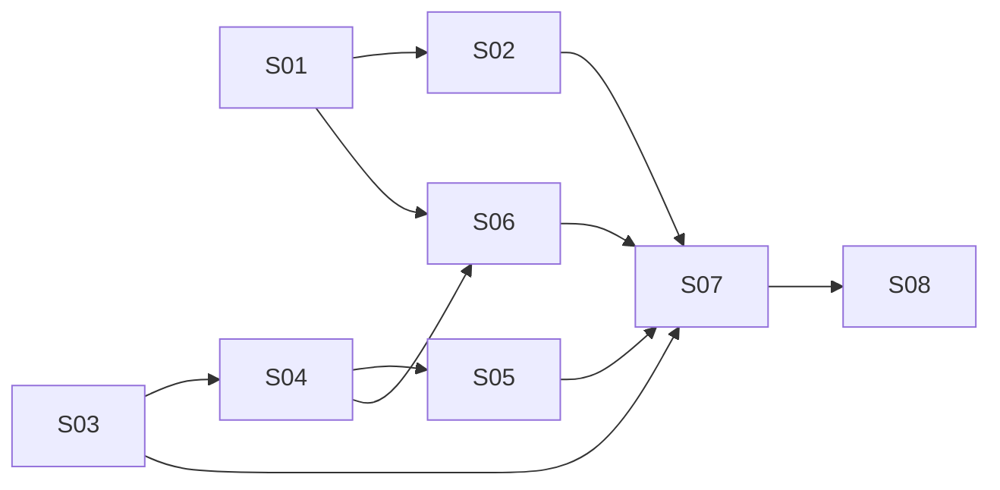

# Implementation Steps: create-worktrees

- **Source feature spec:** `.devpipe/create-worktrees/feature-spec.md`
- **Date:** 2026-11-14
- **Steps:** 8 (8 slices, 0 enablers) in 5 stages

## 1. Overview
The work starts on two independent foundations: the tab state file v2 (with
`worktrees`), and the Qt-free worktree creation use case with its new
`infrastructure/` git layer. On top of them come the start panel worktree list and
the New worktree panel widget (group editing first, then the results and retry
display). The tab then gets the button that opens the panel, and the background run
connects everything. If that run hits an unexpected error, it checks which worktrees were
really created and cleans up the rest. Refusing to close during a run comes last.

## 2. Software layers
| Layer | Location / main files | Notes |
|-------|----------------------|-------|
| Composition | `src/devpipe/app.py` | Builds repositories, services and the git implementation; injects them into `MainWindow` |
| Views | `src/devpipe/views/` (`main_window.py`, `pipeline_tab.py`, `start_panel.py`, new `new_worktree_panel.py`, new `worktree_worker.py`) | PySide6 widgets; the only layer (besides app) that uses Qt; the background thread lives here |
| Services | `src/devpipe/services/` (`tab_state_service.py`, `paths.py`, new `worktree_service.py`) | Use cases, Protocols implemented by lower layers; no Qt |
| Persistence | `src/devpipe/persistence/tab_state_repository.py` | devpipe's own files (tab state JSON) |
| Infrastructure (new) | `src/devpipe/infrastructure/git_worktrees.py` | Runs `git` via `subprocess`; sibling of persistence; no Qt; no tests (D18) |
| Models | `src/devpipe/models/tab_state.py`, new `models/worktree.py` | Plain data, enums, errors; no Qt, no I/O |
| Config / tooling | `pyproject.toml` (`[tool.importlinter]`), `docs/architecture.md` | Layer contracts checked by `uv run lint-imports` |
| Tests | `tests/models/`, `tests/persistence/`, `tests/services/`, `tests/views/` (pytest + pytest-qt) | Mirror the layers; run with `uv run pytest` |

## 3. Steps

### S01 - Tab state file v2 keeps the tab's worktree list

- **Type:** Slice
- **Purpose:** Give every saved tab a persistent list of worktree folders, so later work can append to it and show it. Moves the state file to version 2 while still reading version 1 files.
- **Behavior:** A saved tab writes `{"version": 2, "feature_name": ..., "active_panel": "start", "worktrees": [...]}`. Opening a v1 file loads with no worktrees, and the next write (e.g. a panel switch) produces v2. A v2 file whose `worktrees` is missing, not a list, or holds a non-string or empty string is rejected with `TabStateError(path, "invalid worktrees")`. A `worktrees` key in a v1 file is ignored. A file with `"active_panel": "new-worktree"` is rejected as `unknown active_panel`. The worktree list a tab loaded is written back unchanged on every later write.
- **Requirements covered:** FR-19, FR-20 (file side: only `"start"` is readable or writable)
- **Depends on:** none
- **Prerequisites:** none
- **Provides:**
  - `STATE_FILE_VERSION = 2` (constant, `models/tab_state.py`): the version written; the reader accepts 1 and 2.
  - `TabState.worktrees: list[Path]` (dataclass field, default empty list): absolute worktree folders in saved order.
  - `Panel.NEW_WORKTREE = "new-worktree"` (enum value): a panel id that is never persisted.
  - `PERSISTED_PANELS: frozenset[Panel]` (constant, `models/tab_state.py`) = `{Panel.START}`: the only panels the reader accepts and the writer writes. `TabStateRepository.save` with an `active_panel` outside this set raises `ValueError` (programming error, like a wrongly typed state); callers must pass a persisted panel.
  - `PipelineTab._worktrees: list[Path]` (attribute): the tab's in-memory worktree list; set from `state.worktrees` by `apply_saved`, empty for a new tab and on first save; `_current_state()` always includes it, so every write carries it. Other code may replace or append to this list; the next write persists it.
- **Layers touched:**
  | Layer | Files | Change |
  |-------|-------|--------|
  | Models | `src/devpipe/models/tab_state.py` | modify: version 2, `worktrees` field, `Panel.NEW_WORKTREE`, `PERSISTED_PANELS` |
  | Persistence | `src/devpipe/persistence/tab_state_repository.py` | modify: read v1/v2, validate `worktrees`, accept only persisted panels, write v2 with `worktrees` as `str(path)` |
  | Views | `src/devpipe/views/pipeline_tab.py` | modify: keep `_worktrees`, include it in `_current_state()` and in the first-save state |
  | Tests | `tests/models/test_tab_state.py` | modify: version 2, new field default, `PERSISTED_PANELS` |
  | Tests | `tests/persistence/test_tab_state_repository.py` | modify: v2 write format and key order, v1 load, invalid `worktrees` cases, v1 `worktrees` ignored, `"new-worktree"` rejected, version 3 rejected |
  | Tests | `tests/views/test_pipeline_tab.py`, `tests/views/test_first_save.py`, `tests/views/test_file_open.py` | modify: expected file content is v2 with `"worktrees": []`; the "unsupported version" case uses version 3 |
- **How to test:**
  - Automated: `uv run pytest tests/models tests/persistence tests/views`. New cases: Given a v1 file, when loaded, then `worktrees == []`; given a v2 file with `"worktrees": ["D:\\wt\\x"]`, when loaded and saved again, then the file is identical; given `"worktrees": "x"`, `[1]`, `[""]` or missing, then `TabStateError` with reason `"invalid worktrees"`; given a saved tab loaded with two worktrees, when `show_panel(Panel.START)` is called, then the file still lists both.
  - Manual: Given an existing v1 state file in the last session, when `uv run devpipe` starts, then the tab is restored; after the restore the file on disk is unchanged until the next write, which produces version 2 with `"worktrees": []`.
- **Notes / risks:** Key order written: `version`, `feature_name`, `active_panel`, `worktrees`. Paths are written as given (`str(path)`); making them absolute is the creator's job.

### S02 - Start panel lists the tab's worktrees and opens them

- **Type:** Slice
- **Purpose:** Show the saved worktree folders at the bottom of the start panel, so the user can find and open them across restarts.
- **Behavior:** When a saved tab has worktrees, the start panel shows a "Worktrees" label and a list with one absolute path per entry, in saved order. With no worktrees, both are hidden. Double-clicking an entry opens the folder in the system file explorer. If the folder no longer exists, a warning "Folder not found: <path>" is shown and the list is unchanged.
- **Requirements covered:** FR-04, FR-05
- **Depends on:** S01
- **Prerequisites:** `TabState.worktrees` (field)
- **Provides:**
  - `StartPanel.show_worktrees(paths: list[Path]) -> None` (method): replaces the list contents with `paths` in order (shown with `str(path)`), and shows the label and list when non-empty, hides them when empty. May be called any number of times.
  - `StartPanel.worktrees_label` (`QLabel`, text `WORKTREES_LABEL_TEXT = "Worktrees"`) and `StartPanel.worktrees_list` (`QListWidget`) (widgets): the bottom region of the start panel layout.
- **Layers touched:**
  | Layer | Files | Change |
  |-------|-------|--------|
  | Views | `src/devpipe/views/start_panel.py` | modify: bottom region with label + list (below the big-button column), `show_worktrees`, double-click handler with `QDesktopServices.openUrl(QUrl.fromLocalFile(...))` or `QMessageBox.warning` |
  | Views | `src/devpipe/views/pipeline_tab.py` | modify: `apply_saved` calls `start_panel.show_worktrees(state.worktrees)` |
  | Tests | `tests/views/test_start_panel.py` | modify: hidden when empty, entries and order, re-call replaces, double-click existing folder calls `openUrl` (monkeypatched), double-click missing folder warns and keeps the list |
  | Tests | `tests/views/test_pipeline_tab.py` | modify: `apply_saved` with worktrees shows them on the start panel |
- **How to test:**
  - Automated: `uv run pytest tests/views/test_start_panel.py tests/views/test_pipeline_tab.py`.
  - Manual: Given a v2 state file edited by hand with `"worktrees": ["<an existing folder>", "C:\\does-not-exist"]`, when it is opened with File > Open, then the start panel lists both paths; double-clicking the first opens Explorer; double-clicking the second shows "Folder not found: C:\does-not-exist" and the list stays the same.
- **Notes / risks:** The warning title is `FOLDER_NOT_FOUND_TITLE = "Folder not found"`; the text is `f"Folder not found: {path}"`. Do not open the folder through the shell.

### S03 - Worktree creation use case with the git infrastructure layer

- **Type:** Slice
- **Purpose:** Provide the Qt-free use case that creates one git worktree per request, named after the feature, and the new `infrastructure/` layer that runs `git`. This is the part every UI step calls.
- **Behavior:** `WorktreeService.create_worktrees("feat-x", requests)` processes the requests one at a time, in order. For each one, it checks that the source folder exists, the parent folder exists (it is not created) and `<parent>/feat-x` does not exist, then asks the git implementation to add the worktree on a new branch `feat-x` from the source's default branch. Each request gets a result: success with the absolute target folder, or failure with a readable message ("source folder does not exist", "parent folder does not exist", "target folder already exists", "not a git repository", "default branch not found", "git not found", or git's stderr). `merge_paths` appends new paths to a list, skipping ones already there (`same_file`). `uv run lint-imports` passes with the new layer contracts.
- **Requirements covered:** FR-12, FR-13 (merge without duplicates), FR-22; acceptance criterion "`uv run lint-imports` passes"
- **Depends on:** none
- **Prerequisites:** `same_file` (function, `services/paths.py`, exists)
- **Provides:**
  - `WorktreeRequest(source: Path, parent: Path)` (frozen dataclass, `models/worktree.py`): one (source project, worktree parent) pair as entered by the user.
  - `WorktreeResult(request: WorktreeRequest, target: Path, error: str | None)` (frozen dataclass, `models/worktree.py`) with property `ok: bool` (`error is None`): `target` is always `(request.parent / feature_name).resolve()`, both on success and failure; on success it is the created worktree folder.
  - `GitWorktreeError(message: str)` (exception, `models/worktree.py`): raised by a `GitWorktrees` implementation; `str(error)` is the readable message.
  - `GitWorktrees` (Protocol, `services/worktree_service.py`): `add_worktree(source: Path, branch: str, target: Path) -> None`; checks the source is a git repository, resolves the default branch and start point (FR-12 steps 2-3, never fetches), runs `git worktree add -b <branch> <target> <start-point>`; raises `GitWorktreeError` on any failure, including a missing `git` executable.
  - `WorktreeService(git: GitWorktrees)` (class, `services/worktree_service.py`):
    - `create_worktrees(feature_name: str, requests: list[WorktreeRequest]) -> list[WorktreeResult]`: synchronous, sequential, one result per request in the same order; never raises for a per-request failure; an empty list returns an empty list.
    - `merge_paths(existing: list[Path], new: list[Path]) -> list[Path]`: a new list, `existing` followed by each path of `new` not already present (by `same_file`, also among earlier new ones).
  - `SubprocessGitWorktrees` (class, `infrastructure/git_worktrees.py`): the real `GitWorktrees`; `subprocess.run([...], capture_output=True, text=True)` with argument lists, never `shell=True`.
  - `devpipe.infrastructure` (package and import-linter layer): sibling of `devpipe.persistence` (`"devpipe.persistence | devpipe.infrastructure"`), no Qt, never imported by views.
- **Layers touched:**
  | Layer | Files | Change |
  |-------|-------|--------|
  | Models | `src/devpipe/models/worktree.py` | new: `WorktreeRequest`, `WorktreeResult`, `GitWorktreeError` |
  | Services | `src/devpipe/services/worktree_service.py` | new: `GitWorktrees` Protocol, `WorktreeService` |
  | Infrastructure | `src/devpipe/infrastructure/__init__.py`, `src/devpipe/infrastructure/git_worktrees.py` | new: `SubprocessGitWorktrees` |
  | Config | `pyproject.toml` | modify: layers contract with `"devpipe.persistence \| devpipe.infrastructure"`, add `devpipe.infrastructure` to the "Only views and app use Qt" contract, new "Views never import infrastructure" contract |
  | Docs | `docs/architecture.md` | modify: diagram, layer table (Infrastructure row; Services may import `infrastructure`), layout tree |
  | Tests | `tests/models/test_worktree.py` | new: `ok`, immutability |
  | Tests | `tests/services/test_worktree_service.py` | new: with a fake `GitWorktrees` |
- **How to test:**
  - Automated: `uv run pytest tests/models/test_worktree.py tests/services/test_worktree_service.py` and `uv run lint-imports`. Cases (fake git recording calls): Given two valid requests, then the fake is called twice in order with `branch="feat-x"` and `target=(parent/"feat-x").resolve()`, and both results are `ok`; given a missing source / missing parent / existing target, then that result fails with the matching message and the fake is not called for it; given the fake raises `GitWorktreeError("boom")` for request 2 of 3, then results are ok / "boom" / ok; `merge_paths([a], [b, a2, b])` with `a2` the same file as `a` returns `[a, b]`.
  - Manual: In `uv run python`, build `WorktreeService(SubprocessGitWorktrees())` and call `create_worktrees("try-wt", [WorktreeRequest(Path("<a real repo>"), Path("<an empty folder>"))])`; Given the repo has a `main` branch, then the result is ok and `git -C <repo> worktree list` shows `<folder>\try-wt` on branch `try-wt`. Calling it again returns "target folder already exists". Remove the test worktree and branch by hand afterwards.
- **Notes / risks:** The real-git module has no automated tests (D18, D21). Default branch: `git symbolic-ref --short refs/remotes/origin/HEAD` (strip `origin/`), else local `main`, else local `master` (`git rev-parse --verify --quiet refs/heads/<name>`); start point: the local branch, else `origin/<name>`. Map `FileNotFoundError` from `subprocess.run` to "git not found". The spec's `WorktreeResult(request, path, error)` is given here as `target` + `error` so a failed result can still name its target (see section 7).

### S04 - New worktree panel: edit groups of folders

- **Type:** Slice
- **Purpose:** Build the panel widget where the user enters one or more (source project folder, worktree parent folder) pairs and asks to create them.
- **Behavior:** A fresh panel shows one empty group "Worktree 1" with two labeled rows ("Source project folder", "Worktree parent folder"), each a text input with a folder-picker button. Picking a folder writes its path into that input; cancelling changes nothing. '+' appends an empty group; every group but the first has a '-' that removes it, and groups are renumbered by position. Create is enabled only when every unlocked group has both inputs non-empty after trimming; with no unlocked group it is enabled. Clicking Create emits the requests of the unlocked groups in display order. A locked group has read-only inputs, disabled pickers and no '-'. There is no Back/Cancel button. `reset()` returns the panel to one empty, unlocked group.
- **Requirements covered:** FR-06, FR-07, FR-08, FR-09, FR-10, FR-16 (locked-group behavior), FR-17 (Create enabled with no editable group), FR-18, FR-03 (`reset`)
- **Depends on:** S03
- **Prerequisites:** `WorktreeRequest` (dataclass)
- **Provides:**
  - `NewWorktreePanel()` (`QWidget`, `views/new_worktree_panel.py`): no constructor arguments.
  - `NewWorktreePanel.create_requested = Signal(list)` (signal): emitted with `list[WorktreeRequest]` built from the trimmed inputs (`Path(text.strip())`) of `editable_groups()`, in order, when Create is clicked.
  - `NewWorktreePanel.groups() -> list[WorktreeGroup]` and `NewWorktreePanel.editable_groups() -> list[WorktreeGroup]` (methods): all groups / unlocked groups, in display order. The groups of `editable_groups()` and the requests of the last `create_requested` match one to one, in order, as long as no group is added, removed or locked in between.
  - `NewWorktreePanel.reset() -> None` (method): removes every group and adds one empty unlocked group. Other code may extend `reset` to also clear panel state it adds.
  - `NewWorktreePanel.add_button`, `NewWorktreePanel.create_button` (`QPushButton`) (widgets): '+' and Create; others may change `create_button`'s text, but its enablement is computed by this panel.
  - `WorktreeGroup` (`QGroupBox`, `views/new_worktree_panel.py`) with `source_input`, `parent_input` (`QLineEdit`), `source_picker`, `parent_picker` (`QToolButton`), `remove_button` (`QToolButton`, hidden for the first group and for locked groups), `set_locked(locked: bool)`, `is_locked() -> bool`. Others may set the group's style sheet, tooltip and accessible description; locking refreshes Create's enablement.
  - The panel layout: scroll area with the groups, then '+', then the Create button at the bottom. Others may insert widgets between '+' and Create.
- **Layers touched:**
  | Layer | Files | Change |
  |-------|-------|--------|
  | Views | `src/devpipe/views/new_worktree_panel.py` | new: `NewWorktreePanel`, `WorktreeGroup`, folder picker via `QFileDialog.getExistingDirectory` |
  | Docs | `docs/architecture.md` | modify: add `new_worktree_panel.py` to the views layout tree |
  | Tests | `tests/views/test_new_worktree_panel.py` | new |
- **How to test:**
  - Automated: `uv run pytest tests/views/test_new_worktree_panel.py`. Cases: fresh panel has one group titled "Worktree 1" with hidden '-' and disabled Create; '+' adds "Worktree 2" with '-', '-' removes it; removing the middle of three renumbers to 1, 2; Create enables only when all unlocked groups are filled (whitespace-only counts as empty); with `QFileDialog.getExistingDirectory` monkeypatched to return a path, the input gets it; returning `""` leaves it unchanged; the picker's start directory is the input's folder when it exists, else `""`; `set_locked(True)` makes inputs read-only, disables pickers, hides '-', and excludes the group from both the enablement check and `create_requested`; locking every group enables Create and clicking it emits `[]`; `reset()` leaves one empty unlocked group; tooltips and accessible names "Choose source project folder", "Choose worktree parent folder", "Add worktree", "Remove worktree".
  - Manual: Show the widget alone (e.g. a small script under the scratchpad): Given one group, when '+' is clicked twice and group 2's '-' is clicked, then two groups remain titled "Worktree 1" and "Worktree 2"; picking folders fills the inputs and enables Create.
- **Notes / risks:** Text constants as module-level names, following `start_panel.py` (e.g. `SOURCE_LABEL_TEXT`, `PARENT_LABEL_TEXT`, `CREATE_TEXT = "Create"`, `GROUP_TITLE = "Worktree {n}"`).

### S05 - New worktree panel shows run results and the retry state

- **Type:** Slice
- **Purpose:** Let the panel display a run: a busy state while it runs, then red/green groups, the error list and the Retry state, so a partial failure can be fixed and retried for the failed groups only.
- **Behavior:** `set_busy(True)` disables the whole panel and shows an indeterminate progress bar; `set_busy(False)` restores it. `show_results(results)` applies each result to the matching editable group: succeeded groups get a green border, are locked, and have tooltip / accessible description "Created: <target>"; failed groups get a red border, stay editable, and have "Failed: <error>". A read-only multi-line error box shows one entry per failed result (`<source> → <target>: <error>`), only for the latest results, and is hidden while empty. Create is relabeled "Retry" once a result list with a failure is shown. `reset()` also clears borders, tooltips, the error box and the label.
- **Requirements covered:** FR-11 (busy display), FR-15 (panel display), FR-16, FR-03 (fresh state after `reset`)
- **Depends on:** S04
- **Prerequisites:** `NewWorktreePanel`, `NewWorktreePanel.editable_groups()`, `NewWorktreePanel.reset()`, `NewWorktreePanel.create_button`, `WorktreeGroup.set_locked` (from S04); `WorktreeResult` (from S03)
- **Provides:**
  - `NewWorktreePanel.set_busy(busy: bool) -> None` (method).
  - `NewWorktreePanel.show_results(results: list[WorktreeResult]) -> None` (method): pairs `results[i]` with `editable_groups()[i]` as they are at call time; `len(results)` must equal `len(editable_groups())`.
  - `NewWorktreePanel.error_box` (`QPlainTextEdit`, read-only) and `NewWorktreePanel.progress_bar` (`QProgressBar`, range 0-0) (widgets), placed between '+' and Create.
  - `RETRY_TEXT = "Retry"` (constant, `views/new_worktree_panel.py`).
- **Layers touched:**
  | Layer | Files | Change |
  |-------|-------|--------|
  | Views | `src/devpipe/views/new_worktree_panel.py` | modify: error box and progress bar, `set_busy`, `show_results`, group result styling, extend `reset` |
  | Tests | `tests/views/test_new_worktree_results.py` | new |
- **How to test:**
  - Automated: `uv run pytest tests/views/test_new_worktree_results.py`. Cases: Given two filled groups, when `show_results([ok, failed])`, then group 1 is locked with a green border and "Created: ..." tooltip, group 2 is editable with a red border and "Failed: ..." tooltip, the error box shows one entry naming group 2's source and target, and the button reads "Retry"; when group 2 is edited and `show_results([ok])` is called, then both are green, the error box is empty and hidden; when `show_results` gets a new failure, the error box shows only that one; `set_busy(True)` disables groups, '+', '-', pickers and Create and shows the progress bar; `reset()` after a failure gives one plain group, an empty hidden error box and "Create".
  - Manual: In a scratch script, show the panel with two groups and call `show_results` with one ok and one failed result: the borders, the error text and "Retry" appear; group 1 cannot be edited and has no '-'.
- **Notes / risks:** Border colors as constants; do not rely on color alone (tooltip + accessible description carry the text).

### S06 - "Create new worktree" button opens the New worktree panel

- **Type:** Slice
- **Purpose:** Make the New worktree panel reachable from a saved tab's start panel, without ever persisting it as the active panel.
- **Behavior:** The start panel shows a big, centered "Create new worktree" button, first in the big-button column above "Open a pipeline", with the same size and font. It is disabled until the tab is saved. Clicking it shows the New worktree panel in the tab's stack, fresh (one empty group). While the panel is shown, every state file write records `"active_panel": "start"`, so a restart restores the start panel.
- **Requirements covered:** FR-01, FR-02, FR-03, FR-20 (tab side)
- **Depends on:** S01, S04
- **Prerequisites:** `Panel.NEW_WORKTREE`, `PERSISTED_PANELS` (from S01); `NewWorktreePanel`, `NewWorktreePanel.reset()` (from S04)
- **Provides:**
  - `StartPanel.new_worktree_button` (`QPushButton`, built with `_big_button`, text `NEW_WORKTREE_TEXT = "Create new worktree"`) (widget).
  - `StartPanel.new_worktree_requested = Signal()` (signal): emitted on click.
  - `PipelineTab.new_worktree_panel` (`NewWorktreePanel`) (attribute): the tab's panel instance, registered as `_panels[Panel.NEW_WORKTREE]`.
  - `PipelineTab.open_new_worktree_panel() -> None` (method): `reset()` the panel, then `show_panel(Panel.NEW_WORKTREE)`.
  - `PipelineTab._current_state()` writes `Panel.START` whenever the active panel is not in `PERSISTED_PANELS`.
- **Layers touched:**
  | Layer | Files | Change |
  |-------|-------|--------|
  | Views | `src/devpipe/views/start_panel.py` | modify: the big-button column only (new first button, enabled in `show_saved`, signal) |
  | Views | `src/devpipe/views/pipeline_tab.py` | modify: build and register the panel, connect the signal, `open_new_worktree_panel`, persisted-panel mapping in `_current_state()` |
  | Tests | `tests/views/test_start_panel.py` | modify: button disabled until saved, same min size and font size as Open, first in the column, centered |
  | Tests | `tests/views/test_pipeline_tab.py` | modify: clicking shows the panel fresh (also after it was edited), file still says `"start"` |
  | Tests | `tests/views/test_session_restore.py` | modify: with the panel open, a restarted window restores the start panel |
- **How to test:**
  - Automated: `uv run pytest tests/views`. Given an unsaved tab, then the button is disabled; given a saved tab, when it is clicked, then `tab.stack.currentWidget() is tab.new_worktree_panel`, it has one empty group, and the state file has `"active_panel": "start"`; when a group is added and the button is clicked again (after returning to start), the panel has one group; given the panel is open, when `make_window()` builds a new window, then the restored tab shows the start panel.
  - Manual: `uv run devpipe`, save a tab, click "Create new worktree": the panel opens with one group; close and reopen the app: the tab shows the start panel.
- **Notes / risks:** While no run exists yet, Create on the panel has no effect in the app; the panel cannot be left except by closing the tab (FR-18).

### S07 - Create runs in the background, saves the worktrees and returns to start

- **Type:** Slice
- **Purpose:** Run the worktree creation for real from the tab: off the UI thread, with results shown on the panel, successes saved in the state file, and a return to the start panel when nothing failed. If the run stops with an unexpected error, find out which worktrees were really created and clean up the ones that were not, so the user can retry.
- **Behavior:** Clicking Create/Retry sets the panel busy and, on a background thread, first records a pre-run snapshot of the requests (`WorktreeService.snapshot`), then runs `create_worktrees(feature_name, requests)`. When it finishes, the panel is no longer busy; the succeeded targets are merged into the tab's worktree list without duplicates, and the state file is written once. If nothing failed (including a run with no requests), the tab shows the start panel with the updated list. Otherwise the tab stays on the panel and the panel shows the results. If the write fails, the existing "Cannot save state file" warning is shown, the in-memory list keeps the new paths and navigation is the same.
  - **Unexpected error (recovery):** if `create_worktrees` raises anything (it never raises for a normal per-request failure), the same background thread calls `WorktreeService.recover(feature_name, snapshot, error)`. For each request:
    - a target folder that already existed before the run is never touched (failed result, "target folder already exists");
    - a target that is a registered worktree of the source, checked out on branch `<feature_name>`, is an ok result;
    - anything else is cleaned up: the worktree is removed if git has it registered, the target folder is deleted if it still exists, and the `<feature_name>` branch is deleted only if it did not exist before the run. Those requests get a failed result whose message names the unexpected error and says it was cleaned up; if the cleanup itself fails, the message says so with git's message.

    The recovered results are then applied exactly like a normal run's (merge, single write, navigation, red/green groups).
  - **Fallback:** only if the snapshot or the recovery itself raises does the tab show a warning titled "Worktree creation failed" with the error text, clear busy, write nothing and leave the panel unchanged.
- **Requirements covered:** FR-11, FR-13, FR-14, FR-15 (stay on panel), FR-16 (retry processes only red and new groups), FR-17, FR-04 (refreshed list after a run); recovery after an unexpected error (user decision, see section 7)
- **Depends on:** S02, S03, S05, S06
- **Prerequisites:** `WorktreeService`, `WorktreeService.create_worktrees`, `WorktreeService.merge_paths`, `WorktreeRequest`, `WorktreeResult`, `GitWorktreeError`, `SubprocessGitWorktrees`, `GitWorktrees`, `devpipe.infrastructure` (from S03); `NewWorktreePanel.create_requested` (from S04); `NewWorktreePanel.set_busy`, `NewWorktreePanel.show_results` (from S05); `PipelineTab.new_worktree_panel` (from S06); `StartPanel.show_worktrees` (from S02); `PipelineTab._worktrees` (from S01)
- **Provides:**
  - `PipelineTab(tab_states: TabStateService, worktrees: WorktreeService)` (constructor) and `MainWindow(window_state, tab_states, session, worktrees: WorktreeService)` (constructor); `app.py` builds `WorktreeService(SubprocessGitWorktrees())`.
  - `PipelineTab.run_in_progress -> bool` (property): True from the moment a run starts until its results have been applied, recovery included.
  - `PipelineTab.run_finished = Signal()` (signal): emitted after a run's results have been applied (state written, panel or start shown), also after a recovery or the fallback warning.
  - `WorktreeWorker` (`views/worktree_worker.py`): runs the snapshot and one `create_worktrees` call (and `recover` on an unexpected error) on a `QThread`, and delivers `list[WorktreeResult]` to the UI thread through a signal, or an error text when the snapshot or the recovery failed.
  - `PreRunState(request: WorktreeRequest, target: Path, target_existed: bool, branch_existed: bool)` (frozen dataclass, `models/worktree.py`): what existed before the run, per request; `target` is `(request.parent / feature_name).resolve()`.
  - `GitWorktrees` extended with three methods, each raising `GitWorktreeError` on failure:
    - `branch_exists(source: Path, branch: str) -> bool`: the local branch exists in the repository of `source`.
    - `is_worktree(source: Path, branch: str, target: Path) -> bool`: `target` is a registered worktree of the repository of `source`, checked out on `branch`.
    - `remove_worktree(source: Path, branch: str, target: Path, delete_branch: bool) -> None`: removes the registered worktree at `target` if any (`git worktree remove --force`, then `git worktree prune`), deletes the `target` folder if it still exists, and deletes `branch` (`git branch -D`) when `delete_branch` is True.
  - `SubprocessGitWorktrees` implements the three new methods, with the same rules: argument lists, never `shell=True`, never fetches.
  - `WorktreeService.snapshot(feature_name: str, requests: list[WorktreeRequest]) -> list[PreRunState]`: one entry per request, in order. It never raises for a per-request problem: a `GitWorktreeError` from `branch_exists` (for example, not a repository or git not found) counts as `branch_existed=True`, so recovery never deletes a branch it could not check.
  - `WorktreeService.recover(feature_name: str, snapshot: list[PreRunState], error: str) -> list[WorktreeResult]`: one result per entry, in order, following the recovery rules above; never raises for a per-request problem. Message texts are fixed in the S07 step file.
  - `worktree_service` fixture and `FakeGitWorktrees` (`tests/views/conftest.py`): a fake git whose per-target outcome tests can configure, including the three new methods; `make_window` passes the service.
- **Layers touched:**
  | Layer | Files | Change |
  |-------|-------|--------|
  | Composition | `src/devpipe/app.py` | modify: build and inject `WorktreeService(SubprocessGitWorktrees())` |
  | Models | `src/devpipe/models/worktree.py` | modify: add `PreRunState` |
  | Services | `src/devpipe/services/worktree_service.py` | modify: extend the `GitWorktrees` Protocol; add `WorktreeService.snapshot` and `WorktreeService.recover` |
  | Infrastructure | `src/devpipe/infrastructure/git_worktrees.py` | modify: `branch_exists`, `is_worktree`, `remove_worktree` in `SubprocessGitWorktrees` (no tests, D18/D21) |
  | Views | `src/devpipe/views/main_window.py` | modify: constructor takes and passes the service to every `PipelineTab` |
  | Views | `src/devpipe/views/pipeline_tab.py` | modify: constructor, handle `create_requested`, run lifecycle, merge + single write, navigation, `start_panel.show_worktrees`, fallback warning |
  | Views | `src/devpipe/views/worktree_worker.py` | new: `WorktreeWorker` (snapshot, run, recovery) |
  | Docs | `docs/architecture.md` | modify: add `worktree_worker.py` to the views layout tree |
  | Tests | `tests/models/test_worktree.py` | modify: `PreRunState` immutability |
  | Tests | `tests/services/test_worktree_recovery.py` | new: `snapshot` and `recover` with their own recording fake git |
  | Tests | `tests/views/conftest.py` | modify: `FakeGitWorktrees` (with the new methods), `worktree_service` fixture, `make_window` |
  | Tests | `tests/views/test_pipeline_tab.py` | modify: `make_tab` passes the service |
  | Tests | `tests/views/test_worktree_run.py` | new |
- **How to test:**
  - Automated: `uv run pytest tests/models tests/services tests/views` (wait with `qtbot.waitSignal(tab.run_finished)`). Given a fake that succeeds, when Create is clicked with two groups, then the panel is busy during the run, the tab returns to start, the v2 file contains both targets, and the start panel lists them; given group 2 of 2 fails, then the tab stays on the panel, group 1 is green and locked, group 2 red, the button reads "Retry", and the file holds only group 1's target; when group 2 is fixed and Retry clicked, then only group 2 is sent to the fake, and the tab returns to start with both listed; given every red group was removed, when Retry is clicked, then the tab returns to start; given a target already saved, when created again, then the list has no duplicate; given the save fails (monkeypatched), then the warning is shown, navigation is unchanged, and the next successful write includes the paths.
  - Recovery, service level (with a fake git):
    - Given three requests, where request 1 was created and the run then raised an unexpected `RuntimeError`, when `recover` runs: request 1 (a registered worktree on the branch) is ok; requests 2 and 3 get `remove_worktree(..., delete_branch=True)` and a failed "cleaned up" result.
    - Given a target that existed before the run, then it is never passed to `remove_worktree` and fails with "target folder already exists".
    - Given the branch existed before the run (or `branch_exists` raised), then `delete_branch=False`.
    - Given `remove_worktree` raises `GitWorktreeError("boom")`, then that result's message reports the failed cleanup with "boom".
  - Recovery, view level:
    - Given the fake raises an unexpected error during the run, then the tab applies the recovered results: green for the verified worktree, red for the rest, one write, "Retry".
    - Given `recover` itself raises, then the "Worktree creation failed" warning is shown, nothing is written and the panel is unchanged.
  - Manual: `uv run devpipe`, save tab `try-wt`, open the panel, enter a real repo and an existing empty parent folder, add a second group with a non-repo folder, click Create: group 1 turns green, group 2 red with "not a git repository", "Retry" appears; fix group 2's source to another repo with a different parent, click Retry: the tab returns to start and lists both worktrees; restart the app: the list is still there. Recovery by hand: make `create_worktrees` raise after the first `add_worktree` (a temporary local patch), then click Create with two groups. Group 1 is green and shows in `git worktree list`; group 2's folder and branch are gone. Clean up the test worktrees and branches by hand.
- **Notes / risks:**
  - The worker lives in its own views module (the spec suggests the panel; keeping it separate leaves the panel a pure widget). Keep a reference to the thread and worker until finished, and quit/wait them correctly.
  - Write the state file once per run: when returning to start, the single write is the one done by the panel switch.
  - Snapshot, run and recovery all run on the worker thread, because they call git.
  - Recovery only deletes what the snapshot shows the run could have created: never a target folder that existed before the run, and never a branch that existed before the run.
  - The S03 fake in `tests/services/test_worktree_service.py` is left as it is: the Protocol is structural and no type checker runs.

### S08 - Closing a tab or the window is refused while a run is in progress

- **Type:** Slice
- **Purpose:** Prevent a running background worktree creation from being torn down mid-run, which would lose its results and leave the thread orphaned.
- **Behavior:** While any tab has a run in progress, clicking that tab's close button, or closing the main window, shows an information box titled "Worktree creation in progress" with "Wait for the worktree creation to finish before closing." and nothing closes. Other tabs still close normally. After the run ends, closing works again.
- **Requirements covered:** FR-21
- **Depends on:** S07
- **Prerequisites:** `PipelineTab.run_in_progress`, `PipelineTab.run_finished` (from S07)
- **Provides:** `RUN_IN_PROGRESS_TITLE = "Worktree creation in progress"`, `RUN_IN_PROGRESS_TEXT = "Wait for the worktree creation to finish before closing."` (constants, `views/main_window.py`)
- **Layers touched:**
  | Layer | Files | Change |
  |-------|-------|--------|
  | Views | `src/devpipe/views/main_window.py` | modify: `close_tab` refuses a tab with `run_in_progress`; `closeEvent` ignores the event (before disabling session sync or remembering window state) when any tab has `run_in_progress` |
  | Tests | `tests/views/test_close_during_run.py` | new |
- **How to test:**
  - Automated: `uv run pytest tests/views/test_close_during_run.py`, using a fake git that blocks until the test releases it (e.g. a `threading.Event`). Given a run in progress in tab A, when `close_tab(index of A)` is called, then `QMessageBox.information` (monkeypatched) is called with the title and text and the tab count is unchanged; when `window.close()` is called, then the window stays visible and the session file is unchanged; closing another tab B works; after release and `run_finished`, closing A works.
  - Manual: Use a repo large enough for `git worktree add` to take a moment (or a slow network drive), click Create and immediately try the tab's ×: the message appears and the tab stays.
- **Notes / risks:** Refusal must happen before any other close side effect in `closeEvent`.

## 4. Execution stages
| Stage | Steps (parallel) | Depends on stages | Delivers |
|-------|------------------|-------------------|----------|
| 1 | S01, S03 | - | State file v2 with `worktrees`; tested worktree service, real git layer, import-linter contracts |
| 2 | S02, S04 | 1 | Worktree list on the start panel; New worktree panel widget with group editing |
| 3 | S05, S06 | 2 | Panel result and retry display; button that opens the panel from a saved tab |
| 4 | S07 | 3 | End-to-end creation in the background, persistence and navigation |
| 5 | S08 | 4 | Close refusal during a run |

**Critical path:** S03 → S04 → S05 → S07 → S08

**Parallelization notes:**
- Stage 1: S01 and S03 touch disjoint files (S03 owns `pyproject.toml` and `docs/architecture.md`).
- Stage 2: S02 edits `start_panel.py` (new bottom region) and `pipeline_tab.py` (`apply_saved`); S04 only creates new files plus one line in the `docs/architecture.md` layout tree. No overlap.
- Stage 3: S05 edits only `views/new_worktree_panel.py` and a new test file; S06 edits `start_panel.py` (big-button column only), `pipeline_tab.py` and existing view tests, never `new_worktree_panel.py`. No overlap.
- S07 also modifies S03's files (`models/worktree.py`, `services/worktree_service.py`, `infrastructure/git_worktrees.py`, `tests/models/test_worktree.py`) to add recovery. S03 is in an earlier stage, so these files are never edited in parallel.
- `pipeline_tab.py` is touched by S01, S02, S06 and S07, which are in a dependency chain (S01 → S02/S06 → S07), so never in parallel.
- `tests/views/test_pipeline_tab.py` and `tests/views/test_start_panel.py` are touched by S01/S02/S06/S07, also in a chain.

## 5. Requirements coverage
| Requirement | Steps |
|-------------|-------|
| FR-01 | S06 |
| FR-02 | S06 |
| FR-03 | S04, S05, S06 |
| FR-04 | S02, S07 |
| FR-05 | S02 |
| FR-06 | S04 |
| FR-07 | S04 |
| FR-08 | S04 |
| FR-09 | S04 |
| FR-10 | S04 |
| FR-11 | S05, S07 |
| FR-12 | S03 |
| FR-13 | S03, S07 |
| FR-14 | S07 |
| FR-15 | S05, S07 |
| FR-16 | S04, S05, S07 |
| FR-17 | S04, S07 |
| FR-18 | S04 |
| FR-19 | S01 |
| FR-20 | S01, S06 |
| FR-21 | S08 |
| FR-22 | S03 |
| AC "`uv run lint-imports` passes" | S03 |
| Recovery after an unexpected error (user decision, section 7) | S07 |

## 6. Shared items
| Item | Kind | Created by | Used / extended by | What others may rely on |
|------|------|-----------|--------------------|-------------------------|
| `STATE_FILE_VERSION` (= 2) | constant | S01 | - | Written version; reader accepts 1 and 2 |
| `TabState.worktrees` | dataclass field | S01 | S02 | Absolute paths in saved order, default `[]` |
| `Panel.NEW_WORKTREE` | enum value | S01 | S06 | Panel id, never persisted |
| `PERSISTED_PANELS` | constant | S01 | S06 | `{Panel.START}`; `save` raises `ValueError` for other panels |
| `PipelineTab._worktrees` | attribute | S01 | S07 | In-memory list, always written by `_current_state()`; may be replaced/appended |
| `StartPanel.show_worktrees(paths)` | method | S02 | S07 | Replaces list contents; hides label + list when empty |
| `StartPanel.worktrees_label`, `worktrees_list` | widgets | S02 | - | Bottom region of the start panel |
| `WorktreeRequest` | dataclass | S03 | S04, S07 | `(source, parent)` as entered |
| `WorktreeResult` | dataclass | S03 | S05, S07 | `(request, target, error)`, `ok`; `target` always set |
| `GitWorktreeError` | exception | S03 | S07 (fake in tests, recovery) | Readable message in `str()` |
| `GitWorktrees` | Protocol | S03 | S07 (extends; fake in tests) | `add_worktree(source, branch, target)`, raises `GitWorktreeError`; S07 adds `branch_exists`, `is_worktree`, `remove_worktree` |
| `WorktreeService.create_worktrees` | method | S03 | S07 | Sync, sequential, one result per request in order |
| `WorktreeService.merge_paths` | method | S03 | S07 | Append without duplicates (`same_file`) |
| `SubprocessGitWorktrees` | class | S03 | S07 (extends) | Real git; injected by `app.py`; S07 adds the three recovery methods |
| `PreRunState` | dataclass | S07 | - | `(request, target, target_existed, branch_existed)`, per request, recorded before the run |
| `GitWorktrees.branch_exists`, `is_worktree`, `remove_worktree` | Protocol methods | S07 | - | Raise `GitWorktreeError` on failure |
| `WorktreeService.snapshot` | method | S07 | - | One `PreRunState` per request, in order |
| `WorktreeService.recover` | method | S07 | - | One result per snapshot entry; keeps verified worktrees, cleans up the rest |
| `devpipe.infrastructure` | package / import-linter layer | S03 | S07 (`app.py` only) | Sibling of persistence; no Qt; never imported by views |
| `NewWorktreePanel` | widget class | S04 | S05, S06, S07 | No-arg constructor |
| `NewWorktreePanel.create_requested` | signal | S04 | S07 | `list[WorktreeRequest]` of editable groups in order |
| `NewWorktreePanel.groups()`, `editable_groups()` | methods | S04 | S05 | Display order; editable groups match the last emitted requests |
| `NewWorktreePanel.reset()` | method | S04 | S05 (extends), S06 | One empty unlocked group; extendable to clear added state |
| `NewWorktreePanel.add_button`, `create_button` | widgets | S04 | S05 (relabels `create_button`) | Enablement computed by the panel |
| `WorktreeGroup` (+ `set_locked`, `is_locked`, inputs, pickers, `remove_button`) | widget class | S04 | S05 | Locked = read-only, no '-', excluded from Create check and requests; style/tooltip settable |
| `NewWorktreePanel.set_busy(busy)` | method | S05 | S07 | Disables the panel, shows progress bar |
| `NewWorktreePanel.show_results(results)` | method | S05 | S07 | Pairs results with `editable_groups()` by index |
| `NewWorktreePanel.error_box`, `progress_bar` | widgets | S05 | - | Between '+' and Create |
| `RETRY_TEXT` | constant | S05 | - | "Retry" |
| `StartPanel.new_worktree_button` | widget | S06 | - | Big button, first in the column |
| `StartPanel.new_worktree_requested` | signal | S06 | - | Emitted on click |
| `PipelineTab.new_worktree_panel` | attribute | S06 | S07 | The tab's panel, in `_panels[Panel.NEW_WORKTREE]` |
| `PipelineTab.open_new_worktree_panel()` | method | S06 | - | Reset then show the panel |
| `PipelineTab(tab_states, worktrees)`, `MainWindow(..., worktrees)` | constructors | S07 | S08 | Service injected from `app.py` |
| `PipelineTab.run_in_progress` | property | S07 | S08 | True while a run is active |
| `PipelineTab.run_finished` | signal | S07 | S08 | After results are applied |
| `WorktreeWorker` | class | S07 | - | One run on a `QThread` |
| `FakeGitWorktrees`, `worktree_service` fixture | test helpers | S07 | S08 | Configurable per-target outcome |
| `RUN_IN_PROGRESS_TITLE`, `RUN_IN_PROGRESS_TEXT` | constants | S08 | - | Message box texts |

## 7. Assumptions and open points
All assumptions below were confirmed by the user on 2026-11-14.
- **`WorktreeResult` shape (S03, S05, S07):** the spec suggests `WorktreeResult(request, path | None, error | None)`. The plan uses `target: Path` (always set) plus `error`, so a failed result can name its target in the error box (FR-15) without the view recomputing it.
- **Validation split (S03):** existence checks (source, parent, target) are done in the service, so they are tested; the git-repository check, default branch / start point resolution and `git worktree add` are in the untested infrastructure (D18/D21). Exact message texts are fixed in S03.
- **Writer and the panel (S01, S06):** `TabStateRepository.save` raises `ValueError` for a non-persisted panel; `PipelineTab._current_state()` maps the New worktree panel to `"start"`.
- **Worker placement (S07):** the background worker is in `views/worktree_worker.py` instead of `new_worktree_panel.py`, and the tab (not the panel) drives the run. This keeps the panel testable without threads.
- **Single write per run (S07):** on full success, the state is written by the switch to the start panel; on failure, it is written directly while staying on the panel.
- **Recovery after an unexpected error (S07, user decision 2026-11-14):** this is not in the feature spec.
  - If `create_worktrees` raises unexpectedly, the run checks which worktrees were really created: the folder exists, it is a registered worktree of the source, and it is on branch `<feature>`.
  - It cleans up the others: it removes the worktree if registered, deletes the folder if it exists, and deletes the branch only if this run created it.
  - A pre-run snapshot of which targets and branches already existed decides what may be deleted. A folder or branch that existed before the run is never removed.
  - S07 adds the new git operations and service methods to S03's Protocol, class and service. S03's step file stays as approved.
- **S08 kept separate:** it is small and depends on S07's `run_in_progress`; it could be merged into S07 if a single PR is preferred.
