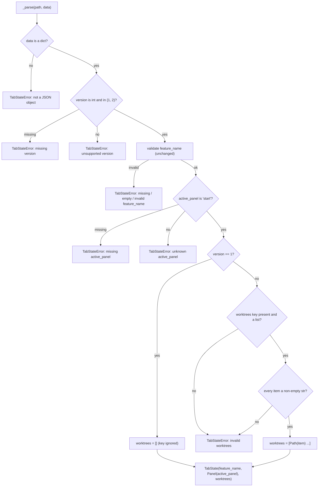
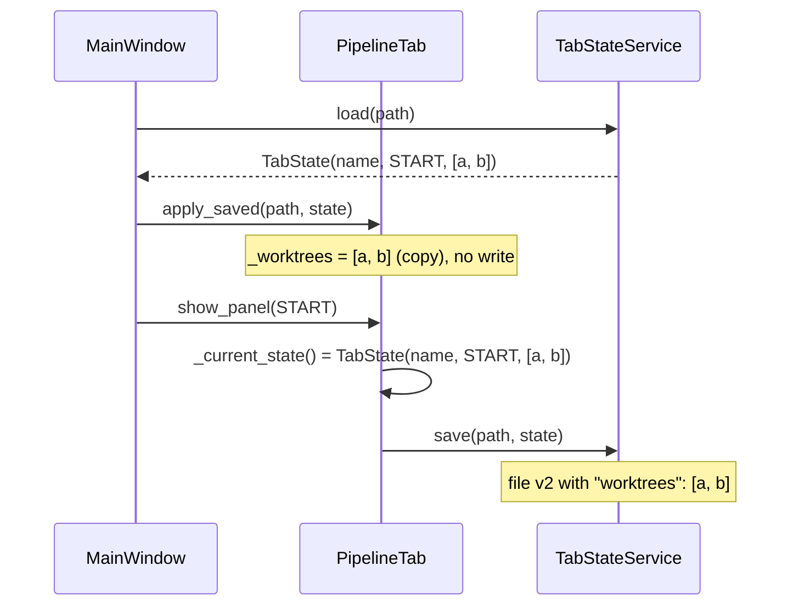

# S01 - Tab state file v2 keeps the tab's worktree list

- **Plan:** [plan.md](plan.md)
- **Type:** Slice
- **Requirements covered:** FR-19, FR-20 (file side: only `"start"` is readable or writable); AC "Given a v1 state file, when it is opened, then the tab loads with no worktrees. The next write produces v2."; AC "Given a v2 file with an invalid `worktrees` value, when it is opened, then a `TabStateError` "invalid worktrees" is reported."
- **Prerequisites:** none
- **Creates:** `STATE_FILE_VERSION` (= 2), `TabState.worktrees`, `Panel.NEW_WORKTREE`, `PERSISTED_PANELS`, `PipelineTab._worktrees`

## 1. Goal
Every saved tab gets a persistent list of worktree folders, and the tab state file
moves to version 2:

```json
{
  "version": 2,
  "feature_name": "feat-x",
  "active_panel": "start",
  "worktrees": ["D:\\wt\\feat-x", "E:\\other\\feat-x"]
}
```

Observable behavior when done:

- Every write produces version 2 with the keys `version`, `feature_name`,
  `active_panel`, `worktrees`, in that order.
- A version 1 file still loads (with `worktrees == []`); a `worktrees` key in a v1
  file is ignored. The next write of that tab produces version 2.
- A v2 file whose `worktrees` is missing, not a list, or holds a non-string or an
  empty string is rejected with `TabStateError(path, "invalid worktrees")`.
- Any other version (0, 3, ...) is still rejected as `unsupported version: ...`.
- `"active_panel": "new-worktree"` in a file (v1 or v2) is rejected as
  `unknown active_panel: 'new-worktree'`; `TabStateRepository.save` refuses to write a
  panel outside `PERSISTED_PANELS` with `ValueError`.
- A tab writes back, on every later write, the worktree list it loaded (or `[]` for a
  tab saved for the first time).

## 2. Context
- `src/devpipe/models/tab_state.py`: `STATE_FILE_VERSION = 1`, `Panel` with only
  `START = "start"`, `TabState(feature_name, active_panel=Panel.START)` (non-frozen
  dataclass), `TabStateError(path, reason)`.
- `src/devpipe/persistence/tab_state_repository.py`: `TabStateRepository.load` /
  `save`; private key constants `_VERSION_KEY`, `_FEATURE_NAME_KEY`,
  `_ACTIVE_PANEL_KEY`; `_PANEL_VALUES` built from every `Panel`; `_parse` validates in
  order version, feature_name, active_panel; `save` writes
  `json.dumps(data, indent=2) + "\n"`. Only `TabStateError` leaves `load`; `save`
  raises `TabStateError` for a well-typed state and lets programming errors propagate.
- `src/devpipe/views/pipeline_tab.py`: `PipelineTab` keeps `_state_path`,
  `_feature_name`, `_active_panel`; `_current_state()` builds the `TabState` written by
  `show_panel`; `save_as` builds the first-save state; `apply_saved` takes a loaded
  state (used by session restore and File > Open, no write).
- `TabStateService` / `TabStateStore` only pass `TabState` through; they need no
  change.
- Conventions: layered `views -> services -> persistence -> models`; models have no
  I/O; `pathlib` only; tests with pytest / pytest-qt under `tests/<layer>/`, run with
  `uv run pytest`.

## 3. Structure

### 3.1 Files
| File | Change | Responsibility |
|------|--------|----------------|
| `src/devpipe/models/tab_state.py` | modify | Version 2, `worktrees` field, `Panel.NEW_WORKTREE`, `PERSISTED_PANELS` |
| `src/devpipe/persistence/tab_state_repository.py` | modify | Read v1/v2, validate `worktrees`, accept only persisted panels, write v2 |
| `src/devpipe/views/pipeline_tab.py` | modify | Keep `_worktrees`; include it in `_current_state()` and the first-save state |
| `tests/models/test_tab_state.py` | modify | Version 2, field default, new enum value, `PERSISTED_PANELS` |
| `tests/persistence/test_tab_state_repository.py` | modify | v2 format, v1 load, invalid `worktrees`, panel rules, version 3 |
| `tests/views/test_pipeline_tab.py` | modify | Expected file is v2; worktree list survives writes |
| `tests/views/test_first_save.py` | modify | Expected file is v2 with `"worktrees": []` |
| `tests/views/test_file_open.py` | modify | "unsupported version" case uses version 3; v1 open then v2 write |

### 3.2 Models - `src/devpipe/models/tab_state.py`

```python
from dataclasses import dataclass, field

STATE_FILE_VERSION = 2
"""The tab state file format version this app writes (it also reads version 1)."""


class Panel(enum.Enum):
    """Panel ids of a tab; the values are the `active_panel` strings of the file.

    Only the panels in PERSISTED_PANELS are ever read from or written to a file.
    """

    START = "start"
    NEW_WORKTREE = "new-worktree"


PERSISTED_PANELS: frozenset[Panel] = frozenset({Panel.START})
"""The panels a tab state file may hold as `active_panel`."""


@dataclass
class TabState:
    feature_name: str
    active_panel: Panel = Panel.START
    worktrees: list[Path] = field(default_factory=list)
    """Worktree folders of the tab, in saved order (absolute when created by the app)."""
```

- `TabState("a") == TabState("a", Panel.START, [])`; each instance gets its own list.
- `is_valid_feature_name` and `TabStateError` are unchanged.

### 3.3 Persistence - `src/devpipe/persistence/tab_state_repository.py`

Module constants (private, next to the existing key constants):

```python
_WORKTREES_KEY = "worktrees"
_V1 = 1                                   # the format without `worktrees`
_READABLE_VERSIONS = frozenset({_V1, STATE_FILE_VERSION})
_PANEL_VALUES = frozenset(panel.value for panel in PERSISTED_PANELS)  # replaces the all-Panel set
_INVALID_WORKTREES = "invalid worktrees"
```

Imports gain `PERSISTED_PANELS` from `devpipe.models.tab_state`.

`TabStateRepository.save(path, state)` (same signature):

```python
def save(self, path: Path, state: TabState) -> None:
    """Write the file (overwrites) in the current format (version 2).

    Raises TabStateError (only) for a well-typed `state`; a wrongly typed `state`
    or an `active_panel` outside PERSISTED_PANELS is a programming error:
    the latter raises ValueError and nothing is written.
    """
```

- First check: `if state.active_panel not in PERSISTED_PANELS: raise ValueError(f"panel is not persisted: {state.active_panel}")`.
  It runs before the feature-name check and before any file access.
- Then the existing feature-name check (unchanged).
- `data` keys in this order: `_VERSION_KEY: STATE_FILE_VERSION`,
  `_FEATURE_NAME_KEY`, `_ACTIVE_PANEL_KEY`, `_WORKTREES_KEY: [str(p) for p in state.worktrees]`.
  Paths are written as given (no `resolve()`, no deduplication).
- Writing and the `OSError` → `TabStateError("cannot write file: ...")` mapping are
  unchanged.

`TabStateRepository._parse(path, data)` (same signature), changes only:

- Version check becomes
  `if type(version) is not int or version not in _READABLE_VERSIONS:` → same
  `unsupported version: {version!r}` error.
- The active_panel check uses the new `_PANEL_VALUES` (persisted panels only); the
  error text is unchanged (`unknown active_panel: {active_panel!r}`).
- After active_panel: `worktrees = self._parse_worktrees(path, data) if version != _V1 else []`.
- Returns `TabState(feature_name, Panel(active_panel), worktrees)`.

New private method:

```python
def _parse_worktrees(self, path: Path, data: dict) -> list[Path]:
    """The v2 `worktrees` list as Paths. Raises TabStateError(path, "invalid worktrees")
    when the key is missing, is not a list, or holds an item that is not a non-empty str."""
```

Validation is `isinstance(item, str) and item != ""` per item; the list is converted
with `Path(item)`, keeping order and duplicates.

### 3.4 Views - `src/devpipe/views/pipeline_tab.py`

- `__init__`: add `self._worktrees: list[Path] = []` next to `_active_panel`.
  Docstring comment: the tab's worktree folders; every state file write carries it;
  other code may replace or append to it, and the next write persists it.
- `apply_saved(path, state)`: add `self._worktrees = list(state.worktrees)` (a copy, so
  the tab never shares the list with the caller's `TabState`). Nothing else changes;
  still no write.
- `save_as(path, feature_name)`: the first-save state becomes
  `TabState(feature_name, self._active_panel, list(self._worktrees))` (empty for an
  unsaved tab). On success `apply_saved` sets `_worktrees` from it.
- `_current_state()`: returns
  `TabState(self._feature_name, self._active_panel, list(self._worktrees))`.
- `show_panel`, `_display`, `_write`, `title`, `tooltip` are untouched.

## 4. Logic flows



Loading keeps the existing validation order and adds the `worktrees` check last, only
for version 2. A v1 file never looks at `worktrees`, so a bad value there cannot
reject it.



The loaded worktree list lives in the tab and is written back on every later write, so
a panel switch never drops it.

## 5. Edge cases and errors
| Case | Expected behavior |
|------|-------------------|
| v1 file, no `worktrees` key | Loads; `worktrees == []` |
| v1 file with any `worktrees` value (valid or not) | Ignored; loads with `worktrees == []` |
| v1 file loaded, then the tab writes | File becomes v2 with `"worktrees": []` |
| v2 file, `worktrees` missing | `TabStateError(path, "invalid worktrees")` |
| v2 file, `worktrees` is `"x"`, `null`, `{}` or a number | `TabStateError(path, "invalid worktrees")` |
| v2 file, `worktrees` holds `1`, `null`, `[]` or `""` | `TabStateError(path, "invalid worktrees")` |
| v2 file, `"worktrees": []` | Loads; `worktrees == []` |
| v2 file with duplicate entries | Loaded as written, order and duplicates kept |
| v2 file with a whitespace-only or relative entry | Accepted (only non-empty is required); kept as `Path(item)` |
| Version `3`, `0`, `"2"`, `true`, `2.0`, `null` | `unsupported version: ...` (unchanged message format) |
| `"active_panel": "new-worktree"` (v1 or v2) | `unknown active_panel: 'new-worktree'` |
| `save` with `active_panel=Panel.NEW_WORKTREE` | `ValueError`; no file created or changed |
| `save` with invalid feature name and persisted panel | Unchanged: `TabStateError(path, "invalid feature_name")` |
| Both feature_name and worktrees invalid | The earlier check wins (`invalid feature_name: ...`) |
| Session restore / File > Open of a v1 file | Tab restored; file on disk unchanged until the next write |
| `apply_saved` caller mutates its `TabState.worktrees` afterwards | The tab's list is not affected (copy) |
| Write failure (`Cannot save state file`) | Unchanged behavior; `_worktrees` is kept and the next write carries it |

## 6. Tests

### 6.1 Automated
| Test file | Test name | Given / When / Then | Proves |
|-----------|-----------|---------------------|--------|
| `tests/models/test_tab_state.py` | `test_panel_values` (replaces `test_panel_start_value_is_start`) | Given `Panel`, then `Panel.START.value == "start"`, `Panel.NEW_WORKTREE.value == "new-worktree"`, `Panel("new-worktree") is Panel.NEW_WORKTREE`, `len(Panel) == 2` | Panel id exists |
| `tests/models/test_tab_state.py` | `test_persisted_panels_is_start_only` | Then `PERSISTED_PANELS == frozenset({Panel.START})` | FR-20 |
| `tests/models/test_tab_state.py` | `test_tab_state_defaults_to_start_panel` (extend) | `TabState("a") == TabState("a", Panel.START, [])` and `TabState("a").worktrees == []` | FR-19 |
| `tests/models/test_tab_state.py` | `test_tab_state_worktrees_default_is_not_shared` | Given two `TabState("a")`, when one's `worktrees` is appended to, then the other's stays `[]` | Field default |
| `tests/models/test_tab_state.py` | `test_state_file_version_is_2` (replaces `..._is_1`) | `STATE_FILE_VERSION == 2` | FR-19 |
| `tests/persistence/test_tab_state_repository.py` | module data | `_VALID` becomes the v2 dict `{"version": 2, "feature_name": "new-feature", "active_panel": "start", "worktrees": []}`; add `_V1_VALID = {"version": 1, "feature_name": "new-feature", "active_panel": "start"}` | - |
| same | `test_save_writes_exact_format` (update) | Given `TabState("new-feature", Panel.START, [tmp_path / "wt" / "a", tmp_path / "wt" / "b"])`, when saved, then the text equals `json.dumps({"version": 2, "feature_name": "new-feature", "active_panel": "start", "worktrees": [str(a), str(b)]}, indent=2) + "\n"` and the key order is `["version", "feature_name", "active_panel", "worktrees"]` | FR-19 write format |
| same | `test_save_writes_empty_worktrees` | Given `TabState("new-feature")`, when saved, then the JSON equals `_VALID` (`"worktrees": []`) | FR-19 |
| same | `test_save_then_load_round_trips` (extend) | Given a state with two worktree paths, when saved and loaded, then the loaded state equals it (order kept) | FR-19 |
| same | `test_v2_file_load_then_save_is_identical` | Given a v2 file written as `json.dumps({..., "worktrees": [str(tmp_path / "wt" / "x")]}, indent=2) + "\n"`, when loaded and saved to the same path, then the bytes are unchanged | FR-19 |
| same | `test_load_v1_file_has_no_worktrees` | Given a file with `_V1_VALID`, when loaded, then `== TabState("new-feature", Panel.START, [])` | FR-19, AC v1 |
| same | `test_load_v1_ignores_worktrees_key` (parametrized `["x"]`, `"x"`, `[1]`, `None`) | Given `_V1_VALID` plus `"worktrees": <value>`, when loaded, then `worktrees == []` and no error | FR-19 |
| same | `test_load_v1_then_save_writes_v2` | Given a v1 file, when loaded and saved back, then the JSON equals `_VALID` | AC "next write produces v2" |
| same | `test_load_accepts_whitespace_and_relative_worktrees` | Given a v2 file with `"worktrees": [" ", "rel/x"]`, when loaded, then `worktrees == [Path(" "), Path("rel/x")]` | Edge case (only non-empty required) |
| same | `test_load_keeps_duplicate_worktrees` | Given v2 with the same path string twice, when loaded, then both entries are kept in order | Edge case |
| same | `_INVALID_FILES` rows (update / add) | `version-2` row becomes `version-3` (`_with("version", 3)`); add `version-0`; `version-str` uses `"2"`; `version-float` uses `2.0`; add `active-panel-new-worktree` (`_with("active_panel", "new-worktree")` → `unknown active_panel: `, prefix); add `v1-active-panel-new-worktree` (v1 dict with `"new-worktree"` → same); add `missing-worktrees` (`_without("worktrees")`), `worktrees-str` (`"x"`), `worktrees-null`, `worktrees-object` (`{}`), `worktrees-int-item` (`[1]`), `worktrees-null-item` (`[None]`), `worktrees-list-item` (`[[]]`), `worktrees-empty-item` (`[""]`), `worktrees-mixed` (`["a", ""]`) → exact reason `"invalid worktrees"`; add `feature-name-and-worktrees-invalid` (`json.dumps({**_VALID, "feature_name": "New Feature", "worktrees": "x"}).encode("utf-8")` → `invalid feature_name: `, prefix) | FR-19 validation, FR-20 reader |
| same | `test_load_rejects_invalid_file` (unchanged body) | Runs over the updated `_INVALID_FILES` | - |
| same | `test_load_ignores_extra_keys` (unchanged) | Still passes with v2 `_VALID` | Regression |
| same | `test_save_rejects_non_persisted_panel` | Given `TabState("new-feature", Panel.NEW_WORKTREE)`, when saved, then `ValueError` is raised and `path` does not exist; given an existing file at `path`, its content is unchanged | FR-20 writer |
| same | `test_save_overwrites_existing_file`, `test_save_rejects_invalid_feature_name`, write/read failure tests | Unchanged bodies; `_VALID` now v2 | Regression |
| `tests/views/test_pipeline_tab.py` | `EXPECTED_FILE` (update) | Becomes `{"version": 2, "feature_name": "x", "active_panel": "start", "worktrees": []}`; existing tests using it keep passing | FR-19 |
| same | `test_show_panel_keeps_loaded_worktrees` | Given `apply_saved(path, TabState("x", Panel.START, [a, b]))` with `a`, `b` under `tmp_path`, when `show_panel(Panel.START)` is called (twice), then the file's `worktrees == [str(a), str(b)]` each time | Plan behavior "written back unchanged" |
| same | `test_apply_saved_copies_worktrees` | Given a `TabState` with `[a]` passed to `apply_saved`, when the test appends to `state.worktrees` and calls `show_panel(Panel.START)`, then the file lists only `a` | Edge case (copy) |
| same | `test_save_as_writes_empty_worktrees` | Given an unsaved tab, when `save_as(path, "x")`, then the file equals `EXPECTED_FILE` | First save carries `[]` |
| same | `test_auto_save_failure_keeps_state_and_retries` (extend) | Keep the existing `save_as(path, "x")` setup; right after it, call `tab.apply_saved(path, TabState("x", Panel.START, [a]))` with `a = tmp_path / "wt" / "a"`. The failing write and its warning assertions are unchanged. The final assertion becomes `read_json(path) == {**EXPECTED_FILE, "worktrees": [str(a)]}` | Write failure keeps the list |
| `tests/views/test_first_save.py` | the two `read_json(path) == {...}` assertions (lines ~109, ~213) | Expected dicts become v2 with `"worktrees": []` | FR-19 |
| `tests/views/test_file_open.py` | `test_open_invalid_file_warns_and_adds_no_tab` rows | The `"unsupported version"` row uses `"version": 3`; add a row `({"version": 2, "feature_name": "a", "active_panel": "start", "worktrees": "x"}, "invalid worktrees")` and a row `({"version": 2, "feature_name": "a", "active_panel": "new-worktree", "worktrees": []}, "unknown active_panel")` | FR-19, FR-20, AC invalid worktrees |
| same | `test_open_v1_file_loads_and_next_write_is_v2` | Given `write_state(tmp_path / "a.json", "a")` (v1, kept as the helper's format), when File > Open opens it, then a saved tab is added, the file bytes are unchanged, and after `tab.show_panel(Panel.START)` the JSON equals `{"version": 2, "feature_name": "a", "active_panel": "start", "worktrees": []}` | AC v1 open / next write v2 |

Test doubles: none new; use the existing `tab_states`, `make_window`, `open_dialog`,
`warnings` fixtures and `tmp_path`. Build worktree paths from `tmp_path` so the tests
are platform neutral.

Run with: `uv run pytest tests/models tests/persistence tests/views`, then the full
suite `uv run pytest` (session restore and service tests must still pass unchanged).

### 6.2 Manual
- Given a v1 state file of a tab listed in the last session (`config.json`), when
  `uv run devpipe` starts, then the tab is restored, and the file on disk is unchanged
  (compare bytes before and after). The app has no user action yet that rewrites a
  restored tab's file, so "the next write produces v2" is proven by
  `test_load_v1_then_save_writes_v2` and `test_open_v1_file_loads_and_next_write_is_v2`.
  (Proves FR-19, AC v1.)
- Given a v2 file edited by hand to `"worktrees": "x"`, when it is opened with
  File > Open, then the "Cannot open state file" warning names the path and
  "invalid worktrees", and no tab is added. (Proves AC invalid worktrees.)

### 6.3 Static checks
- `grep -rn '"version": 1' tests/views` → two lines, both in
  `tests/views/test_file_open.py`: the `write_state` helper and the
  `"active_panel": "process"` row of `test_open_invalid_file_warns_and_adds_no_tab`
  (both kept on purpose as v1 input files).
- `grep -n "STATE_FILE_VERSION = 2" src/devpipe/models/tab_state.py` → one line.
- `git diff --stat main -- ai-skills` → empty.

## 7. Implementation order
1. Models: `STATE_FILE_VERSION = 2`, `Panel.NEW_WORKTREE`, `PERSISTED_PANELS`,
   `TabState.worktrees`; update `tests/models/test_tab_state.py`.
2. Persistence: write v2 with `worktrees` and the `ValueError` guard in `save`; read
   v1/v2 with `_parse_worktrees`; restrict `_PANEL_VALUES` to persisted panels; update
   `tests/persistence/test_tab_state_repository.py`. Run `uv run pytest tests/models tests/persistence`.
3. Views: `_worktrees` in `PipelineTab` (`__init__`, `apply_saved`, `save_as`,
   `_current_state`); update `tests/views/test_pipeline_tab.py`,
   `tests/views/test_first_save.py`, `tests/views/test_file_open.py`. Run
   `uv run pytest`.

## 8. Out of scope
- No UI for worktrees: no widget, list, button or panel is added, and
  `Panel.NEW_WORKTREE` is not registered in `PipelineTab._panels` or shown.
- No mapping of a non-persisted active panel to `"start"` inside `PipelineTab`
  (the tab only ever shows `Panel.START` in this step).
- No git, no worktree creation, no path resolution or deduplication of the list.
- No change to `TabStateService`, `TabStateStore`, `MainWindow`, `start_panel.py`,
  `pyproject.toml`, `docs/architecture.md` or `ai-skills/`.
- No removal or pruning of saved worktree entries (feature non-goal).

## 9. Design notes
- **Single source of truth for the format:** `STATE_FILE_VERSION` stays the written
  version in models; the set of readable versions (`_READABLE_VERSIONS`) and the
  v1/v2 difference are file-format details, so they stay private to the repository.
- **Persisted panels in one place:** the reader's accepted values and the writer's
  guard both derive from `PERSISTED_PANELS`, so adding a persisted panel later is a
  one-line model change (Open/Closed).
- **`ValueError` for a non-persisted panel:** it signals a caller bug, like a wrongly
  typed state, and is kept apart from `TabStateError` so the tab's "Cannot save state
  file" warning never hides it. It is raised before any I/O, so the file is never
  touched.
- **Validation order:** `worktrees` is checked last so existing error messages for
  files that are bad in several ways stay as they are.
- **Copies at the tab boundary:** `apply_saved` and `_current_state()` copy the list,
  so a `TabState` handed in or out never aliases the tab's own `_worktrees`.
- **Rejected:** validating that entries are absolute or unique on load. The spec only
  requires non-empty strings; stricter checks would reject hand-edited files for no
  user benefit, and making paths absolute belongs to whoever adds them.
- **Trade-off:** `tests/views/test_session_restore.py` keeps its `'{"version": 2}'`
  invalid-file case unchanged; it is still invalid (now for a missing
  `feature_name`), and that test only checks that invalid files are skipped.
