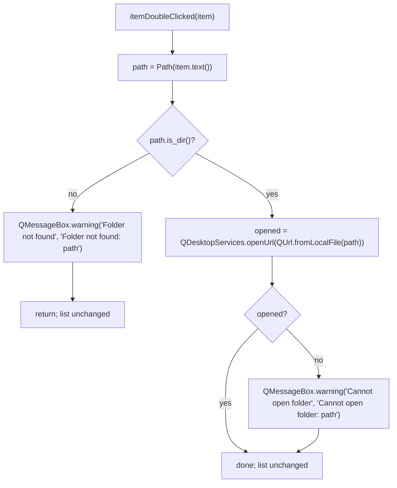

# S02 - Start panel lists the tab's worktrees and opens them

- **Plan:** [plan.md](plan.md)
- **Type:** Slice
- **Requirements covered:** FR-04, FR-05; AC "Given a listed worktree folder that no longer exists, when it is double-clicked, then a "Folder not found" warning is shown and the list is unchanged."
- **Prerequisites:** `TabState.worktrees` (field)
- **Creates:** `StartPanel.show_worktrees(paths)`, `StartPanel.worktrees_label`, `StartPanel.worktrees_list`, `WORKTREES_LABEL_TEXT`

## 1. Goal
The bottom of the start panel shows the tab's saved worktree folders:

- When a saved tab has worktrees, a "Worktrees" label and a list appear below the
  big-button column, one entry per folder (`str(path)`), in saved order.
- With no worktrees (new tab, first save, or a file with `"worktrees": []`), the label
  and the list are hidden.
- Double-clicking an entry opens that folder in the system file explorer.
- If the folder does not exist, a warning box titled "Folder not found" with the text
  "Folder not found: <path>" is shown, and the list stays as it was.
- If the folder exists but the OS cannot open it (`QDesktopServices.openUrl` returns
  False), a warning box titled "Cannot open folder" with the text
  "Cannot open folder: <path>" is shown, and the list stays as it was.

## 2. Context
- `src/devpipe/views/start_panel.py`: `StartPanel(QWidget)` with module-level text and
  size constants (`OPEN_TEXT`, `BIG_BUTTON_*`, ...), widgets as public attributes
  (`name_input`, `save_button`, `slug_label`, `open_button`, `create_button`), a root
  `QVBoxLayout` holding `name_row`, `slug_label` and the centered `buttons` layout with
  stretch 1. Signal handlers are private `_on_*` methods.
- `src/devpipe/views/pipeline_tab.py`: `apply_saved(path, state)` puts the tab in saved
  mode (calls `start_panel.show_saved(...)`, `_display(...)`, emits
  `identity_changed`), with no write. It is used by `save_as` (first save), session
  restore and File > Open. `TabState.worktrees` is available on the loaded state.
- Views may use Qt and `pathlib`; warnings use `QMessageBox.warning(self, TITLE, text)`
  (see `SAVE_ERROR_TITLE` in `pipeline_tab.py`). Tests monkeypatch `QMessageBox.warning`
  through a local `warnings` fixture in each test module.
- Tests: pytest + pytest-qt (`qtbot`), `tests/views/`, run with `uv run pytest`.

## 3. Structure

### 3.1 Files
| File | Change | Responsibility |
|------|--------|----------------|
| `src/devpipe/views/start_panel.py` | modify | Worktrees label + list at the bottom, `show_worktrees`, double-click handler |
| `src/devpipe/views/pipeline_tab.py` | modify | `apply_saved` passes `state.worktrees` to the start panel |
| `tests/views/test_start_panel.py` | modify | List visibility, contents, order, replace, double-click open / missing folder / cannot open |
| `tests/views/test_pipeline_tab.py` | modify | `apply_saved` shows the worktrees on the start panel |

### 3.2 Views - `src/devpipe/views/start_panel.py`

Module docstring: add "and, at the bottom, the tab's worktree folders (double-click
opens one in the file explorer)".

Imports gain `from pathlib import Path`, `QUrl` (`PySide6.QtCore`), `QDesktopServices`
(`PySide6.QtGui`), and `QListWidget`, `QListWidgetItem`, `QMessageBox`
(`PySide6.QtWidgets`).

New module constants, next to the existing ones:

```python
WORKTREES_LABEL_TEXT = "Worktrees"
FOLDER_NOT_FOUND_TITLE = "Folder not found"
FOLDER_NOT_FOUND_TEXT = "Folder not found: {path}"
CANNOT_OPEN_FOLDER_TITLE = "Cannot open folder"
CANNOT_OPEN_FOLDER_TEXT = "Cannot open folder: {path}"
```

`StartPanel.__init__` additions (everything existing stays as it is):

```python
self.worktrees_label = QLabel(WORKTREES_LABEL_TEXT)
self.worktrees_list = QListWidget()
self.worktrees_list.setAccessibleName(WORKTREES_LABEL_TEXT)
self.worktrees_label.setBuddy(self.worktrees_list)
...
layout.addLayout(buttons, 1)          # unchanged
layout.addWidget(self.worktrees_label)
layout.addWidget(self.worktrees_list)
...
self.worktrees_list.itemDoubleClicked.connect(self._on_worktree_double_clicked)
self.show_worktrees([])               # hidden at start
```

The big-button column keeps stretch 1, so the label and the list sit at the bottom of
the panel; they get no stretch factor.

New public method:

```python
def show_worktrees(self, paths: list[Path]) -> None:
    """Replace the worktree list with `paths` (shown as str(path)), in order.

    The label and the list are shown when `paths` is non-empty, hidden otherwise.
    May be called any number of times; `paths` is not kept or modified.
    """
```

Body: `self.worktrees_list.clear()`, then `addItem(str(path))` for each path, then
`setVisible(bool(paths))` on both `worktrees_label` and `worktrees_list`.

New private handler:

```python
def _on_worktree_double_clicked(self, item: QListWidgetItem) -> None:
    """Open the entry's folder in the file explorer; warn when it does not exist or the OS cannot open it."""
```

- `path = Path(item.text())` (the text is exactly `str(path)`, so it round-trips).
- `if not path.is_dir():` -> `QMessageBox.warning(self, FOLDER_NOT_FOUND_TITLE,
  FOLDER_NOT_FOUND_TEXT.format(path=path))` and return. The list is not touched.
- Else `opened = QDesktopServices.openUrl(QUrl.fromLocalFile(str(path)))`. Always call
  it as an attribute of the class (`QDesktopServices.openUrl`), so tests can monkeypatch
  it. If `opened` is False -> `QMessageBox.warning(self, CANNOT_OPEN_FOLDER_TITLE,
  CANNOT_OPEN_FOLDER_TEXT.format(path=path))`. The list is not touched in either case.
  Never open through a shell or `subprocess`/`os.startfile`.

### 3.3 Views - `src/devpipe/views/pipeline_tab.py`

`apply_saved(path, state)`: right after `self.start_panel.show_saved(state.feature_name)`
add `self.start_panel.show_worktrees(state.worktrees)`. Nothing else changes (still no
write; `_worktrees`, `save_as`, `_current_state`, `show_panel` are untouched). Because
`save_as` ends with `apply_saved`, the first save also refreshes (hides) the list.

## 4. Logic flows



A double-click never changes the list: a missing folder only warns, an existing one is
handed to the OS file explorer, and a refusal by the OS shows a second kind of warning.

## 5. Edge cases and errors
| Case | Expected behavior |
|------|-------------------|
| New (unsaved) tab | Label and list hidden, list empty |
| First save (`save_as`) | `show_worktrees([])`: still hidden |
| Saved tab with `worktrees == []` | Hidden |
| Saved tab with N worktrees | Label and list visible, N entries in saved order |
| Duplicate entries in the file | Shown as written (both entries) |
| `show_worktrees` called again with a different list | Old entries removed, new ones shown in order |
| `show_worktrees([])` after a non-empty list | List cleared, label and list hidden |
| Caller mutates its list after `show_worktrees` | No effect on the displayed entries |
| Double-click on an existing folder, `openUrl` returns True | `QDesktopServices.openUrl(QUrl.fromLocalFile(str(path)))`; no warning |
| Double-click on an existing folder, `openUrl` returns False | Warning "Cannot open folder" / "Cannot open folder: <path>"; list unchanged |
| Double-click on a missing folder | Warning "Folder not found" / "Folder not found: <path>"; no `openUrl`; list unchanged (same entries, same count) |
| Entry names an existing regular file, not a folder | Treated as not found (warning) |
| Relative or whitespace-only entry (accepted on load) | Shown as written; double-click checks `Path(text).is_dir()` as given (relative to the working directory), usually warns |

## 6. Tests

### 6.1 Automated
Test doubles (local to `tests/views/test_start_panel.py`):
- `warnings` fixture: monkeypatches `QMessageBox.warning` to record `(title, text)` and
  return `QMessageBox.StandardButton.Ok` (same shape as in `test_pipeline_tab.py`).
- `opened_urls` fixture: monkeypatches `QDesktopServices.openUrl` with a fake that
  records its `QUrl` argument in a list and returns the list's `result` attribute
  (a small `list` subclass, `result = True` by default; a test sets it to `False`).

Double-clicks are simulated with `panel.worktrees_list.itemDoubleClicked.emit(item)`
where `item = panel.worktrees_list.item(i)`. Folders are built under `tmp_path`
(existing: `mkdir`; missing: never created).

| Test file | Test name | Given / When / Then | Proves |
|-----------|-----------|---------------------|--------|
| `tests/views/test_start_panel.py` | `test_new_panel_hides_worktrees` | Given a new `StartPanel`, then `worktrees_label.isHidden()`, `worktrees_list.isHidden()`, `worktrees_list.count() == 0`, `worktrees_label.text() == "Worktrees"` | FR-04 empty state |
| same | `test_show_worktrees_lists_paths_in_order` | Given paths `[b, a]` under `tmp_path`, when `show_worktrees([b, a])`, then the item texts are `[str(b), str(a)]` and neither the label nor the list is hidden | FR-04 |
| same | `test_show_worktrees_replaces_previous_entries` | Given `show_worktrees([a, b])`, when `show_worktrees([c])`, then the item texts are `[str(c)]` | FR-04 (re-call replaces) |
| same | `test_show_worktrees_empty_hides_again` | Given `show_worktrees([a])`, when `show_worktrees([])`, then count is 0 and label and list are hidden | FR-04 empty state |
| same | `test_show_worktrees_does_not_keep_caller_list` | Given `paths = [a]` shown, when the test appends `b` to `paths`, then the list still has one entry | Edge case |
| same | `test_worktrees_are_below_the_big_buttons` | Given a panel, then with `layout = panel.layout()`, `layout.indexOf(panel.worktrees_label) == layout.count() - 2` and `layout.indexOf(panel.worktrees_list) == layout.count() - 1` (the last two items, after the big-button layout) | FR-04 "bottom of the start panel" |
| same | `test_double_click_existing_folder_opens_it` (uses `opened_urls`, `warnings`) | Given `show_worktrees([d])` with `d` an existing folder, when entry 0 is double-clicked, then `opened_urls == [QUrl.fromLocalFile(str(d))]` and `warnings == []` | FR-05 |
| same | `test_double_click_missing_folder_warns_and_keeps_list` (uses `opened_urls`, `warnings`) | Given `show_worktrees([d, m])` with `d` existing and `m` missing, when entry 1 is double-clicked, then `warnings == [("Folder not found", f"Folder not found: {m}")]`, `opened_urls == []`, and the item texts are still `[str(d), str(m)]` | FR-05, AC "Folder not found" |
| same | `test_double_click_folder_the_os_cannot_open_warns` (uses `opened_urls`, `warnings`) | Given `show_worktrees([d, e])` with both existing and `opened_urls.result = False`, when entry 0 is double-clicked, then `opened_urls == [QUrl.fromLocalFile(str(d))]`, `warnings == [("Cannot open folder", f"Cannot open folder: {d}")]`, and the item texts are still `[str(d), str(e)]` | FR-05 (open failure) |
| same | `test_double_click_file_is_not_a_folder` (uses `opened_urls`, `warnings`) | Given `f = tmp_path / "f.txt"` written as a file and shown, when double-clicked, then one "Folder not found" warning and no `openUrl` | Edge case |
| `tests/views/test_pipeline_tab.py` | `test_apply_saved_shows_worktrees_on_start_panel` | Given `a`, `b` under `tmp_path`, when `apply_saved(tmp_path / "x.json", TabState("x", Panel.START, [a, b]))`, then `start_panel.worktrees_list` texts are `[str(a), str(b)]` and the label is not hidden | FR-04 (saved tab) |
| same | `test_apply_saved_without_worktrees_hides_list` | Given a tab after `apply_saved(..., TabState("x", Panel.START, [a]))`, when `apply_saved(..., TabState("x"))` is called, then the list is empty and hidden | FR-04 empty state |
| same | `test_save_as_keeps_worktrees_hidden` | Given an unsaved tab, when `save_as(tmp_path / "x.json", "x")` succeeds, then `start_panel.worktrees_list.isHidden()` | Regression (first save) |

Existing tests in both files stay unchanged and must pass.

Run with: `uv run pytest tests/views/test_start_panel.py tests/views/test_pipeline_tab.py`,
then the full suite `uv run pytest`.

### 6.2 Manual
- Given a v2 state file edited by hand with `"worktrees": ["<an existing folder>",
  "C:\\does-not-exist"]`, when it is opened with File > Open (`uv run devpipe`), then
  the start panel shows the "Worktrees" label and both paths at the bottom, below the
  big buttons, in that order. (Proves FR-04.)
- When the first entry is double-clicked, then Windows Explorer opens that folder and
  no warning is shown. (Proves FR-05.)
- When the second entry is double-clicked, then a warning titled "Folder not found"
  shows "Folder not found: C:\does-not-exist", and after closing it the list still has
  both entries. (Proves FR-05, AC.)
- Given a new tab, then no "Worktrees" label or list is visible; after Save they are
  still hidden. (Proves FR-04 empty state.)

### 6.3 Static checks
- `grep -n "shell=True\|startfile\|subprocess" src/devpipe/views/start_panel.py` -> no output.
- `grep -n "show_worktrees" src/devpipe/views/pipeline_tab.py` -> one line, in `apply_saved`.
- `uv run lint-imports` -> passes (no new cross-layer imports).

## 7. Implementation order
1. `start_panel.py`: constants, `worktrees_label` + `worktrees_list` at the bottom of
   the layout, `show_worktrees` (hidden at start); add the visibility / contents /
   order / layout tests. Run `uv run pytest tests/views/test_start_panel.py`.
2. `start_panel.py`: `_on_worktree_double_clicked` wired to `itemDoubleClicked`
   (missing-folder and cannot-open warnings); add the `warnings` / `opened_urls`
   fixtures and the double-click tests.
3. `pipeline_tab.py`: call `show_worktrees(state.worktrees)` in `apply_saved`; add the
   `test_pipeline_tab.py` tests. Run `uv run pytest`.

## 8. Out of scope
- Does not change the big-button column (its buttons, order, enablement) or
  `show_saved`.
- Does not add, remove or reorder saved worktrees, and does not write the state file
  (no change to `_worktrees`, `save_as`, `_current_state`, `show_panel`).
- No removal or pruning of list entries, no context menu, no "remove missing" action
  (feature non-goal).
- No change to models, persistence, services, `main_window.py`, `pyproject.toml`,
  `docs/architecture.md` or `ai-skills/`.

## 9. Design notes
- **Single source of the displayed text:** each entry is `str(path)` and the handler
  rebuilds the path with `Path(item.text())`, so no parallel list of paths has to be
  kept in sync with the widget (DRY).
- **`show_worktrees` is the only way to fill the list:** the constructor calls it with
  `[]`, so visibility is decided in one place for the initial and every later state.
- **Existence check in the view:** `Path.is_dir()` is a one-line guard tied to a UI
  action; a service for it would add a layer with no rule to own (KISS). A regular file
  is treated as not found because only folders are opened.
- **`itemDoubleClicked` rather than `itemActivated`:** the spec asks for double-click;
  `itemActivated` would also fire on Enter, which is not required.
- **`openUrl` failure warns (user decision):** when the OS refuses to open an existing
  folder, the app shows its own "Cannot open folder" warning, with title and text as
  module constants in the same style as the "Folder not found" ones.
- **Rejected:** opening via `os.startfile` or `explorer.exe` with `subprocess`; it is
  Windows-only and goes through the shell, which the plan forbids.
