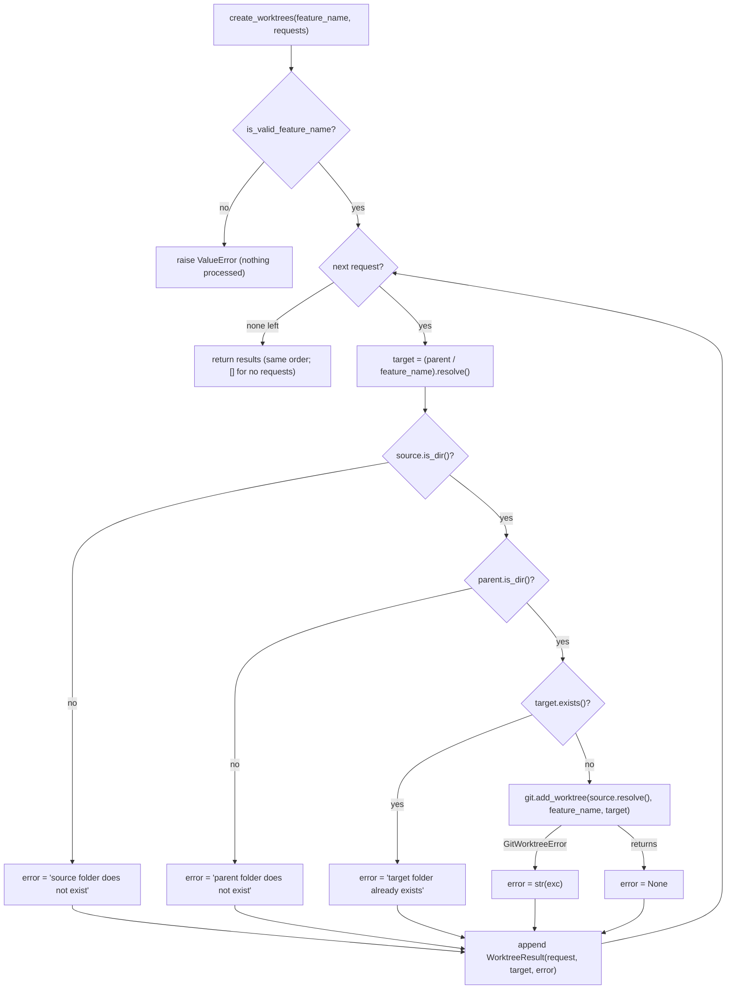
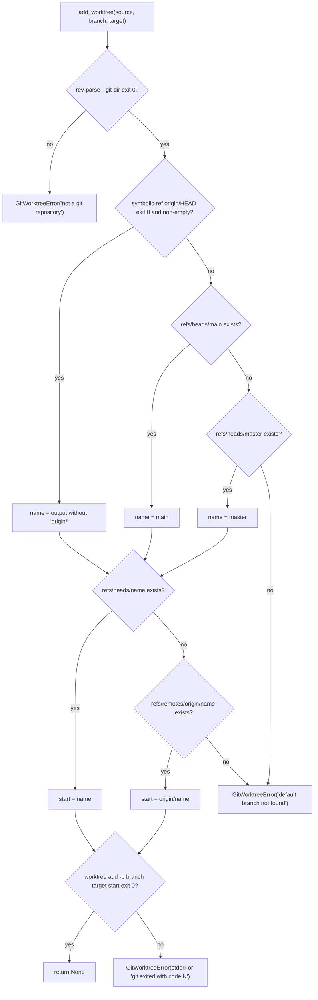

# S03 - Worktree creation use case with the git infrastructure layer

- **Plan:** [plan.md](plan.md)
- **Type:** Slice
- **Requirements covered:** FR-12, FR-13 (merge without duplicates), FR-22; acceptance criterion "`uv run lint-imports` passes with the new `infrastructure` layer contracts"
- **Prerequisites:** `same_file` (function, `src/devpipe/services/paths.py`); `is_valid_feature_name` (function, `src/devpipe/models/tab_state.py`)
- **Creates:** `WorktreeRequest`, `WorktreeResult` (with `ok`), `GitWorktreeError`, `GitWorktrees` (Protocol), `WorktreeService` (`create_worktrees`, `merge_paths`), `SubprocessGitWorktrees`, `devpipe.infrastructure` (package and import-linter layer)

## 1. Goal
A Qt-free use case that creates one git worktree per request, named after the
feature, plus a new `infrastructure/` layer that runs `git`.

When done:
- `WorktreeService(git).create_worktrees("feat-x", requests)` handles the requests
  one at a time, in order (FR-22). For each one it checks that the source folder
  exists, that the parent folder exists (it is never created) and that
  `<parent>/feat-x` does not exist. Then it calls
  `git.add_worktree(source, "feat-x", target)`. It returns one `WorktreeResult` per
  request, in the same order: success with the absolute target folder, or failure
  with a readable message. It never raises for a failure of one request.
- `SubprocessGitWorktrees` is the real `GitWorktrees`. It checks that the source is a
  git repository, resolves the default branch and the start point without fetching
  (FR-12 steps 2-3), and runs `git -C <source> worktree add -b <branch> <target> <start-point>`.
  Every failure is reported as a `GitWorktreeError` with a readable message.
- `WorktreeService.merge_paths(existing, new)` appends the new paths and skips any
  path already present, compared with `same_file` (FR-13).
- `uv run lint-imports` passes. `devpipe.infrastructure` is a sibling of
  `devpipe.persistence` (the two never import each other), does not use Qt, and is
  never imported by views.

Nothing in the UI changes in this step. `app.py` is not touched.

## 2. Context
- Layers today: `views -> services -> persistence -> models`. They are enforced by
  three import-linter contracts in `pyproject.toml` (all KEPT; import-linter 2.16,
  which supports `|` independent sibling layers).
- Services define a Protocol, and a lower layer implements it. Example:
  `TabStateStore` in `services/tab_state_service.py`, implemented by
  `persistence/tab_state_repository.py` and injected by `app.py`. Each package
  `__init__.py` has a docstring with the layer's purpose and "May import: ...".
- Models are plain dataclasses and exceptions (`TabStateError(path, reason)` keeps
  its arguments as attributes). There is no I/O in models.
- `services/paths.py::same_file(a, b)` compares paths after `resolve()`, ignoring
  case on Windows.
- Tests: pytest with `--import-mode=importlib`, no `__init__.py`, folders mirror the
  layers. Fakes are small hand-written classes that record calls (see
  `FakeTabStateStore` in `tests/services/test_tab_state_service.py`). Paths come from
  `tmp_path`.
- The real-git module has no automated tests (D18, D21). It is checked manually.

## 3. Structure

### 3.1 Files
| File | Change | Responsibility |
|------|--------|----------------|
| `src/devpipe/models/worktree.py` | new | `WorktreeRequest`, `WorktreeResult`, `GitWorktreeError` |
| `src/devpipe/services/worktree_service.py` | new | `GitWorktrees` Protocol, `WorktreeService`, precheck messages |
| `src/devpipe/services/__init__.py` | modify | Docstring: "May import" also lists `devpipe.infrastructure` |
| `src/devpipe/infrastructure/__init__.py` | new | Package docstring (layer purpose, no Qt, may import `devpipe.models`) |
| `src/devpipe/infrastructure/git_worktrees.py` | new | `SubprocessGitWorktrees`: runs `git` through `subprocess` |
| `pyproject.toml` | modify | import-linter contracts |
| `docs/architecture.md` | modify | Diagram, layer table, layout tree |
| `tests/models/test_worktree.py` | new | Value objects |
| `tests/services/test_worktree_service.py` | new | Use case with a fake `GitWorktrees` |

### 3.2 Models: `src/devpipe/models/worktree.py`

```python
"""Worktree creation requests and results (no Qt, no I/O)."""

from dataclasses import dataclass
from pathlib import Path


@dataclass(frozen=True)
class WorktreeRequest:
    """One (source project folder, worktree parent folder) pair, as entered."""

    source: Path
    parent: Path


@dataclass(frozen=True)
class WorktreeResult:
    """Outcome of one request.

    `target` is always `(request.parent / feature_name).resolve()`, on success
    and on failure. On success it is the created worktree folder.
    `error` is None on success, else a readable message.
    """

    request: WorktreeRequest
    target: Path
    error: str | None

    @property
    def ok(self) -> bool:
        return self.error is None


class GitWorktreeError(Exception):
    """A git worktree could not be created; str(error) is the readable message."""

    def __init__(self, message: str) -> None:
        super().__init__(message)
        self.message = message
```

- All three fields of `WorktreeResult` are required (no defaults).
- Frozen dataclasses: assigning a field raises `dataclasses.FrozenInstanceError`. The
  dataclass gives value equality and hashing.

### 3.3 Services: `src/devpipe/services/worktree_service.py`

```python
"""Create git worktrees named after a feature, and merge their paths (no Qt)."""

from pathlib import Path
from typing import Protocol

from devpipe.models.tab_state import is_valid_feature_name
from devpipe.models.worktree import GitWorktreeError, WorktreeRequest, WorktreeResult
from devpipe.services.paths import same_file

SOURCE_MISSING_MESSAGE = "source folder does not exist"
PARENT_MISSING_MESSAGE = "parent folder does not exist"
TARGET_EXISTS_MESSAGE = "target folder already exists"


class GitWorktrees(Protocol):
    """Creates git worktrees (implemented in the infrastructure layer)."""

    def add_worktree(self, source: Path, branch: str, target: Path) -> None:
        """Add a worktree of the repository at `source` at `target`, on a new
        branch `branch` started from the source's default branch.

        Checks that `source` is a git repository and resolves the default branch
        and the start point without fetching. Raises GitWorktreeError (only) on
        any failure, including a missing git executable.
        """
        ...


class WorktreeService:
    def __init__(self, git: GitWorktrees) -> None:
        self._git = git

    def create_worktrees(
        self, feature_name: str, requests: list[WorktreeRequest]
    ) -> list[WorktreeResult]:
        """One result per request, in the same order. Requests are processed
        one at a time; the call blocks until all are done.

        Raises ValueError (before processing any request) when `feature_name`
        is not a valid feature slug. Never raises for the failure of one request.
        """

    def merge_paths(self, existing: list[Path], new: list[Path]) -> list[Path]:
        """A new list: `existing` (unchanged, in order) followed by each path of
        `new` that is not already in it (by same_file, also among earlier new
        paths). The inputs are not modified."""

    def _create_one(self, feature_name: str, request: WorktreeRequest) -> WorktreeResult:
        """Precheck, then call git; turn a GitWorktreeError into the result's error."""

    @staticmethod
    def _precheck(request: WorktreeRequest, target: Path) -> str | None:
        """The first failing check's message, or None when all checks pass."""
```

Behavior details:
- `create_worktrees`: if `not is_valid_feature_name(feature_name)`, raise
  `ValueError(f"invalid feature name: {feature_name!r}")`. Otherwise return
  `[self._create_one(feature_name, r) for r in requests]`. An empty list returns `[]`
  and git is never called.
- `_create_one`:
  1. `target = (request.parent / feature_name).resolve()`.
  2. `error = self._precheck(request, target)`.
  3. If `error is None`, call `self._git.add_worktree(request.source.resolve(), feature_name, target)`.
     On `GitWorktreeError as exc`, set `error = str(exc)`. Any other exception is a
     bug and propagates.
  4. Return `WorktreeResult(request, target, error)`. The `request` object is the
     same instance that was passed in.
- `_precheck`, checks in this order:
  1. `not request.source.is_dir()` → `SOURCE_MISSING_MESSAGE`. A path to a regular
     file counts as missing.
  2. `not request.parent.is_dir()` → `PARENT_MISSING_MESSAGE`.
  3. `target.exists()` (a file or a folder) → `TARGET_EXISTS_MESSAGE`.
  4. Otherwise `None`.
- `merge_paths`: `merged = list(existing)`. For each `path` in `new`, append it unless
  `any(same_file(path, kept) for kept in merged)`. Return `merged`. Kept paths are the
  original objects, not normalized copies. Duplicates that are already in `existing`
  are left as they are.

`src/devpipe/services/__init__.py`: change the docstring line to
`May import: \`devpipe.persistence\`, \`devpipe.infrastructure\`, \`devpipe.models\`.`
Nothing else changes.

### 3.4 Infrastructure

`src/devpipe/infrastructure/__init__.py`, following the docstring style of
`persistence/__init__.py`:

```python
"""Infrastructure layer: talk to external tools (git) on behalf of services.

Implements Protocols defined in `devpipe.services`. No Qt.
May import: `devpipe.models`.
"""
```

`src/devpipe/infrastructure/git_worktrees.py`:

```python
"""Create git worktrees by running the git executable (no Qt, no shell)."""

import subprocess
from pathlib import Path

from devpipe.models.worktree import GitWorktreeError

GIT_EXECUTABLE = "git"
REMOTE = "origin"
FALLBACK_DEFAULT_BRANCHES = ("main", "master")

NOT_A_REPOSITORY_MESSAGE = "not a git repository"
DEFAULT_BRANCH_NOT_FOUND_MESSAGE = "default branch not found"
GIT_NOT_FOUND_MESSAGE = "git not found"


class SubprocessGitWorktrees:
    """The real GitWorktrees: runs `git -C <source> ...` with argument lists."""

    def add_worktree(self, source: Path, branch: str, target: Path) -> None:
        """See GitWorktrees.add_worktree. Raises GitWorktreeError (only)."""

    def _check_repository(self, source: Path) -> None:
        """Raise GitWorktreeError(NOT_A_REPOSITORY_MESSAGE) unless
        `git rev-parse --git-dir` succeeds in `source`. A folder inside a
        repository's work tree also passes (its enclosing repository is used)."""

    def _default_branch(self, source: Path) -> str:
        """Target of refs/remotes/origin/HEAD without the "origin/" prefix,
        else the first of FALLBACK_DEFAULT_BRANCHES that exists as a local
        branch. Raises GitWorktreeError(DEFAULT_BRANCH_NOT_FOUND_MESSAGE)."""

    def _start_point(self, source: Path, name: str) -> str:
        """`name` when refs/heads/<name> exists, else `origin/<name>` when
        refs/remotes/origin/<name> exists. Raises
        GitWorktreeError(DEFAULT_BRANCH_NOT_FOUND_MESSAGE)."""

    def _ref_exists(self, source: Path, ref: str) -> bool:
        """`git rev-parse --verify --quiet <ref>` exits 0."""

    def _run(self, source: Path, *args: str) -> subprocess.CompletedProcess[str]:
        """Run git in `source`; never raises for a non-zero exit code."""
```

Commands (each through `_run`, which builds `[GIT_EXECUTABLE, "-C", str(source), *args]`):

| Purpose | Arguments after `-C <source>` | Success | Failure |
|---------|-------------------------------|---------|---------|
| Repository check | `rev-parse --git-dir` | exit 0 | `NOT_A_REPOSITORY_MESSAGE` |
| Remote default | `symbolic-ref --quiet --short refs/remotes/origin/HEAD` | exit 0 and non-empty stdout `origin/<name>` → `<name>` (`removeprefix(f"{REMOTE}/")`) | fall through to the local fallbacks |
| Local fallback | `rev-parse --verify --quiet refs/heads/<name>` for `main`, then `master` | first one that exits 0 | none exists → `DEFAULT_BRANCH_NOT_FOUND_MESSAGE` |
| Start point | `rev-parse --verify --quiet refs/heads/<name>`, else `refs/remotes/origin/<name>` | `<name>` / `origin/<name>` | neither exists → `DEFAULT_BRANCH_NOT_FOUND_MESSAGE` |
| Create | `worktree add -b <branch> <str(target)> <start-point>` | exit 0 | `stderr.strip()`, or `f"git exited with code {returncode}"` when stderr is empty |

`_run` details:
- `subprocess.run(cmd, capture_output=True, text=True, encoding="utf-8", errors="replace", check=False)`.
  Never `shell=True`. No `cwd` (`-C` selects the folder). No network commands
  (no `fetch`, `pull` or `ls-remote`).
- `FileNotFoundError` → `GitWorktreeError(GIT_NOT_FOUND_MESSAGE)`. Any other
  `OSError` → `GitWorktreeError(f"cannot run git: {exc.strerror or exc}")`. Both are
  chained with `from exc`.

### 3.5 Config: `pyproject.toml` (`[tool.importlinter]` only)

```toml
[[tool.importlinter.contracts]]
name = "Layers: app -> views -> services -> persistence | infrastructure -> models"
type = "layers"
layers = [
    "devpipe.__main__",
    "devpipe.app",
    "devpipe.views",
    "devpipe.services",
    "devpipe.persistence | devpipe.infrastructure",
    "devpipe.models",
]

[[tool.importlinter.contracts]]
name = "Views go through services, never persistence"   # unchanged
...

[[tool.importlinter.contracts]]
name = "Views never import infrastructure"
type = "forbidden"
source_modules = ["devpipe.views"]
forbidden_modules = ["devpipe.infrastructure"]

[[tool.importlinter.contracts]]
name = "Only views and app use Qt"
type = "forbidden"
source_modules = ["devpipe.services", "devpipe.persistence", "devpipe.infrastructure", "devpipe.models"]
forbidden_modules = ["PySide6"]
```

The "Views go through services, never persistence" contract stays as it is. Nothing
else in `pyproject.toml` changes. No new dependency is added (`subprocess` is in the
standard library).

### 3.6 Docs: `docs/architecture.md`
- Diagram: replace the one-line stack with:
  ```
  views  ->  services  ->  persistence     ->  models
                       ->  infrastructure  ->
  ```
  Add one sentence under it: persistence and infrastructure are siblings and never
  import each other.
- Layer table:
  - Composition: "Builds repositories, infrastructure implementations and services,
    injects them into views".
  - Services: may import `persistence`, `infrastructure`, `models`.
  - New row after Persistence: `Infrastructure` | `infrastructure/` | "Talk to
    external tools (git) through `subprocess`; implements service Protocols; no Qt"
    | `models`.
- Layout tree: add `├── infrastructure/` with
  `│   └── git_worktrees.py   # runs git to create worktrees` between `app.py` and
  `models/`, keeping alphabetical order.
- Leave the `views/` entries and the closing import-linter paragraph as they are.

## 4. Logic flows



The service validates the slug once. Then it handles each request in turn: a
precheck failure skips git for that request only, and a git failure is stored in the
result. The loop always goes on to the next request.



The real implementation resolves the default branch and the start point using only
local refs (no fetch). Any `git` launch in this flow can raise
`GitWorktreeError('git not found')` (or `'cannot run git: ...'`) when the executable
cannot be started.

## 5. Edge cases and errors
| Case | Expected behavior |
|------|-------------------|
| `requests == []` | Returns `[]`; git is not called |
| `feature_name` not a slug (e.g. `""`, `"-x"`, `"A b"`) | `ValueError` before any request; git is not called |
| Source missing, or a regular file | Result error `"source folder does not exist"`; git not called for it |
| Parent missing, or a regular file | `"parent folder does not exist"`; the parent is not created |
| Target already exists (folder or file) | `"target folder already exists"`; git not called for it |
| Several failing checks | Only the first message, in the order source, parent, target |
| Two requests with the same parent | The first is created; the second fails `"target folder already exists"` because the check runs after the first one's git call |
| Relative source/parent paths | `target` and the source passed to git are resolved against the process working folder |
| Git raises `GitWorktreeError` for one request | That result has `error == str(exc)`; the next requests are still processed |
| Source is not a git repository | `"not a git repository"` (real git) |
| Source is a subfolder inside a repository (not its root) | Accepted: `rev-parse --git-dir` succeeds, and the worktree is created from the enclosing repository (a full worktree at `<parent>/<feature>`, not only the subfolder) |
| No `origin/HEAD`, no local `main`/`master` | `"default branch not found"` |
| `origin/HEAD` → `origin/develop` with no local `develop` but with `refs/remotes/origin/develop` | Start point `origin/develop` |
| Branch `<feature>` already exists in the source | git exits non-zero; error is git's stderr, stripped |
| git fails with empty stderr | `"git exited with code <N>"` |
| `git` not on PATH | `"git not found"` for every processed request that passes the prechecks |
| git output not valid in the locale encoding | Decoded as UTF-8 with replacement; no decode error |
| `merge_paths` with `new` holding a path equal to an existing one under a different spelling (case on Windows, `..`) | Not added |
| `merge_paths` with the same new path twice | Added once |
| `merge_paths([], [])` | `[]` (a new list) |

## 6. Tests

### 6.1 Automated
Test double in `tests/services/test_worktree_service.py`:

```python
class FakeGitWorktrees:
    """Records add_worktree calls; raises a preset GitWorktreeError per target,
    otherwise creates the target folder like real git would."""

    def __init__(self, errors: dict[Path, GitWorktreeError] | None = None):
        self.errors = errors or {}  # keyed by the resolved target, e.g. (wt / "feat-x").resolve()
        self.calls: list[tuple[Path, str, Path]] = []

    def add_worktree(self, source, branch, target):
        self.calls.append((source, branch, target))
        if target in self.errors:
            raise self.errors[target]
        target.mkdir()
```

A helper `make_request(tmp_path, name)` creates `tmp_path/name/src` and
`tmp_path/name/wt` folders and returns `WorktreeRequest(src, wt)`.

| Test file | Test name | Given / When / Then | Proves |
|-----------|-----------|---------------------|--------|
| `tests/models/test_worktree.py` | `test_result_ok_when_no_error` | Given `WorktreeResult(req, t, None)` / then `ok is True` | `ok` contract |
| `tests/models/test_worktree.py` | `test_result_not_ok_with_error` | Given `WorktreeResult(req, t, "boom")` / then `ok is False` | `ok` contract |
| `tests/models/test_worktree.py` | `test_request_and_result_are_frozen` | When assigning `req.source` or `res.error` / then `FrozenInstanceError` | Immutability |
| `tests/models/test_worktree.py` | `test_request_value_equality` | Given two requests with equal paths / then equal and same hash | Value object |
| `tests/models/test_worktree.py` | `test_git_worktree_error_message` | Given `GitWorktreeError("x")` / then `str(e) == "x"`, `e.message == "x"`, is an `Exception` | Readable message |
| `tests/services/test_worktree_service.py` | `test_creates_each_request_in_order` | Given two valid requests / when `create_worktrees("feat-x", ...)` / then the fake calls are `[(src1.resolve(), "feat-x", (wt1/"feat-x").resolve()), (src2.resolve(), ...)]` in order; both results `ok`; `results[i].request is requests[i]`; `results[i].target == (wt_i/"feat-x").resolve()` | FR-12 step 4, FR-22 |
| `tests/services/test_worktree_service.py` | `test_empty_requests_return_empty_list` | Given `[]` / then `[]` and no fake calls | Empty input |
| `tests/services/test_worktree_service.py` | `test_invalid_feature_name_raises` (parametrized `""`, `"-x"`, `"Feat"`) | Then `ValueError` and no fake calls | Precondition, security (no option-like branch) |
| `tests/services/test_worktree_service.py` | `test_missing_source_fails_without_git` | Given a source path that does not exist / then error `"source folder does not exist"`, target set, no fake call | FR-12 step 1 |
| `tests/services/test_worktree_service.py` | `test_source_file_counts_as_missing` | Given source is a regular file / then `"source folder does not exist"` | FR-12 step 1 |
| `tests/services/test_worktree_service.py` | `test_missing_parent_fails_and_is_not_created` | Given a parent that does not exist / then `"parent folder does not exist"`, the parent still does not exist, no fake call | FR-12 step 1, D15 |
| `tests/services/test_worktree_service.py` | `test_parent_file_counts_as_missing` | Given the parent is a regular file / then `"parent folder does not exist"`, no fake call | FR-12 step 1 |
| `tests/services/test_worktree_service.py` | `test_existing_target_fails_without_git` | Given `wt/"feat-x"` exists / then `"target folder already exists"`, no fake call | FR-12 step 1 |
| `tests/services/test_worktree_service.py` | `test_first_failing_check_wins` | Given a missing source and a missing parent / then `"source folder does not exist"` | Check order |
| `tests/services/test_worktree_service.py` | `test_git_error_is_reported_and_run_continues` | Given 3 valid requests and the fake raises `GitWorktreeError("boom")` for target 2 / then results are ok / `"boom"` / ok, the fake is called 3 times | FR-12 step 5, FR-22 |
| `tests/services/test_worktree_service.py` | `test_precheck_failure_does_not_stop_later_requests` | Given request 1 with a missing source and a valid request 2 / then result 1 fails, result 2 ok, one fake call (for request 2) | FR-22 |
| `tests/services/test_worktree_service.py` | `test_same_parent_second_request_fails` | Given two requests with different sources and the same parent / then results are ok / `"target folder already exists"`, the fake is called once (for request 1) | FR-12 step 1, FR-22 |
| `tests/services/test_worktree_service.py` | `test_relative_paths_are_resolved` | Given `monkeypatch.chdir(tmp_path)` and `WorktreeRequest(Path("src"), Path("wt"))` (both created) / then `target == (tmp_path/"wt"/"feat-x").resolve()`, `target.is_absolute()`, and `fake.calls[0][0] == (tmp_path/"src").resolve()` | Absolute paths |
| `tests/services/test_worktree_service.py` | `test_merge_paths_appends_new_in_order` | `merge_paths([a], [b, c])` / then `[a, b, c]` | FR-13 |
| `tests/services/test_worktree_service.py` | `test_merge_paths_skips_same_file` | Given `a2 = a.parent / "x" / ".." / a.name` / when `merge_paths([a], [b, a2, b])` / then `[a, b]` | FR-13 (no duplicates) |
| `tests/services/test_worktree_service.py` | `test_merge_paths_does_not_modify_inputs` | Then the returned list is not `existing`, and `existing` and `new` are unchanged | Pure function |
| `tests/services/test_worktree_service.py` | `test_merge_paths_empty` | `merge_paths([], [])` / then `[]` | Empty input |

Run with: `uv run pytest tests/models/test_worktree.py tests/services/test_worktree_service.py`.
Regression: `uv run pytest` (whole suite) passes.

### 6.2 Manual
These cover the untested real-git module (D18, D21). Use `uv run python` in the
devpipe folder, with
`from pathlib import Path; from devpipe.models.worktree import WorktreeRequest; from devpipe.services.worktree_service import WorktreeService; from devpipe.infrastructure.git_worktrees import SubprocessGitWorktrees; s = WorktreeService(SubprocessGitWorktrees())`.
- Given a real repo with a local `main` and an empty folder `P`, when
  `s.create_worktrees("try-wt", [WorktreeRequest(Path(repo), Path(P))])` runs, then
  the result is ok with `target == P\try-wt`, and `git -C <repo> worktree list` shows
  it on branch `try-wt` at the tip of `main`. (FR-12 steps 2-4)
- Given the same call again, then the error is `"target folder already exists"`.
- Given the worktree folder is deleted by hand (branch `try-wt` remains) and
  `git -C <repo> worktree prune` is run, when the call is repeated, then the error is
  git's stderr saying the branch already exists.
- Given a plain folder that is not a repo as the source, then the error is
  `"not a git repository"`.
- Given a subfolder of a real repo (e.g. `<repo>\docs`) as the source, then the result
  is ok and the new worktree is a full checkout of the enclosing repository.
- Given a repo whose only branch is `trunk` and that has no `origin`, then the error
  is `"default branch not found"`.
- Given a clone whose `origin/HEAD` points to a branch with no local copy (e.g. clone,
  then `git checkout -b other` and `git branch -D main`), then the worktree starts at
  `origin/main`. No network access happens (works offline).
- Given a shell with a `PATH` that has no `git` (start `uv run python` from a shell
  with a reduced `PATH`, or run `os.environ["PATH"] = ""` first), then the error is
  `"git not found"`.
- Afterwards, remove the test worktrees (`git worktree remove`) and the branches
  (`git branch -D try-wt`) by hand.

### 6.3 Static checks
- `uv run lint-imports` → 4 contracts, all KEPT, including
  "Layers: app -> views -> services -> persistence | infrastructure -> models" and
  "Views never import infrastructure". (Acceptance criterion)
- `rg -n "shell=True" src/devpipe/infrastructure` → no matches. (Security NFR)
- `rg -n "fetch|pull|ls-remote" src/devpipe/infrastructure` → no matches. (FR-12 step 3, no network)
- `rg -n "PySide6" src/devpipe/infrastructure src/devpipe/services/worktree_service.py src/devpipe/models/worktree.py` → no matches.
- `git diff --stat -- ai-skills` → empty.

## 7. Implementation order
1. Add `models/worktree.py` and `tests/models/test_worktree.py`. Run the model tests.
2. Add `services/worktree_service.py` with the Protocol, the prechecks,
   `create_worktrees` and `merge_paths`, and `tests/services/test_worktree_service.py`.
   Update the `services/__init__.py` docstring. Run the service tests.
3. Add the `infrastructure/` package and `git_worktrees.py`.
4. Update the `pyproject.toml` contracts. Run `uv run lint-imports`.
5. Update `docs/architecture.md`.
6. Run `uv run pytest` and the manual checks against a real repository.

## 8. Out of scope
- No change to `app.py`, to any view, or to any UI wiring. This step builds and
  tests the use case and the git layer only.
- No change to the tab state file format, to `TabState`, or to
  `persistence/tab_state_repository.py`.
- No automated tests for `infrastructure/git_worktrees.py` (D18, D21).
- No removal or pruning of worktrees, no branch deletion, no fetch, no base ref other
  than the default branch (spec non-goals).
- No threading. The use case is synchronous.
- `ai-skills/` is not touched.
- In `docs/architecture.md`, only the diagram, the layer table and the
  `infrastructure/` entry of the layout tree change.

## 9. Design notes
- **Dependency Inversion:** the service depends on the `GitWorktrees` Protocol that
  it owns, and the infrastructure class implements it. This is the same pattern as
  `TabStateStore`. It keeps the service testable with a fake and keeps `subprocess`
  out of services.
- **Validation split:** the filesystem checks (source, parent, target) are in the
  service, so they are tested. The git-dependent checks are in infrastructure. The
  target check runs after earlier requests' git calls, so two requests with the same
  parent give "created" then "target folder already exists", as the spec expects.
- **Feature name precondition:** `create_worktrees` raises `ValueError` for a
  non-slug name. Callers always pass a saved, valid slug, so this only catches
  programming errors. It also guarantees that the branch argument can never look
  like a git option. `is_valid_feature_name` is reused instead of a new rule (DRY).
- **Resolved source:** the source is passed to git as `request.source.resolve()`, so
  `-C` gets an absolute path, like `target`. The result keeps the request exactly as
  given.
- **Encoding:** `encoding="utf-8", errors="replace"` is added to the plan's
  `capture_output=True, text=True`. git writes UTF-8, and the Windows locale code page
  could otherwise raise a decode error on non-ASCII paths in stderr.
- **Messages as constants:** the precheck messages live in the service module, and the
  git messages in the infrastructure module, each next to the code that produces
  them. There is no shared message module: no message is used in both places.
- **Rejected:** a single `git worktree add` with `--guess-remote`, or letting git pick
  the base. Either would break the D5/D6 default-branch rules. A Windows
  `CREATE_NO_WINDOW` flag is not added: the app runs from a console (`uv run devpipe`),
  so no console window flashes. It can be added later if the app is ever started with
  `pythonw`.
- **Source inside a repository:** a subfolder of a repository is accepted, and the
  worktree is made from the enclosing repository. The spec only asks that the source
  "is a git repository", and git itself accepts any folder inside the work tree.
  Rejecting it would mean comparing `rev-parse --show-toplevel` with the source.
  Infrastructure cannot import `services.paths.same_file`, so that would duplicate
  the path comparison. This choice is open for the user to confirm.
- **Docstring of `services/__init__.py`:** updated so its "May import" line matches
  the new layer contract. It is a one-line documentation change.
