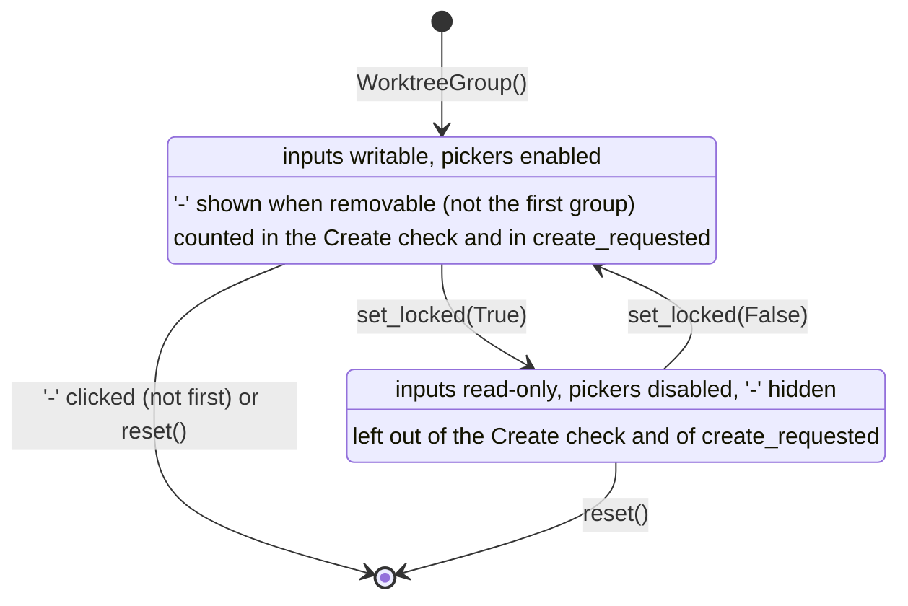
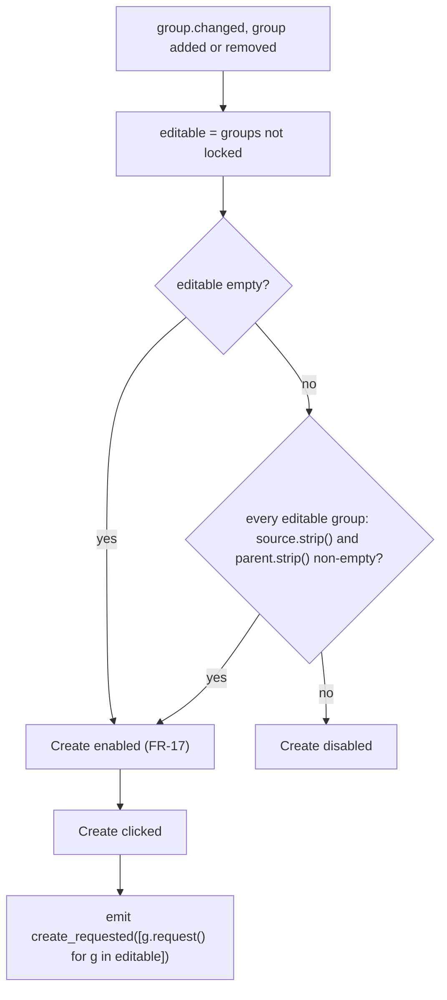
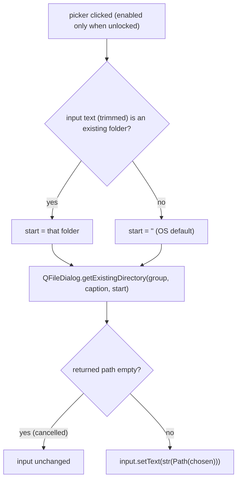

# S04 - New worktree panel: edit groups of folders

- **Plan:** [plan.md](plan.md)
- **Type:** Slice
- **Requirements covered:** FR-06, FR-07, FR-08, FR-09, FR-10, FR-16 (locked-group behavior), FR-17 (Create enabled with no editable group), FR-18, FR-03 (`reset`)
- **Prerequisites:** `WorktreeRequest` (frozen dataclass, `src/devpipe/models/worktree.py`)
- **Creates:** `NewWorktreePanel` (with `create_requested`, `groups()`, `editable_groups()`, `reset()`, `add_button`, `create_button`), `WorktreeGroup` (with `source_input`, `parent_input`, `source_picker`, `parent_picker`, `remove_button`, `set_locked`, `is_locked`), the panel layout (scroll area with groups, '+', Create)

## 1. Goal
A self-contained `QWidget` where the user enters one or more (source project folder,
worktree parent folder) pairs and asks to create them.

When done:
- A new `NewWorktreePanel()` shows one empty group titled "Worktree 1" with two
  labeled rows, "Source project folder" and "Worktree parent folder". Each row is a
  text input with a folder-picker button on its right (FR-06).
- A picker opens `QFileDialog.getExistingDirectory`. Choosing a folder writes its path
  into that row's input; cancelling changes nothing (FR-07).
- '+' appends an empty group (FR-08). Every group but the first has a '-' that removes
  it. Groups are titled "Worktree N" by their display position and renumbered after a
  removal (FR-09).
- Create, at the bottom, is enabled only when every unlocked group has both inputs
  non-empty after trimming. With no unlocked group, it is enabled (FR-10, FR-17).
- Clicking Create emits `create_requested` with one `WorktreeRequest` per unlocked group,
  in display order.
- A locked group has read-only inputs, disabled pickers and no '-', and is left out of
  the Create check and of the requests (FR-16).
- There is no Back/Cancel button (FR-18).
- `reset()` returns the panel to one empty unlocked group (FR-03).

The panel is not added to any tab or window in this step. Nothing calls it from the app.

## 2. Context
- Views are PySide6 widgets in `src/devpipe/views/`. They may import `devpipe.services`
  and `devpipe.models` (import-linter). This step imports only `devpipe.models.worktree`.
- `views/start_panel.py` sets the conventions followed here: module docstring, UI texts
  and sizes as module-level constants, widgets as public attributes built in
  `__init__`, signals as class attributes with a comment, private `_on_...` slots and
  `_refresh_..._enabled` helpers.
- `views/main_window.py` sets the tool-button accessibility pattern: `setToolTip(X)` and
  `setAccessibleName(X)` with the same constant (`new_tab_button`).
- Tests: pytest + pytest-qt (`qtbot`), `tests/views/`, no `__init__.py`,
  `--import-mode=importlib`. Panels are built directly and registered with
  `qtbot.addWidget` (see `make_panel` in `tests/views/test_start_panel.py`). Widgets are
  not shown in tests, so visibility is checked with `isHidden()`, not `isVisible()`.
- Paths: `pathlib` only.

## 3. Structure

### 3.1 Files
| File | Change | Responsibility |
|------|--------|----------------|
| `src/devpipe/views/new_worktree_panel.py` | new | `WorktreeGroup` (one pair of folder rows), `NewWorktreePanel` (list of groups, '+', Create) |
| `docs/architecture.md` | modify | Layout tree: add `new_worktree_panel.py` under `views/` |
| `tests/views/test_new_worktree_panel.py` | new | Widget tests |

### 3.2 Views: `src/devpipe/views/new_worktree_panel.py`

Module docstring: `"""New worktree panel: groups of (source project, worktree parent) folders and Create."""`

Imports: `pathlib.Path`; `functools.partial`; from `PySide6.QtCore`: `Signal`; from
`PySide6.QtWidgets`: `QFileDialog`, `QGridLayout`, `QGroupBox`, `QHBoxLayout`, `QLabel`,
`QLineEdit`, `QPushButton`, `QScrollArea`, `QToolButton`, `QVBoxLayout`, `QWidget`; from
`devpipe.models.worktree`: `WorktreeRequest`.

Constants (module level):

```python
SOURCE_LABEL_TEXT = "Source project folder"
PARENT_LABEL_TEXT = "Worktree parent folder"
SOURCE_PICKER_TOOLTIP = "Choose source project folder"
PARENT_PICKER_TOOLTIP = "Choose worktree parent folder"
PICKER_TEXT = "..."
ADD_TEXT = "+"
ADD_TOOLTIP = "Add worktree"
REMOVE_TEXT = "-"
REMOVE_TOOLTIP = "Remove worktree"
CREATE_TEXT = "Create"
GROUP_TITLE = "Worktree {n}"  # n is the 1-based display position
NO_START_DIRECTORY = ""       # lets the OS dialog pick its default folder
```

#### `WorktreeGroup(QGroupBox)`

```python
class WorktreeGroup(QGroupBox):
    """One (source project folder, worktree parent folder) pair."""

    changed = Signal()           # an input's text changed, or the lock state changed
    remove_requested = Signal()  # '-' was clicked

    def __init__(self) -> None: ...

    # public widgets
    source_input: QLineEdit
    parent_input: QLineEdit
    source_picker: QToolButton
    parent_picker: QToolButton
    remove_button: QToolButton

    def set_locked(self, locked: bool) -> None: ...
    def is_locked(self) -> bool: ...
    def set_removable(self, removable: bool) -> None: ...
    def is_filled(self) -> bool: ...
    def request(self) -> WorktreeRequest: ...

    def _choose_folder(self, line_edit: QLineEdit, caption: str) -> None: ...
    def _refresh_controls(self) -> None: ...
```

Attributes and construction:
- `_locked: bool = False`, `_removable: bool = False`.
- Title: empty at construction; the panel sets it with `setTitle(...)`.
- `source_input`, `parent_input`: empty `QLineEdit`s.
- `source_picker`, `parent_picker`: `QToolButton` with text `PICKER_TEXT`, tooltip and
  accessible name `SOURCE_PICKER_TOOLTIP` / `PARENT_PICKER_TOOLTIP`.
- `remove_button`: `QToolButton` with text `REMOVE_TEXT`, tooltip and accessible name
  `REMOVE_TOOLTIP`; hidden at construction (`_removable` is False).
- Two `QLabel`s with `SOURCE_LABEL_TEXT` / `PARENT_LABEL_TEXT`, each with
  `setBuddy(<its input>)` so screen readers name the input.
- Layout (`QVBoxLayout` on the group):
  1. Header row (`QHBoxLayout`): `addStretch(1)`, then `remove_button` (the group's
     top-right area).
  2. `QGridLayout`, two rows: column 0 the label, column 1 the input (column stretch 1),
     column 2 the picker. Row 0 source, row 1 parent.
- Connections:
  - `source_input.textChanged` and `parent_input.textChanged` → `changed.emit()`
    (drop the text argument).
  - `source_picker.clicked` → `_choose_folder(self.source_input, SOURCE_PICKER_TOOLTIP)`;
    `parent_picker.clicked` → `_choose_folder(self.parent_input, PARENT_PICKER_TOOLTIP)`
    (lambdas that drop the `checked` argument, as in `main_window.py`).
  - `remove_button.clicked` → `remove_requested.emit()`.

Methods:
- `set_locked(locked)`: stores it, calls `_refresh_controls()`, then emits `changed`
  (so the panel refreshes Create). Calling it with the current value still emits
  (harmless; keeps the method simple).
- `is_locked() -> bool`: `_locked`.
- `set_removable(removable)`: stores it and calls `_refresh_controls()`. Called by the
  panel only (False for the first group, True for the others).
- `_refresh_controls()`: `source_input.setReadOnly(_locked)`,
  `parent_input.setReadOnly(_locked)`, `source_picker.setEnabled(not _locked)`,
  `parent_picker.setEnabled(not _locked)`,
  `remove_button.setVisible(_removable and not _locked)`.
- `is_filled() -> bool`: both `source_input.text().strip()` and
  `parent_input.text().strip()` are non-empty.
- `request() -> WorktreeRequest`:
  `WorktreeRequest(Path(self.source_input.text().strip()), Path(self.parent_input.text().strip()))`.
  Precondition: `is_filled()` (the panel only calls it then).
- `_choose_folder(line_edit, caption)`:
  1. `current = line_edit.text().strip()`.
  2. `start = current if current and Path(current).is_dir() else NO_START_DIRECTORY`.
  3. `chosen = QFileDialog.getExistingDirectory(self, caption, start)` — called through
     the class attribute with these three positional arguments, so tests can
     monkeypatch it.
  4. If `chosen` is empty (cancelled): return, input unchanged.
  5. Else `line_edit.setText(str(Path(chosen)))` (native separators on Windows).
     `textChanged` then emits `changed`.

The group does not set its own style sheet, tooltip or accessible description, so other
code may set them freely.

#### `NewWorktreePanel(QWidget)`

```python
class NewWorktreePanel(QWidget):
    create_requested = Signal(list)  # list[WorktreeRequest] of editable_groups(), in order

    def __init__(self) -> None: ...

    add_button: QPushButton     # '+'
    create_button: QPushButton  # 'Create'

    def groups(self) -> list[WorktreeGroup]: ...
    def editable_groups(self) -> list[WorktreeGroup]: ...
    def reset(self) -> None: ...

    def _add_group(self) -> WorktreeGroup: ...
    def _remove_group(self, group: WorktreeGroup) -> None: ...
    def _renumber(self) -> None: ...
    def _refresh_create_enabled(self) -> None: ...
    def _on_create_clicked(self) -> None: ...
```

Attributes and construction:
- `_groups: list[WorktreeGroup]` — the single source of display order.
- `_groups_layout: QVBoxLayout` on an inner `QWidget` that holds only the groups,
  followed by one `addStretch(1)` so groups stay at the top. A new group is inserted at
  index `len(self._groups)` (before the stretch).
- `_scroll: QScrollArea` with `setWidgetResizable(True)` and the inner widget.
- `add_button = QPushButton(ADD_TEXT)`, tooltip and accessible name `ADD_TOOLTIP`.
- `create_button = QPushButton(CREATE_TEXT)`.
- Root layout (`QVBoxLayout(self)`), in this order: `_scroll` (stretch 1),
  `add_button`, `create_button`. Other code may insert widgets between `add_button`
  and `create_button` (for example with `insertWidget(layout.indexOf(create_button), w)`).
  There is no Back or Cancel button (FR-18).
- Connections: `add_button.clicked` → `_add_group()` (lambda dropping `checked`);
  `create_button.clicked` → `_on_create_clicked()`.
- Ends with `self.reset()`, which builds the first group and sets Create's enablement.

Methods:
- `groups()`: `list(self._groups)` (a copy; display order).
- `editable_groups()`: `[g for g in self._groups if not g.is_locked()]`.
- `reset()`: for each group: remove it from `_groups_layout`, `setParent(None)`,
  `deleteLater()`; clear `_groups`; then `_add_group()`. Result: one empty unlocked
  group titled "Worktree 1" with no '-', Create disabled.
- `_add_group()`: create a `WorktreeGroup`, connect `group.changed` →
  `_refresh_create_enabled` and `group.remove_requested` →
  `partial(self._remove_group, group)`; append to `_groups`; insert in
  `_groups_layout`; `_renumber()`; `_refresh_create_enabled()`; return the group.
- `_remove_group(group)`: if `group` is the first group or not in `_groups`, return
  (defensive; its '-' is hidden). Otherwise remove it from `_groups` and the layout,
  `setParent(None)`, `deleteLater()`, then `_renumber()` and
  `_refresh_create_enabled()`.
- `_renumber()`: for `i, group in enumerate(self._groups, start=1)`:
  `group.setTitle(GROUP_TITLE.format(n=i))` and `group.set_removable(i > 1)`.
- `_refresh_create_enabled()`:
  `create_button.setEnabled(all(g.is_filled() for g in self.editable_groups()))`.
  An empty `editable_groups()` gives True (FR-17). Only this method sets Create's
  enablement; other code may change its text.
- `_on_create_clicked()`:
  `self.create_requested.emit([g.request() for g in self.editable_groups()])`.
  Because Create is enabled only when all editable groups are filled, every
  `request()` call meets its precondition. Clicking Create does not change the panel.

### 3.3 Docs: `docs/architecture.md`
In the layout tree only, add one entry under `views/`, between `main_window.py` and
`pipeline_tab.py` (alphabetical):

```
    ├── new_worktree_panel.py  # New worktree panel: folder groups, '+', Create
```

Keep the `└──` on the last entry and the existing entries' text unchanged (their
comments may be re-aligned to the new column). Nothing else in the file changes.

## 4. Logic flows



A group is either editable or locked. Removal by '-' is possible only for an editable
group that is not first; `reset()` removes every group, locked or not. Every
transition emits `changed`, so the panel recomputes Create's enablement.



Create's enablement is recomputed after every change that can affect it, and the
emitted requests come from the same `editable_groups()` list in display order.



The folder picker starts in the folder already typed when it exists, and only writes
the input when the user chose a folder.

## 5. Edge cases and errors
| Case | Expected behavior |
|------|-------------------|
| Fresh panel | One group "Worktree 1", inputs empty, '-' hidden, Create disabled |
| Input holds only whitespace | Counts as empty; Create disabled |
| Input has leading/trailing spaces around a path | Counts as filled; the request uses the trimmed text |
| Picker dialog cancelled (`""` returned) | Input unchanged |
| Picker with an input that is empty, a missing folder, or a regular file | Dialog start directory is `""` |
| Picker with an input holding an existing folder | Dialog starts in that folder |
| Removing the middle group of three | Remaining groups titled "Worktree 1", "Worktree 2"; the second keeps its '-' |
| Removing the last non-first group | Back to one group; '-' hidden on it; Create recomputed |
| `_remove_group` called with the first group (not reachable from the UI) | Ignored |
| Locked group with empty inputs | Does not block Create |
| Every group locked | Create enabled; clicking emits `[]` |
| Locked group, then unlocked | Inputs writable, pickers enabled, '-' shown again unless first; Create recomputed |
| Locking the first group | '-' stays hidden; unlocking keeps it hidden |
| '+' while some groups are locked | New empty editable group appended; Create disabled until it is filled |
| `reset()` after groups were added, filled or locked | One empty unlocked "Worktree 1", no '-', Create disabled |
| Many groups | The scroll area scrolls; '+' and Create stay visible at the bottom |

## 6. Tests

### 6.1 Automated
File: `tests/views/test_new_worktree_panel.py`. Helpers:
- `make_panel(qtbot) -> NewWorktreePanel`: builds the panel and calls `qtbot.addWidget`.
- `fill(group, source="C:/src", parent="C:/wt")`: sets both inputs with `setText`.
- A picker fake installed with
  `monkeypatch.setattr(QFileDialog, "getExistingDirectory", fake)`, where
  `fake(parent, caption, directory)` records its arguments and returns a preset string.

Visibility of '-' is checked with `remove_button.isHidden()`.

| Test file | Test name | Given / When / Then | Proves |
|-----------|-----------|---------------------|--------|
| `tests/views/test_new_worktree_panel.py` | `test_fresh_panel_has_one_empty_group` | Given a new panel / then `len(groups()) == 1`, title "Worktree 1", both inputs empty, `remove_button.isHidden()`, `not create_button.isEnabled()`, `create_button.text() == "Create"` | FR-06, FR-09, FR-10, AC "one empty group with no '-'" |
| `tests/views/test_new_worktree_panel.py` | `test_group_rows_have_labels_inputs_and_pickers` | Given a new panel / then the group is a `QGroupBox` and has `QLabel`s "Source project folder" and "Worktree parent folder" whose buddies are `source_input` / `parent_input`; pickers are `QToolButton`s | FR-06 |
| `tests/views/test_new_worktree_panel.py` | `test_accessible_names_and_tooltips` | Then `source_picker`, `parent_picker`, `add_button`, `remove_button` have tooltip == accessible name == "Choose source project folder", "Choose worktree parent folder", "Add worktree", "Remove worktree" | UI/UX accessibility |
| `tests/views/test_new_worktree_panel.py` | `test_add_appends_removable_group` | When `add_button` is clicked (`qtbot.mouseClick`) / then two groups, the second titled "Worktree 2" with `not remove_button.isHidden()`, the first still without '-' | FR-08, FR-09, AC '+' |
| `tests/views/test_new_worktree_panel.py` | `test_remove_deletes_group` | Given two groups / when group 2's `remove_button` is clicked / then one group remains and it is the original first group | FR-09, AC '-' |
| `tests/views/test_new_worktree_panel.py` | `test_remove_middle_renumbers` | Given three groups with distinct source texts / when group 2 is removed / then titles are "Worktree 1", "Worktree 2", and group 2 holds the former group 3's text | FR-09, renumbering |
| `tests/views/test_new_worktree_panel.py` | `test_removed_group_not_in_requests` | Given three groups filled with distinct texts (`"A"`/`"B"`, `"C"`/`"D"`, `"E"`/`"F"`) / when group 2's `remove_button` is clicked and then Create is clicked inside `qtbot.waitSignal(panel.create_requested)` / then the emitted list is exactly `[WorktreeRequest(Path("A"), Path("B")), WorktreeRequest(Path("E"), Path("F"))]` | FR-09 (removed groups are not processed) |
| `tests/views/test_new_worktree_panel.py` | `test_remove_first_group_is_ignored` | Given two groups / when `panel._remove_group(panel.groups()[0])` / then still two groups | Defensive guard |
| `tests/views/test_new_worktree_panel.py` | `test_create_enabled_only_when_all_editable_groups_filled` | Given two groups / when only group 1 is filled → disabled; group 2 source only → disabled; both filled → enabled; group 1 parent cleared → disabled | FR-10, AC "Create enabled" |
| `tests/views/test_new_worktree_panel.py` | `test_whitespace_only_counts_as_empty` (parametrized `" "`, `"\t "`) | Given group 1 source filled and parent set to the whitespace value / then Create disabled | FR-10 trimming |
| `tests/views/test_new_worktree_panel.py` | `test_removing_unfilled_group_enables_create` | Given group 1 filled and group 2 empty (Create disabled) / when group 2 is removed / then Create enabled | Enablement after removal |
| `tests/views/test_new_worktree_panel.py` | `test_create_emits_trimmed_requests_in_order` | Given two groups filled with `"  A  "`/`"B"` and `"C"`/`" D"` / when Create is clicked inside `qtbot.waitSignal(panel.create_requested)` / then args are `[[WorktreeRequest(Path("A"), Path("B")), WorktreeRequest(Path("C"), Path("D"))]]` | Create contract, FR-10 |
| `tests/views/test_new_worktree_panel.py` | `test_picker_writes_chosen_folder` | Given the fake returns `tmp_path.as_posix()` (forward slashes, as Qt returns on Windows) / when `source_picker` is clicked / then `source_input.text() == str(tmp_path)`; same for `parent_picker` → `parent_input` | FR-07, AC picker, native separators |
| `tests/views/test_new_worktree_panel.py` | `test_picker_cancel_keeps_input` | Given `source_input` holds `"keep"` and the fake returns `""` / when the picker is clicked / then the text is still `"keep"` | FR-07, AC cancel |
| `tests/views/test_new_worktree_panel.py` | `test_picker_starts_in_existing_folder` | Given `source_input` holds `f"  {tmp_path}  "` / when clicked / then the fake got `directory == str(tmp_path)` and `caption == "Choose source project folder"` | UI/UX picker start |
| `tests/views/test_new_worktree_panel.py` | `test_picker_start_empty_when_input_not_a_folder` (parametrized: `""`, a missing path under `tmp_path`, a regular file under `tmp_path`) | When the picker is clicked / then the fake got `directory == ""` | UI/UX OS default |
| `tests/views/test_new_worktree_panel.py` | `test_locked_group_is_read_only` | Given two groups / when group 2 `set_locked(True)` / then `is_locked()`, both inputs `isReadOnly()`, both pickers disabled, `remove_button.isHidden()` | FR-16 |
| `tests/views/test_new_worktree_panel.py` | `test_unlocking_restores_controls` | Given group 2 locked / when `set_locked(False)` / then inputs writable, pickers enabled, '-' shown; group 1 locked then unlocked keeps '-' hidden | FR-16, FR-09 |
| `tests/views/test_new_worktree_panel.py` | `test_locked_group_excluded_from_check_and_requests` | Given group 1 empty and locked, group 2 filled / then `editable_groups() == [group 2]`, Create enabled, and clicking emits one request from group 2 | FR-16, editable groups contract |
| `tests/views/test_new_worktree_panel.py` | `test_locking_refreshes_create` | Given group 1 filled, group 2 empty (Create disabled) / when group 2 `set_locked(True)` / then Create enabled; when unlocked / then disabled | Lock refreshes enablement |
| `tests/views/test_new_worktree_panel.py` | `test_all_locked_enables_create_and_emits_empty` | Given every group locked / then Create enabled; clicking emits `[[]]` | FR-17 |
| `tests/views/test_new_worktree_panel.py` | `test_add_after_lock_appends_editable_group` | Given group 1 filled and locked / when '+' is clicked / then group 2 is editable, has '-', and Create is disabled | FR-16 ('+' in retry state) |
| `tests/views/test_new_worktree_panel.py` | `test_groups_and_editable_groups_keep_display_order` | Given three groups, group 2 locked / then `groups()` is all three in order, `editable_groups()` is groups 1 and 3 in order, and `groups()` returns a new list each call | Shared methods contract |
| `tests/views/test_new_worktree_panel.py` | `test_reset_returns_to_one_empty_unlocked_group` | Given three groups, filled, group 1 locked / when `reset()` / then one group "Worktree 1", inputs empty, unlocked, '-' hidden, Create disabled | FR-03 |
| `tests/views/test_new_worktree_panel.py` | `test_no_back_or_cancel_button` | Then the only `QPushButton`s in the panel (`findChildren(QPushButton)`) are `add_button` and `create_button` | FR-18 |
| `tests/views/test_new_worktree_panel.py` | `test_layout_order_scroll_add_create` | Then the root layout's items are, in order, a `QScrollArea` containing the groups, `add_button`, `create_button` | Panel layout contract |

Run with: `uv run pytest tests/views/test_new_worktree_panel.py`.
Regression: `uv run pytest` (whole suite) passes.

### 6.2 Manual
Show the widget alone with a scratch script (in the scratchpad, not the repo), run with
`uv run python <script>`:

```python
from PySide6.QtWidgets import QApplication
from devpipe.views.new_worktree_panel import NewWorktreePanel
app = QApplication([])
panel = NewWorktreePanel()
panel.create_requested.connect(print)
panel.show()
app.exec()
```

- Given one group, when '+' is clicked twice and group 2's '-' is clicked, then two
  groups remain titled "Worktree 1" and "Worktree 2", and only the second has '-'.
  (FR-08, FR-09)
- Given a group, when a picker is clicked and a folder is chosen, then the path
  appears in that input with Windows separators; when the dialog is cancelled, the
  input is unchanged. When the input already holds an existing folder, the dialog
  opens there. (FR-07)
- Given both groups filled through the pickers, then Create is enabled; clicking it
  prints the list of two `WorktreeRequest`s. Clearing one input disables Create.
  (FR-10)
- Given ten groups (click '+' repeatedly), then the groups scroll and '+' and Create stay
  at the bottom. Hovering the pickers, '+' and '-' shows their tooltips. (UI/UX)
- There is no Back or Cancel button. (FR-18)

### 6.3 Static checks
- `rg -n "devpipe\.(services|persistence|infrastructure)" src/devpipe/views/new_worktree_panel.py` → no matches (the panel depends only on models).
- `uv run lint-imports` → all contracts KEPT.
- `rg -n "new_worktree_panel.py" docs/architecture.md` → one match in the layout tree.
- `git diff --stat -- ai-skills` → empty.

## 7. Implementation order
1. Add `new_worktree_panel.py` with the constants and `WorktreeGroup`
   (inputs, pickers, '-', lock, `is_filled`, `request`).
2. Add `NewWorktreePanel` (scroll area, `_add_group`, `_remove_group`, `_renumber`,
   `reset`, Create enablement and `create_requested`).
3. Add `tests/views/test_new_worktree_panel.py`; run it.
4. Update the `docs/architecture.md` layout tree.
5. Run `uv run pytest`, `uv run lint-imports` and the manual checks.

## 8. Out of scope
- The panel is not added to `PipelineTab`, `StartPanel` or `MainWindow`; no existing
  view, `app.py` or test file changes.
- No run, thread, busy state, result display (borders, result tooltips, error box) or
  Retry label: this step only provides the locking, the request list and the hooks
  described above.
- No validation beyond "non-empty after trimming" (no existence or git checks in the
  panel).
- No persistence of the panel's contents (spec non-goal).
- No Back/Cancel button (FR-18).
- In `docs/architecture.md`, only the `views/` entry for `new_worktree_panel.py` is
  added.
- `ai-skills/` is not touched.

## 9. Design notes
- **Single Responsibility:** `WorktreeGroup` owns one pair's widgets, its lock state
  and how it turns into a `WorktreeRequest`; `NewWorktreePanel` owns the list (order,
  numbering, add/remove), Create's enablement and the signal. The panel never reaches
  into a group's line edits to decide filled/locked.
- **One `changed` signal** on the group covers both text edits and lock changes, so
  the panel has a single place (`_refresh_create_enabled`) that recomputes Create and
  locking from outside automatically refreshes it, as required.
- **`set_removable` on the group** instead of the group knowing its index: the panel
  is the only owner of position, and the group combines "removable" and "locked" into
  the '-' visibility in one method (`_refresh_controls`).
- **`_groups` list as the source of order** rather than reading the layout: simpler and
  avoids depending on layout item indexes (the layout also holds a stretch).
- **Folder picker** is called through `QFileDialog.getExistingDirectory` with
  positional arguments so tests can monkeypatch it without opening a dialog; the
  chosen path goes through `Path` to get native separators, following the project's
  `pathlib` rule. The dialog caption reuses the picker's tooltip text (DRY).
- **Rejected:** a separate model object for the groups (YAGNI: the widgets already
  hold the two strings and the lock flag); validating paths in the panel (the spec
  keeps Create's check cheap, D14, and deep checks fail per group).
- **Trade-off:** `set_locked` always emits `changed`, even when the value does not
  change; this costs one extra enablement check and keeps the method trivial.
