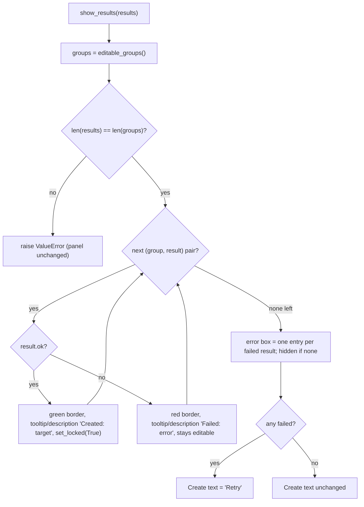

# S05 - New worktree panel shows run results and the retry state

- **Plan:** [plan.md](plan.md)
- **Type:** Slice
- **Requirements covered:** FR-11 (busy display), FR-15 (panel display), FR-16 (green groups locked, red groups editable, latest errors only), FR-03 (fresh state after `reset`)
- **Prerequisites:** `NewWorktreePanel` (with `create_requested`, `editable_groups()`, `groups()`, `reset()`, `add_button`, `create_button`, `CREATE_TEXT`, the private `_scroll`, `_refresh_create_enabled` and the root layout), `WorktreeGroup` (with `set_locked`, `is_locked`, `is_filled`, `request`, `source_input`, `parent_input`, `source_picker`, `parent_picker`, `remove_button`), `WorktreeResult` (with `request`, `target`, `error`, `ok`), `WorktreeRequest`
- **Creates:** `NewWorktreePanel.set_busy(busy)`, `NewWorktreePanel.show_results(results)`, `NewWorktreePanel.error_box`, `NewWorktreePanel.progress_bar`, `RETRY_TEXT`

## 1. Goal
The New worktree panel can display a run, so a partial failure can be fixed and
retried for the failed groups only.

When done:
- `set_busy(True)` disables the groups (inputs, pickers, '-'), '+' and Create/Retry,
  and shows an indeterminate progress bar. `set_busy(False)` restores them and hides
  the bar (FR-11).
- `show_results(results)` pairs `results[i]` with `editable_groups()[i]` as they are at
  call time (FR-15, FR-16):
  - a succeeded group gets a green border, is locked, and has tooltip and accessible
    description "Created: <target>";
  - a failed group gets a red border, stays editable, and has "Failed: <error>".
- A read-only multi-line error box between '+' and Create shows one entry per failed
  result of the latest call (`<source> → <target>: <error>`), and is hidden while
  empty.
- Create is relabeled "Retry" once a result list with a failure has been shown, and
  stays "Retry" until `reset()`.
- `reset()` also clears the busy state, the error box and the label, so the panel is
  fresh: one plain group, hidden empty error box, "Create" (FR-03).

Nothing calls these methods from the app in this step.

## 2. Context
- `src/devpipe/views/new_worktree_panel.py` holds `WorktreeGroup` and
  `NewWorktreePanel`. The panel's root `QVBoxLayout` holds, in order, the scroll area
  `_scroll` with the groups, `add_button` and `create_button`. `__init__` ends with
  `reset()`. Only `_refresh_create_enabled()` sets Create's enablement; other code may
  change Create's text and a group's style sheet, tooltip and accessible description.
  `set_locked` refreshes Create through the group's `changed` signal.
- Conventions (from `views/start_panel.py` and the panel module): module-level text
  and size constants, public widget attributes built in `__init__`, private helpers.
- Views may import `devpipe.models`; this step adds an import of `WorktreeResult` from
  `devpipe.models.worktree` only.
- Tests: pytest + pytest-qt (`qtbot`) in `tests/views/`, no `__init__.py`. Widgets are
  not shown, so visibility is checked with `isHidden()`, and enablement with
  `isEnabled()` (which is False for a child of a disabled widget).

## 3. Structure

### 3.1 Files
| File | Change | Responsibility |
|------|--------|----------------|
| `src/devpipe/views/new_worktree_panel.py` | modify | Busy state, result display on groups, error box, Retry label, extended `reset` |
| `tests/views/test_new_worktree_results.py` | new | Widget tests for busy, results, retry state and reset |

### 3.2 Views: `src/devpipe/views/new_worktree_panel.py`

Imports: add `QPlainTextEdit`, `QProgressBar` to the `PySide6.QtWidgets` import; change
the models import to `from devpipe.models.worktree import WorktreeRequest, WorktreeResult`.

New module-level constants (after the existing ones):

```python
RETRY_TEXT = "Retry"
CREATED_DESCRIPTION = "Created: {target}"
FAILED_DESCRIPTION = "Failed: {error}"
ERROR_ENTRY = "{source} \u2192 {target}: {error}"  # "→"
ERROR_BOX_ACCESSIBLE_NAME = "Worktree errors"
ERROR_BOX_MAX_HEIGHT = 120  # px; keeps the groups visible above it
PROGRESS_ACCESSIBLE_NAME = "Creating worktrees"
SUCCESS_BORDER_COLOR = "#2e7d32"  # green
FAILURE_BORDER_COLOR = "#c62828"  # red
RESULT_STYLE = (
    "QGroupBox {{ border: 2px solid {color}; border-radius: 4px;"
    " margin-top: 1.5ex; padding-top: 1ex; }}"
    " QGroupBox::title {{ subcontrol-origin: margin; left: 8px; padding: 0 3px; }}"
)
```

The `QGroupBox` selector only matches the group itself (its children are labels, line
edits and tool buttons), so the border does not leak into child widgets. The
`::title` rule keeps the title readable once a border is set by style sheet.

#### `NewWorktreePanel` changes

```python
class NewWorktreePanel(QWidget):
    # new public widgets
    error_box: QPlainTextEdit     # read-only, hidden while empty
    progress_bar: QProgressBar    # range 0-0 (indeterminate), hidden while not busy

    def set_busy(self, busy: bool) -> None: ...
    def show_results(self, results: list[WorktreeResult]) -> None: ...

    # private additions
    _busy: bool
    def _show_group_result(self, group: WorktreeGroup, result: WorktreeResult) -> None: ...
    def _show_errors(self, failed: list[WorktreeResult]) -> None: ...
```

Construction (`__init__`), changes only:
- `self._busy = False` is set before any widget is built (`_refresh_create_enabled`,
  reached from `reset()`, reads it).
- `error_box = QPlainTextEdit()`: `setReadOnly(True)`, `setAccessibleName(ERROR_BOX_ACCESSIBLE_NAME)`,
  `setMaximumHeight(ERROR_BOX_MAX_HEIGHT)`, hidden.
- `progress_bar = QProgressBar()`: `setRange(0, 0)`, `setTextVisible(False)`,
  `setAccessibleName(PROGRESS_ACCESSIBLE_NAME)`, hidden.
- Root layout order becomes: `_scroll` (stretch 1), `add_button`, `error_box`,
  `progress_bar`, `create_button`. The two widgets are added before `create_button`
  in the existing construction; nothing else in the layout changes.
- `__init__` still ends with `self.reset()`.

Methods:

- `set_busy(busy: bool) -> None`
  1. `self._busy = busy`.
  2. `self._scroll.setEnabled(not busy)`: disables every group with its inputs,
     pickers and '-' at once. A picker or '-' that a locked group disabled or hid
     keeps its own state when the scroll area is enabled again.
  3. `self.add_button.setEnabled(not busy)`.
  4. `self.progress_bar.setVisible(busy)`.
  5. `self._refresh_create_enabled()`.
  The error box is left as it is (read-only already; it stays readable during a run).
  Calling it twice with the same value is harmless.

- `_refresh_create_enabled()` (existing, modified): becomes
  `create_button.setEnabled(not self._busy and all(g.is_filled() for g in self.editable_groups()))`.
  It stays the only place that sets Create's enablement.

- `show_results(results: list[WorktreeResult]) -> None`
  1. `groups = self.editable_groups()` (captured once, at call time).
  2. If `len(results) != len(groups)`: raise
     `ValueError(f"expected {len(groups)} results, got {len(results)}")` before any
     change (programming error).
  3. For each `(group, result)` in `zip(groups, results)`: `_show_group_result(group, result)`.
  4. `failed = [r for r in results if not r.ok]`; `_show_errors(failed)`.
  5. If `failed`: `create_button.setText(RETRY_TEXT)`. Otherwise the text is left as it
     is (a panel that already shows "Retry" keeps it until `reset()`).
  The busy state is not changed by this method.

- `_show_group_result(group, result)`:
  - `result.ok`: `text = CREATED_DESCRIPTION.format(target=result.target)`,
    `color = SUCCESS_BORDER_COLOR`, then `group.set_locked(True)`.
  - else: `text = FAILED_DESCRIPTION.format(error=result.error)`,
    `color = FAILURE_BORDER_COLOR`; the lock state is not touched (the group is
    editable, since it came from `editable_groups()`).
  - Both: `group.setStyleSheet(RESULT_STYLE.format(color=color))`,
    `group.setToolTip(text)`, `group.setAccessibleDescription(text)`.

- `_show_errors(failed)`:
  `entries = [ERROR_ENTRY.format(source=r.request.source, target=r.target, error=r.error) for r in failed]`;
  `error_box.setPlainText("\n".join(entries))`; `error_box.setVisible(bool(entries))`.
  The whole text is replaced, so only the latest call's errors are shown.

- `reset()` (existing, extended): after the existing group rebuild (which deletes
  every group, with its border, tooltip and description, and adds one plain unlocked
  group), add:
  1. `self._show_errors([])` (empty and hidden error box).
  2. `self.create_button.setText(CREATE_TEXT)`.
  3. `self.set_busy(False)` (enables the scroll area and '+', hides the progress bar,
     recomputes Create).

`WorktreeGroup` is not changed. A group added with '+' after a result display has no
style sheet, tooltip or description (pending, default style).

## 4. Logic flows



Results are paired by index with the groups that were editable when the call
started, so locking a green group during the loop does not shift the pairing. The
error box always reflects only this call.

```mermaid
stateDiagram-v2
  [*] --> Fresh: NewWorktreePanel() / reset()
  Fresh --> Busy: set_busy(True)
  Busy --> Fresh: set_busy(False), no results shown yet
  Busy --> Busy: show_results(results) (results applied, still busy)
  Busy --> Shown: set_busy(False) after show_results while busy or before
  Fresh --> Shown: show_results(results)
  Shown --> Busy: set_busy(True)
  Shown --> Shown: show_results(results)
  Shown --> Fresh: reset()
  Busy --> Fresh: reset()
  Fresh: label 'Create', error box hidden, groups plain
  Busy: scroll area, '+' and Create disabled, progress bar shown
  Shown: groups green (locked) or red; label 'Retry' once any failure was shown
```



The panel's display state only goes back to fresh through `reset()`. `set_busy` is
independent of the shown results: it only toggles enablement and the progress bar.

## 5. Edge cases and errors
| Case | Expected behavior |
|------|-------------------|
| `len(results)` differs from `len(editable_groups())` | `ValueError`; no group, error box or label changes |
| `show_results([])` with no editable groups | Nothing changes on groups; error box empty and hidden; label unchanged |
| All results ok on a fresh panel | Groups green and locked; error box hidden; label stays "Create" |
| A failure, then a later call with only ok results | Previously red groups now green and locked; error box empty and hidden; label stays "Retry" |
| A later call with a different failure | Error box shows only the new failure's entry |
| A red group is edited before the next call | It keeps its red border and "Failed" text until the next `show_results` |
| A group added with '+' after results | Default style, no tooltip or description; it is editable and is paired with the next call's results by position |
| Green groups before editable ones (retry state) | Pairing skips locked groups; green groups keep their border and text |
| Error message with several lines (git stderr) | The entry spans those lines; the tooltip shows the full text |
| `set_busy(True)` with all groups filled | Create disabled; clicking it emits nothing |
| `set_busy(False)` with a locked group | Its inputs stay read-only, pickers disabled, '-' hidden |
| `set_busy(False)` with an empty editable group | Create stays disabled |
| `reset()` while busy | Not busy: scroll area and '+' enabled, progress bar hidden |
| `reset()` after a failure | One plain "Worktree 1", empty hidden error box, label "Create", Create disabled |
| Colors not visible to the user | The group's tooltip and accessible description carry the result as text |

## 6. Tests

### 6.1 Automated
File: `tests/views/test_new_worktree_results.py`. Helpers:
- `make_panel(qtbot) -> NewWorktreePanel` (builds it, `qtbot.addWidget`).
- `fill(group, source, parent="C:/wt")`: `setText` on both inputs.
- `ok(group) -> WorktreeResult`: `WorktreeResult(group.request(), Path(group.parent_input.text()) / "feat-x", None)`.
- `failed(group, error="boom") -> WorktreeResult`: same with `error`.
- `make_panel_with(qtbot, n)`: panel with `n` groups (click `add_button` `n - 1` times),
  group `i` filled with source `f"C:/src{i}"`.

Border checks compare `group.styleSheet()` with
`RESULT_STYLE.format(color=SUCCESS_BORDER_COLOR | FAILURE_BORDER_COLOR)`; "plain" means
`styleSheet() == ""`, `toolTip() == ""` and `accessibleDescription() == ""`.

| Test file | Test name | Given / When / Then | Proves |
|-----------|-----------|---------------------|--------|
| `tests/views/test_new_worktree_results.py` | `test_fresh_panel_has_hidden_error_box_and_progress` | Given a new panel / then `error_box.isHidden()`, `error_box.isReadOnly()`, `error_box.toPlainText() == ""`, `progress_bar.isHidden()`, `progress_bar.minimum() == progress_bar.maximum() == 0`, `error_box.accessibleName() == "Worktree errors"`, `progress_bar.accessibleName() == "Creating worktrees"`, group 1 plain, `create_button.text() == "Create"` | FR-03, UI/UX busy indicator |
| `tests/views/test_new_worktree_results.py` | `test_layout_order_add_error_progress_create` | Then the root layout's widgets are, in order, the scroll area, `add_button`, `error_box`, `progress_bar`, `create_button` | Panel layout (error box at the bottom) |
| `tests/views/test_new_worktree_results.py` | `test_set_busy_disables_panel_and_shows_progress` | Given two filled groups (Create enabled) / when `set_busy(True)` / then both groups' inputs, pickers and group 2's `remove_button` are not `isEnabled()`, `add_button` and `create_button` disabled, `not progress_bar.isHidden()`; clicking Create inside `qtbot.assertNotEmitted(panel.create_requested)` emits nothing | FR-11 |
| `tests/views/test_new_worktree_results.py` | `test_set_busy_false_restores_panel` | Given the panel above busy / when `set_busy(False)` / then inputs, pickers, '-', '+' and Create enabled, progress bar hidden | FR-11 |
| `tests/views/test_new_worktree_results.py` | `test_set_busy_false_keeps_locked_group_locked` | Given group 1 locked, group 2 filled, busy / when `set_busy(False)` / then group 1 inputs read-only and pickers disabled, group 2 pickers enabled | FR-16 with busy |
| `tests/views/test_new_worktree_results.py` | `test_set_busy_false_keeps_create_disabled_when_unfilled` | Given one empty group, busy / when `set_busy(False)` / then Create disabled | Enablement rule kept |
| `tests/views/test_new_worktree_results.py` | `test_partial_failure_shows_green_red_and_retry` | Given two filled groups / when `show_results([ok(g1), failed(g2, "not a git repository")])` / then g1 has the green style, `is_locked()`, tooltip == accessible description == `f"Created: {r1.target}"`, `remove_button.isHidden()`; g2 has the red style, not locked, tooltip == description == "Failed: not a git repository", `not remove_button.isHidden()`; `error_box.toPlainText() == f"C:/src2 → {r2.target}: not a git repository"`, error box shown; `create_button.text() == "Retry"` | FR-15, FR-16, AC "group 2 of 2 fails" (panel side) |
| `tests/views/test_new_worktree_results.py` | `test_retry_success_clears_errors` | Given the partial failure above / when g2's source is changed and `show_results([ok(g2)])` / then both groups green and locked, `error_box.toPlainText() == ""` and hidden, label still "Retry" | FR-16 (latest result), errors of latest run only |
| `tests/views/test_new_worktree_results.py` | `test_new_failure_replaces_error_list` | Given the partial failure above / when `show_results([failed(g2, "other")])` / then the error box text is exactly the one entry ending in ": other" and g2's tooltip is "Failed: other" | FR-16 (latest errors only) |
| `tests/views/test_new_worktree_results.py` | `test_results_pair_with_editable_groups_only` | Given three groups where g1 is green from an earlier `show_results([ok(g1), failed(g2), failed(g3)])` / when `show_results([ok(g2), failed(g3, "x")])` / then g1 keeps the green style and its "Created" text, g2 becomes green and locked, g3 red with "Failed: x" | Pairing by `editable_groups()`, FR-16 |
| `tests/views/test_new_worktree_results.py` | `test_group_added_after_results_is_plain_and_paired_next` | Given a partial failure on two groups / when '+' is clicked / then group 3 is plain and editable; when `show_results([ok(g2), failed(g3)])` / then g3 has the red style | FR-16 ('+' in retry state) |
| `tests/views/test_new_worktree_results.py` | `test_edited_red_group_stays_red_until_next_results` | Given a partial failure / when g2's source text is changed / then g2 keeps the red style and "Failed" tooltip | Border reflects latest result |
| `tests/views/test_new_worktree_results.py` | `test_all_ok_keeps_create_label` | Given two filled groups / when `show_results([ok(g1), ok(g2)])` / then both green and locked, error box hidden, label "Create", Create enabled (no editable group) | FR-15 only on failure, FR-17 enablement |
| `tests/views/test_new_worktree_results.py` | `test_show_results_length_mismatch_raises` (parametrized: 1 and 3 results for 2 groups) | Then `ValueError`, both groups plain and unlocked, error box hidden, label "Create" | Precondition |
| `tests/views/test_new_worktree_results.py` | `test_show_empty_results_with_no_editable_groups` | Given every group locked / when `show_results([])` / then nothing raises, groups unchanged, error box hidden | Edge case |
| `tests/views/test_new_worktree_results.py` | `test_show_results_does_not_change_busy` | Given busy / when `show_results([failed(g1)])` / then the progress bar is still shown and Create still disabled | Independence of busy and results |
| `tests/views/test_new_worktree_results.py` | `test_reset_after_failure_is_fresh` | Given a partial failure on two groups / when `reset()` / then one plain unlocked group "Worktree 1", error box empty and hidden, label "Create", Create disabled | FR-03 |
| `tests/views/test_new_worktree_results.py` | `test_reset_while_busy_clears_busy` | Given `set_busy(True)` / when `reset()` / then progress bar hidden, '+' enabled, group inputs enabled | FR-03 |

Run with: `uv run pytest tests/views/test_new_worktree_results.py`.
Regression: `uv run pytest` (whole suite, including the existing panel tests) passes.

### 6.2 Manual
Scratch script in the scratchpad (not the repo), run with `uv run python <script>`:

```python
from pathlib import Path
from PySide6.QtWidgets import QApplication
from devpipe.models.worktree import WorktreeResult
from devpipe.views.new_worktree_panel import NewWorktreePanel

app = QApplication([])
panel = NewWorktreePanel()
panel.add_button.click()
g1, g2 = panel.groups()
g1.source_input.setText("C:/a"); g1.parent_input.setText("C:/wt")
g2.source_input.setText("C:/b"); g2.parent_input.setText("C:/wt")
panel.show_results([
    WorktreeResult(g1.request(), Path("C:/wt/feat-x"), None),
    WorktreeResult(g2.request(), Path("C:/wt/feat-x"), "not a git repository"),
])
panel.show()
app.exec()
```

- Given the script runs, then group 1 has a green border and group 2 a red border, the
  error box at the bottom reads `C:\b → C:\wt\feat-x: not a git repository`, and the
  button reads "Retry". (FR-15)
- Given group 1, then its inputs cannot be edited, its pickers are disabled and it has
  no '-'; hovering it shows "Created: C:\wt\feat-x". Hovering group 2 shows
  "Failed: not a git repository". (FR-16, accessibility)
- Given the script changed to call `panel.set_busy(True)` before `show()`, then every
  control is greyed out and an indeterminate progress bar moves above the button.
  (FR-11)
- Group titles stay readable with the colored borders, in both a light and a dark
  Windows theme.

### 6.3 Static checks
- `rg -n "RETRY_TEXT = \"Retry\"" src/devpipe/views/new_worktree_panel.py` → one match.
- `rg -n "devpipe\.(services|persistence|infrastructure)" src/devpipe/views/new_worktree_panel.py` → no matches.
- `rg -n "create_button\.setEnabled" src/devpipe/views/new_worktree_panel.py` → exactly one match, inside `_refresh_create_enabled`.
- `uv run lint-imports` → all contracts KEPT.
- `git diff --stat -- ai-skills` → empty.

## 7. Implementation order
1. Add the constants and imports; build `error_box` and `progress_bar` and insert them
   in the root layout before `create_button`; initialize `_busy`. Run the existing
   panel tests.
2. Add `set_busy` and the `_busy` term in `_refresh_create_enabled`.
3. Add `_show_group_result`, `_show_errors` and `show_results`.
4. Extend `reset()`.
5. Add `tests/views/test_new_worktree_results.py`; run it, then `uv run pytest` and
   `uv run lint-imports`, then the manual checks.

## 8. Out of scope
- No run, thread, service call, state file write or navigation: the panel only
  displays what it is given.
- `WorktreeGroup` is not changed, and the group editing behavior ('+', '-',
  numbering, pickers, the Create enablement rule other than the busy term, the
  `create_requested` contents) stays as it is.
- The panel is not added to any tab or window; no other view, `app.py`, docs or
  existing test file changes.
- No persistence of the panel's contents or results (spec non-goal).
- `ai-skills/` is not touched.

## 9. Design notes
- **Busy by disabling the scroll area, '+' and Create** rather than `self.setEnabled(False)`:
  disabling the whole widget would also grey out the progress bar and the error box.
  Qt keeps each child's own enabled flag, so locked groups' pickers stay disabled
  after the busy state ends without extra bookkeeping.
- **Single source for Create's enablement:** the busy flag is a term in the existing
  `_refresh_create_enabled`, so no other code toggles Create and a group change during
  a run cannot re-enable it.
- **Pairing captured once:** `editable_groups()` is read before any group is locked,
  so locking green groups inside the loop does not shift the index pairing.
- **"Retry" is sticky until `reset()`:** the plan's rule is "once a result list with a
  failure is shown"; reverting to "Create" after an all-ok retry would only be visible
  in a state the panel normally leaves, and keeping it avoids a second rule.
- **Result display in panel methods, not on `WorktreeGroup`:** it uses only the
  group's settable surface (style sheet, tooltip, accessible description,
  `set_locked`), so the group class stays unchanged.
- **Not color alone:** every result is also given as tooltip and accessible
  description text, and the error box names source and target (accessibility).
- **Colors and style as constants:** one `RESULT_STYLE` template with two color
  constants (DRY); the `::title` rule is needed because a style-sheet border on a
  `QGroupBox` otherwise draws over the title.
- **Rejected:** a `ResultState` enum on groups (YAGNI: the result itself carries the
  state, and the display is a pure function of it); validating that results match the
  groups' requests (the index contract is enough, only the length is checked).
