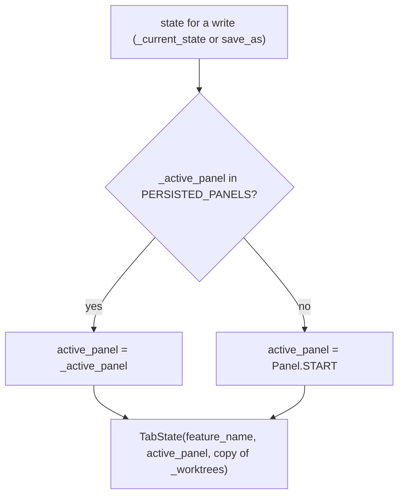

# S06 - "Create new worktree" button opens the New worktree panel

- **Plan:** [plan.md](plan.md)
- **Type:** Slice
- **Requirements covered:** FR-01, FR-02, FR-03, FR-20 (tab side); AC "Given an unsaved tab, when the start panel is shown, then "Create new worktree" is disabled."; AC "Given the start panel, then "Create new worktree" has the same minimum size and font size as "Open a pipeline" and sits centered above it."; AC "Given a saved tab, when the user clicks "Create new worktree", then the New worktree panel shows exactly one empty group with no '-' button, and Create is disabled."; AC "Given the New worktree panel is open, when the app restarts, then the restored tab shows the start panel."
- **Prerequisites:** `Panel.NEW_WORKTREE`, `PERSISTED_PANELS`, `TabState.worktrees`, `PipelineTab._worktrees` (in `src/devpipe/models/tab_state.py` / `src/devpipe/views/pipeline_tab.py`); `NewWorktreePanel`, `NewWorktreePanel.reset()`, `NewWorktreePanel.groups()`, `NewWorktreePanel.add_button`, `NewWorktreePanel.create_button`, `WorktreeGroup` (`source_input`, `parent_input`, `remove_button`) (in `src/devpipe/views/new_worktree_panel.py`)
- **Creates:** `StartPanel.new_worktree_button`, `NEW_WORKTREE_TEXT`, `StartPanel.new_worktree_requested`, `PipelineTab.new_worktree_panel`, `PipelineTab.open_new_worktree_panel()`, the persisted-panel mapping in `PipelineTab._current_state()`

## 1. Goal
A saved tab can open the New worktree panel from its start panel, and the panel is
never persisted as the active panel.

When done:
- The start panel's centered big-button column holds, top to bottom, "Create new
  worktree", "Open a pipeline", "Create a pipeline". The new button is built with
  `_big_button` (same minimum size and font size as the others) (FR-01).
- The new button is disabled until `show_saved` is called, exactly like the other two
  big buttons (FR-02).
- Clicking it shows the tab's `NewWorktreePanel` in the tab's `QStackedWidget`, freshly
  reset: one empty unlocked group "Worktree 1", no '-', Create disabled. This holds
  every time it is opened, also after the panel was edited (FR-03).
- Opening the panel on a saved tab writes the state file (the existing auto-save of
  `show_panel`), and that write, like every write while the panel is shown, records
  `"active_panel": "start"` and the tab's worktree list unchanged. A restarted app
  therefore restores the tab on the start panel (FR-20).
- The panel cannot be left from the UI in this step (no Back/Cancel, FR-18); Create on
  the panel has no effect in the app yet.

## 2. Context
- `src/devpipe/views/start_panel.py`: `StartPanel` builds `open_button` and
  `create_button` with the static `_big_button(text)` helper, both disabled at
  construction and enabled in `show_saved`. They sit in a local `buttons`
  `QVBoxLayout` (`AlignCenter`, spacing `BIG_BUTTON_SPACING`) added to the root
  layout with stretch 1. UI texts are module constants (`OPEN_TEXT`, `CREATE_TEXT`).
  The root layout may also hold a worktrees label and list below the big-button
  column; this step does not touch them.
- `src/devpipe/views/pipeline_tab.py`: `PipelineTab` holds `stack`
  (`QStackedWidget`), `start_panel`, and `_panels: dict[Panel, QWidget]`, the single
  map from panel id to widget. `show_panel(panel)` calls `_display(panel)` then, when
  saved, `_write(path, _current_state())` (warning "Cannot save state file" on
  failure). `save_as` writes a first-save `TabState(feature_name, self._active_panel,
  list(self._worktrees))` and calls `apply_saved`, which displays
  `state.active_panel`. `_current_state()` returns
  `TabState(self._feature_name, self._active_panel, list(self._worktrees))`.
- `TabStateRepository.save` raises `ValueError` for an `active_panel` outside
  `PERSISTED_PANELS`, so the tab must never pass `Panel.NEW_WORKTREE` to a write.
- `NewWorktreePanel()` takes no arguments and is already reset after construction.
- Signal-to-slot style: lambdas that drop Qt's `checked` argument
  (`main_window.py`: `clicked.connect(lambda: self.add_new_tab())`).
- Tests: pytest + pytest-qt under `tests/views/`; `make_panel` / `make_tab` helpers,
  `tab_states`, `make_window` and `warnings` fixtures; widgets are not shown, so
  visibility uses `isHidden()`. Run with `uv run pytest`.

## 3. Structure

### 3.1 Files
| File | Change | Responsibility |
|------|--------|----------------|
| `src/devpipe/views/start_panel.py` | modify | Big-button column only: new first button, its constant, signal, enablement in `show_saved` |
| `src/devpipe/views/pipeline_tab.py` | modify | Build and register the panel, connect the start panel's signal, `open_new_worktree_panel`, persisted-panel mapping for writes |
| `tests/views/test_start_panel.py` | modify | Button text, enablement, format, position, signal |
| `tests/views/test_pipeline_tab.py` | modify | Stack content, opening the panel fresh, file still says `"start"` |
| `tests/views/test_session_restore.py` | modify | Restart with the panel open restores the start panel |

### 3.2 Views: `src/devpipe/views/start_panel.py`

Module docstring: the first line stays; the second paragraph becomes:
`"Create new worktree" asks the tab to open the New worktree panel. What "Open a pipeline" and "Create a pipeline" do is not decided yet.`

New constant, next to `OPEN_TEXT`:

```python
NEW_WORKTREE_TEXT = "Create new worktree"
```

`StartPanel` changes (nothing else in the class changes):

```python
class StartPanel(QWidget):
    save_requested = Signal(str)  # emitted with the current slug when Save is clicked
    new_worktree_requested = Signal()  # emitted when "Create new worktree" is clicked

    def __init__(self) -> None:
        ...
        self.new_worktree_button = self._big_button(NEW_WORKTREE_TEXT)  # before open_button
        self.open_button = self._big_button(OPEN_TEXT)
        self.create_button = self._big_button(CREATE_TEXT)
        self.new_worktree_button.setEnabled(False)
        self.open_button.setEnabled(False)
        self.create_button.setEnabled(False)
        ...
        buttons.addWidget(self.new_worktree_button)  # first in the column
        buttons.addWidget(self.open_button)
        buttons.addWidget(self.create_button)
        ...
        self.new_worktree_button.clicked.connect(
            lambda: self.new_worktree_requested.emit()  # drop the `checked` argument
        )

    def show_saved(self, feature_name: str) -> None:
        """Switch to saved mode (one-way): name fixed, the big buttons enabled."""
        ...
        self.new_worktree_button.setEnabled(True)
        self.open_button.setEnabled(True)
        self.create_button.setEnabled(True)
```

- `new_worktree_button`: public `QPushButton` attribute; same minimum size
  (`BIG_BUTTON_MIN_WIDTH` x `BIG_BUTTON_MIN_HEIGHT`) and point size
  (`BIG_BUTTON_POINT_SIZE`) as the other big buttons, because it comes from the same
  `_big_button` helper. Centering and spacing come from the existing `buttons` layout.
- The `buttons` layout itself, its alignment, spacing and stretch, and every widget or
  method outside the big-button column are unchanged.
- A disabled button emits nothing (Qt does not emit `clicked` for disabled buttons).

### 3.3 Views: `src/devpipe/views/pipeline_tab.py`

Module docstring second line becomes:
`New panels are added to `stack` and `_panels`; the start panel is always the first one. Only panels in PERSISTED_PANELS are written as `active_panel`.`

Imports: add `PERSISTED_PANELS` to the `devpipe.models.tab_state` import; add
`from devpipe.views.new_worktree_panel import NewWorktreePanel`.

`__init__` (after `self.start_panel` is added to the stack):

```python
self.new_worktree_panel = NewWorktreePanel()
self.stack.addWidget(self.new_worktree_panel)
self.stack.setCurrentWidget(self.start_panel)
# The single map from panel id to panel widget.
self._panels: dict[Panel, QWidget] = {
    Panel.START: self.start_panel,
    Panel.NEW_WORKTREE: self.new_worktree_panel,
}
...
self.start_panel.new_worktree_requested.connect(self.open_new_worktree_panel)
```

- Stack order: index 0 `start_panel`, index 1 `new_worktree_panel`; the start panel
  stays current at construction.

New public method:

```python
def open_new_worktree_panel(self) -> None:
    """Show the New worktree panel, fresh (one empty group).

    Uses show_panel, so a saved tab auto-saves; the file keeps active_panel "start".
    """
    self.new_worktree_panel.reset()
    self.show_panel(Panel.NEW_WORKTREE)
```

- No guard on the saved state: the start panel's button is enabled only once saved;
  called on an unsaved tab, it only displays the panel and writes nothing (same as
  `show_panel` today).

New private helper (one source of truth for the panel written to the file):

```python
def _persisted_panel(self) -> Panel:
    """The panel to write as active_panel: the shown one, or START when it is not persisted."""
    return self._active_panel if self._active_panel in PERSISTED_PANELS else Panel.START
```

Changes to existing methods:
- `_current_state()`: returns
  `TabState(self._feature_name, self._persisted_panel(), list(self._worktrees))`.
- `save_as(path, feature_name)`: the first-save state becomes
  `TabState(feature_name, self._persisted_panel(), list(self._worktrees))`, so a first
  save can never pass a non-persisted panel to the repository.
- `show_panel`, `apply_saved`, `_display`, `_write`, `title`, `tooltip`,
  `state_path` are unchanged. `active_panel` keeps returning the panel actually shown
  (`Panel.NEW_WORKTREE` while the panel is open); only what is written is mapped.

## 4. Logic flows

```mermaid
sequenceDiagram
  participant U as User
  participant SP as StartPanel
  participant T as PipelineTab
  participant P as NewWorktreePanel
  participant S as TabStateService
  U->>SP: click "Create new worktree" (enabled: tab saved)
  SP->>T: new_worktree_requested
  T->>P: reset()
  Note over P: one empty unlocked group, Create disabled
  T->>T: show_panel(NEW_WORKTREE)
  T->>T: _display: stack shows the panel, _active_panel = NEW_WORKTREE
  T->>T: _current_state(): active_panel = START (not persisted), worktrees copied
  T->>S: save(path, state)
  alt write ok
    S-->>T: file v2, "active_panel": "start"
  else TabStateError
    T->>U: warning "Cannot save state file"; panel stays shown
  end
```

The panel is reset before it is shown, so it always opens fresh. The write that
follows is the normal auto-save, but the active panel is mapped to `START` before it
reaches the repository.



Every write goes through `_persisted_panel()`, so `Panel.NEW_WORKTREE` never reaches
the file, and a restored tab always lands on the start panel.

## 5. Edge cases and errors
| Case | Expected behavior |
|------|-------------------|
| Unsaved tab | "Create new worktree" disabled; clicking it does nothing |
| Saved tab, button clicked | Panel shown with one empty group, no '-', Create disabled; file has `"active_panel": "start"` |
| Panel edited (groups added, inputs filled), start panel shown again, button clicked | Panel is fresh again: one empty group |
| Button clicked while the panel is already reset | Same result (reset is idempotent) |
| Saved tab with worktrees, panel opened | File keeps the same `worktrees` list and `"active_panel": "start"` |
| State file write fails when opening the panel | Existing warning "Cannot save state file"; the panel is still shown; the tab stays saved and the next write retries |
| `open_new_worktree_panel()` on an unsaved tab (not reachable from the UI) | Panel shown, no file written, no warning |
| `save_as` while the panel is shown (not reachable from the UI) | File written with `"active_panel": "start"`; no `ValueError`; `apply_saved` then shows the start panel |
| App closed while the panel is open, restarted | Restored tab shows the start panel (its file says `"start"`) |
| `tab.active_panel` while the panel is open | `Panel.NEW_WORKTREE` (what is shown); only the written value is mapped |

## 6. Tests

### 6.1 Automated
Helpers already present: `make_panel(qtbot)` in `test_start_panel.py`;
`make_tab(qtbot, tab_states)`, `EXPECTED_FILE` (v2, `"worktrees": []`), `read_json`,
`warnings` in `test_pipeline_tab.py`. New helper in `test_start_panel.py`:

```python
def big_button_column(panel) -> QVBoxLayout:
    """The child layout of the panel's root layout that holds open_button."""
```

It iterates `panel.layout()` items, returns the item's `layout()` whose
`indexOf(panel.open_button) >= 0`, and fails the test if none is found.

| Test file | Test name | Given / When / Then | Proves |
|-----------|-----------|---------------------|--------|
| `tests/views/test_start_panel.py` | `test_new_panel_is_unsaved_and_empty` (extend) | Also `not panel.new_worktree_button.isEnabled()` and `panel.new_worktree_button.text() == "Create new worktree"` | FR-02, AC unsaved |
| same | `test_typing_a_name_previews_slug_and_enables_only_save` (extend) | Also `not panel.new_worktree_button.isEnabled()` | FR-02 |
| same | `test_show_saved_switches_to_saved_mode` (extend) | Also `panel.new_worktree_button.isEnabled()` | FR-02 |
| same | `test_saved_mode_keeps_save_disabled` (extend) | Also `panel.new_worktree_button.isEnabled()` after the second `show_saved` | FR-02 |
| same | `test_new_worktree_button_matches_open_button_format` | Given a panel / then `new_worktree_button.minimumSize() == open_button.minimumSize() == QSize(BIG_BUTTON_MIN_WIDTH, BIG_BUTTON_MIN_HEIGHT)` and `new_worktree_button.font().pointSize() == open_button.font().pointSize() == BIG_BUTTON_POINT_SIZE` | FR-01, AC format |
| same | `test_new_worktree_button_is_first_in_centered_column` | Given a panel / when `column = big_button_column(panel)` / then `column.indexOf(new_worktree_button) == 0`, `indexOf(open_button) == 1`, `indexOf(create_button) == 2`, `column.alignment() == Qt.AlignmentFlag.AlignCenter`, `column.spacing() == BIG_BUTTON_SPACING` | FR-01, AC "centered above it" |
| same | `test_new_worktree_click_emits_signal` | Given `show_saved("x")` / when `new_worktree_button` is clicked (`qtbot.mouseClick`) inside `qtbot.waitSignal(panel.new_worktree_requested)` / then the signal was emitted with no arguments (`blocker.args == []`) | Signal contract |
| same | `test_disabled_new_worktree_button_emits_nothing` | Given an unsaved panel / when the button is clicked inside `qtbot.assertNotEmitted(panel.new_worktree_requested)` / then nothing is emitted | FR-02 |
| `tests/views/test_pipeline_tab.py` | `test_tab_shows_start_panel_in_a_stack` (update) | Then `stack.count() == 2`, `stack.widget(0) is tab.start_panel`, `stack.widget(1) is tab.new_worktree_panel`, `isinstance(tab.new_worktree_panel, NewWorktreePanel)`, current widget is the start panel, `tab.active_panel is Panel.START` | Panel registered |
| same | `test_new_tab_start_panel_is_unsaved` (extend) | Also `not panel.new_worktree_button.isEnabled()` | FR-02 |
| same | `test_apply_saved_switches_to_saved_mode_without_writing` (extend) | Also `panel.new_worktree_button.isEnabled()` | FR-02 |
| same | `test_clicking_new_worktree_opens_fresh_panel` | Given `apply_saved(path, TabState("x"))` / when `start_panel.new_worktree_button` is clicked (`qtbot.mouseClick`) / then `stack.currentWidget() is tab.new_worktree_panel`, `active_panel is Panel.NEW_WORKTREE`, `len(new_worktree_panel.groups()) == 1`, that group's `source_input` and `parent_input` are empty and `remove_button.isHidden()`, `not new_worktree_panel.create_button.isEnabled()`, and `read_json(path) == EXPECTED_FILE` | FR-03, FR-20, AC "one empty group with no '-', Create disabled" |
| same | `test_reopening_new_worktree_panel_is_fresh` | Given a saved tab with the panel open, '+' clicked once and group 1's `source_input` set to `"C:/src"` / when `show_panel(Panel.START)` and then the button is clicked again / then the panel has one group with empty inputs | FR-03 |
| same | `test_open_new_worktree_panel_resets_panel` | Given a saved tab and the panel with two groups (via `add_button`) / when `tab.open_new_worktree_panel()` is called directly / then one group and the panel is the current widget | `open_new_worktree_panel` contract |
| same | `test_new_worktree_panel_is_never_written_as_active` | Given `apply_saved(path, TabState("x", Panel.START, [a]))` with `a = tmp_path / "wt" / "a"` / when `show_panel(Panel.NEW_WORKTREE)` / then `read_json(path) == {**EXPECTED_FILE, "worktrees": [str(a)]}`; when `show_panel(Panel.START)` / then the same content | FR-20, worktrees kept |
| same | `test_open_panel_on_unsaved_tab_writes_nothing` | Given an unsaved tab / when `open_new_worktree_panel()` / then the panel is current, `list(tmp_path.iterdir()) == []`, `warnings == []` | Edge case |
| same | `test_save_as_while_panel_shown_writes_start` | Given an unsaved tab with `open_new_worktree_panel()` called / when `save_as(path, "x")` / then it returns True, `read_json(path) == EXPECTED_FILE` and `stack.currentWidget() is tab.start_panel` | Mapping in the first save (no `ValueError`) |
| same | `test_open_panel_write_failure_warns_and_shows_panel` | Given `save_as(folder / "x.json", "x")` then `shutil.rmtree(folder)` / when the button is clicked / then one warning titled "Cannot save state file", the panel is current, `tab.state_path` unchanged; when the folder is recreated and `show_panel(Panel.START)` is called / then `read_json(path) == EXPECTED_FILE` | Edge case, write failure |
| `tests/views/test_session_restore.py` | `test_restart_with_new_worktree_panel_open_restores_start_panel` | Given `a, _ = files` (the existing `files` fixture, so the state file `a` exists before any window is built), `window = make_window()`, `tab = window.add_saved_tab(a, TabState("a"))` and `tab.open_new_worktree_panel()` called (the tab shows the panel) / when `window.close()` and `restarted = make_window()` / then `json.loads(a.read_text("utf-8"))["active_panel"] == "start"`, `restarted.tabs.count() == 1`, and for `restored = restarted.tabs.widget(0)`: `restored.state_path == a`, `restored.active_panel is Panel.START`, `restored.stack.currentWidget() is restored.start_panel`, and `restored.start_panel.new_worktree_button.isEnabled()` | FR-20, AC restart |

Test doubles: none new. Imports to add: `QSize`, `QVBoxLayout` and the
`BIG_BUTTON_*` constants in `test_start_panel.py`; `NewWorktreePanel` in
`test_pipeline_tab.py`. `Qt` is already imported in `test_start_panel.py`; add
`from PySide6.QtCore import Qt` to `test_pipeline_tab.py`.

Run with: `uv run pytest tests/views`, then the whole suite `uv run pytest`.

### 6.2 Manual
- Given `uv run devpipe` with a new tab, then "Create new worktree" is the top big
  button, centered above "Open a pipeline", same size and font, and disabled. (FR-01,
  FR-02)
- Given the tab is saved (enter a name, Save, pick a file), when "Create new worktree"
  is clicked, then the New worktree panel shows one group "Worktree 1" with no '-' and
  a disabled Create; the state file on disk contains `"active_panel": "start"`. (FR-03,
  FR-20)
- Given the panel is open, when the app is closed and started again, then the tab
  shows the start panel with the name fixed and the big buttons enabled. (FR-20, AC
  restart)

### 6.3 Static checks
- `rg -n "NEW_WORKTREE_TEXT = \"Create new worktree\"" src/devpipe/views/start_panel.py` → one match.
- `rg -n "PERSISTED_PANELS" src/devpipe/views/pipeline_tab.py` → the import and the use in `_persisted_panel`.
- `uv run lint-imports` → all contracts KEPT (views import only views, services, models).
- `git diff --stat -- ai-skills src/devpipe/views/new_worktree_panel.py` → empty.

## 7. Implementation order
1. `start_panel.py`: `NEW_WORKTREE_TEXT`, `new_worktree_button` (first in the column,
   disabled), `new_worktree_requested`, enable in `show_saved`; extend and add the
   start panel tests. Run `uv run pytest tests/views/test_start_panel.py`.
2. `pipeline_tab.py`: `_persisted_panel()` and its use in `_current_state()` and
   `save_as` (no behavior change yet, only `START` is shown).
3. `pipeline_tab.py`: build `new_worktree_panel`, add it to `stack` and `_panels`,
   `open_new_worktree_panel()`, connect the start panel signal; update and add the
   pipeline tab tests.
4. Add the session restore test; run `uv run pytest` and `uv run lint-imports`.

## 8. Out of scope
- No change to `new_worktree_panel.py` (its groups, Create enablement, signals and
  layout are used as they are); `create_requested` is not connected to anything.
- No way back from the panel to the start panel in the UI, and no Back/Cancel button.
- No change to the start panel outside the big-button column (the name row, the slug
  label and any worktree list below the column stay as they are).
- No behavior for "Open a pipeline" / "Create a pipeline".
- No change to `main_window.py`, `app.py`, models, persistence, services,
  `pyproject.toml`, `docs/architecture.md` or `ai-skills/`.
- No persistence of the panel's contents (feature non-goal).

## 9. Design notes
- **One mapping point:** `_persisted_panel()` is the only place that decides which
  panel id is written, used by both `_current_state()` and `save_as` (DRY). It is
  driven by `PERSISTED_PANELS`, so a panel that becomes persisted later needs no tab
  change (Open/Closed).
- **Shown vs written:** `active_panel` keeps reporting the panel actually shown; only
  the written value is mapped. Reporting `START` while the panel is visible would lie
  to callers.
- **Reset before show:** `open_new_worktree_panel` resets first, so the fresh state is
  in place before the stack switches and before the write; the panel's own `reset()`
  is the single definition of "fresh" (no duplicated clearing in the tab).
- **The tab connects the start panel's signal itself:** opening a panel is tab-internal
  navigation, so `main_window.py` needs no change, unlike `save_requested`, which needs
  the window's file dialog.
- **Rejected:** a guard in `open_new_worktree_panel` for unsaved tabs. The UI already
  disables the button, and `show_panel` already handles the unsaved case by writing
  nothing (YAGNI).
- **Trade-off:** opening the panel causes a state file write whose content is the same
  as before; this keeps the single `show_panel` path for every panel switch instead of
  adding a "display without write" variant.
