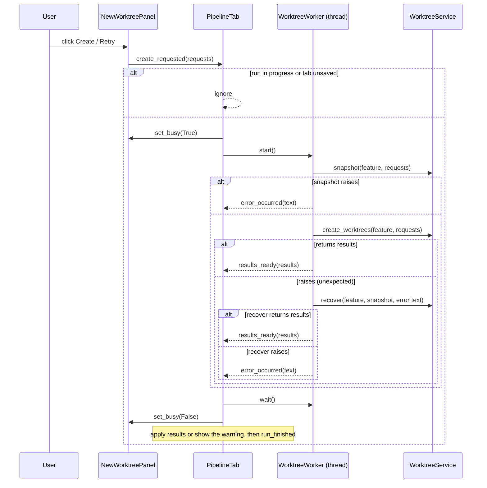
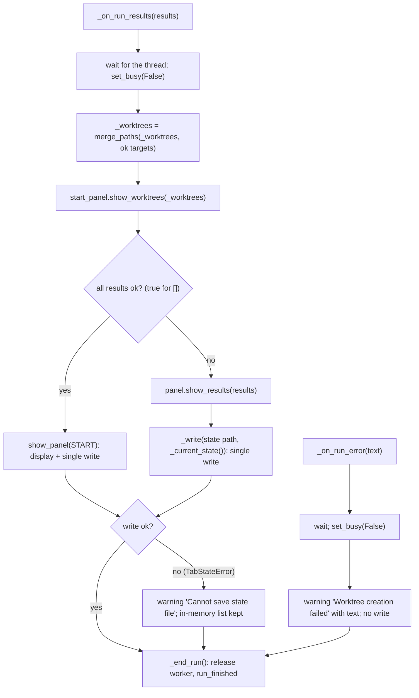
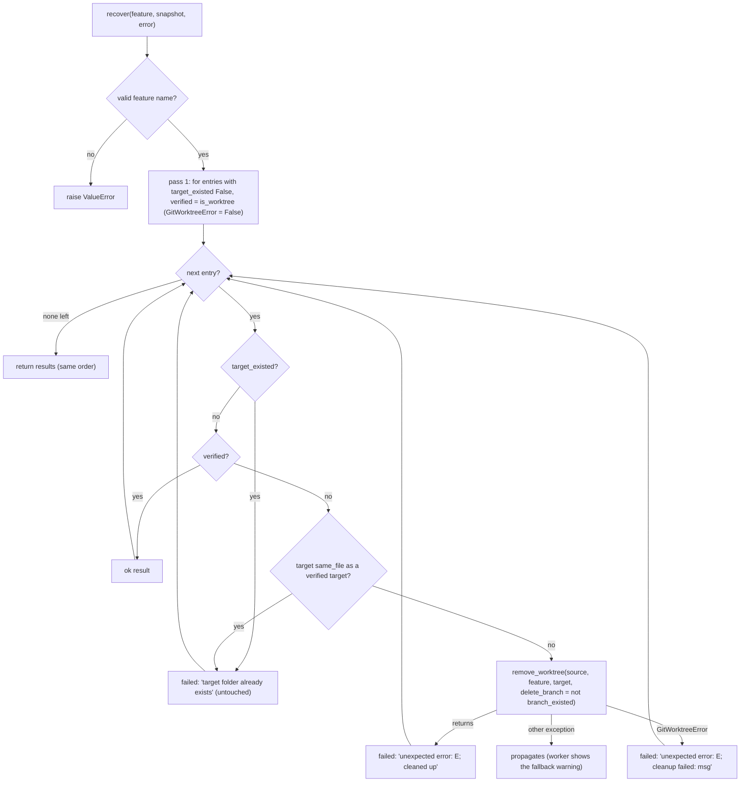
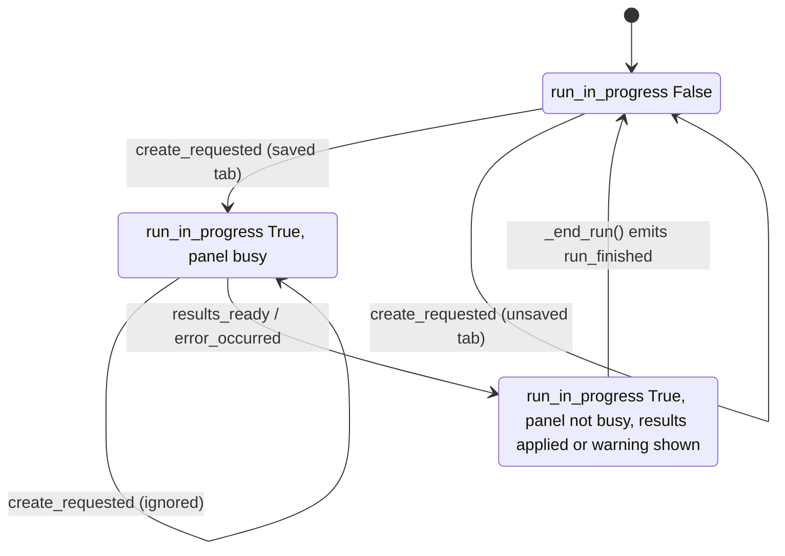

# S07 - Create runs in the background, saves the worktrees and returns to start

- **Plan:** [plan.md](plan.md)
- **Type:** Slice
- **Requirements covered:** FR-11 (background run), FR-13, FR-14, FR-15 (stay on the panel), FR-16 (Retry processes only red and new groups), FR-17, FR-04 (list refreshed after a run); recovery after an unexpected error (user decision, plan section 7); AC "Given a fake git client that succeeds for all groups, when Create is clicked, then the panel is busy during the run, the tab returns to the start panel, the state file (v2) contains the new paths, and the start panel lists them."; AC "Given a fake git client where group 2 of 2 fails ... the state file contains only group 1's path." (tab side); AC "Given the retry state, when the user fixes group 2 and clicks Retry, then only group 2 is processed, and on success the tab returns to start with both paths listed."; AC "Given the retry state where the user removed every red group, when Retry is clicked, then the tab returns to start."; AC "Given a path already in the saved list, when it is created again, then the list has no duplicate."
- **Prerequisites:** `WorktreeRequest`, `WorktreeResult` (with `ok`), `GitWorktreeError`, `GitWorktrees` (Protocol with `add_worktree`), `WorktreeService` (with `create_worktrees`, `merge_paths`, the precheck message constants `TARGET_EXISTS_MESSAGE`, ...), `SubprocessGitWorktrees` (with the private `_run`, `_check_repository`, `_ref_exists` and the message constants), `devpipe.infrastructure`, `same_file`, `is_valid_feature_name`; `TabState` (with `worktrees`), `Panel`, `TabStateError`, `PipelineTab._worktrees`, `PipelineTab.new_worktree_panel`, `PipelineTab.open_new_worktree_panel`, `PipelineTab.show_panel`, `PipelineTab._write`, `PipelineTab._current_state`, `SAVE_ERROR_TITLE`; `StartPanel.show_worktrees`, `StartPanel.worktrees_list`, `StartPanel.worktrees_label`; `NewWorktreePanel` (with `create_requested`, `set_busy`, `show_results`, `groups()`, `editable_groups()`, `add_button`, `create_button`, `error_box`, `progress_bar`, `RETRY_TEXT`), `WorktreeGroup` (with `source_input`, `parent_input`, `remove_button`, `is_locked`); test fixtures `tab_states`, `make_window`
- **Creates:** `PipelineTab(tab_states, worktrees)` and `MainWindow(window_state, tab_states, session, worktrees)` (constructors), `PipelineTab.run_in_progress`, `PipelineTab.run_finished`, `RUN_ERROR_TITLE`, `WorktreeWorker`, `PreRunState`, `GitWorktrees.branch_exists` / `is_worktree` / `remove_worktree`, their `SubprocessGitWorktrees` implementations, `WorktreeService.snapshot`, `WorktreeService.recover` (with `CLEANED_UP_MESSAGE`, `CLEANUP_FAILED_MESSAGE`), `FakeGitWorktrees` and the `fake_git` / `worktree_service` fixtures (`tests/views/conftest.py`)

## 1. Goal
Clicking Create/Retry on the New worktree panel really creates the worktrees, off the
UI thread, and the tab applies the outcome.

When done:
- On Create/Retry the panel turns busy, and a background `QThread` first takes a
  pre-run snapshot of the requests (`WorktreeService.snapshot`), then runs
  `WorktreeService.create_worktrees(feature_name, requests)` (FR-11).
- When the run ends, the panel is no longer busy. The targets of the ok results are
  merged into the tab's worktree list without duplicates (`merge_paths`), the start
  panel list is refreshed, and the state file is written exactly once (FR-13, FR-04).
  - No failure (also a run with no requests): the tab shows the start panel, and that
    panel switch is the single write (FR-14, FR-17).
  - Any failure: the tab stays on the panel, the panel shows the results (green / red,
    error box, "Retry"), and the tab writes the state once (FR-15, FR-16).
  - A failed write shows the existing "Cannot save state file" warning; the in-memory
    list keeps the new paths and navigation is the same.
- **Unexpected error:** if `create_worktrees` raises (it never does for a per-request
  failure), the same thread calls `WorktreeService.recover(feature_name, snapshot,
  error_text)`. Recovery keeps the worktrees that really exist (registered worktree of
  the source, on branch `<feature_name>`), never touches a target folder or branch
  that existed before the run, and cleans up the rest. Its results are applied exactly
  like a normal run's.
- **Fallback:** only if the snapshot or the recovery raises does the tab show a
  warning titled "Worktree creation failed" with the error text; busy is cleared,
  nothing is written and the panel is otherwise unchanged.
- `PipelineTab.run_in_progress` is True from the click until the outcome has been
  applied (including any warning box), and `PipelineTab.run_finished` is emitted right
  after.
- `app.py` builds `WorktreeService(SubprocessGitWorktrees())` and injects it through
  `MainWindow` into every `PipelineTab`.

## 2. Context
- `src/devpipe/views/pipeline_tab.py`: `PipelineTab(tab_states)` holds `stack`,
  `start_panel`, `new_worktree_panel` (stack index 1, `_panels[Panel.NEW_WORKTREE]`),
  `_state_path`, `_feature_name`, `_active_panel`, `_worktrees: list[Path]`.
  `show_panel(panel)` displays and, when saved, writes `_current_state()` through
  `_write` (the only write point, which shows "Cannot save state file" and returns
  False on `TabStateError`). `_current_state()` writes `Panel.START` while the New
  worktree panel is shown and always carries a copy of `_worktrees`.
  `create_requested` of the panel is not connected yet.
- `src/devpipe/views/main_window.py`: `MainWindow(window_state, tab_states, session)`
  builds tabs in `add_new_tab` and `add_saved_tab` with `PipelineTab(self._tab_states)`.
- `src/devpipe/app.py`: builds `MainWindow(WindowStateService(config),
  TabStateService(TabStateRepository()), SessionService(config))`.
- `src/devpipe/services/worktree_service.py`: `GitWorktrees` Protocol (`add_worktree`),
  `WorktreeService(git)` with `create_worktrees` (validates the slug, then for each
  request computes `target = (parent / feature_name).resolve()`, prechecks, calls
  `git.add_worktree(source.resolve(), feature_name, target)` and turns only
  `GitWorktreeError` into a failed result) and `merge_paths`.
- `src/devpipe/infrastructure/git_worktrees.py`: `SubprocessGitWorktrees` with
  `_run(source, *args)` (never raises for a non-zero exit; maps a missing executable to
  `GitWorktreeError("git not found")`), `_check_repository`, `_ref_exists`, and the
  inline failure message of the `worktree add` command (stripped stderr, else
  `"git exited with code N"`). It has no automated tests (D18, D21).
- Layer rules: views may import `devpipe.services` and `devpipe.models`, never
  `devpipe.infrastructure`; infrastructure may import only `devpipe.models` (so it
  cannot use `services.paths.same_file`); only `app.py` imports every layer.
- Signal style: lambdas only to drop Qt's `checked` argument; slots connected to
  bound methods.
- Tests: pytest + pytest-qt under `tests/<layer>/`, `--import-mode=importlib` (a
  `conftest.py` cannot be imported, so shared test doubles are reached through
  fixtures). `tests/views/conftest.py` has `tab_states` and `make_window`. Each view
  test module has its own `warnings` fixture. Run with `uv run pytest`.

## 3. Structure

### 3.1 Files
| File | Change | Responsibility |
|------|--------|----------------|
| `src/devpipe/models/worktree.py` | modify | Add `PreRunState` |
| `src/devpipe/services/worktree_service.py` | modify | Extend `GitWorktrees`; add `snapshot`, `recover`, recovery messages; shared slug check |
| `src/devpipe/infrastructure/git_worktrees.py` | modify | `branch_exists`, `is_worktree`, `remove_worktree` and their private helpers |
| `src/devpipe/views/worktree_worker.py` | new | `WorktreeWorker`: snapshot, run and recovery on a `QThread` |
| `src/devpipe/views/pipeline_tab.py` | modify | Constructor, run lifecycle, applying results, fallback warning |
| `src/devpipe/views/main_window.py` | modify | Constructor takes the service and passes it to every `PipelineTab` |
| `src/devpipe/app.py` | modify | Build and inject `WorktreeService(SubprocessGitWorktrees())` |
| `docs/architecture.md` | modify | Add `worktree_worker.py` to the views layout tree |
| `tests/models/test_worktree.py` | modify | `PreRunState` value and immutability |
| `tests/services/test_worktree_recovery.py` | new | `snapshot` and `recover` with a recording fake git |
| `tests/views/conftest.py` | modify | `FakeGitWorktrees`, `fake_git` and `worktree_service` fixtures, `make_window` passes the service |
| `tests/views/test_pipeline_tab.py` | modify | `make_tab` passes the service |
| `tests/views/test_main_window.py` | modify | `IdentityTab` / `add_identity_tab` pass the service (constructor change) |
| `tests/views/test_worktree_run.py` | new | End-to-end runs through the tab with the fake git, and the worker |

### 3.2 Models: `src/devpipe/models/worktree.py`

Add after `WorktreeResult` (nothing else changes):

```python
@dataclass(frozen=True)
class PreRunState:
    """What existed before a run, for one request; decides what recovery may delete.

    `target` is `(request.parent / feature_name).resolve()`, the same folder the run
    would create.
    """

    request: WorktreeRequest
    target: Path
    target_existed: bool   # a file or folder was at `target` before the run
    branch_existed: bool   # the branch existed in the source repository, or could not be checked
```

All fields are required. Frozen: value equality, hashing, `FrozenInstanceError` on
assignment.

### 3.3 Services: `src/devpipe/services/worktree_service.py`

Imports: add `PreRunState` to the `devpipe.models.worktree` import.

New constants (next to the precheck messages):

```python
CLEANED_UP_MESSAGE = "unexpected error: {error}; cleaned up"
CLEANUP_FAILED_MESSAGE = "unexpected error: {error}; cleanup failed: {cleanup_error}"
```

`GitWorktrees` Protocol gains three methods (`add_worktree` unchanged):

```python
class GitWorktrees(Protocol):
    def add_worktree(self, source: Path, branch: str, target: Path) -> None: ...

    def branch_exists(self, source: Path, branch: str) -> bool:
        """The local branch `branch` exists in the repository of `source`.
        Raises GitWorktreeError when it cannot be checked (not a repository, git not found, ...)."""
        ...

    def is_worktree(self, source: Path, branch: str, target: Path) -> bool:
        """`target` is an existing folder registered as a worktree of the repository of
        `source` and checked out on `branch`. Raises GitWorktreeError when it cannot be checked."""
        ...

    def remove_worktree(self, source: Path, branch: str, target: Path, delete_branch: bool) -> None:
        """Undo what a failed worktree creation may have left: remove the registered
        worktree at `target` if any, delete the `target` folder if it still exists, and,
        when `delete_branch` is True, delete `branch` unless a remaining worktree has it
        checked out. Missing pieces are skipped. Raises GitWorktreeError on any failure."""
        ...
```

`WorktreeService` additions:

```python
class WorktreeService:
    def snapshot(self, feature_name: str, requests: list[WorktreeRequest]) -> list[PreRunState]:
        """One PreRunState per request, in order, taken before a run.

        Raises ValueError for an invalid feature name (before any git call). Never raises
        for a per-request problem: a GitWorktreeError from branch_exists counts as
        branch_existed=True, so recovery never deletes a branch it could not check.
        """

    def recover(self, feature_name: str, snapshot: list[PreRunState], error: str) -> list[WorktreeResult]:
        """Results for a run that stopped with the unexpected error `error`, one per
        snapshot entry, in order; cleans up what the run may have left half-done.

        Raises ValueError for an invalid feature name. Never raises for a per-request
        problem (GitWorktreeError); any other exception propagates.
        """

    @staticmethod
    def _require_valid_feature_name(feature_name: str) -> None:
        """Raise ValueError(f"invalid feature name: {feature_name!r}") for a non-slug name."""

    def _is_verified(self, feature_name: str, entry: PreRunState) -> bool:
        """is_worktree(source.resolve(), feature_name, target); a GitWorktreeError counts as False."""

    def _clean_up(self, feature_name: str, entry: PreRunState, error: str) -> WorktreeResult:
        """remove_worktree(...) and the failed result that reports it."""
```

Behavior details:
- `_require_valid_feature_name`: the existing check of `create_worktrees` moves here
  unchanged (same `ValueError` text); `create_worktrees` calls it, and so do `snapshot`
  and `recover`. `create_worktrees` behaves exactly as before.
- `snapshot`: after the slug check, for each request:
  1. `target = (request.parent / feature_name).resolve()`.
  2. `target_existed = target.exists()` (a file or a folder, like the precheck).
  3. `branch_existed = self._git.branch_exists(request.source.resolve(), feature_name)`;
     on `GitWorktreeError` it is `True`. Other exceptions propagate.
  4. Append `PreRunState(request, target, target_existed, branch_existed)` (the request
     object is the one passed in).
- `recover`: after the slug check, two passes over `snapshot`:
  1. **Verify:** for each entry with `target_existed == False`, `verified = self._is_verified(...)`.
     Entries with `target_existed == True` are not checked (no git call for them).
     `verified_targets` = targets of the verified entries.
  2. **Results**, in snapshot order:
     - `target_existed` → `WorktreeResult(entry.request, entry.target, TARGET_EXISTS_MESSAGE)`;
       nothing is touched.
     - verified → `WorktreeResult(entry.request, entry.target, None)` (ok).
     - not verified, and `any(same_file(entry.target, t) for t in verified_targets)` →
       `WorktreeResult(..., TARGET_EXISTS_MESSAGE)`; nothing is touched (the folder is
       another request's verified worktree).
     - otherwise `_clean_up(...)`: call
       `self._git.remove_worktree(entry.request.source.resolve(), feature_name, entry.target, delete_branch=not entry.branch_existed)`;
       on success the error is `CLEANED_UP_MESSAGE.format(error=error)`; on
       `GitWorktreeError as exc` it is
       `CLEANUP_FAILED_MESSAGE.format(error=error, cleanup_error=str(exc))`. Other
       exceptions propagate.
  - `recover(feature_name, [], error)` returns `[]` with no git call.

### 3.4 Infrastructure: `src/devpipe/infrastructure/git_worktrees.py`

Imports: add `os`, `shutil`, `stat`.

New constants:

```python
BRANCH_REF = "refs/heads/{branch}"
CANNOT_DELETE_FOLDER_MESSAGE = "cannot delete folder: {reason}"
```

New members of `SubprocessGitWorktrees` (existing members unchanged, except that the
`worktree add` failure message is built by `_failure_message`):

```python
class SubprocessGitWorktrees:
    def branch_exists(self, source: Path, branch: str) -> bool:
        """See GitWorktrees.branch_exists."""

    def is_worktree(self, source: Path, branch: str, target: Path) -> bool:
        """See GitWorktrees.is_worktree."""

    def remove_worktree(self, source: Path, branch: str, target: Path, delete_branch: bool) -> None:
        """See GitWorktrees.remove_worktree."""

    def _worktree_entries(self, source: Path) -> list[tuple[Path, str | None]]:
        """(folder, checked-out ref or None when detached) of every registered worktree,
        from `git worktree list --porcelain`. Checks the repository first."""

    def _run_checked(self, source: Path, *args: str) -> subprocess.CompletedProcess[str]:
        """_run, then raise GitWorktreeError(_failure_message(completed)) on a non-zero exit."""

    @staticmethod
    def _failure_message(completed: subprocess.CompletedProcess[str]) -> str:
        """Stripped stderr, or f"git exited with code {completed.returncode}" when empty."""


def _same_folder(a: Path, b: Path) -> bool:
    """Same folder after resolve(), ignoring case on Windows (os.path.normcase)."""


def _make_writable_and_retry(function, path, _exc) -> None:
    """shutil.rmtree onexc handler: clear the read-only flag and retry (Windows)."""
```

Behavior (every git call through `_run` / `_run_checked`: argument lists, never
`shell=True`, never `fetch`/`pull`/`ls-remote`):

| Method | Steps |
|--------|-------|
| `branch_exists` | `_check_repository(source)` (raises "not a git repository"), then `_ref_exists(source, BRANCH_REF.format(branch=branch))` |
| `is_worktree` | `False` when `not target.is_dir()`; else `any(_same_folder(folder, target) and ref == BRANCH_REF.format(branch=branch) for folder, ref in _worktree_entries(source))` |
| `remove_worktree` | 1. `entries = _worktree_entries(source)`. 2. If any entry's folder is `_same_folder` as `target`: `_run_checked(source, "worktree", "remove", "--force", str(target))`. 3. Always `_run_checked(source, "worktree", "prune")`. 4. If `target.is_dir()`: `shutil.rmtree(target, onexc=_make_writable_and_retry)`; an `OSError` becomes `GitWorktreeError(CANNOT_DELETE_FOLDER_MESSAGE.format(reason=exc.strerror or exc))` (chained). 5. If `delete_branch`, the branch ref exists (`_ref_exists`) and no entry of a fresh `_worktree_entries(source)` has it checked out: `_run_checked(source, "branch", "-D", branch)` |
| `_worktree_entries` | `_check_repository(source)`; `_run_checked(source, "worktree", "list", "--porcelain")`; parse blocks separated by blank lines: the `worktree <path>` line gives `Path(<path>)`, a `branch <ref>` line gives the ref; any block without a `branch <ref>` line (detached, bare main worktree) gives `None`; every other line (`HEAD`, `detached`, `bare`, `locked`, `prunable`, ...) is ignored |

Note on the branch rule in step 5: two requests on the same repository share the
branch `<feature_name>`; skipping a branch that a remaining (verified) worktree has
checked out keeps that worktree intact (git would refuse `branch -D` anyway, and the
cleanup would be reported as failed for no reason).

### 3.5 Views: `src/devpipe/views/worktree_worker.py` (new)

```python
"""Run one worktree creation off the UI thread (snapshot, run, recovery on error)."""

from PySide6.QtCore import QThread, Signal

from devpipe.models.worktree import WorktreeRequest
from devpipe.services.worktree_service import WorktreeService


class WorktreeWorker(QThread):
    """One run: snapshot, create_worktrees, and recover if create_worktrees raises.

    Exactly one of the two signals is emitted per run, from the worker thread; slots of
    objects living in the UI thread receive it queued, on the UI thread.
    """

    results_ready = Signal(object)  # list[WorktreeResult], one per request, in order
    error_occurred = Signal(str)    # error text: the snapshot or the recovery raised

    def __init__(
        self, service: WorktreeService, feature_name: str, requests: list[WorktreeRequest]
    ) -> None:
        super().__init__()
        ...  # keeps the service, the name and a copy of the requests

    def run(self) -> None: ...


def _error_text(error: Exception) -> str:
    """f"{type(error).__name__}: {error}", or only the type name when str(error) is empty."""
```

`run()`:
1. `snapshot = service.snapshot(feature_name, requests)`; on any `Exception as exc` →
   `error_occurred.emit(_error_text(exc))` and return.
2. `results = service.create_worktrees(feature_name, requests)`; on any
   `Exception as exc` → `results = service.recover(feature_name, snapshot, _error_text(exc))`;
   if that raises any `Exception as exc2` → `error_occurred.emit(_error_text(exc2))`
   and return.
3. `results_ready.emit(results)`.

The broad `except Exception` is deliberate: this is the thread boundary, and an
exception escaping `run()` would leave the tab busy forever. `Signal(object)` carries
the Python list unchanged through the queued connection.

### 3.6 Views: `src/devpipe/views/pipeline_tab.py`

Imports: add `Slot` to the `PySide6.QtCore` import; add
`from devpipe.models.worktree import WorktreeRequest, WorktreeResult`,
`from devpipe.services.worktree_service import WorktreeService`,
`from devpipe.views.worktree_worker import WorktreeWorker`.

New constant: `RUN_ERROR_TITLE = "Worktree creation failed"`.

```python
class PipelineTab(QWidget):
    identity_changed = Signal()  # unchanged
    run_finished = Signal()      # emitted after a run's outcome was applied (results, recovery or warning)

    def __init__(self, tab_states: TabStateService, worktrees: WorktreeService) -> None:
        ...  # existing body
        self._worktree_service = worktrees
        self._worker: WorktreeWorker | None = None   # the run in progress, if any
        ...
        self.new_worktree_panel.create_requested.connect(self._start_run)

    @property
    def run_in_progress(self) -> bool:
        """True from the start of a run until its outcome was applied (just before run_finished)."""
        return self._worker is not None

    def _start_run(self, requests: list[WorktreeRequest]) -> None: ...
    @Slot(object)
    def _on_run_results(self, results: list[WorktreeResult]) -> None: ...
    @Slot(str)
    def _on_run_error(self, text: str) -> None: ...
    def _end_run(self) -> None: ...
```

- The constructor parameter is named `worktrees` (shared name); the attribute is
  `_worktree_service` because `_worktrees` already holds the path list.
- `_start_run(requests)`:
  1. If `self._worker is not None` (a run is already in progress) or
     `self._state_path is None` (unsaved tab: no feature name to create): return,
     nothing changes.
  2. `self.new_worktree_panel.set_busy(True)`.
  3. `self._worker = WorktreeWorker(self._worktree_service, self._feature_name, requests)`;
     connect `results_ready` → `self._on_run_results` and `error_occurred` →
     `self._on_run_error` (bound methods, so they run queued on the UI thread);
     `self._worker.start()`.
- `_on_run_results(results)`:
  1. `self._worker.wait()` (the thread is returning; it must be finished before any
     modal box or deletion).
  2. `self.new_worktree_panel.set_busy(False)`.
  3. `created = [r.target for r in results if r.ok]`;
     `self._worktrees = self._worktree_service.merge_paths(self._worktrees, created)`;
     `self.start_panel.show_worktrees(self._worktrees)`.
  4. If `all(r.ok for r in results)` (True for `[]`): `self.show_panel(Panel.START)`
     (its auto-save is the single write).
     Else: `self.new_worktree_panel.show_results(results)`, then
     `self._write(self._state_path, self._current_state())` (the single write; the tab
     stays on the panel).
  5. `self._end_run()`.
- `_on_run_error(text)`:
  1. `self._worker.wait()`.
  2. `self.new_worktree_panel.set_busy(False)`.
  3. `QMessageBox.warning(self, RUN_ERROR_TITLE, text)`.
  4. `self._end_run()`. Nothing is written; `_worktrees` and the panel's groups are
     unchanged.
- `_end_run()`: `worker, self._worker = self._worker, None`; `worker.deleteLater()`;
  `self.run_finished.emit()`.
- Everything else in the class is unchanged. A write failure in step 4 is handled by
  the existing `_write` / `show_panel` warning; navigation does not depend on it.

### 3.7 Views: `src/devpipe/views/main_window.py`

- Import `from devpipe.services.worktree_service import WorktreeService`.
- `__init__(self, window_state: WindowStateService, tab_states: TabStateService, session: SessionService, worktrees: WorktreeService)`:
  store `self._worktree_service = worktrees` next to `self._tab_states`.
- `add_new_tab` and `add_saved_tab`: `PipelineTab(self._tab_states, self._worktree_service)`.
- Nothing else changes (closing behavior included).

### 3.8 Composition: `src/devpipe/app.py`

- Docstring first line: "Composition root: builds repositories, infrastructure
  implementations and services and injects them into views."
- Imports: `from devpipe.infrastructure.git_worktrees import SubprocessGitWorktrees`,
  `from devpipe.services.worktree_service import WorktreeService`.
- `main()`: pass `WorktreeService(SubprocessGitWorktrees())` as the fourth
  `MainWindow` argument.

### 3.9 Docs: `docs/architecture.md`
In the layout tree, add `worktree_worker.py` as the last entry under `views/` (the
previous last entry's `└──` becomes `├──`), with the comment
`# background thread running one worktree creation`. Nothing else changes.

### 3.10 Tests: `tests/views/conftest.py`

```python
GATE_TIMEOUT_S = 5  # a gated add_worktree gives up after this, so a failing test never hangs


class FakeGitWorktrees:
    """In-memory git for view tests, configurable per resolved target.

    add_worktree waits for `gate` when set, records the call, raises failures[target]
    when present (a GitWorktreeError is a normal failure, any other exception an
    unexpected one), else creates the target folder and registers the worktree.
    """

    def __init__(self) -> None:
        self.failures: dict[Path, Exception] = {}
        self.gate: threading.Event | None = None
        self.branch_check_error: Exception | None = None  # raised by branch_exists
        self.remove_error: Exception | None = None        # raised by remove_worktree
        self.calls: list[tuple[Path, str, Path]] = []      # add_worktree calls
        self.removed: list[tuple[Path, str, Path, bool]] = []
        self.branches: set[tuple[Path, str]] = set()       # (source, branch)
        self.worktrees: set[tuple[Path, str, Path]] = set()  # (source, branch, target)

    def add_worktree(self, source, branch, target): ...
    def branch_exists(self, source, branch): ...   # raises branch_check_error if set; else (source, branch) in branches
    def is_worktree(self, source, branch, target): ...  # target.is_dir() and (source, branch, target) in worktrees
    def remove_worktree(self, source, branch, target, delete_branch): ...
        # raises remove_error if set; else records, unregisters, rmtree(target) if it is a
        # folder, discards (source, branch) from branches when delete_branch
```

- On a gate timeout `add_worktree` raises `GitWorktreeError("gate timeout")`.
- A successful `add_worktree` adds `(source, branch)` to `branches` and
  `(source, branch, target)` to `worktrees`, then `target.mkdir()`.
- New fixtures: `fake_git() -> FakeGitWorktrees` (a new instance per test) and
  `worktree_service(fake_git) -> WorktreeService` (`WorktreeService(fake_git)`).
- `make_window` gains the `worktree_service` fixture and passes it as the fourth
  `MainWindow` argument.

## 4. Logic flows



All git work (snapshot, run, recovery) happens on the worker thread; the tab only
reacts to one of the two queued signals. `run_in_progress` stays True until the
outcome is applied.



The outcome decides only the navigation: full success goes back to start, any
failure stays on the panel. A failed write never changes that.



Verification runs first for every entry, so a cleanup can never delete the folder of
another request's verified worktree. Only what the snapshot shows the run could have
created is ever deleted.



## 5. Edge cases and errors
| Case | Expected behavior |
|------|-------------------|
| All requests succeed | Tab shows the start panel listing the merged targets; file v2 holds them; one write |
| Some requests fail (normal failures) | Tab stays on the panel: ok groups green and locked, failed groups red, error box, "Retry"; file holds only the ok targets; one write |
| Retry after a partial failure | Only the editable (red and new) groups are sent; their results pair with them; green groups keep their state |
| Retry with no editable group left (all red groups removed) | Run with `[]`: no git call, results `[]`, tab returns to start; one write |
| An ok target is already in the saved list (same file) | Not added again (`merge_paths`) |
| State file write fails after a run | "Cannot save state file" warning; `_worktrees` keeps the new paths; navigation unchanged; the next write includes them |
| `create_worktrees` raises unexpectedly | Recovery results applied like a normal run (green verified worktrees, red cleaned-up ones, "Retry", one write) |
| Target existed before the run | Recovery never passes it to `remove_worktree`; result "target folder already exists" |
| Branch existed before the run, or `branch_exists` raised | `delete_branch=False` |
| Two requests with the same target, one verified | The other gets "target folder already exists" and is not cleaned up |
| `is_worktree` raises `GitWorktreeError` | Counts as not verified: the entry is cleaned up |
| `remove_worktree` raises `GitWorktreeError("boom")` | That result: `"unexpected error: <E>; cleanup failed: boom"`; later entries still processed |
| Branch to delete is checked out by a remaining worktree (real git) | Not deleted; cleanup still succeeds |
| Snapshot raises (non-git exception) | Warning "Worktree creation failed" / `"<Type>: <message>"`; `create_worktrees` never runs; no write; panel unchanged except not busy |
| Recovery raises (non-git exception) | Same warning with the recovery's error text; no write; panel unchanged except not busy. Worktrees the run created stay on disk unsaved (a later retry reports "target folder already exists") |
| Exception with an empty message | Error text is the type name only (e.g. `"RuntimeError"`) |
| Create clicked again while running (not reachable: panel busy) | Ignored; one run only |
| `create_requested` on an unsaved tab (not reachable from the UI) | Ignored: not busy, no run, no write |
| Invalid feature name (not reachable: saved tabs hold a slug) | `snapshot` raises `ValueError` → fallback warning |
| Modal warning shown while applying | `run_in_progress` is still True until `run_finished` |

## 6. Tests

### 6.1 Automated

**`tests/models/test_worktree.py`** (add):

| Test file | Test name | Given / When / Then | Proves |
|-----------|-----------|---------------------|--------|
| `tests/models/test_worktree.py` | `test_pre_run_state_is_frozen_value` | Given two `PreRunState(req, t, False, True)` with equal values / then equal with the same hash, fields readable; assigning `target_existed` raises `FrozenInstanceError` | `PreRunState` contract |

**`tests/services/test_worktree_recovery.py`** (new). Test double:

```python
class RecordingGit:
    """Recording GitWorktrees for snapshot / recover; add_worktree is never used."""

    def __init__(self):
        self.calls = []                       # ("branch_exists" | "is_worktree" | "remove_worktree", *args)
        self.branches: set[Path] = set()      # sources whose branch exists
        self.branch_errors: set[Path] = set() # branch_exists raises GitWorktreeError("no repo")
        self.worktrees: set[tuple[Path, Path]] = set()  # (source, target) that is_worktree reports
        self.worktree_errors: set[Path] = set()         # targets for which is_worktree raises GitWorktreeError
        self.remove_errors: dict[Path, Exception] = {}  # target -> exception raised by remove_worktree
```

Helper `make_request(tmp_path, name)` creates `tmp_path/name/src` and `tmp_path/name/wt`
and returns `WorktreeRequest(src, wt)`; `target(req) = (req.parent / "feat-x").resolve()`;
`state(req, existed=False, branch=False) = PreRunState(req, target(req), existed, branch)`.
`E = "RuntimeError: boom"`.

| Test file | Test name | Given / When / Then | Proves |
|-----------|-----------|---------------------|--------|
| `tests/services/test_worktree_recovery.py` | `test_snapshot_records_target_and_branch_per_request` | Given r1, r2, `target(r2)` created as a folder, `branches = {r1.source.resolve()}` / when `snapshot("feat-x", [r1, r2])` / then `[PreRunState(r1, target(r1), False, True), PreRunState(r2, target(r2), True, False)]`, `calls == [("branch_exists", r1.source.resolve(), "feat-x"), ("branch_exists", r2.source.resolve(), "feat-x")]`, `result[0].request is r1` | Pre-run snapshot |
| same | `test_snapshot_target_file_counts_as_existing` | Given `target(r1)` written as a file / then `target_existed is True` | Never delete what existed |
| same | `test_snapshot_branch_check_error_counts_as_existing` | Given `branch_errors = {r1.source.resolve()}` / then `branch_existed is True`, no exception | Never delete an unchecked branch |
| same | `test_snapshot_empty_requests` | Then `[]`, no calls | Empty input |
| same | `test_snapshot_invalid_feature_name_raises` | `snapshot("Bad", [r1])` / then `ValueError`, no calls | Precondition |
| same | `test_recover_keeps_verified_and_cleans_up_the_rest` | Given r1..r3, `worktrees = {(r1.source.resolve(), target(r1))}` / when `recover("feat-x", [state(r1), state(r2), state(r3)], E)` / then result 1 ok with `target(r1)`; results 2 and 3 error `"unexpected error: RuntimeError: boom; cleaned up"`; remove calls are exactly `(r2.source.resolve(), "feat-x", target(r2), True)` then the same for r3; `results[i].request is snapshot[i].request` | Recovery rules |
| same | `test_recover_never_touches_existing_target` | Given `state(r1, existed=True)` / then error `"target folder already exists"`, no `is_worktree` and no `remove_worktree` call for it | Recovery safety |
| same | `test_recover_keeps_branch_that_existed` | Given `state(r1, branch=True)` not verified / then the remove call has `delete_branch=False` | Recovery safety |
| same | `test_recover_unverifiable_worktree_is_cleaned_up` | Given `worktree_errors = {target(r1)}` / then r1 is passed to `remove_worktree` and gets the "cleaned up" error | `is_worktree` failure |
| same | `test_recover_cleanup_failure_reports_git_message` | Given r1, r2 not verified, `remove_errors = {target(r1): GitWorktreeError("boom")}` / then result 1 error `"unexpected error: RuntimeError: boom; cleanup failed: boom"`, result 2 "cleaned up" (still processed) | Cleanup failure |
| same | `test_recover_does_not_clean_target_of_verified_entry` | Given r1 and r2 with different sources and the same parent (same target), `worktrees = {(r1.source.resolve(), t)}` / then result 1 ok, result 2 `"target folder already exists"`, no remove call | Recovery safety (shared target) |
| same | `test_recover_unexpected_exception_propagates` | Given `remove_errors = {target(r1): RuntimeError("x")}` / then `recover` raises `RuntimeError` | Fallback trigger |
| same | `test_recover_empty_snapshot` | Then `[]`, no calls | Empty input |
| same | `test_recover_invalid_feature_name_raises` | `recover("Bad", [state(r1)], E)` / then `ValueError`, no calls | Precondition |

**`tests/views/test_worktree_run.py`** (new). Fixtures and helpers:
- `warnings` fixture (records `(title, text)` of `QMessageBox.warning`, same shape as
  in the other view tests).
- `writes` fixture: wraps `tab_states.save` with `monkeypatch.setattr(tab_states, "save", spy)`;
  the spy appends `(path, state)` to a list (the fixture's value) and calls the
  original. It also records the auto-save of `open_new_worktree_panel()`, so the run's
  writes are isolated by clearing it: `run()`, and every test that clicks Create
  without `run()`, calls `writes.clear()` just before the click. "One write" is then
  asserted as `len(writes) == 1`, "no write" as `writes == []`.
- `read_json(path) -> dict`: `json.loads(path.read_text("utf-8"))` (module-local; it
  cannot be imported from another test module).
- `RUN_TIMEOUT_MS = 5000`.
- `saved_tab(qtbot, tab_states, worktree_service, path, worktrees=())`: builds
  `PipelineTab(tab_states, worktree_service)`, `qtbot.addWidget`,
  `apply_saved(path, TabState("feat-x", Panel.START, list(worktrees)))`,
  `open_new_worktree_panel()`; returns the tab.
- `fill(tab, tmp_path, n) -> list[Path]`: makes the panel have `n` groups (click
  `add_button`), creates `tmp_path/f"src{i}"` and `tmp_path/f"wt{i}"`, sets the
  inputs, and returns the targets `(tmp_path/f"wt{i}"/"feat-x").resolve()`.
- `run(qtbot, tab, writes)`: calls `writes.clear()`, then clicks
  `new_worktree_panel.create_button` inside
  `qtbot.waitSignal(tab.run_finished, timeout=RUN_TIMEOUT_MS)`.
- `expected_file(*targets)`: `{"version": 2, "feature_name": "feat-x", "active_panel": "start", "worktrees": [str(t) for t in targets]}`.
- Every test that sets `fake_git.gate` releases it in a `finally` and then waits for
  the run to end before teardown, so no `QThread` is destroyed while running:
  `fake_git.gate.set()` followed by
  `qtbot.waitUntil(lambda: not tab.run_in_progress, timeout=RUN_TIMEOUT_MS)`.
- The bare-worker tests call `worker.wait()` in a `finally`, for the same reason.

| Test file | Test name | Given / When / Then | Proves |
|-----------|-----------|---------------------|--------|
| `tests/views/test_worktree_run.py` | `test_successful_run_returns_to_start_and_saves_targets` | Given a saved tab with two filled groups / when Create is clicked and the run finishes / then `fake_git.calls == [(src0.resolve(), "feat-x", t0), (src1.resolve(), "feat-x", t1)]`, `stack.currentWidget() is start_panel`, `active_panel is Panel.START`, `read_json(path) == expected_file(t0, t1)`, the start panel list texts are `[str(t0), str(t1)]` and not hidden, `len(writes) == 1`, `not run_in_progress` | FR-13, FR-14, FR-04, AC "all succeed" |
| same | `test_panel_is_busy_while_run_in_progress` | Given `fake_git.gate = threading.Event()` and one filled group / when `writes.clear()` and Create is clicked (no wait) / then `run_in_progress`, `not progress_bar.isHidden()`, `create_button` and `add_button` disabled, the file still has `"worktrees": []`; when the gate is set inside `waitSignal(run_finished)` / then the progress bar is hidden and `not run_in_progress` | FR-11, AC "busy during the run" |
| same | `test_partial_failure_stays_on_panel_with_retry` | Given two groups and `fake_git.failures[t1] = GitWorktreeError("not a git repository")` / when the run finishes / then the panel is current, group 0 `is_locked()` with tooltip `f"Created: {t0}"`, group 1 not locked with tooltip "Failed: not a git repository", `create_button.text() == "Retry"`, error box text contains "not a git repository", `read_json(path) == expected_file(t0)`, start panel list `[str(t0)]`, `len(writes) == 1` | FR-13, FR-15, AC "group 2 of 2 fails" |
| same | `test_retry_processes_only_fixed_group` | Given the partial failure above / when `failures` is cleared, group 1's source is set to a new existing folder `src9` and Retry is run / then the only new call is `(src9.resolve(), "feat-x", t1)`, the tab shows the start panel, `read_json(path) == expected_file(t0, t1)`, list `[str(t0), str(t1)]` | FR-16, AC "retry" |
| same | `test_retry_with_no_editable_group_returns_to_start` | Given the partial failure above / when group 1's `remove_button` is clicked and Retry is run / then no new git call, the start panel is current, `read_json(path) == expected_file(t0)` | FR-17, AC "removed every red group" |
| same | `test_already_saved_target_is_not_duplicated` | Given a tab saved with `worktrees=[t0]` (folder not on disk) and one group targeting `t0` / when the run succeeds / then `read_json(path)["worktrees"] == [str(t0)]` and the list has one entry | FR-13, AC "no duplicate" |
| same | `test_save_failure_after_success_warns_and_keeps_paths` | Given `path = tmp_path/"d"/"x.json"` with `d` created, a saved tab opened on the panel, one filled group, then `d` removed / when the run succeeds / then one warning titled "Cannot save state file", the start panel is current; when `d` is recreated and `open_new_worktree_panel()` is called / then `read_json(path) == expected_file(t0)` | Edge case "write fails" |
| same | `test_save_failure_after_partial_failure_stays_on_panel` | Same setup with two groups and group 1 failing / then one "Cannot save state file" warning, the panel is current, "Retry" | Edge case "write fails" (navigation unchanged) |
| same | `test_unexpected_error_applies_recovered_results` | Given two groups and `fake_git.failures[t1] = RuntimeError("disk on fire")` / when the run finishes / then group 0 locked with "Created: …", group 1 tooltip `"Failed: unexpected error: RuntimeError: disk on fire; cleaned up"`, "Retry", `fake_git.removed == [(src1.resolve(), "feat-x", t1, True)]`, `read_json(path) == expected_file(t0)`, `len(writes) == 1`, no warning | Recovery (view level) |
| same | `test_recovery_failure_shows_warning_and_changes_nothing` | Given `failures[t1] = RuntimeError("x")` and `fake_git.remove_error = RuntimeError("boom")` / when the run finishes / then `warnings == [("Worktree creation failed", "RuntimeError: boom")]`, `writes == []`, the panel is current, both groups unlocked with empty style sheet and tooltip, `create_button.text() == "Create"`, `create_button.isEnabled()`, progress bar hidden, `read_json(path)["worktrees"] == []` | Fallback |
| same | `test_snapshot_failure_shows_warning_and_does_not_run` | Given `fake_git.branch_check_error = RuntimeError("no git")` / when the run finishes / then `warnings == [("Worktree creation failed", "RuntimeError: no git")]`, `fake_git.calls == []`, `writes == []` | Fallback |
| same | `test_run_finished_after_outcome_applied` | Given one filled group and a slot on `run_finished` recording `(tab.run_in_progress, tab.stack.currentWidget())` / when the run succeeds / then the recorded value is `(False, tab.start_panel)` | `run_finished` / `run_in_progress` contract |
| same | `test_create_ignored_while_run_in_progress` | Given a gated run started with one group (`writes.clear()` before the click) / when `new_worktree_panel.create_requested.emit([request])` is called again / then after the gate is released and `run_finished` waited, `len(fake_git.calls) == 1` and `qtbot.assertNotEmitted(tab.run_finished, wait=200)` holds | One run at a time |
| same | `test_create_on_unsaved_tab_is_ignored` | Given an unsaved `PipelineTab` with `open_new_worktree_panel()` / when `create_requested.emit([request])` / then `not run_in_progress`, progress bar hidden, `fake_git.calls == []`, `list(tmp_path.iterdir())` holds only the request folders | Edge case |
| same | `test_worker_delivers_results` | Given `WorktreeWorker(worktree_service, "feat-x", [request])` / when started inside `waitSignal(worker.results_ready)` / then `blocker.args[0]` is one ok `WorktreeResult`; `worker.wait()` returns True | Worker contract |
| same | `test_worker_reports_error_type_without_message` | Given `fake_git.branch_check_error = RuntimeError()` / when the worker runs inside `waitSignal(worker.error_occurred)` / then `blocker.args == ["RuntimeError"]` | Error text |

**Existing tests updated:**
- `tests/views/test_pipeline_tab.py`: `make_tab(qtbot, tab_states, worktree_service)`
  builds `PipelineTab(tab_states, worktree_service)`; every test calling `make_tab`
  adds the `worktree_service` fixture parameter. Assertions unchanged.
- `tests/views/test_main_window.py`: `IdentityTab.__init__(self, tab_states, worktrees)`
  passes both to `super().__init__`; `add_identity_tab(qtbot, window, tab_states, worktree_service)`;
  its three callers add the `worktree_service` fixture. Assertions unchanged.
- `tests/views/conftest.py`: `make_window` passes the service (all window-based tests
  keep passing unchanged).

Run with: `uv run pytest tests/models tests/services tests/views`, then the whole
suite `uv run pytest`.

### 6.2 Manual
- Given `uv run devpipe`, a tab saved as `try-wt`, the New worktree panel open with
  group 1 = a real repository and an existing empty parent folder, and group 2 = a
  plain folder that is not a repository, when Create is clicked, then the progress bar
  shows while it runs, group 1 turns green, group 2 red with "not a git repository",
  and "Retry" appears; the state file lists only group 1's worktree. (FR-11, FR-15)
- When group 2's source is changed to another repository with a different parent and
  Retry is clicked, then the tab returns to the start panel and lists both worktrees;
  after restarting the app the list is still there. (FR-14, FR-16, FR-04)
- Given the panel with only the first group green and the second removed with '-',
  when Retry is clicked, then the tab returns to start. (FR-17)
- Recovery by hand: with a temporary local patch making `create_worktrees` raise after
  the first `add_worktree`, click Create with two groups on two repositories: group 1
  is green and appears in `git worktree list`; group 2 is red with "unexpected error:
  …; cleaned up", and its folder and `try-wt` branch are gone. With a second patch
  making `remove_worktree` raise a non-git exception, the "Worktree creation failed"
  warning appears and nothing is written. Revert the patches.
- Real-git checks of the new infrastructure methods (no automated tests, D18, D21), in
  `uv run python` with `g = SubprocessGitWorktrees()`: on a repository with a worktree
  created at `P\try-wt`, `g.branch_exists(repo, "try-wt")` is True,
  `g.is_worktree(repo, "try-wt", P\try-wt)` is True and False for another folder;
  `g.remove_worktree(repo, "try-wt", P\try-wt, True)` removes the folder, the
  registration and the branch; with `delete_branch=False` the branch stays; on a plain
  folder `branch_exists` raises "not a git repository".
- Clean up the test worktrees and branches by hand afterwards.

### 6.3 Static checks
- `uv run lint-imports` → all contracts KEPT (views do not import infrastructure).
- `rg -n "devpipe\.infrastructure" src/devpipe/views` → no matches.
- `rg -n "shell=True|fetch|pull|ls-remote" src/devpipe/infrastructure` → no matches.
- `rg -n "WorktreeService\(SubprocessGitWorktrees\(\)\)" src/devpipe/app.py` → one match.
- `rg -n "PySide6" src/devpipe/services src/devpipe/models src/devpipe/infrastructure` → no matches.
- `git diff --stat -- ai-skills tests/services/test_worktree_service.py` → empty.

## 7. Implementation order
1. `models/worktree.py`: `PreRunState`; its model test.
2. `services/worktree_service.py`: `_require_valid_feature_name` (used by
   `create_worktrees`, no behavior change), the three Protocol methods, `snapshot`,
   `recover` and the messages; `tests/services/test_worktree_recovery.py`. Run the
   service tests (the existing ones too).
3. `infrastructure/git_worktrees.py`: `_failure_message`, `_run_checked`,
   `_worktree_entries`, `_same_folder`, `branch_exists`, `is_worktree`,
   `remove_worktree`. Run the manual real-git checks.
4. `views/worktree_worker.py`.
5. `pipeline_tab.py` (constructor, run lifecycle), `main_window.py`, `app.py`; update
   `tests/views/conftest.py` (fake, fixtures, `make_window`), `test_pipeline_tab.py`
   and `test_main_window.py`. Run `uv run pytest`.
6. `tests/views/test_worktree_run.py`; `docs/architecture.md`; then `uv run pytest`,
   `uv run lint-imports` and the manual checks.

## 8. Out of scope
- Refusing to close a tab or the window while a run is in progress; `close_tab` and
  `closeEvent` are not changed.
- No change to `new_worktree_panel.py`, `start_panel.py`, the tab state format, the
  repository or `TabStateService`.
- No change to `add_worktree`'s behavior or messages, nor to
  `tests/services/test_worktree_service.py` (its fake keeps only `add_worktree`).
- No removal or pruning of worktrees outside recovery, no removal of saved list
  entries, no fetch, no base ref other than the default branch (feature non-goals).
- No cancel of a running run.
- No automated tests for `infrastructure/git_worktrees.py` (D18, D21).
- `ai-skills/` is not touched.

## 9. Design notes
- **The tab drives the run, the panel stays a widget:** the panel only emits requests
  and displays what it is given; the tab owns the worker, the merge, the write and the
  navigation (Single Responsibility). The worker is its own module so the panel and
  the tab logic can be tested without reading thread code.
- **`QThread` subclass with `run()`:** one object to start, wait and delete, emitting
  exactly one of two signals. Slots are bound methods of the tab, so delivery is
  queued to the UI thread. The tab calls `wait()` before it touches anything else, so
  no thread is ever destroyed while running. Rejected: `QRunnable` / `QThreadPool`
  (no signals without an extra `QObject`, and no handle to wait on).
- **One write per run:** full success writes through the `show_panel(START)` auto-save;
  a failure writes once directly. Both go through the existing `_write`, so the
  "Cannot save state file" warning and its behavior come for free (DRY).
- **`run_in_progress` covers the whole apply phase:** it is cleared just before
  `run_finished`, so a modal warning shown while applying still counts as a run in
  progress.
- **Recovery decides from facts, not from where the error happened:** the snapshot is
  taken before any git change; recovery verifies every entry first, and deletes only
  what the snapshot proves the run could have created. A target that is another
  entry's verified worktree is never deleted, and a branch is deleted only if it did
  not exist before and no remaining worktree uses it.
- **Snapshot errors are pessimistic:** a branch that cannot be checked is treated as
  existing, and an unverifiable worktree is treated as not created (it is cleaned up,
  but only within what the snapshot allows), so mistakes can only leave things behind,
  never delete pre-existing work.
- **Slug check shared:** `snapshot`, `recover` and `create_worktrees` use one private
  `_require_valid_feature_name` (DRY), with the existing message.
- **`_same_folder` in infrastructure:** infrastructure may not import
  `services.paths.same_file`, so it has its own small comparison (`resolve()` +
  `os.path.normcase`); git prints worktree paths with forward slashes on Windows.
- **`_failure_message` / `_run_checked`:** the new git commands report failures the
  same way as `worktree add`; the existing inline message is moved into the helper
  without changing its text.
- **Error text `"<Type>: <message>"`:** an unexpected exception's message alone (for
  example a bare `KeyError` key) is often unreadable; the type makes it clear.
- **Trade-off:** in the fallback, worktrees created before the error stay on disk and
  are not saved; the plan keeps the panel and the file unchanged in that case, and a
  retry then reports "target folder already exists" for them.
- **Test fakes:** the view fake (`FakeGitWorktrees`) behaves like a tiny git
  (folders, registrations, branches) so end-to-end runs are realistic; the service
  tests use a separate recording fake with direct switches for each recovery branch.
  The view fake's `gate` (with a timeout) makes the busy state observable without
  risking a hung test.
