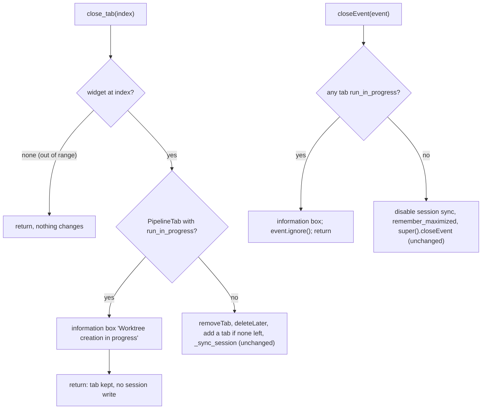

# S08 - Closing a tab or the window is refused while a run is in progress

- **Plan:** [plan.md](plan.md)
- **Type:** Slice
- **Requirements covered:** FR-21; AC "Given a run in progress, when the user tries to close its tab or the main window, then the "Worktree creation in progress" message is shown and nothing closes."
- **Prerequisites:** `MainWindow(window_state, tab_states, session, worktrees)` (with `close_tab`, `closeEvent`, `add_saved_tab`, `find_tab`, `_sync_session`, `_session_sync_enabled`), `PipelineTab` (with `run_in_progress`, `run_finished`, `open_new_worktree_panel`, `new_worktree_panel`, `state_path`), `NewWorktreePanel` (with `groups()`, `create_button`), `WorktreeGroup` (with `source_input`, `parent_input`), `TabState`, `TabStateService`, `WindowStateService.remember_maximized`, `ConfigRepository`; test fixtures `tab_states`, `make_window`, `fake_git` (`FakeGitWorktrees` with `gate`), `worktree_service`
- **Creates:** `RUN_IN_PROGRESS_TITLE`, `RUN_IN_PROGRESS_TEXT` (constants, `views/main_window.py`)

## 1. Goal
A background worktree creation can never be torn down mid-run.

When done:
- While a tab has `run_in_progress`, closing that tab (its × button, i.e.
  `tabs.tabCloseRequested`, or a direct `close_tab(index)`) shows an information box
  titled "Worktree creation in progress" with the text "Wait for the worktree creation
  to finish before closing." The tab stays, and nothing else happens (no session write,
  no replacement tab).
- While any tab has `run_in_progress`, closing the main window (title-bar ×, Alt+F4,
  `window.close()`) shows the same box and the window stays open. Nothing of the
  normal close happens: session sync stays enabled and the maximized state is not
  remembered.
- Tabs without a run in progress still close normally, also while another tab runs.
- Once the run has ended (`run_finished`), closing the tab and the window work again.

## 2. Context
- `src/devpipe/views/main_window.py`:
  - `close_tab(index)` is the single place tabs are removed (wired to
    `tabs.tabCloseRequested`). It returns for an out-of-range index
    (`self.tabs.widget(index) is None`), else removes the tab, `deleteLater()`s it, adds
    a new tab if none is left, and calls `_sync_session()`.
  - `closeEvent(event)` disables session sync (`_session_sync_enabled = False`), calls
    `self._window_state.remember_maximized(self.isMaximized())`, then
    `super().closeEvent(event)`.
  - Module-level text constants (`ALREADY_OPEN_TITLE`, `ALREADY_OPEN_TEXT`, ...) and
    message boxes through the static `QMessageBox` functions with `self` as parent.
- `PipelineTab.run_in_progress` is True from the Create click until the run's outcome
  has been applied (including any warning box shown while applying);
  `PipelineTab.run_finished` is emitted right after it turns False.
- Tests: pytest + pytest-qt, `--import-mode=importlib` (shared doubles only through
  fixtures in `tests/views/conftest.py`). `make_window` builds a `MainWindow` on
  `tmp_path / "config.json"` with the `worktree_service` fixture, whose git is the
  `fake_git` fixture (same instance in one test). `fake_git.gate` (a
  `threading.Event`) makes `add_worktree` wait until it is set (5 s timeout).

## 3. Structure

### 3.1 Files
| File | Change | Responsibility |
|------|--------|----------------|
| `src/devpipe/views/main_window.py` | modify | Refuse closing a running tab or the window during a run |
| `tests/views/test_close_during_run.py` | new | Close refusal tests with a gated fake git |

### 3.2 Views: `src/devpipe/views/main_window.py`

New constants, after `OPEN_ERROR_TITLE`:

```python
RUN_IN_PROGRESS_TITLE = "Worktree creation in progress"
RUN_IN_PROGRESS_TEXT = "Wait for the worktree creation to finish before closing."
```

New private methods of `MainWindow` (placed next to `close_tab`):

```python
def _any_run_in_progress(self) -> bool:
    """True when at least one PipelineTab in self.tabs has run_in_progress."""

def _refuse_close(self) -> None:
    """Show the 'Worktree creation in progress' information box (parent: self)."""
    QMessageBox.information(self, RUN_IN_PROGRESS_TITLE, RUN_IN_PROGRESS_TEXT)
```

`_any_run_in_progress` iterates `range(self.tabs.count())` like `find_tab`, checking
`isinstance(widget, PipelineTab) and widget.run_in_progress`.

`close_tab(index)` (modified): right after the existing `widget is None` check and
before `removeTab`:

```python
if isinstance(widget, PipelineTab) and widget.run_in_progress:
    self._refuse_close()
    return
```

The docstring gains one line: "A tab with a run in progress is not removed: an
information box is shown instead." Everything else in `close_tab` is unchanged.

`closeEvent(event)` (modified): first statement, before disabling session sync or
remembering the window state:

```python
if self._any_run_in_progress():
    self._refuse_close()
    event.ignore()
    return
```

The rest of `closeEvent` is unchanged. Nothing else in the module changes (no new
imports: `QMessageBox`, `QCloseEvent` and `PipelineTab` are already imported).

### 3.3 Tests: `tests/views/test_close_during_run.py` (new)

Module-local helpers and fixtures:
- `RUN_TIMEOUT_MS = 5000`.
- `infos` fixture: monkeypatches `QMessageBox.information` with a recorder that appends
  `(title, text)` and returns `QMessageBox.StandardButton.Ok`; the fixture's value is
  the list.
- `config_bytes(tmp_path) -> bytes`: `(tmp_path / "config.json").read_bytes()`.
- `saved_tab(window, tab_states, tmp_path, name) -> PipelineTab`: saves
  `TabState(name)` to `tmp_path / "states" / f"{name}.json"` (folder created) with
  `tab_states.save`, then `window.add_saved_tab(path, state)`; returns the tab.
  `name` must be a valid feature slug (the repository rejects anything else). The tests
  always use exactly `a = saved_tab(window, tab_states, tmp_path, "feat-a")` and, when a
  second tab is needed, `b = saved_tab(window, tab_states, tmp_path, "feat-b")`, created
  in that order (so `b` is the current tab afterwards). "A" and "B" in 6.1 mean these
  two tabs.
- `start_gated_run(tab, fake_git, tmp_path) -> None`: always sets a fresh
  `fake_git.gate = threading.Event()` (each test starts exactly one gated run), calls
  `tab.open_new_worktree_panel()`, creates the folders `tmp_path / f"src-{tab.title()}"`
  and `tmp_path / f"wt-{tab.title()}"` (for A: `src-feat-a`, `wt-feat-a`), sets group
  0's `source_input` / `parent_input` to their `str()` (the create button is enabled
  once both inputs are filled; assert `create_button.isEnabled()`), calls
  `tab.new_worktree_panel.create_button.click()` (a programmatic click, which works
  whether or not the tab is the current one), and asserts `tab.run_in_progress`.
- `finish_run(qtbot, tab, fake_git) -> None`: `fake_git.gate.set()` then
  `qtbot.waitUntil(lambda: not tab.run_in_progress, timeout=RUN_TIMEOUT_MS)`.
- Every test that starts a gated run calls `finish_run` in a `finally`, so no
  `QThread` is destroyed while running and the window can close at teardown.
- `window` fixture: `make_window()`, then `window.show()` and `qtbot.waitExposed(window)`.

## 4. Logic flows



Tab close checks only the tab being closed; window close checks every tab. The
refusal comes before any side effect, so a refused close leaves the window exactly as
it was.

## 5. Edge cases and errors
| Case | Expected behavior |
|------|-------------------|
| Close a running tab (× or `close_tab`) | Information box; tab count and order unchanged; tab not deleted; session unchanged |
| Close the window while any tab runs (also a non-current tab) | Information box; `event.ignore()`; window stays visible; `config.json` unchanged (no session write, no `remember_maximized`); session sync still enabled |
| Close another tab without a run while one runs | Closes normally; session updated; no box |
| Close the only tab while it runs | Refused; no replacement tab is added |
| Out-of-range index while a run is in progress | No-op, no box (existing behavior first) |
| Close after `run_finished` | Works normally |
| No run anywhere | Unchanged behavior, no box (existing tests keep passing) |
| Window close attempted while the run's outcome is being applied (e.g. a warning box is open) | Still refused: `run_in_progress` is True until `run_finished` |

## 6. Tests

### 6.1 Automated
Fixtures used: `qtbot`, `tmp_path`, `make_window` (through the module's `window`
fixture), `tab_states`, `fake_git`, `infos`, `monkeypatch`.

| Test file | Test name | Given / When / Then | Proves |
|-----------|-----------|---------------------|--------|
| `tests/views/test_close_during_run.py` | `test_closing_running_tab_is_refused` | Given saved tabs A and B, a gated run in A, and `before = config_bytes(tmp_path)` taken right after `start_gated_run` and before the close request / when `window.tabs.tabCloseRequested.emit(window.tabs.indexOf(A))` / then `infos == [("Worktree creation in progress", "Wait for the worktree creation to finish before closing.")]`, the tab count is unchanged, `window.tabs.indexOf(A) >= 0`, and `config_bytes(tmp_path) == before` | FR-21 (tab), AC |
| same | `test_closing_running_tab_directly_is_refused` | Given a gated run in the only saved tab A / when `window.close_tab(0)` / then one info box, `window.tabs.count() == 1`, `window.tabs.widget(0) is A` (no replacement tab) | FR-21 (tab), edge case "only tab" |
| same | `test_other_tab_closes_during_run` | Given saved tabs A and B and a gated run in A / when `window.close_tab(window.tabs.indexOf(B))` / then `infos == []`, the count dropped by one, `window.find_tab(B's path) is None` and the session's open files no longer list B | FR-21 ("other tabs still close") |
| same | `test_closing_window_during_run_is_refused` | Given saved tabs A and B, a gated run in A, B selected (current after creation), `before = config_bytes(tmp_path)` taken right after `start_gated_run` and before the close request, and `WindowStateService.remember_maximized` monkeypatched to record calls / when `window.close()` / then it returns False, one info box, `window.isVisible()`, the tab count is unchanged, `config_bytes(tmp_path) == before`, no `remember_maximized` call; when B is then closed with `close_tab` / then the session in `config.json` drops B (sync still enabled) | FR-21 (window), refusal before side effects |
| same | `test_closing_works_after_run_finished` | Given saved tabs A and B and a gated run in A, a refused `close_tab` of A / when the gate is set inside `qtbot.waitSignal(A.run_finished, timeout=RUN_TIMEOUT_MS)` and `close_tab(indexOf(A))` is called / then A is gone and only the one earlier info box was shown; when `window.close()` / then it returns True and `window.isHidden()` | FR-21 ("after the run ends") |
| same | `test_out_of_range_close_during_run_does_nothing` | Given a gated run in A / when `window.close_tab(5)` / then `infos == []`, count unchanged | Edge case |

Regression: `tests/views/test_main_window.py::test_closing_unsaved_tabs_asks_nothing`
(fails on any `QMessageBox.information`) and the close tests in
`tests/views/test_session_restore.py` must keep passing unchanged.

Run with: `uv run pytest tests/views/test_close_during_run.py`, then the whole suite
`uv run pytest`.

### 6.2 Manual
- Given `uv run devpipe` and a saved tab with the New worktree panel filled with a
  repository large enough for `git worktree add` to take a moment (or a folder on a
  slow network drive), when Create is clicked and the tab's × is clicked immediately,
  then the "Worktree creation in progress" box appears with "Wait for the worktree
  creation to finish before closing." and the tab stays. (FR-21)
- Same setup, when the window's title-bar × (or Alt+F4) is used during the run, then
  the same box appears and the window stays open; after the run ends, the window
  closes normally and the next start restores the session. (FR-21)
- During the run, a second saved tab without a run closes normally. (FR-21)

### 6.3 Static checks
- `rg -n "RUN_IN_PROGRESS_(TITLE|TEXT) =" src/devpipe/views/main_window.py` → two matches.
- `rg -n "\.run_in_progress" src/devpipe/views/main_window.py` → matches only in the
  bodies of `_any_run_in_progress` and `close_tab`.
- `git diff --stat -- ai-skills src/devpipe/views/pipeline_tab.py src/devpipe/views/new_worktree_panel.py` → empty.

## 7. Implementation order
1. `main_window.py`: the two constants, `_refuse_close`, `_any_run_in_progress`.
2. `close_tab` refusal; then the `closeEvent` refusal as its first statement.
3. `tests/views/test_close_during_run.py`; run it, then `uv run pytest` and the manual
   checks.

## 8. Out of scope
- No change to `PipelineTab`, the run, the worker, the New worktree panel or the start
  panel.
- No cancel of a running run, and no "close anyway" option in the box.
- No handling of application shutdown paths that bypass `closeEvent` (for example
  `QApplication.quit()` called directly); the app has none.
- No change to the tab state file, the session format or `config.json` keys.
- `ai-skills/` is not touched.

## 9. Design notes
- **Refuse in the existing single entry points:** `close_tab` is already the only place
  tabs are removed and `closeEvent` the only window-close hook, so one check in each
  covers the × button, Alt+F4 and programmatic closes (no new signal wiring).
- **Refusal first in `closeEvent`:** disabling session sync and remembering the window
  state are side effects of a close that does not happen; doing them before the check
  would silently stop session tracking for the rest of the session.
- **`_refuse_close` shared by both paths (DRY):** one place for the box and its texts.
- **Information box, not a question:** FR-21 refuses the close outright; there is no
  cancel of a run, so offering "close anyway" would orphan the thread.
- **Gated fake git in tests:** a run is held open with `fake_git.gate` so the refusal is
  observed deterministically; every test releases it in `finally` and waits for the run
  to end so no `QThread` is destroyed while running.
