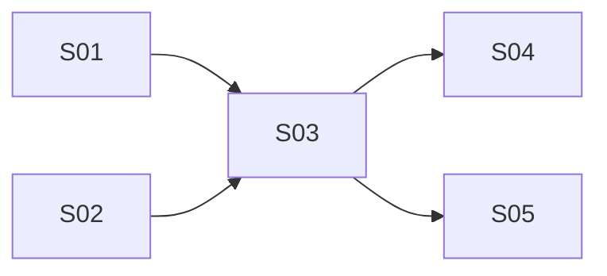

# Implementation Steps: Tab state file

- **Source feature spec:** `.devpipe/tab-state-file/feature-spec.md`
- **Date:** 2026-11-13
- **Steps:** 5 (4 slices, 1 enabler) in 3 stages

## 1. Overview
The work starts with two independent foundations: the new tab structure (panel stack, start
panel, "+" and closable tabs, all view-only) and the state file read/write stack (model,
repository, service), which has no UI. They meet in the first-save slice, which ties a tab to a
state file with the Save dialog and auto-save. Session restore and File > Open then build on the
saved tab in parallel.

## 2. Software layers
| Layer | Location / main files | Notes |
|-------|----------------------|-------|
| Composition | `src/devpipe/app.py` | Builds repositories and services, injects them into `MainWindow`. |
| Views | `src/devpipe/views/` (`main_window.py`, `start_tab.py` today) | Only layer with Qt widgets, dialogs and message boxes. Never imports persistence. |
| Services | `src/devpipe/services/` (`window_state_service.py`) | Use cases, `Protocol`-typed stores so tests inject fakes. No Qt. |
| Persistence | `src/devpipe/persistence/` (`config_repository.py`) | File I/O for `config.json` and now the tab state file. No Qt. Keeps unknown keys of `config.json`. |
| Models | `src/devpipe/models/` (`app_config.py`) | Dataclasses, enums, pure rules, domain errors. No Qt, no I/O. |
| Docs | `docs/architecture.md` | Layer rules and layout tree; must describe tabs/panels. |
| Tests | `tests/models/`, `tests/persistence/`, `tests/services/`, `tests/views/` | pytest + pytest-qt, `--import-mode=importlib`. Run `uv run pytest` and `uv run lint-imports`. |

## 3. Steps

### S01 - Tabs hold a panel stack with an unsaved start panel

- **Type:** Slice
- **Purpose:** Replace the fixed `StartTab` with a tab container that holds a stack of panels, give the start panel its feature-name row, and let the user add and close tabs freely. This is the navigation structure later panels plug into.
- **Behavior:** Each tab shows a start panel with a feature-name input, a "Save" button to its right, a live slug preview below the input and the existing "Open a pipeline" / "Create a pipeline" buttons. Typing "Nová Feature_X" previews `nova-feature-x` and enables Save; "!!!" previews nothing and keeps Save disabled. "Open a pipeline" and "Create a pipeline" stay disabled (the tab is unsaved). Clicking Save emits a request carrying the slug (no file is written in this step). The tab bar has a "+" corner button that adds and selects a new "New pipeline" tab; every tab is closable; closing the last tab adds a new unsaved tab; unsaved tabs are discarded with no confirmation.
- **Requirements covered:** FR-01, FR-02 (close button, no file deletion), FR-03, FR-04 ("New pipeline" title), FR-06, FR-07, FR-08, FR-09 (slug condition), FR-10 (unsaved state), FR-26
- **Depends on:** none
- **Prerequisites:** `MainWindow.tabs` (existing `QTabWidget`), `WindowStateService` (existing)
- **Provides:**
  - `normalize_feature_name(text: str) -> str` in `devpipe.models.feature_name`: pure; strips accents (NFKD), lowercases, turns spaces/underscores/any non-`a-z0-9` run into a single hyphen, trims leading/trailing hyphens; result is `""` or matches `^[a-z0-9]+(-[a-z0-9]+)*$`.
  - `StartPanel` (`QWidget`) in `devpipe.views.start_panel`: attributes `name_input` (`QLineEdit`), `slug_label` (`QLabel`), `save_button`, `open_button`, `create_button` (`QPushButton`); signal `save_requested(str)` emitted with the current slug when Save is clicked; method `show_saved(feature_name: str)` that puts the panel in saved mode (input text replaced by `feature_name`, input and Save disabled, Open and Create enabled; the row stays visible). Until `show_saved` is called the panel is in unsaved mode (Save enabled only when the slug is non-empty; Open and Create disabled).
  - `PipelineTab` (`QWidget`) in `devpipe.views.pipeline_tab`: attribute `stack` (`QStackedWidget`; new panels are added to it, exactly one is shown), attribute `start_panel` (`StartPanel`, the first panel of `stack`), methods `title() -> str` (returns `"New pipeline"`) and `tooltip() -> str` (returns `""`), signal `identity_changed()`. Later work may add constructor arguments, attributes and methods, and may extend `title()` / `tooltip()` to reflect a saved state, emitting `identity_changed` after a change.
  - `MainWindow.add_pipeline_tab(tab: PipelineTab) -> int`: the single entry point that inserts a tab (at the end, title `tab.title()`, tooltip `tab.tooltip()`) and connects `tab.identity_changed` so the tab's text and tooltip are refreshed from `title()` / `tooltip()`; returns the index. Later work may add signal connections inside it.
  - `MainWindow.add_new_tab() -> PipelineTab`: builds an unsaved `PipelineTab`, adds it with `add_pipeline_tab`, selects it and returns it. Later work may change how the tab is constructed (extra constructor arguments); signature and behavior stay.
  - `MainWindow.close_tab(index: int) -> None`: the single place tabs are removed (wired to `tabCloseRequested`); if no tab is left it calls `add_new_tab()`. Later work may add calls at its end.
  - `MainWindow.new_tab_button` (`QToolButton` "+", corner widget of `tabs`, calls `add_new_tab()`).
  - "Tabs and panels" section and views entries of the layout tree in `docs/architecture.md`.
- **Layers touched:**
  | Layer | Files | Change |
  |-------|-------|--------|
  | Models | `src/devpipe/models/feature_name.py` | new: `normalize_feature_name` |
  | Views | `src/devpipe/views/start_panel.py` | new: `StartPanel` (row, preview, existing big buttons) |
  | Views | `src/devpipe/views/start_tab.py` | delete (replaced by `StartPanel`) |
  | Views | `src/devpipe/views/pipeline_tab.py` | new: `PipelineTab` with `QStackedWidget` |
  | Views | `src/devpipe/views/main_window.py` | modify: closable tabs, "+" corner button, `add_pipeline_tab`, `add_new_tab`, `close_tab` |
  | Docs | `docs/architecture.md` | modify: "Tabs and panels" section; views lines of the layout tree |
  | Tests | `tests/models/test_feature_name.py` | new |
  | Tests | `tests/views/test_start_panel.py` | new (replaces `test_start_tab.py`) |
  | Tests | `tests/views/test_start_tab.py` | delete |
  | Tests | `tests/views/test_pipeline_tab.py` | new |
  | Tests | `tests/views/test_main_window.py` | modify: tab 0 is a `PipelineTab`; "+", close, last-close tests |
- **How to test:**
  - Automated: `uv run pytest` and `uv run lint-imports`. Cases: `normalize_feature_name("Nová Feature_X") == "nova-feature-x"`, `"!!!" -> ""`, `"  a--b  " -> "a-b"`; StartPanel unsaved mode enables Save only for a non-empty slug and keeps Open/Create disabled; `save_requested` carries the slug; `show_saved("x")` gives the saved-mode widget states; `PipelineTab.stack.currentWidget() is tab.start_panel`; "+" adds and selects a tab titled "New pipeline"; closing a tab removes it; closing the last tab leaves exactly one new tab.
  - Manual: Given `uv run devpipe`, when the user types "New Feature", then the preview shows `new-feature` and only Save is enabled; when they click "+" twice and close all tabs, then one "New pipeline" tab remains.
- **Notes / risks:** The "any button added later" part of FR-10 is documented in the "Tabs and panels" section: panels keep their action buttons disabled while the tab is unsaved. `docs/architecture.md`: this step owns the new section and the views lines of the layout tree; it does not edit the layer table rows.

### S02 - Tab state files can be written and read back with validation

- **Type:** Enabler
- **Purpose:** Provide the tab state file format and its I/O, so a tab can be persisted and loaded. No UI.
- **Behavior:** A `TabState` saved to a path produces `{"version": 1, "feature_name": "<slug>", "active_panel": "start"}` as UTF-8, indented JSON with a trailing newline. Loading that file returns an equal `TabState`. Loading fails with a `TabStateError` holding the path and a readable reason when the file is missing, unreadable, not valid JSON, not an object, has `version` other than 1, has a missing/empty/invalid `feature_name`, or has an unknown `active_panel`. A write failure also raises `TabStateError`.
- **Requirements covered:** FR-15, FR-17, FR-25 (error type for write failures); enables FR-16, FR-20, FR-24
- **Depends on:** none
- **Prerequisites:** none
- **Provides:**
  - `Panel` (`enum.Enum`, `START = "start"`) in `devpipe.models.tab_state`: the panel ids; values are the `active_panel` strings.
  - `TabState` dataclass in `devpipe.models.tab_state`: `feature_name: str`, `active_panel: Panel = Panel.START`.
  - `STATE_FILE_VERSION = 1` and `is_valid_feature_name(name: str) -> bool` (matches `^[a-z0-9]+(-[a-z0-9]+)*$`) in `devpipe.models.tab_state`.
  - `TabStateError(Exception)` in `devpipe.models.tab_state`: attributes `path: Path`, `reason: str`; `str()` reads "`<path>`: `<reason>`". Views may import it to show errors.
  - `TabStateRepository` in `devpipe.persistence.tab_state_repository`: `load(path: Path) -> TabState`, `save(path: Path, state: TabState) -> None`; both raise only `TabStateError`.
  - `TabStateStore` (`Protocol` with the same `load` / `save`) and `TabStateService(store: TabStateStore)` in `devpipe.services.tab_state_service`: `load(path) -> TabState`, `save(path, state) -> None`, both raising `TabStateError`. Later work may add methods.
  - Persistence row of the layer table in `docs/architecture.md` lists the tab state file.
- **Layers touched:**
  | Layer | Files | Change |
  |-------|-------|--------|
  | Models | `src/devpipe/models/tab_state.py` | new: `Panel`, `TabState`, `STATE_FILE_VERSION`, `is_valid_feature_name`, `TabStateError` |
  | Persistence | `src/devpipe/persistence/tab_state_repository.py` | new: `TabStateRepository` |
  | Services | `src/devpipe/services/tab_state_service.py` | new: `TabStateStore`, `TabStateService` |
  | Docs | `docs/architecture.md` | modify: Persistence row of the layer table only |
  | Tests | `tests/models/test_tab_state.py` | new |
  | Tests | `tests/persistence/test_tab_state_repository.py` | new |
  | Tests | `tests/services/test_tab_state_service.py` | new (with a fake store) |
- **How to test:**
  - Automated: `uv run pytest` and `uv run lint-imports`. Round trip; exact file text (`json.loads` equals the three fields, ends with `"\n"`); one parametrized test per FR-17 failure case checking `TabStateError.path` and a non-empty `reason`; save into a missing directory (or a read-only path) raises `TabStateError`.
  - Manual: none (no UI).
- **Notes / risks:** `docs/architecture.md` is also edited by S01 in parallel; this step touches only the Persistence row of the layer table.

### S03 - First save ties a tab to a state file, then auto-saves

- **Type:** Slice
- **Purpose:** Let the user save a named tab to a state file of their choice, and keep that file up to date afterwards. This is the core of the feature.
- **Behavior:** Clicking Save opens the native Save dialog ("JSON files (*.json)", suggested `<slug>.json`, in the last-used folder or the home folder). Cancelling changes nothing. Confirming writes the state file (appending `.json` when the name has no extension), stores the file's folder as the last-used folder in `config.json`, switches the start panel to saved mode, and sets the tab title to the slug and the tooltip to the full path. Saving to a path already open in another tab shows a warning and the tab stays unsaved. A write failure shows a warning with the path and reason; the tab stays unsaved (first save) or keeps its in-memory state and retries on the next change (auto-save). After the first save, every state change (`show_panel`) rewrites the file with no dialog.
- **Requirements covered:** FR-04 (saved title/tooltip), FR-09 (disabled once saved), FR-10 (enabled once saved), FR-11, FR-12 (saved files), FR-13, FR-14, FR-15, FR-16, FR-23, FR-25
- **Depends on:** S01, S02
- **Prerequisites:** `StartPanel.save_requested`, `StartPanel.show_saved`, `PipelineTab` (and its `stack`, `start_panel`, `title()`, `tooltip()`, `identity_changed`), `MainWindow.add_pipeline_tab`, `MainWindow.add_new_tab`, `Panel`, `TabState`, `TabStateError`, `TabStateService`, `TabStateRepository`, `ConfigStore` (existing Protocol in `window_state_service.py`)
- **Provides:**
  - `AppConfig.last_state_folder: Path | None = None`; `ConfigRepository` reads/writes it as the `last_state_folder` string key (invalid values fall back to `None`, unknown keys kept).
  - `SessionService(store: ConfigStore)` in `devpipe.services.session_service`: `start_folder() -> Path` (last-used folder if it still exists, else `Path.home()`), `remember_folder(state_file: Path) -> None` (stores `state_file.parent`). Later work may add methods and `AppConfig` fields.
  - `same_file(a: Path, b: Path) -> bool` in `devpipe.services.paths`: compares after `Path.resolve()`, case-insensitively on Windows.
  - `PipelineTab.state_path: Path | None` (`None` while unsaved), `PipelineTab.active_panel: Panel`, `PipelineTab.show_panel(panel: Panel)` (shows the panel; when saved, auto-saves), `PipelineTab.apply_saved(path: Path, state: TabState)` (puts the tab in saved mode for that file and shows `state.active_panel`, without writing). Once saved, `title()` returns the feature name, `tooltip()` the full path, and `identity_changed` is emitted.
  - `MainWindow(window_state: WindowStateService, tab_states: TabStateService, session: SessionService)` constructor; `app.py` builds and injects the new repositories and services.
  - `MainWindow.find_tab(path: Path) -> int | None`: index of the tab whose `state_path` is the same file (`same_file`), else `None`.
  - `MainWindow.add_saved_tab(path: Path, state: TabState) -> PipelineTab`: builds a tab, calls `apply_saved`, adds it with `add_pipeline_tab`, selects it and returns it.
  - Test fixture `make_window` in `tests/views/conftest.py`: returns a callable that builds a new `MainWindow` with real repositories on `tmp_path / "config.json"` (same file on every call, so a second call simulates a restart), registered with `qtbot`.
- **Layers touched:**
  | Layer | Files | Change |
  |-------|-------|--------|
  | Models | `src/devpipe/models/app_config.py` | modify: `last_state_folder` |
  | Persistence | `src/devpipe/persistence/config_repository.py` | modify: read/write `last_state_folder` |
  | Services | `src/devpipe/services/session_service.py` | new: `SessionService` (last-used folder) |
  | Services | `src/devpipe/services/paths.py` | new: `same_file` |
  | Views | `src/devpipe/views/pipeline_tab.py` | modify: saved state, `state_path`, `active_panel`, `show_panel`, `apply_saved`, auto-save, title/tooltip |
  | Views | `src/devpipe/views/main_window.py` | modify: constructor arguments, Save dialog flow, duplicate check, warnings, `find_tab`, `add_saved_tab` |
  | Composition | `src/devpipe/app.py` | modify: build `TabStateRepository`, `TabStateService`, `SessionService`; inject them |
  | Tests | `tests/views/conftest.py` | new: `make_window` fixture |
  | Tests | `tests/views/test_first_save.py` | new (monkeypatch `QFileDialog.getSaveFileName`, `QMessageBox.warning`) |
  | Tests | `tests/views/test_main_window.py` | modify: build windows with `make_window` |
  | Tests | `tests/services/test_session_service.py` | new |
  | Tests | `tests/services/test_paths.py` | new |
  | Tests | `tests/persistence/test_config_repository.py` | modify: `last_state_folder` round trip and fallback |
- **How to test:**
  - Automated: `uv run pytest` and `uv run lint-imports`. Given a valid name, when Save is clicked, then the dialog is called with the start folder, `<slug>.json` and the JSON filter; given cancel, then the tab is unchanged and no file exists; given a confirmed path, then the file has the three fields, input and Save are disabled, Open/Create enabled, title = slug, tooltip = path, and `config.json` has `last_state_folder`; given a path open in another tab (`add_saved_tab`), then a warning is shown and the tab stays unsaved; given a write failure, then a warning shows path and reason and the tab stays unsaved; given a saved tab whose file was deleted, when `show_panel(Panel.START)` is called, then the file is written again; `start_folder()` falls back to home when the folder is gone.
  - Manual: Given a new tab named "New Feature", when the user clicks Save and confirms, then `new-feature.json` exists with the expected content and the tab is titled `new-feature` with the path as tooltip; the next Save dialog in another tab opens in the same folder.
- **Notes / risks:** Uses the feature spec assumption that `.json` is appended when the typed name has no extension. The native Save dialog handles overwrite confirmation for files that exist but are not open. Errors use `QMessageBox.warning`.

### S04 - Open tabs are kept in config.json and restored at startup

- **Type:** Slice
- **Purpose:** Let the user continue where they stopped: the saved open tabs and the active tab come back on the next start.
- **Behavior:** `config.json` always holds the ordered paths of the saved open tabs and the active one, rewritten on first save, any tab added from a file, close, reorder and active-tab change; unsaved tabs never appear. At startup a tab opens for each listed file, in order, showing its `active_panel`, and the previously active tab is selected (if it was unsaved, the last saved tab that was active, else the first restored tab). Invalid files are skipped silently and removed from the list. If nothing is restored, one unsaved tab is shown. Closed tabs leave their files on disk.
- **Requirements covered:** FR-02 (removed from the session list), FR-18, FR-19, FR-20, FR-21
- **Depends on:** S03
- **Prerequisites:** `SessionService`, `AppConfig.last_state_folder` and the `ConfigRepository` key handling it extends, `TabStateService.load`, `TabStateError`, `MainWindow.add_pipeline_tab`, `MainWindow.add_new_tab`, `MainWindow.close_tab`, `MainWindow.add_saved_tab`, `PipelineTab.state_path`, `PipelineTab.identity_changed`, `make_window` fixture
- **Provides:**
  - `AppConfig.open_state_files: list[Path]` (default empty) and `AppConfig.active_state_file: Path | None` (default `None`); `ConfigRepository` reads/writes the `open_state_files` (list of strings) and `active_state_file` keys, with invalid values falling back to empty/`None`.
  - `SessionService.open_files() -> list[Path]`, `SessionService.active_file() -> Path | None`, `SessionService.remember_session(files: list[Path], active: Path | None) -> None`.
  - Session sync in `MainWindow`: any tab added through `add_pipeline_tab` or removed through `close_tab`, any first save (`identity_changed`), tab move and current-tab change rewrites the session list. Tabs added from a file by any code path are thus recorded without extra calls.
- **Layers touched:**
  | Layer | Files | Change |
  |-------|-------|--------|
  | Models | `src/devpipe/models/app_config.py` | modify: `open_state_files`, `active_state_file` |
  | Persistence | `src/devpipe/persistence/config_repository.py` | modify: read/write the two session keys |
  | Services | `src/devpipe/services/session_service.py` | modify: add session list methods |
  | Views | `src/devpipe/views/main_window.py` | modify: startup restore in the constructor (one unsaved tab only when nothing restored), session sync connections in `add_pipeline_tab` / end of `close_tab`, tab bar `tabMoved` and `currentChanged` |
  | Tests | `tests/views/test_session_restore.py` | new |
  | Tests | `tests/services/test_session_service.py` | modify: session list cases |
  | Tests | `tests/persistence/test_config_repository.py` | modify: session keys round trip and fallbacks |
- **How to test:**
  - Automated: `uv run pytest` and `uv run lint-imports`. With `make_window`: given two saved tabs and one unsaved tab with the second saved tab active, when the window is closed and `make_window()` is called again, then two tabs reopen in order with the second selected; given a listed file deleted or corrupted, then it is skipped with no dialog and `config.json` no longer lists it; given no restorable files, then one unsaved tab; given a tab is closed, then it leaves `open_state_files` and its file still exists; given tabs are reordered or the current tab changes, then `config.json` follows.
  - Manual: Given two saved tabs, when the user closes and restarts devpipe, then both tabs come back in order with the same tab selected.
- **Notes / risks:** Uses the feature spec assumption for an unsaved active tab at shutdown. Restore must not write a partial list while tabs are being rebuilt (sync once after restore, which also drops invalid entries). Region in `main_window.py`: constructor restore, `add_pipeline_tab`, `close_tab` and tab bar signal connections; it does not touch the menu bar.

### S05 - File > Open loads a state file into a tab

- **Type:** Slice
- **Purpose:** Let the user resume a pipeline that is not in the current session.
- **Behavior:** The window has a menu bar with File > Open... (Ctrl+O). It shows the native Open dialog ("JSON files (*.json)") in the last-used folder (or home). Choosing a valid file not yet open adds and selects a saved tab for it, showing its `active_panel`, and stores its folder as the last-used folder. Choosing a file already open selects that tab and adds nothing. Choosing an invalid file shows a warning with the path and the reason, and no tab opens. Cancelling does nothing.
- **Requirements covered:** FR-05, FR-12 (opened files), FR-22, FR-24
- **Depends on:** S03
- **Prerequisites:** `SessionService.start_folder`, `SessionService.remember_folder`, `TabStateService.load`, `TabStateError`, `MainWindow.find_tab`, `MainWindow.add_saved_tab`, `make_window` fixture
- **Provides:** `MainWindow.open_action` (`QAction` "Open...", shortcut Ctrl+O, in the "File" menu of the window's menu bar).
- **Layers touched:**
  | Layer | Files | Change |
  |-------|-------|--------|
  | Views | `src/devpipe/views/main_window.py` | modify: menu bar with File > Open..., open handler (dialog, `find_tab`, load, warning, `add_saved_tab`, `remember_folder`) |
  | Tests | `tests/views/test_file_open.py` | new (monkeypatch `QFileDialog.getOpenFileName`, `QMessageBox.warning`) |
- **How to test:**
  - Automated: `uv run pytest` and `uv run lint-imports`. Given a valid file not open, when `open_action` is triggered, then a new selected tab titled with the feature name exists and `last_state_folder` is its folder; given that file is already open, then that tab is selected and the count is unchanged; given an invalid file, then a warning containing the path and reason is shown and the count is unchanged; given cancel, then nothing changes; the dialog receives the start folder and the JSON filter; `open_action.shortcut()` is Ctrl+O.
  - Manual: Given a saved state file not open, when the user presses Ctrl+O and picks it, then it opens in a new tab; picking it again focuses that tab.
- **Notes / risks:** Region in `main_window.py`: menu bar creation and the open handler only; it does not touch tab add/close or session code.

## 4. Execution stages
| Stage | Steps (parallel) | Depends on stages | Delivers |
|-------|------------------|-------------------|----------|
| 1 | S01, S02 | - | Panel-stack tabs with an unsaved start panel, "+" and closable tabs; state file format and I/O |
| 2 | S03 | 1 | First save with the Save dialog, last-used folder, duplicate check, auto-save, write errors |
| 3 | S04, S05 | 2 | Session list and startup restore; File > Open |

**Critical path:** S01 → S03 → S04 (S02 and S05 run beside it)

**Parallelization notes:**
- Stage 1: S01 and S02 share only `docs/architecture.md`; S01 owns the new "Tabs and panels" section and the views lines of the layout tree, S02 edits only the Persistence row of the layer table. No other shared files.
- Stage 3: S04 and S05 both edit `src/devpipe/views/main_window.py` in separate regions: S04 owns the constructor restore, the session sync inside `add_pipeline_tab` / `close_tab` and the tab bar signals; S05 owns the menu bar and its open handler. Each adds its own test file; only S04 edits `session_service.py`, `app_config.py`, `config_repository.py`. A tab opened by S05 is recorded in the session because S04 syncs on every `add_pipeline_tab`.

## 5. Requirements coverage
| Requirement | Steps |
|-------------|-------|
| FR-01 | S01 |
| FR-02 | S01, S04 |
| FR-03 | S01 |
| FR-04 | S01, S03 |
| FR-05 | S05 |
| FR-06 | S01 |
| FR-07 | S01 |
| FR-08 | S01 |
| FR-09 | S01, S03 |
| FR-10 | S01, S03 |
| FR-11 | S03 |
| FR-12 | S03, S05 |
| FR-13 | S03 |
| FR-14 | S03 |
| FR-15 | S02, S03 |
| FR-16 | S03 |
| FR-17 | S02 |
| FR-18 | S04 |
| FR-19 | S04 |
| FR-20 | S04 |
| FR-21 | S04 |
| FR-22 | S05 |
| FR-23 | S03 |
| FR-24 | S05 |
| FR-25 | S02, S03 |
| FR-26 | S01 |
| Acceptance: `docs/architecture.md`, `lint-imports`, `pytest` | S01, S02 (docs); all steps (checks) |

## 6. Shared items
| Item | Kind | Created by | Used / extended by | What others may rely on |
|------|------|-----------|--------------------|-------------------------|
| `normalize_feature_name` | function (`models/feature_name.py`) | S01 | - | pure; `""` or a valid slug |
| `StartPanel` (`name_input`, `slug_label`, `save_button`, `open_button`, `create_button`) | widget class | S01 | S03 | unsaved mode by default; Open/Create disabled until saved |
| `StartPanel.save_requested(str)` | Qt signal | S01 | S03 | emitted with the slug on Save click |
| `StartPanel.show_saved(feature_name)` | method | S01 | S03 | switches the panel to saved mode |
| `PipelineTab` (`stack`, `start_panel`, `title()`, `tooltip()`, `identity_changed`) | widget class | S01 | S03, S04 | panels live in `stack`; may gain arguments/methods; `identity_changed` after title/tooltip change |
| `MainWindow.add_pipeline_tab(tab)` | method | S01 | S03, S04 | single insertion point; refreshes text/tooltip on `identity_changed`; may gain connections |
| `MainWindow.add_new_tab()` | method | S01 | S03, S04 | adds and selects an unsaved tab; construction may gain arguments |
| `MainWindow.close_tab(index)` | method | S01 | S04 | single removal point; adds a tab when none is left; may gain calls at its end |
| `MainWindow.new_tab_button` | widget | S01 | - | "+" corner button |
| "Tabs and panels" section, views lines of layout tree | doc region | S01 | - | describes the panel-stack structure |
| `Panel` | enum (`models/tab_state.py`) | S02 | S03, S04, S05 | `START = "start"` |
| `TabState` | dataclass | S02 | S03, S04, S05 | `feature_name`, `active_panel` |
| `STATE_FILE_VERSION`, `is_valid_feature_name` | constant, function | S02 | - | version 1; slug regex |
| `TabStateError` | exception (models) | S02 | S03, S04, S05 | `path`, `reason`; the only error from load/save |
| `TabStateRepository` | class | S02 | S03 (wiring) | `load(path)`, `save(path, state)` |
| `TabStateStore`, `TabStateService` | Protocol, service | S02 | S03, S04, S05 | `load(path)`, `save(path, state)`; may gain methods |
| Persistence row of the layer table | doc region | S02 | - | lists the tab state file |
| `AppConfig.last_state_folder` + `last_state_folder` key | model field, config key | S03 | S04 (adds sibling fields) | `Path | None` |
| `SessionService` (`start_folder`, `remember_folder`) | service | S03 | S04 (adds methods), S05 | home fallback when folder is gone |
| `same_file(a, b)` | function (`services/paths.py`) | S03 | - (through `find_tab`) | resolve + case-insensitive on Windows |
| `PipelineTab.state_path`, `active_panel`, `show_panel`, `apply_saved` | attributes, methods | S03 | S04, S05 | `apply_saved` never writes; `show_panel` auto-saves when saved |
| `MainWindow(window_state, tab_states, session)` | constructor | S03 | S04, S05 | injected services |
| `MainWindow.find_tab(path)` | method | S03 | S05 | index or `None` |
| `MainWindow.add_saved_tab(path, state)` | method | S03 | S04, S05 | adds, selects and returns a saved tab |
| `make_window` | pytest fixture (`tests/views/conftest.py`) | S03 | S04, S05 | same `config.json` on every call |
| `AppConfig.open_state_files`, `AppConfig.active_state_file` + keys | model fields, config keys | S04 | - | ordered paths; active or `None` |
| `SessionService.open_files`, `active_file`, `remember_session` | methods | S04 | - | session list access |
| `MainWindow.open_action` | `QAction` | S05 | - | File > Open..., Ctrl+O |

## 7. Assumptions and open points
- Typing a name without an extension in the Save dialog appends `.json` (feature spec assumption; S03).
- When the active tab at shutdown was unsaved, the last saved tab that was active is selected, else the first restored tab (feature spec assumption; S04).
- State files are read synchronously at startup, with no network timeout handling (feature spec assumption; S04).
- `TabStateError` lives in `models/tab_state.py` (not in persistence) so views can show its reason without importing persistence (planning decision; S02, S03, S05).
- In this feature the only state change after the first save is `show_panel` (only `Panel.START` exists), so auto-save is tested by calling it directly (S03).
