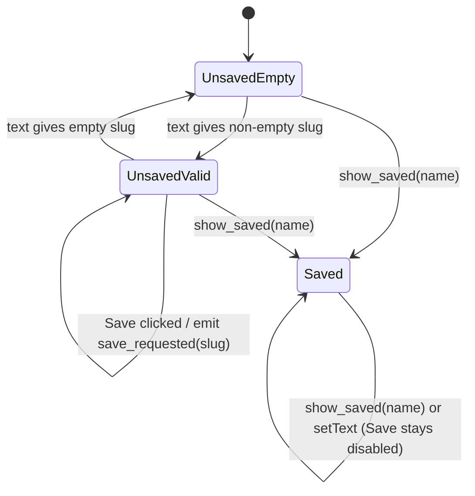
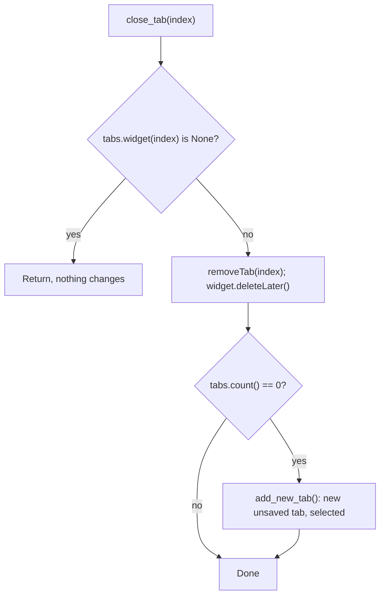

# S01 - Tabs hold a panel stack with an unsaved start panel

- **Plan:** [plan.md](plan.md)
- **Type:** Slice
- **Requirements covered:** FR-01, FR-02 (close button, no file deletion), FR-03, FR-04 ("New pipeline" title), FR-06, FR-07, FR-08, FR-09 (slug condition), FR-10 (unsaved state), FR-26
- **Prerequisites:** `MainWindow.tabs` (existing `QTabWidget`), `WindowStateService` (existing)
- **Creates:** `normalize_feature_name`, `StartPanel` (`name_input`, `slug_label`, `save_button`, `open_button`, `create_button`, `save_requested(str)`, `show_saved(feature_name)`), `PipelineTab` (`stack`, `start_panel`, `title()`, `tooltip()`, `identity_changed`), `MainWindow.add_pipeline_tab(tab)`, `MainWindow.add_new_tab()`, `MainWindow.close_tab(index)`, `MainWindow.new_tab_button`, the "Tabs and panels" section and the views lines of the layout tree in `docs/architecture.md`

## 1. Goal
Every tab of the main window is a `PipelineTab`: a container with a `QStackedWidget` of panels that shows exactly one panel, today the `StartPanel`. The start panel has a top row with a feature-name input and a "Save" button on its right, a live slug preview under the input, and the existing big "Open a pipeline" / "Create a pipeline" buttons centered below.

Observable behavior when done:
- A new tab shows the start panel with an empty input; Save, Open and Create are disabled.
- Typing "Nová Feature_X" shows `nova-feature-x` in the preview and enables Save; "!!!" shows an empty preview and keeps Save disabled. Open and Create stay disabled.
- Clicking Save emits `save_requested("<slug>")`. Nothing else happens (no dialog, no file).
- The tab bar has a "+" corner button that adds and selects a new tab titled "New pipeline".
- Every tab has a close button. Closing a tab removes it with no confirmation; closing the last one leaves exactly one new "New pipeline" tab.
- `docs/architecture.md` describes the tab/panel-stack structure.

## 2. Context
- `src/devpipe/views/main_window.py`: `MainWindow(window_state: WindowStateService)` builds `self.tabs = QTabWidget()` as central widget and adds one `StartTab()` titled "New pipeline". `show_initial()` and `closeEvent()` deal with the maximized state through `WindowStateService` and stay as they are.
- `src/devpipe/views/start_tab.py`: `StartTab(QWidget)` with `open_button` / `create_button` made by a static `_big_button(text)` helper (min size 320x90, font 16 pt), in a centered `QVBoxLayout` with spacing 24. It is replaced by `StartPanel`.
- `README.md` ("Useful variants" block, lines 67-68) uses `tests/views/test_start_tab.py` and `-k start_tab` as example test commands; they must follow the rename.
- `src/devpipe/models/` holds only `app_config.py` (a dataclass, no Qt, no I/O). New models follow the same style: module docstring, plain functions/dataclasses.
- Layer rules (import-linter in `pyproject.toml`): views may import services and models, never persistence; models import nothing from the project and never PySide6.
- Tests: pytest + pytest-qt (`qtbot`), `--import-mode=importlib`, no `__init__.py` files; test folders mirror the layers (`tests/models/` exists and is empty). Existing view tests build `MainWindow` with a `window_state` fixture on `tmp_path / "config.json"`.
- No QSettings, `pathlib` only (no paths are used in this step).

## 3. Structure

### 3.1 Files
| File | Change | Responsibility |
|------|--------|----------------|
| `src/devpipe/models/feature_name.py` | new | Pure feature-name normalization (slug) |
| `src/devpipe/views/start_panel.py` | new | `StartPanel`: name row, slug preview, start buttons, unsaved/saved modes |
| `src/devpipe/views/start_tab.py` | delete | Replaced by `StartPanel` |
| `src/devpipe/views/pipeline_tab.py` | new | `PipelineTab`: one tab, a stack of panels, its title/tooltip |
| `src/devpipe/views/main_window.py` | modify | Closable tabs, "+" corner button, single add/close entry points |
| `docs/architecture.md` | modify | New "Tabs and panels" section; views lines of the layout tree |
| `README.md` | modify | Example test commands point to `test_start_panel.py` / `start_panel` |
| `tests/models/test_feature_name.py` | new | Normalization rules |
| `tests/views/test_start_panel.py` | new | Start panel widgets, modes and signal |
| `tests/views/test_start_tab.py` | delete | Replaced by `test_start_panel.py` |
| `tests/views/test_pipeline_tab.py` | new | Panel stack, title, tooltip |
| `tests/views/test_main_window.py` | modify | Tab 0 is a `PipelineTab`; "+", close, last-close, identity refresh |

### 3.2 Models - `src/devpipe/models/feature_name.py`

```python
"""Feature name normalization: turns free text into a feature slug."""

import re
import unicodedata

SLUG_SEPARATOR = "-"
_SLUG_CHARS = frozenset("abcdefghijklmnopqrstuvwxyz0123456789")
# Unicode major categories treated as word separators: separators (Z),
# punctuation (P, includes "-" and "_"), symbols (S), control/other (C, includes tab and newline).
_SEPARATOR_CATEGORIES = frozenset({"Z", "P", "S", "C"})
_SEPARATOR_RUN = re.compile(r"-+")


def normalize_feature_name(text: str) -> str:
    """Return the slug of `text`, or "" when nothing usable is left.

    The result is "" or matches ^[a-z0-9]+(-[a-z0-9]+)*$.
    """
```

Algorithm (in this order), matching FR-08 and the devpipe skill rule ("turn spaces/underscores/other separators into single hyphens, drop characters outside `a-z0-9-`"):
1. `unicodedata.normalize("NFKD", text).lower()`: accents become separate combining marks ("á" -> "a" + U+0301).
2. Map each character:
   - in `_SLUG_CHARS` -> kept;
   - `unicodedata.category(ch)[0] in _SEPARATOR_CATEGORIES` (whitespace, `_`, `-`, `.`, `/`, `!`, tab, newline, ...) -> `SLUG_SEPARATOR`;
   - anything else (combining marks, i.e. stripped accents, and letters or digits outside `a-z0-9` such as "ß", "日", "١") -> dropped.
3. Collapse runs of hyphens into one (`_SEPARATOR_RUN.sub(SLUG_SEPARATOR, ...)`).
4. `.strip(SLUG_SEPARATOR)`.

Pure: no I/O, no Qt, never raises for any `str` input.

### 3.3 Views - `src/devpipe/views/start_panel.py` (new)

```python
"""First panel of a pipeline tab: feature name, Save, and the start buttons.

What "Open a pipeline" and "Create a pipeline" do is not decided yet.
"""

from PySide6.QtCore import Qt, Signal
from PySide6.QtWidgets import QHBoxLayout, QLabel, QLineEdit, QPushButton, QVBoxLayout, QWidget

from devpipe.models.feature_name import normalize_feature_name

NAME_PLACEHOLDER = "Feature name"
SAVE_TEXT = "Save"
OPEN_TEXT = "Open a pipeline"
CREATE_TEXT = "Create a pipeline"
BIG_BUTTON_MIN_WIDTH = 320
BIG_BUTTON_MIN_HEIGHT = 90
BIG_BUTTON_POINT_SIZE = 16
BIG_BUTTON_SPACING = 24


class StartPanel(QWidget):
    save_requested = Signal(str)  # emitted with the current slug when Save is clicked

    def __init__(self) -> None: ...
    def show_saved(self, feature_name: str) -> None: ...
    def _on_name_changed(self, text: str) -> None: ...
    def _on_save_clicked(self) -> None: ...
    def _refresh_save_enabled(self) -> None: ...
    @staticmethod
    def _big_button(text: str) -> QPushButton: ...  # moved unchanged from StartTab, using the constants
```

Additional constant: `SLUG_FONT_POINT_DELTA = -1` (the preview is one point smaller than the default font).

Public attributes (created in `__init__`):
| Attribute | Type | Initial state |
|-----------|------|---------------|
| `name_input` | `QLineEdit` | empty, enabled, placeholder `NAME_PLACEHOLDER` |
| `save_button` | `QPushButton` | text "Save", disabled |
| `slug_label` | `QLabel` | empty text; font point size `font.pointSize() + SLUG_FONT_POINT_DELTA` (small preview) |
| `open_button` | `QPushButton` | "Open a pipeline", big button, disabled |
| `create_button` | `QPushButton` | "Create a pipeline", big button, disabled |

Private state: `self._saved: bool = False` (unsaved mode) and `self._slug: str = ""` (slug of the current input text; the single source for the preview, the Save rule and the emitted value).

Layout:
- Outer `QVBoxLayout(self)`.
- First item: `QHBoxLayout` row with `name_input` (stretch 1) then `save_button` (stretch 0), so Save sits on the right and the input stretches.
- Second item: `slug_label`, directly under the row.
- Then the two big buttons, centered as today: an inner `QVBoxLayout` with `AlignCenter` and spacing `BIG_BUTTON_SPACING`, added to the outer layout with stretch 1 so it takes the remaining space.

Behavior:
- `name_input.textChanged` -> `_on_name_changed(text)`: `self._slug = normalize_feature_name(text)`, `slug_label.setText(self._slug)`, then `_refresh_save_enabled()`. This is the only call to `normalize_feature_name` in the panel.
- `_refresh_save_enabled()`: `save_button.setEnabled(not self._saved and bool(self._slug))`. One place holds the FR-09 rule.
- `save_button.clicked` -> `_on_save_clicked()`: if `self._slug` is non-empty, emits `save_requested(self._slug)`; otherwise does nothing (defensive, the button is disabled then).
- `show_saved(feature_name)`: sets `self._saved = True` first, then `name_input.setText(feature_name)` (the preview follows through `textChanged`), `name_input.setEnabled(False)`, `save_button.setEnabled(False)`, `open_button.setEnabled(True)`, `create_button.setEnabled(True)`. The row stays visible. Idempotent. Precondition (not checked): `feature_name` is a valid slug.
- In unsaved mode Open and Create are never enabled (FR-10). The panel writes nothing and does not know about files.

### 3.4 Views - `src/devpipe/views/pipeline_tab.py` (new)

```python
"""One pipeline tab: a stack of panels, exactly one shown at a time.

New panels are added to `stack`; the start panel is always the first one.
"""

from PySide6.QtCore import Signal
from PySide6.QtWidgets import QStackedWidget, QVBoxLayout, QWidget

from devpipe.views.start_panel import StartPanel

NEW_TAB_TITLE = "New pipeline"


class PipelineTab(QWidget):
    identity_changed = Signal()  # emitted after title() or tooltip() change

    def __init__(self) -> None:
        # self.stack = QStackedWidget()
        # self.start_panel = StartPanel(); self.stack.addWidget(self.start_panel)
        # self.stack.setCurrentWidget(self.start_panel)
        # QVBoxLayout(self) with zero contents margins holding self.stack
        ...

    def title(self) -> str:
        return NEW_TAB_TITLE

    def tooltip(self) -> str:
        return ""
```

- `stack: QStackedWidget`: holds the panels; `stack.widget(0)` and `stack.currentWidget()` are `start_panel`.
- `start_panel: StartPanel`.
- `title()` / `tooltip()` are the tab's identity as shown in the tab bar. In this step they are constant; `identity_changed` exists so the window can refresh the tab text when they change. The tab does not connect `start_panel.save_requested` to anything.

### 3.5 Views - `src/devpipe/views/main_window.py` (modify)

Imports: replace `from devpipe.views.start_tab import StartTab` with `from devpipe.views.pipeline_tab import PipelineTab`; add `QToolButton` to the `PySide6.QtWidgets` import and `Qt` from `PySide6.QtCore`.

Module constants: `NEW_TAB_BUTTON_TEXT = "+"`, `NEW_TAB_BUTTON_TOOLTIP = "New pipeline tab"`.

In `__init__`, replace `self.tabs.addTab(StartTab(), "New pipeline")` with:
```python
self.tabs.setTabsClosable(True)
self.tabs.tabCloseRequested.connect(self.close_tab)

self.new_tab_button = QToolButton()
self.new_tab_button.setText(NEW_TAB_BUTTON_TEXT)
self.new_tab_button.setToolTip(NEW_TAB_BUTTON_TOOLTIP)
self.new_tab_button.setAccessibleName(NEW_TAB_BUTTON_TOOLTIP)
self.new_tab_button.clicked.connect(lambda: self.add_new_tab())  # drop the `checked` argument
self.tabs.setCornerWidget(self.new_tab_button, Qt.Corner.TopRightCorner)

self.add_new_tab()
```

New methods:
```python
def add_pipeline_tab(self, tab: PipelineTab) -> int:
    """Insert `tab` at the end, titled from tab.title() / tab.tooltip(); return its index.

    The single entry point for adding tabs. Connects tab.identity_changed so the
    tab text and tooltip are refreshed from title() / tooltip(). Does not select the tab.
    """

def add_new_tab(self) -> PipelineTab:
    """Build an unsaved PipelineTab, add it with add_pipeline_tab, select it, return it."""

def close_tab(self, index: int) -> None:
    """Remove the tab at `index` (no confirmation, nothing deleted on disk).

    The single place tabs are removed; wired to tabs.tabCloseRequested.
    Out-of-range index: no-op. If no tab is left, calls add_new_tab().
    """

def _refresh_tab_identity(self, tab: PipelineTab) -> None:
    """Copy tab.title() / tab.tooltip() to its tab bar entry; no-op if `tab` is not in self.tabs."""
```

Details:
- `add_pipeline_tab`: `index = self.tabs.addTab(tab, tab.title())`, `self.tabs.setTabToolTip(index, tab.tooltip())`, `tab.identity_changed.connect(lambda: self._refresh_tab_identity(tab))`, return `index`.
- `_refresh_tab_identity`: `index = self.tabs.indexOf(tab)`; if `index < 0` return; otherwise `setTabText(index, tab.title())` and `setTabToolTip(index, tab.tooltip())`. The index is looked up on every refresh, so moved tabs still get the right entry.
- `close_tab`: `widget = self.tabs.widget(index)`; if `widget is None` return; `self.tabs.removeTab(index)`; `widget.deleteLater()`; if `self.tabs.count() == 0`, `self.add_new_tab()`.
- `show_initial()` and `closeEvent()` are unchanged. Closing the window with unsaved tabs shows nothing (FR-26).

### 3.6 Docs - `docs/architecture.md` (modify)

1. In the layout tree, replace the two views lines (`main_window.py`, `start_tab.py`) with:
   ```
   └── views/
       ├── main_window.py   # window, tab bar with "+" and closable tabs
       ├── pipeline_tab.py  # one tab: a stack of panels
       └── start_panel.py   # first panel: feature name, Save, start buttons
   ```
2. Append a new section at the end of the file:
   ```markdown
   ## Tabs and panels

   - The main window has one tab per pipeline. The tab bar has a "+" corner button
     that adds a new tab; every tab is closable, and closing the last tab adds a new
     one, so the window always has at least one tab.
   - Tabs are added only through `MainWindow.add_pipeline_tab` and removed only
     through `MainWindow.close_tab`.
   - Each tab is a `PipelineTab`: a container holding a `QStackedWidget` of panels
     (start, process, ...) that shows exactly one panel at a time, depending on what
     the user is working on. The start panel (`StartPanel`) is always the first panel.
     New panels are added to that stack; the tab structure does not change.
   - The tab text and tooltip come from `PipelineTab.title()` / `tooltip()`; a tab
     emits `identity_changed` when they change and the window refreshes the tab bar.
   - A new tab is unsaved: its title is "New pipeline". While a tab is unsaved, every
     panel keeps its action buttons disabled; on the start panel only "Save" can be
     enabled, and only when the feature name gives a non-empty slug.
   ```
3. Do not edit the layer table, the import diagram or the import-linter paragraph.

## 4. Logic flows


Start panel modes. UnsavedEmpty: Save, Open, Create disabled. UnsavedValid: only Save enabled. Saved: input and Save disabled, Open and Create enabled; there is no way back to unsaved.


`close_tab` is the only removal path (the tab close button goes through `tabCloseRequested`). It never asks for confirmation and never touches files.

```mermaid
sequenceDiagram
  participant T as PipelineTab
  participant W as MainWindow
  participant B as tabs (QTabWidget)
  W->>B: addTab(T, T.title()); setTabToolTip(i, T.tooltip())
  W->>T: connect identity_changed
  T-->>W: identity_changed
  W->>B: indexOf(T)
  alt index >= 0
    W->>B: setTabText / setTabToolTip from T.title() / T.tooltip()
  else tab already removed
    W-->>W: ignore
  end
```
`add_pipeline_tab` reads the identity once on insertion and again on every `identity_changed`, looking up the current index each time.

## 5. Edge cases and errors
| Case | Expected behavior |
|------|-------------------|
| Empty input | Preview empty, Save disabled |
| Input "!!!" (only characters that normalize away) | Preview empty, Save disabled |
| Input "Nová Feature_X" | Preview `nova-feature-x`, Save enabled, Open/Create disabled |
| Input "  a--b  " | Preview `a-b` |
| Valid name, then cleared | Save disabled again |
| Non-ASCII letter with no accent to strip ("Straße") | Dropped, as in the devpipe skill rule: `strae` |
| Only non-Latin text ("日本") | Preview empty, Save disabled |
| Save clicked with a valid slug | `save_requested` emitted once with the slug; no dialog, no file, panel unchanged |
| `show_saved` called twice, or text set after it | Stays in saved mode; Save stays disabled |
| "+" clicked | New tab at the end, titled "New pipeline", empty tooltip, selected |
| Close button on any tab | Tab removed, no dialog (FR-26) |
| Closing the last tab | Exactly one new unsaved tab, selected (FR-03) |
| `close_tab` with an out-of-range index | No-op |
| `identity_changed` from a tab already removed (pending deletion) | Ignored, other tabs unchanged |
| Window closed with unsaved tabs | Closes with no dialog; maximized state still saved |

## 6. Tests

### 6.1 Automated
| Test file | Test name | Given / When / Then | Proves |
|-----------|-----------|---------------------|--------|
| `tests/models/test_feature_name.py` | `test_normalize_feature_name` (parametrized) | Given each input, when normalized, then: "Nová Feature_X" -> "nova-feature-x"; "!!!" -> ""; "  a--b  " -> "a-b"; "New Feature" -> "new-feature"; "" -> ""; "already-a-slug" -> same; "ÀÉÎõü 123" -> "aeiou-123"; "__x__" -> "x"; "a.b/c" -> "a-b-c"; "Straße" -> "strae"; "日本" -> ""; "a - b" -> "a-b"; "x\ty\nz" -> "x-y-z"; "C++ & Rust" -> "c-rust" | FR-08 |
| `tests/models/test_feature_name.py` | `test_normalize_feature_name_gives_empty_or_valid_slug` (parametrized over the inputs above plus "-", "a_-_b") | Given an input, when normalized, then the result is "" or matches `^[a-z0-9]+(-[a-z0-9]+)*$` | FR-08 |
| `tests/views/test_start_panel.py` | `test_new_panel_is_unsaved_and_empty` | Given a new `StartPanel`, then the input is empty and enabled, `slug_label` text is "", Save/Open/Create are disabled, button texts are "Save", "Open a pipeline", "Create a pipeline" | FR-07, FR-09, FR-10, AC "new tab" |
| `tests/views/test_start_panel.py` | `test_typing_a_name_previews_slug_and_enables_only_save` | Given a new panel, when `qtbot.keyClicks(name_input, "New Feature")`, then `slug_label` is "new-feature", Save enabled, Open/Create disabled | FR-08, FR-09, FR-10 |
| `tests/views/test_start_panel.py` | `test_accented_name_previews_slug` | When `name_input.setText("Nová Feature_X")`, then `slug_label` is "nova-feature-x" and Save is enabled | AC "Nová Feature_X" |
| `tests/views/test_start_panel.py` | `test_name_without_slug_keeps_save_disabled` | When text is "!!!", then `slug_label` is "" and Save disabled | AC "!!!" |
| `tests/views/test_start_panel.py` | `test_clearing_the_name_disables_save` | Given text "abc", when cleared, then Save disabled and preview "" | FR-09 |
| `tests/views/test_start_panel.py` | `test_save_click_emits_slug` | Given text "Nová Feature_X", when Save is clicked (`qtbot.mouseClick`) inside `qtbot.waitSignal(panel.save_requested)`, then `blocker.args == ["nova-feature-x"]` and the panel stays unsaved (input enabled) | Plan behavior (Save request) |
| `tests/views/test_start_panel.py` | `test_show_saved_switches_to_saved_mode` | Given text "New Feature", when `show_saved("new-feature")`, then input text "new-feature" and disabled, `slug_label` "new-feature", Save disabled, Open/Create enabled, and `not panel.name_input.isHidden()` and `not panel.save_button.isHidden()` (the row stays) | Saved mode of `StartPanel` (FR-13 widget states) |
| `tests/views/test_start_panel.py` | `test_saved_mode_keeps_save_disabled` | Given `show_saved("x")`, when `name_input.setText("other")` and `show_saved("x")` again, then Save stays disabled and Open/Create enabled | FR-09 |
| `tests/views/test_pipeline_tab.py` | `test_tab_shows_start_panel_in_a_stack` | Given a new `PipelineTab`, then `stack` is a `QStackedWidget` with count 1, `stack.widget(0) is tab.start_panel`, `stack.currentWidget() is tab.start_panel`, `start_panel` is a `StartPanel` | FR-06 |
| `tests/views/test_pipeline_tab.py` | `test_new_tab_identity` | Given a new tab, then `title() == "New pipeline"` and `tooltip() == ""` | FR-04 |
| `tests/views/test_pipeline_tab.py` | `test_new_tab_start_panel_is_unsaved` | Given a new tab, then its start panel's Save/Open/Create are disabled | FR-10 |
| `tests/views/test_main_window.py` | `test_main_window_opens_with_one_new_pipeline_tab` (replaces `test_main_window_opens_with_a_start_tab`) | Given a new window, then count 1, `widget(0)` is a `PipelineTab`, tab text "New pipeline", tooltip "", current index 0 | FR-04, AC "new tab" |
| `tests/views/test_main_window.py` | `test_tabs_are_closable` | Then `window.tabs.tabsClosable()` is True | FR-02 |
| `tests/views/test_main_window.py` | `test_plus_button_is_the_tab_corner_widget` | Then `window.tabs.cornerWidget(Qt.Corner.TopRightCorner) is window.new_tab_button` and its text is "+" | FR-01 |
| `tests/views/test_main_window.py` | `test_plus_button_adds_and_selects_a_new_tab` | When `qtbot.mouseClick(window.new_tab_button, Qt.MouseButton.LeftButton)`, then count 2, current index 1, `widget(1)` is a new `PipelineTab` titled "New pipeline" | FR-01, AC "+" |
| `tests/views/test_main_window.py` | `test_add_new_tab_returns_the_selected_tab` | When `tab = window.add_new_tab()`, then `window.tabs.currentWidget() is tab` | FR-01 |
| `tests/views/test_main_window.py` | `test_close_request_removes_the_tab` | Given two tabs (first `a`, second `b`), when `window.tabs.tabCloseRequested.emit(0)`, then count 1 and `widget(0) is b` | FR-02 |
| `tests/views/test_main_window.py` | `test_closing_the_last_tab_adds_a_new_one` | Given one tab `old`, when `close_tab(0)`, then count 1, `widget(0)` is a `PipelineTab` that is not `old`, titled "New pipeline", current index 0 | FR-03, AC "last tab" |
| `tests/views/test_main_window.py` | `test_closing_every_tab_leaves_one_new_tab` | Given "+" clicked twice (3 tabs), when `close_tab(0)` three times, then count 1 and it is titled "New pipeline" | FR-03 |
| `tests/views/test_main_window.py` | `test_close_tab_with_invalid_index_does_nothing` | Given one tab, when `close_tab(5)` and `close_tab(-1)`, then count 1 and the same tab remains | `close_tab` guard |
| `tests/views/test_main_window.py` | `test_closing_unsaved_tabs_asks_nothing` | Given `QMessageBox.question`, `warning`, `information` and `critical` monkeypatched to fail the test, when a tab is closed and then the window is closed, then no dialog was called and the window is hidden | FR-26 |
| `tests/views/test_main_window.py` | `test_add_pipeline_tab_uses_tab_identity` | Given a test subclass of `PipelineTab` whose `title()` / `tooltip()` return mutable attributes ("t1" / "p1"), when `add_pipeline_tab(tab)`, then the returned index has text "t1" and tooltip "p1" and the current index is unchanged | `add_pipeline_tab` |
| `tests/views/test_main_window.py` | `test_identity_changed_refreshes_tab_text` | Given that tab added, when its attributes become "t2" / "p2" and `identity_changed` is emitted, then the tab text is "t2" and tooltip "p2" | FR-04 (refresh mechanism) |
| `tests/views/test_main_window.py` | `test_identity_changed_after_close_is_ignored` | Given that tab added beside another tab and then closed with `close_tab`, when `identity_changed` is emitted before deletion is processed, then no error and the remaining tab's text is unchanged | `_refresh_tab_identity` guard |
| `tests/views/test_main_window.py` | `test_close_saves_and_next_launch_restores_maximized` (existing, unchanged) | As today | Regression |

Tests in `tests/views/` keep the existing `window_state` fixture and register every widget with `qtbot.addWidget`.

Run with: `uv run pytest` and `uv run lint-imports`

### 6.2 Manual
- Given `uv run devpipe`, when the window opens, then one tab titled "New pipeline" shows the name input with "Save" on its right, an empty preview below, and the two big buttons centered below; all three buttons are disabled. (FR-07, FR-10)
- Given that tab, when the user types "New Feature", then the preview shows `new-feature` and only Save is enabled; when they click Save, then nothing visible happens. (FR-08, FR-09)
- Given the window, when the user resizes it wider, then the input stretches and Save stays at the right end of the row. (FR-07)
- Given the window, when the user clicks "+" twice, then three "New pipeline" tabs exist and the last is selected; when they close all tabs with the tab close buttons, then no dialog appears and one "New pipeline" tab remains. (FR-01, FR-02, FR-03, FR-26)

### 6.3 Static checks
- `git grep -n -e StartTab -e start_tab -- src tests docs README.md` -> no output.
- `git ls-files src/devpipe/views/start_tab.py tests/views/test_start_tab.py` -> no output once the deletions are staged.
- `git status --porcelain ai-skills` -> no output.

## 7. Implementation order
1. Add `models/feature_name.py` and `tests/models/test_feature_name.py`; run the tests.
2. Add `views/start_panel.py` and `tests/views/test_start_panel.py` (the old `StartTab` still exists and is still used).
3. Add `views/pipeline_tab.py` and `tests/views/test_pipeline_tab.py`.
4. Change `main_window.py` (closable tabs, "+" button, `add_pipeline_tab`, `add_new_tab`, `close_tab`, `_refresh_tab_identity`, constructor uses `add_new_tab`) and update `tests/views/test_main_window.py`.
5. Delete `views/start_tab.py` and `tests/views/test_start_tab.py`.
6. Update `docs/architecture.md`, and in `README.md` change the two example commands to `uv run pytest tests/views/test_start_panel.py  # one file` and `uv run pytest -k start_panel                # tests whose name matches` (keep the comment column aligned).
7. Run the static checks, `uv run pytest` and `uv run lint-imports`.

## 8. Out of scope
- Does not show any file dialog, write or read any file, or react to `save_requested` (nothing is connected to it in this step).
- Does not give `PipelineTab` a saved state, a file path or panel switching; `title()` and `tooltip()` stay constant here.
- Does not add a menu bar, change `config.json`, `AppConfig`, `ConfigRepository`, `WindowStateService`, `app.py` or the `MainWindow` constructor signature.
- Does not define what "Open a pipeline" / "Create a pipeline" do.
- Does not edit the layer table, the import diagram or the import-linter paragraph of `docs/architecture.md`, nor the models line of the layout tree.
- Does not change `ai-skills/`.

## 9. Design notes
- **Slug rule follows FR-08 and the devpipe skill rule** (decision #9: consistent with `.devpipe/<feature-name>/` naming): separators (Unicode categories Z, P, S, C) become one hyphen, every other character outside `a-z0-9` is dropped, so "Straße" gives `strae`, the same slug the devpipe skills produce. The alternative of turning every non-`a-z0-9` run into a hyphen (a literal reading of the plan's one-line summary, giving `stra-e`) was rejected because the same name would get two different slugs. Both satisfy the plan's guarantee (`""` or `^[a-z0-9]+(-[a-z0-9]+)*$`). Pinned by tests.
- **Slug computed once per text change:** `_slug` is the single source for the preview, the Save-enabled rule and the `save_requested` value.
- **Single Responsibility:** `normalize_feature_name` (pure rule, models) is separate from `StartPanel` (widget states), `PipelineTab` (panel container and identity) and `MainWindow` (tab bar management).
- **One source for each rule:** the Save-enabled rule lives only in `_refresh_save_enabled`; tab insertion only in `add_pipeline_tab`; tab removal only in `close_tab`; tab text/tooltip only come from `title()` / `tooltip()`.
- **Open/Closed:** new panels go into `PipelineTab.stack` and tab identity changes go through `identity_changed`, so the window needs no change when tabs gain states.
- **`_refresh_tab_identity` looks up the index each time** instead of capturing it, because indexes change when tabs are closed or moved; it ignores tabs no longer in the widget.
- **`close_tab` calls `deleteLater()`** because `QTabWidget.removeTab` does not delete the page; without it closed tabs would leak.
- **"+" uses a lambda** to drop the `checked` argument of `clicked`, keeping `add_new_tab()` free of a Qt-specific parameter.
- **Corner position:** `TopRightCorner` (Qt's default corner). If the user prefers the "+" next to the tabs on the left, only the corner argument and its test change.
- `slug_label` shows only the slug (no prefix text), which keeps the tests and the saved-mode display simple.
