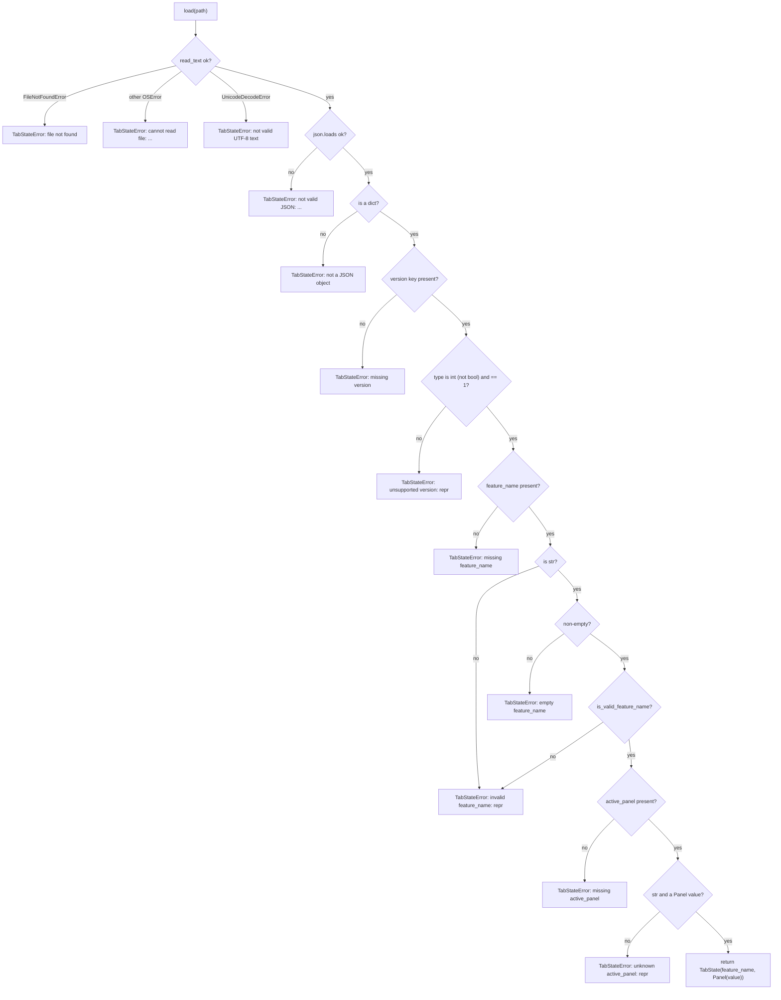

# S02 - Tab state files can be written and read back with validation

- **Plan:** [plan.md](plan.md)
- **Type:** Enabler
- **Requirements covered:** FR-15, FR-17, FR-25 (error type for write failures); enables FR-16, FR-20, FR-24
- **Prerequisites:** none
- **Creates:** `Panel`, `TabState`, `STATE_FILE_VERSION`, `is_valid_feature_name`, `TabStateError` (all in `devpipe.models.tab_state`), `TabStateRepository` (`devpipe.persistence.tab_state_repository`), `TabStateStore`, `TabStateService` (`devpipe.services.tab_state_service`), Persistence row of the layer table in `docs/architecture.md`

## 1. Goal
Provide the tab state file format and its I/O, with no UI:

- `TabStateService.save(path, TabState("new-feature"))` writes, as UTF-8 indented JSON with a trailing newline:
  ```json
  {
    "version": 1,
    "feature_name": "new-feature",
    "active_panel": "start"
  }
  ```
- `TabStateService.load(path)` on that file returns `TabState("new-feature", Panel.START)` (equal to the saved one).
- Load fails with `TabStateError` (holding `path` and a readable `reason`) when the file is missing, unreadable, not valid JSON, not a JSON object, has a `version` other than 1, has a missing/empty/invalid `feature_name`, or has a missing/unknown `active_panel`.
- A write failure raises `TabStateError` too. `load` raises only `TabStateError` for any file content. For a `TabState` whose fields have their declared types (`feature_name: str`, `active_panel: Panel`), `save` raises only `TabStateError`; a wrongly typed `TabState` is a programming error and its exception (`TypeError`, `AttributeError`) propagates unwrapped.

## 2. Context
- Layers: `views -> services -> persistence -> models`, enforced by `uv run lint-imports` (contracts in `pyproject.toml`): models import nothing from the project, persistence imports only models, services import persistence/models, nothing below views imports `PySide6`.
- Existing siblings to follow:
  - `src/devpipe/models/app_config.py`: one module docstring, a plain `@dataclass`.
  - `src/devpipe/persistence/config_repository.py`: `json.loads(path.read_text(encoding="utf-8"))`, `path.write_text(json.dumps(data, indent=2) + "\n", encoding="utf-8")`.
  - `src/devpipe/services/window_state_service.py`: a `Protocol` store (`ConfigStore`) defined in the service module, the service takes the store in its constructor and keeps it as `self._store`.
- Tests: pytest with `--import-mode=importlib`, folders mirror layers (`tests/models/` exists and is empty), no `__init__.py`, plain `test_*` functions using `tmp_path`.
- `docs/architecture.md` layer table, Persistence row today: ``| Persistence   | `persistence/` | Read/write devpipe's files (control files, `current-state.json`, `config.json`); no Qt | `models` |``.

## 3. Structure

### 3.1 Files
| File | Change | Responsibility |
|------|--------|----------------|
| `src/devpipe/models/tab_state.py` | new | Tab state data, panel ids, format version, feature-name rule, domain error |
| `src/devpipe/persistence/tab_state_repository.py` | new | Read/write one tab state file at a given path, with validation |
| `src/devpipe/services/tab_state_service.py` | new | `TabStateStore` Protocol and the `TabStateService` use case |
| `docs/architecture.md` | modify | Persistence row of the layer table only |
| `tests/models/test_tab_state.py` | new | Model rules and error formatting |
| `tests/persistence/test_tab_state_repository.py` | new | File format, round trip, every load/save failure |
| `tests/services/test_tab_state_service.py` | new | Service delegation with a fake store |

### 3.2 Models: `src/devpipe/models/tab_state.py`

```python
"""State of one pipeline tab, as kept in its tab state file."""

import enum
import re
from dataclasses import dataclass
from pathlib import Path

STATE_FILE_VERSION = 1
"""The only tab state file format version this app reads and writes."""

_FEATURE_NAME_PATTERN = re.compile(r"[a-z0-9]+(-[a-z0-9]+)*")


class Panel(enum.Enum):
    """Panel ids of a tab; the values are the `active_panel` strings of the file."""

    START = "start"


@dataclass
class TabState:
    feature_name: str
    active_panel: Panel = Panel.START


def is_valid_feature_name(name: str) -> bool:
    """True when `name` matches `^[a-z0-9]+(-[a-z0-9]+)*$` (so never for "")."""
    return _FEATURE_NAME_PATTERN.fullmatch(name) is not None


class TabStateError(Exception):
    """A tab state file could not be read or written."""

    def __init__(self, path: Path, reason: str) -> None:
        super().__init__(f"{path}: {reason}")
        self.path = path
        self.reason = reason
```

- `Panel`: exactly one member, `START = "start"`.
- `TabState`: plain mutable `@dataclass` (same style as `AppConfig`), default equality; `active_panel` defaults to `Panel.START`. No validation in the dataclass (validation happens at the file boundary).
- `is_valid_feature_name`: uses `fullmatch` (not `match` with `$`, which would accept a trailing `"\n"`). Pure, no I/O.
- `TabStateError`: `path: Path`, `reason: str` (public attributes); `str(error) == f"{path}: {reason}"`. It lives in models so views can import it to show `reason` without importing persistence.

### 3.3 Persistence: `src/devpipe/persistence/tab_state_repository.py`

```python
"""Read/write tab state files (one JSON file per saved pipeline tab)."""

import json
from pathlib import Path

from devpipe.models.tab_state import (
    STATE_FILE_VERSION, Panel, TabState, TabStateError, is_valid_feature_name,
)

_VERSION_KEY = "version"
_FEATURE_NAME_KEY = "feature_name"
_ACTIVE_PANEL_KEY = "active_panel"


class TabStateRepository:
    def load(self, path: Path) -> TabState:
        """Read and validate the file. Raises TabStateError (only)."""

    def save(self, path: Path, state: TabState) -> None:
        """Write the file (overwrites).

        Raises TabStateError (only) for a well-typed `state`; a wrongly typed
        `state` is a programming error and its exception propagates.
        """

    def _read_json(self, path: Path) -> object: ...          # raises TabStateError
    def _parse(self, path: Path, data: object) -> TabState: ...  # raises TabStateError
```

- No constructor arguments: the path is passed per call (one repository serves every tab).
- `load(path)`:
  1. `_read_json`: `path.read_text(encoding="utf-8")`, then `json.loads`. Error mapping (exact reasons in section 5): `FileNotFoundError` -> "file not found"; any other `OSError` -> "cannot read file: <strerror or str(exc)>"; `UnicodeDecodeError` -> "not valid UTF-8 text"; `json.JSONDecodeError` -> "not valid JSON: <exc.msg> (line <lineno>, column <colno>)". Catch `UnicodeDecodeError` before `ValueError`-based `JSONDecodeError`; both are caught explicitly, not by a bare `except`.
  2. `_parse`: validates in this order and raises at the first failure: object, `version`, `feature_name`, `active_panel` (flow in section 4). Returns `TabState(feature_name, Panel(active_panel))`.
  - Extra keys in the object are ignored (not an error).
- `save(path, state)`: precondition: `state.feature_name` is a `str` and `state.active_panel` is a `Panel`. For such input it raises only `TabStateError`; a wrongly typed `TabState` is a programming error and its exception (`TypeError` from the regex, `AttributeError` from `.value`) propagates; no type guard is added.
  1. If `not is_valid_feature_name(state.feature_name)` -> `TabStateError(path, "invalid feature_name")`, nothing is written (the app must never produce a file it cannot read back).
  2. Build `{"version": STATE_FILE_VERSION, "feature_name": state.feature_name, "active_panel": state.active_panel.value}` (key order as shown).
  3. `path.write_text(json.dumps(data, indent=2) + "\n", encoding="utf-8")` (same style as `ConfigRepository.save`).
  4. `OSError` -> `TabStateError(path, "cannot write file: <strerror or str(exc)>")`, raised `from exc`. The parent folder is not created.
- Always raise `TabStateError(...) from exc` when wrapping, so the cause stays visible in tracebacks.

### 3.4 Services: `src/devpipe/services/tab_state_service.py`

```python
"""Load and save the state file of a pipeline tab."""

from pathlib import Path
from typing import Protocol

from devpipe.models.tab_state import TabState


class TabStateStore(Protocol):
    """Where tab states are kept (implemented in the persistence layer).

    Both methods raise TabStateError on failure.
    """

    def load(self, path: Path) -> TabState: ...

    def save(self, path: Path, state: TabState) -> None: ...


class TabStateService:
    def __init__(self, store: TabStateStore) -> None:
        self._store = store

    def load(self, path: Path) -> TabState:
        """Raises TabStateError."""
        return self._store.load(path)

    def save(self, path: Path, state: TabState) -> None:
        """Raises TabStateError."""
        self._store.save(path, state)
```

- Pure delegation today; it is the place use cases on tab state files are added. It lets `TabStateError` propagate unchanged.
- `TabStateRepository` satisfies `TabStateStore` structurally (no inheritance), like `ConfigRepository` and `ConfigStore`.
- No wiring in `app.py` in this step (nothing uses the service yet).

### 3.5 Docs: `docs/architecture.md`
Change only the Persistence row of the layer table; its responsibility cell becomes:

`Read/write devpipe's files (control files, `current-state.json`, `config.json`, tab state files); no Qt`

Keep the row's other cells and the table's column alignment as close as markdown allows. No other line of the file changes.

## 4. Logic flows



Load reads, decodes and validates the file in a fixed order and stops at the first problem, so every invalid file gives exactly one `TabStateError` with one reason (`repr` in the labels stands for `repr(value)` of the offending value). `version` must be an `int` that is not a `bool` (`True == 1` in Python) and equal to `STATE_FILE_VERSION`. The `active_panel` check tests `isinstance(value, str)` before `Panel(value)` so non-string values (lists, numbers) give the same "unknown" error.

`save` is linear (validate name, build dict, write, map `OSError`), see 3.3.

## 5. Edge cases and errors
`<repr>` is `repr(value)` of the offending JSON value; `<strerror>` is `exc.strerror` or `str(exc)` when `strerror` is `None`.

| Case | Expected behavior |
|------|-------------------|
| Load: file does not exist | `TabStateError(path, "file not found")` |
| Load: path is a folder, or no read permission | `TabStateError(path, "cannot read file: <strerror>")` |
| Load: bytes are not UTF-8 | `TabStateError(path, "not valid UTF-8 text")` |
| Load: empty file or broken JSON (`{not json`) | `TabStateError(path, "not valid JSON: <msg> (line L, column C)")` |
| Load: JSON is a list / string / number / `null` | `TabStateError(path, "not a JSON object")` |
| Load: no `version` | `TabStateError(path, "missing version")` |
| Load: `version` is `2`, `"1"`, `1.0`, `true` or `null` | `TabStateError(path, "unsupported version: <repr>")` |
| Load: no `feature_name` | `TabStateError(path, "missing feature_name")` |
| Load: `feature_name` is `""` | `TabStateError(path, "empty feature_name")` |
| Load: `feature_name` is `"New Feature"`, `"-a"`, `"a--b"`, `5` or `null` | `TabStateError(path, "invalid feature_name: <repr>")` |
| Load: no `active_panel` | `TabStateError(path, "missing active_panel")` |
| Load: `active_panel` is `"process"`, `"START"`, `1` or `[]` | `TabStateError(path, "unknown active_panel: <repr>")` |
| Load: valid object with extra keys | Loads normally; extra keys ignored |
| Load: UTF-8 file with a BOM | Fails as "not valid JSON" (`json.loads` rejects a BOM); acceptable, the app never writes one |
| Save: parent folder missing | `TabStateError(path, "cannot write file: <strerror>")`; folder not created |
| Save: path is an existing folder, or not writable | `TabStateError(path, "cannot write file: <strerror>")` |
| Save: `state.feature_name` not a valid slug (e.g. `""`) | `TabStateError(path, "invalid feature_name")`; no file written |
| Save: file already exists | Overwritten (overwrite confirmation is a UI concern) |
| Save: wrongly typed `TabState` (e.g. `feature_name=None`, `active_panel="start"`) | Programming error, not part of the contract: the `TypeError` / `AttributeError` propagates unwrapped |
| Any failure (load with any content; save with a well-typed `TabState`) | Only `TabStateError`; `error.path` is the `path` argument unchanged, `str(error) == f"{path}: {reason}"` |

## 6. Tests

### 6.1 Automated
Test doubles: only `FakeTabStateStore` in the service test (a small class in the test file recording calls, returning a preset `TabState` from `load`, or raising a preset `TabStateError`). Repository tests use real files under `tmp_path`.

| Test file | Test name | Given / When / Then | Proves |
|-----------|-----------|---------------------|--------|
| `tests/models/test_tab_state.py` | `test_panel_start_value_is_start` | Given `Panel`, then `Panel.START.value == "start"`, `Panel("start") is Panel.START`, `len(Panel) == 1` | FR-15 |
| `tests/models/test_tab_state.py` | `test_tab_state_defaults_to_start_panel` | When `TabState("a")`, then `active_panel is Panel.START`; `TabState("a") == TabState("a", Panel.START)` | FR-15 |
| `tests/models/test_tab_state.py` | `test_state_file_version_is_1` | Then `STATE_FILE_VERSION == 1` | FR-15 |
| `tests/models/test_tab_state.py` | `test_is_valid_feature_name_accepts_slugs` (parametrized: `"a"`, `"new-feature"`, `"nova-feature-x"`, `"a1-2b"`) | Then `True` | FR-17 |
| `tests/models/test_tab_state.py` | `test_is_valid_feature_name_rejects_non_slugs` (parametrized: `""`, `"-a"`, `"a-"`, `"a--b"`, `"New"`, `"a b"`, `"a_b"`, `"á"`, `"a\n"`) | Then `False` | FR-17 |
| `tests/models/test_tab_state.py` | `test_tab_state_error_keeps_path_and_reason` | Given `TabStateError(Path("x/s.json"), "file not found")`, then `.path == Path("x/s.json")`, `.reason == "file not found"`, `str(e) == f"{Path('x/s.json')}: file not found"`, and it is an `Exception` | FR-25 |
| `tests/persistence/test_tab_state_repository.py` | `test_save_writes_exact_format` | Given `TabState("new-feature")`, when `save(tmp_path / "s.json", ...)`, then `text = read_text(encoding="utf-8")`; `json.loads(text) == {"version": 1, "feature_name": "new-feature", "active_panel": "start"}`, `list(json.loads(text)) == ["version", "feature_name", "active_panel"]`, `text.endswith("\n")`, `text == json.dumps(expected, indent=2) + "\n"` | FR-15 |
| `tests/persistence/test_tab_state_repository.py` | `test_save_then_load_round_trips` | Given a saved `TabState("nova-feature-x", Panel.START)`, when `load` the same path, then the result equals it | FR-15, enables FR-20/FR-24 |
| `tests/persistence/test_tab_state_repository.py` | `test_save_overwrites_existing_file` | Given a file with other content, when `save`, then it holds the new state | FR-16 (enabler) |
| `tests/persistence/test_tab_state_repository.py` | `test_load_ignores_extra_keys` | Given a valid object plus `"extra": 1`, when `load`, then the `TabState` is returned | FR-17 |
| `tests/persistence/test_tab_state_repository.py` | `test_load_rejects_invalid_file` (parametrized with ids, one per row: missing file (no file written), not JSON `"{not json"`, empty file `""`, non-UTF-8 bytes `b"\xff\xfe"`, UTF-8 BOM + valid JSON (`b"\xef\xbb\xbf"` + the bytes of a valid file, reason prefix `"not valid JSON: "`), list `[]`, string `"\"x\""`, number `5`, `null`, missing `version`, `version` `2`, `"1"`, `true`, `1.0`, `null`, missing `feature_name`, `feature_name` `""`, `"New Feature"`, `"-a"`, `"a--b"`, `5`, `null`, missing `active_panel`, `active_panel` `"process"`, `"START"`, `1`, `[]`) | Given the file content (written with `write_bytes`/`write_text`), when `load(path)`, then `pytest.raises(TabStateError)` with `error.path == path`, `error.reason` equal to the reason from section 5 for that row (prefix match for reasons ending in variable text: `"not valid JSON: "`, `"unsupported version: "`, `"invalid feature_name: "`, `"unknown active_panel: "`), and `str(error).startswith(str(path))` | FR-17 |
| `tests/persistence/test_tab_state_repository.py` | `test_load_folder_raises_tab_state_error` | Given `path = tmp_path` (a folder), when `load(path)`, then `TabStateError` with `reason.startswith("cannot read file: ")` | FR-17 (unreadable) |
| `tests/persistence/test_tab_state_repository.py` | `test_save_into_missing_folder_raises_tab_state_error` | Given `tmp_path / "missing" / "s.json"`, when `save`, then `TabStateError` with that `path`, `reason.startswith("cannot write file: ")`, and the folder `tmp_path / "missing"` does not exist | FR-25 |
| `tests/persistence/test_tab_state_repository.py` | `test_save_onto_folder_raises_tab_state_error` | Given `path = tmp_path / "d"` created as a folder, when `save`, then `TabStateError` with `reason.startswith("cannot write file: ")` | FR-25 |
| `tests/persistence/test_tab_state_repository.py` | `test_save_rejects_invalid_feature_name` | Given `TabState("")`, when `save(tmp_path / "s.json", ...)`, then `TabStateError(reason="invalid feature_name")` and the file does not exist | FR-15, FR-17 |
| `tests/services/test_tab_state_service.py` | `test_load_returns_store_state` | Given a fake store whose `load` returns `TabState("a")`, when `service.load(p)`, then it returns that state and the fake recorded `load(p)` | enables FR-20/FR-24 |
| `tests/services/test_tab_state_service.py` | `test_save_passes_path_and_state_to_store` | When `service.save(p, TabState("a"))`, then the fake recorded `save(p, TabState("a"))` | FR-15/FR-16 (enabler) |
| `tests/services/test_tab_state_service.py` | `test_errors_propagate_unchanged` | Given a fake store raising `TabStateError(p, "boom")` from `load` and from `save`, when the service methods are called, then the same exception object is raised | FR-25 |
| `tests/services/test_tab_state_service.py` | `test_works_with_real_repository` | Given `TabStateService(TabStateRepository())`, when `save` then `load` under `tmp_path`, then the states are equal | FR-15 |

Run with: `uv run pytest tests/models/test_tab_state.py tests/persistence/test_tab_state_repository.py tests/services/test_tab_state_service.py`, then the full `uv run pytest` and `uv run lint-imports`.

### 6.2 Manual
None (no UI in this step).

### 6.3 Static checks
- `uv run lint-imports` -> all contracts kept (models import nothing from the project, no `PySide6` below views).
- `grep -rn "PySide6" src/devpipe/models/tab_state.py src/devpipe/persistence/tab_state_repository.py src/devpipe/services/tab_state_service.py` -> no output.
- `grep -n "^| Persistence " docs/architecture.md` -> exactly one line, whose responsibility cell is the new text from 3.5 (`Read/write devpipe's files (control files, `current-state.json`, `config.json`, tab state files); no Qt`).

## 7. Implementation order
1. `models/tab_state.py` with `tests/models/test_tab_state.py`; run them.
2. `persistence/tab_state_repository.py`: `save` first with the format and write-failure tests, then `load` with the round trip and the parametrized failure tests.
3. `services/tab_state_service.py` with `tests/services/test_tab_state_service.py`.
4. Update the Persistence row in `docs/architecture.md`.
5. Run `uv run pytest` and `uv run lint-imports`.

## 8. Out of scope
- No UI, no dialogs, no message boxes; no change to `views/` or `app.py` (the service is not wired yet).
- No change to `AppConfig`, `ConfigRepository`, `config.json` keys or `WindowStateService`.
- No feature-name normalization (slug generation from free text); only validation of an already-normalized name.
- In `docs/architecture.md`, only the Persistence row's responsibility cell; no other table rows, sections or layout tree lines.
- No migrations between format versions; only version 1 exists.
- No link to `.devpipe/<feature-name>/` control files or `current-state.json`.
- `ai-skills/` is not touched.

## 9. Design notes
- **Single Responsibility:** models hold data and the pure slug rule, the repository owns the JSON format and all I/O error mapping, the service is the use-case entry point. Parsing stays in persistence because the key names and the version check are part of the file format.
- **Dependency Inversion:** `TabStateService` depends on the `TabStateStore` Protocol, so its tests use a fake; same pattern as `WindowStateService` / `ConfigStore`.
- **One error type:** every failure (read, decode, validate, write) becomes `TabStateError` with the original exception chained (`from exc`), so callers need a single `except` and can show `path` and `reason`.
- **Strict load, ordered checks:** first failure wins, giving one deterministic reason per file. A missing `active_panel` is treated as invalid (the format has exactly three fields); extra keys are tolerated so a newer app adding a field does not break reading, while the `version` gate guards real format changes.
- **`bool` is not a version:** `type(v) is int` is used because `json.loads("true") == 1` in Python.
- **`save` validates the feature name:** cheap guard so the app never writes a file its own `load` would reject. Alternative rejected: no check (would allow unreadable files after a programming error).
- **Write style matches `ConfigRepository`:** `write_text(json.dumps(..., indent=2) + "\n", encoding="utf-8")`, so on Windows the newline is written in the platform style exactly like `config.json`. Atomic write (temp file + `os.replace`) was rejected as YAGNI for a three-field file; the trade-off is that a crash mid-write could leave a broken file, which `load` then reports as invalid.
- **DRY trade-off:** `is_valid_feature_name` owns the slug regex for validating files; it does not normalize text, so it does not duplicate slug generation.
- **Stateless repository:** no constructor arguments, since each tab has its own path; one instance serves all tabs.
