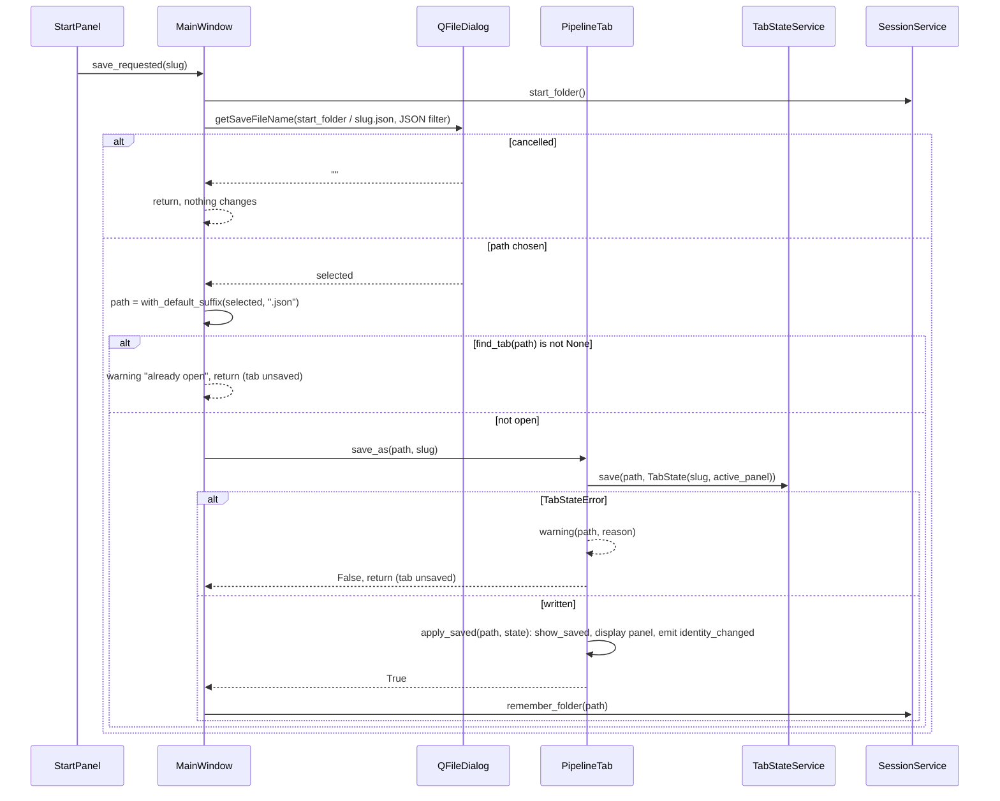
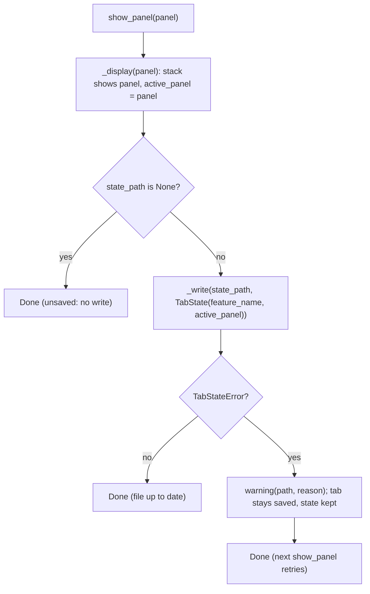
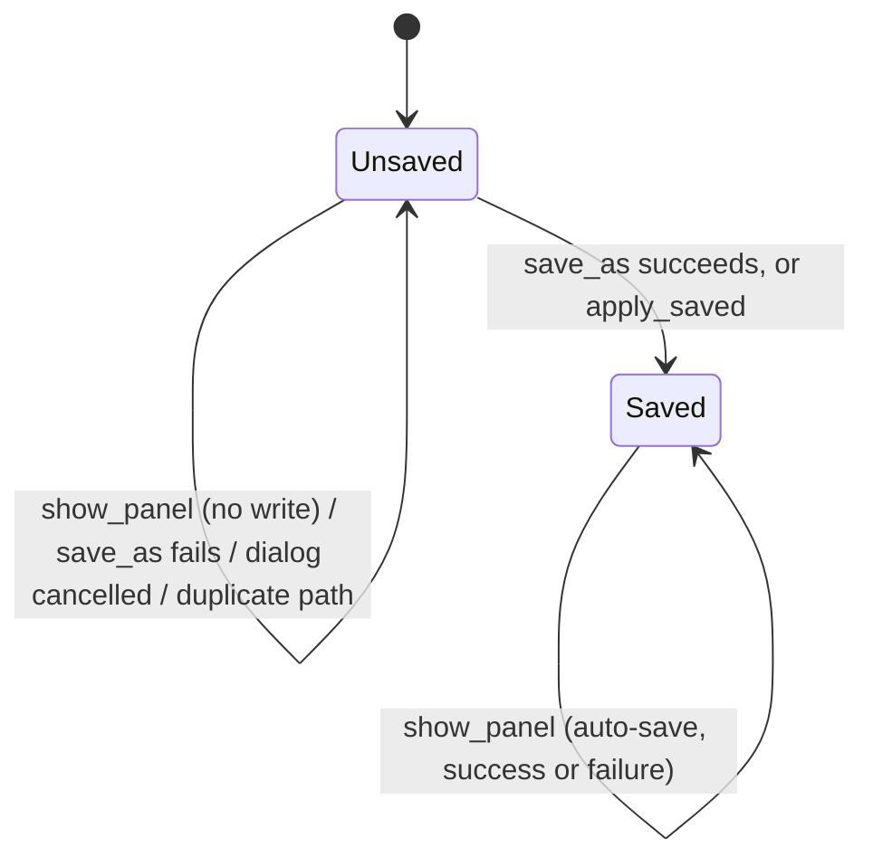

# S03 - First save ties a tab to a state file, then auto-saves

- **Plan:** [plan.md](plan.md)
- **Type:** Slice
- **Requirements covered:** FR-04 (saved title/tooltip), FR-09 (disabled once saved), FR-10 (enabled once saved), FR-11, FR-12 (saved files), FR-13, FR-14, FR-15, FR-16, FR-23, FR-25
- **Prerequisites:** `StartPanel` (`name_input`, `slug_label`, `save_button`, `open_button`, `create_button`), `StartPanel.save_requested(str)`, `StartPanel.show_saved(feature_name)`, `PipelineTab` (`stack`, `start_panel`, `title()`, `tooltip()`, `identity_changed`), `NEW_TAB_TITLE` (`views/pipeline_tab.py`), `MainWindow.tabs`, `MainWindow.add_pipeline_tab(tab)`, `MainWindow.add_new_tab()`, `MainWindow.close_tab(index)`, `MainWindow.new_tab_button`, `Panel`, `TabState`, `TabStateError`, `TabStateService`, `TabStateRepository`, `AppConfig`, `ConfigRepository`, `ConfigStore`, `WindowStateService`
- **Creates:** `AppConfig.last_state_folder` and the `last_state_folder` key of `config.json`, `SessionService` (`start_folder()`, `remember_folder(state_file)`), `same_file(a, b)` (`services/paths.py`), `PipelineTab.state_path`, `PipelineTab.active_panel`, `PipelineTab.show_panel(panel)`, `PipelineTab.apply_saved(path, state)`, saved-mode `PipelineTab.title()` / `tooltip()`, `MainWindow(window_state, tab_states, session)` constructor, `MainWindow.find_tab(path)`, `MainWindow.add_saved_tab(path, state)`, test fixture `make_window` (`tests/views/conftest.py`)

## 1. Goal
A named tab can be saved to a state file the user picks, and that file then follows the tab's state with no more dialogs.

Observable behavior when done:
- In an unsaved tab with a valid name, clicking Save opens the native Save dialog titled "Save pipeline state", filter "JSON files (*.json)", suggesting `<slug>.json` in the last-used folder (or the home folder).
- Cancelling the dialog changes nothing (no file, tab unchanged).
- Confirming writes `{"version": 1, "feature_name": "<slug>", "active_panel": "start"}` to the chosen path (`.json` appended when the name has no extension), stores the file's folder as `last_state_folder` in `config.json`, puts the start panel in saved mode (input shows the slug and is disabled, Save disabled, Open/Create enabled), and the tab text becomes the slug with the full path as tooltip.
- Saving to a path already open in another tab shows a warning; the tab stays unsaved and nothing is written.
- A write failure shows a warning with the path and the reason. On first save the tab stays unsaved; on auto-save the tab stays saved, keeps its in-memory state and tries again on the next change.
- After the first save, every `show_panel` call rewrites the file (auto-save), with no dialog.

## 2. Context
- Starting code (as the prerequisites leave it): `MainWindow(window_state: WindowStateService)` builds `self.tabs`, the "+" `new_tab_button`, and adds one tab with `add_new_tab()`; `add_pipeline_tab(tab)` inserts a tab and connects `tab.identity_changed` to `_refresh_tab_identity(tab)`; `close_tab(index)` removes tabs. `PipelineTab()` has no constructor arguments, a `QStackedWidget` `stack` whose only panel is `start_panel`, constant `title()` (`NEW_TAB_TITLE`) and `tooltip()` (`""`). Nothing is connected to `StartPanel.save_requested`.
- `TabStateService(store)` offers `load(path)` / `save(path, state)` raising only `TabStateError(path, reason)`; `TabStateRepository()` takes no arguments. Neither is wired in `app.py` yet.
- `src/devpipe/app.py`: `main()` builds `WindowStateService(ConfigRepository(CONFIG_PATH))` and `MainWindow(window_state)`.
- `src/devpipe/models/app_config.py`: `@dataclass AppConfig` with `window_maximized: bool = False`.
- `src/devpipe/persistence/config_repository.py`: `load()` reads raw JSON (`_read_raw`, `{}` on any error) and validates each key with an `isinstance` fallback; `save()` re-reads raw data so unknown keys are kept, then writes `json.dumps(data, indent=2) + "\n"`.
- `src/devpipe/services/window_state_service.py`: `ConfigStore` Protocol (`load() -> AppConfig`, `save(config)`); services keep the store in `self._store` and do load-modify-save.
- Layer rules (`uv run lint-imports`): views import services and models, never persistence; no `PySide6` below views; `app.py` may import every layer.
- Tests: pytest + pytest-qt, `--import-mode=importlib`, no `__init__.py`, folders mirror the layers, real repositories on `tmp_path`. There is no `tests/conftest.py` and no `tests/views/conftest.py` yet.
- Settings only in `config.json` (no `QSettings`); `pathlib.Path` everywhere.

## 3. Structure

### 3.1 Files
| File | Change | Responsibility |
|------|--------|----------------|
| `src/devpipe/models/app_config.py` | modify | `last_state_folder` field |
| `src/devpipe/persistence/config_repository.py` | modify | Read/write the `last_state_folder` key |
| `src/devpipe/services/session_service.py` | new | `SessionService`: last-used folder |
| `src/devpipe/services/paths.py` | new | Pure path helpers: `same_file`, `with_default_suffix` |
| `src/devpipe/views/pipeline_tab.py` | modify | Saved state, `state_path`, `active_panel`, `show_panel`, `apply_saved`, `save_as`, auto-save, write-error warning, saved title/tooltip |
| `src/devpipe/views/main_window.py` | modify | Constructor arguments, Save dialog flow, duplicate check, `find_tab`, `add_saved_tab` |
| `src/devpipe/app.py` | modify | Build and inject `TabStateService`, `SessionService` |
| `tests/views/conftest.py` | new | `tab_states` and `make_window` fixtures |
| `tests/views/test_first_save.py` | new | Save dialog flow end to end through `MainWindow` |
| `tests/views/test_pipeline_tab.py` | modify | Build tabs with `PipelineTab(tab_states)`; saved mode, `show_panel`, `save_as`, auto-save |
| `tests/views/test_main_window.py` | modify | Build windows with `make_window`; `find_tab`, `add_saved_tab` |
| `tests/services/test_session_service.py` | new | Last-used folder rules |
| `tests/services/test_paths.py` | new | `same_file`, `with_default_suffix` |
| `tests/persistence/test_config_repository.py` | modify | `last_state_folder` round trip and fallbacks; expected dict of `test_save_keeps_unknown_keys` |

### 3.2 Models - `src/devpipe/models/app_config.py`

```python
"""App settings stored in `config.json`."""

from dataclasses import dataclass
from pathlib import Path


@dataclass
class AppConfig:
    window_maximized: bool = False
    last_state_folder: Path | None = None  # folder of the last saved/opened state file
```

### 3.3 Persistence - `src/devpipe/persistence/config_repository.py`

Add a key constant and one private helper; keep `_read_raw` and the unknown-keys behavior unchanged.

```python
_LAST_STATE_FOLDER_KEY = "last_state_folder"


class ConfigRepository:
    def load(self) -> AppConfig:
        data = self._read_raw()
        maximized = data.get("window_maximized", False)
        return AppConfig(
            window_maximized=maximized if isinstance(maximized, bool) else False,
            last_state_folder=self._read_path(data, _LAST_STATE_FOLDER_KEY),
        )

    def save(self, config: AppConfig) -> None:
        data = self._read_raw()
        data["window_maximized"] = config.window_maximized
        data[_LAST_STATE_FOLDER_KEY] = (
            str(config.last_state_folder) if config.last_state_folder is not None else None
        )
        self.path.write_text(json.dumps(data, indent=2) + "\n", encoding="utf-8")

    @staticmethod
    def _read_path(data: dict, key: str) -> Path | None:
        """Path from a non-empty string value; None for a missing key or any other value."""
```

- `_read_path`: returns `Path(value)` when `isinstance(value, str) and value != ""`, else `None` (covers `null`, numbers, booleans, lists, objects, `""`). It does not check that the folder exists (that is a use-case rule in `SessionService`).
- `save` always writes the key (`null` when `None`), so `config.json` reflects the model exactly. Error behavior of `save` is unchanged (an `OSError` propagates, as today).

### 3.4 Services - `src/devpipe/services/paths.py` (new)

```python
"""Pure helpers for state file paths (no Qt)."""

import os
from pathlib import Path


def same_file(a: Path, b: Path) -> bool:
    """True when `a` and `b` name the same file.

    Compares after Path.resolve() (absolute, `..` removed, symlinks followed;
    the files need not exist), case-insensitively on Windows (os.path.normcase).
    """
    return os.path.normcase(a.resolve()) == os.path.normcase(b.resolve())


def with_default_suffix(path: Path, suffix: str) -> Path:
    """`path` with `suffix` appended when it has no extension, else `path` unchanged."""
    return path if path.suffix else path.with_name(path.name + suffix)
```

- `os.path.normcase` lowercases and turns `/` into `\` on Windows and is the identity elsewhere, which gives "case-insensitive on Windows" with no platform `if`.
- `with_default_suffix(Path("x/new-feature"), ".json") == Path("x/new-feature.json")`; `"a.json"`, `"a.JSON"`, `"a.txt"` stay unchanged.

### 3.5 Services - `src/devpipe/services/session_service.py` (new)

```python
"""Remember where state files live between sessions."""

from pathlib import Path

from devpipe.services.window_state_service import ConfigStore


class SessionService:
    def __init__(self, store: ConfigStore) -> None:
        self._store = store

    def start_folder(self) -> Path:
        """Folder the Save/Open dialogs start in.

        The last-used folder if it is set and is still an existing folder, else Path.home().
        """

    def remember_folder(self, state_file: Path) -> None:
        """Store state_file.parent as the last-used folder (load-modify-save, other settings kept)."""
```

- `start_folder()`: `folder = self._store.load().last_state_folder`; return `folder` if `folder is not None and folder.is_dir()`, else `Path.home()`. Does not clear a stale value from `config.json` (the next `remember_folder` replaces it).
- `remember_folder(state_file)`: `config = self._store.load()`, `config.last_state_folder = state_file.parent`, `self._store.save(config)`. Errors from the store propagate (same as `WindowStateService`).

### 3.6 Views - `src/devpipe/views/pipeline_tab.py` (modify)

New imports: `Path` (`pathlib`), `QMessageBox` (`PySide6.QtWidgets`), `Panel`, `TabState`, `TabStateError` (`devpipe.models.tab_state`), `TabStateService` (`devpipe.services.tab_state_service`).

New module constant: `SAVE_ERROR_TITLE = "Cannot save state file"`. `NEW_TAB_TITLE` stays.

```python
class PipelineTab(QWidget):
    identity_changed = Signal()  # unchanged: emitted after title() or tooltip() change

    def __init__(self, tab_states: TabStateService) -> None: ...

    @property
    def state_path(self) -> Path | None: ...      # None while unsaved
    @property
    def active_panel(self) -> Panel: ...          # Panel.START for a new tab

    def title(self) -> str: ...                   # feature name when saved, else NEW_TAB_TITLE
    def tooltip(self) -> str: ...                 # str(state_path) when saved, else ""

    def show_panel(self, panel: Panel) -> None: ...
    def apply_saved(self, path: Path, state: TabState) -> None: ...
    def save_as(self, path: Path, feature_name: str) -> bool: ...

    def _display(self, panel: Panel) -> None: ...
    def _current_state(self) -> TabState: ...
    def _write(self, path: Path, state: TabState) -> bool: ...
```

Constructor (keeps the existing stack/start panel/layout code):
- `self._tab_states = tab_states`
- `self._state_path: Path | None = None`, `self._feature_name: str | None = None`, `self._active_panel = Panel.START`
- `self._panels: dict[Panel, QWidget] = {Panel.START: self.start_panel}`: the single map from panel id to panel widget; a new panel is one more entry plus its `stack.addWidget`.

Members:
- `state_path` / `active_panel`: read-only properties over the private fields.
- `title()`: `self._feature_name if self._state_path is not None else NEW_TAB_TITLE`.
- `tooltip()`: `str(self._state_path) if self._state_path is not None else ""` (full path with the platform separators).
- `_display(panel)`: `self.stack.setCurrentWidget(self._panels[panel])`; `self._active_panel = panel`. Never writes.
- `show_panel(panel)`: `_display(panel)`; then, if `self._state_path is not None`, `self._write(self._state_path, self._current_state())` (auto-save, FR-16). Always writes when saved, even if the panel did not change. Unsaved: no write, no dialog. The return value of `_write` is ignored: on failure the tab stays saved, the in-memory state is kept and the next call writes again (FR-25).
- `apply_saved(path, state)`: puts the tab in saved mode for `path` without writing: `self._state_path = path`, `self._feature_name = state.feature_name`, `self.start_panel.show_saved(state.feature_name)`, `self._display(state.active_panel)`, then `self.identity_changed.emit()`. Precondition (not checked): `state` is a valid `TabState`.
- `save_as(path, feature_name) -> bool`: first save. `state = TabState(feature_name, self._active_panel)`; if `not self._write(path, state)` return `False` (tab unchanged, still unsaved); else `self.apply_saved(path, state)` and return `True`.
- `_write(path, state) -> bool`: the only place the tab writes. `self._tab_states.save(path, state)`; on `TabStateError as error`, `QMessageBox.warning(self, SAVE_ERROR_TITLE, f"{error.path}\n\n{error.reason}")` and return `False`; else return `True`.
- `_current_state()`: `TabState(self._feature_name, self._active_panel)`; only called when saved.

The tab still does not connect `start_panel.save_requested` (the window owns the dialog flow).

### 3.7 Views - `src/devpipe/views/main_window.py` (modify)

New imports: `Path` (`pathlib`), `QFileDialog`, `QMessageBox` (`PySide6.QtWidgets`), `TabState` (`devpipe.models.tab_state`), `SessionService` (`devpipe.services.session_service`), `TabStateService` (`devpipe.services.tab_state_service`), `same_file`, `with_default_suffix` (`devpipe.services.paths`).

New module constants:
```python
STATE_FILE_SUFFIX = ".json"
STATE_FILE_FILTER = "JSON files (*.json)"
SAVE_DIALOG_TITLE = "Save pipeline state"
ALREADY_OPEN_TITLE = "State file already open"
ALREADY_OPEN_TEXT = "This state file is already open in another tab."
```

Constructor:
```python
def __init__(
    self,
    window_state: WindowStateService,
    tab_states: TabStateService,
    session: SessionService,
) -> None:
```
Stores `self._tab_states` and `self._session` next to `self._window_state`, before the first `add_new_tab()` call. The rest of the constructor (tabs, closable tabs, "+" button, first `add_new_tab()`) is unchanged.

Changed methods:
- `add_new_tab()`: builds the tab with `PipelineTab(self._tab_states)`; the rest is unchanged.
- `add_pipeline_tab(tab)`: add one connection after the existing `identity_changed` connection:
  `tab.start_panel.save_requested.connect(lambda slug: self._save_tab_as(tab, slug))`. Every tab is thus wired whatever code path added it. Insertion, title/tooltip and return value unchanged.

New methods:
```python
def find_tab(self, path: Path) -> int | None:
    """Index of the tab whose state_path is the same file as `path` (same_file), else None.
    Unsaved tabs never match."""

def add_saved_tab(self, path: Path, state: TabState) -> PipelineTab:
    """Build a PipelineTab, apply_saved(path, state) (no write), add it with
    add_pipeline_tab, select it and return it."""

def _save_tab_as(self, tab: PipelineTab, feature_name: str) -> None:
    """First-save flow for `tab` (Save dialog, duplicate check, write, last-used folder)."""
```

- `find_tab`: loops `range(self.tabs.count())`; `widget = self.tabs.widget(i)`; matches when `isinstance(widget, PipelineTab)`, `widget.state_path is not None` and `same_file(widget.state_path, path)`; returns the first match.
- `add_saved_tab`: `tab = PipelineTab(self._tab_states)`, `tab.apply_saved(path, state)`, `index = self.add_pipeline_tab(tab)`, `self.tabs.setCurrentIndex(index)`, return `tab`. It does not check for duplicates (callers use `find_tab`).
- `_save_tab_as(tab, feature_name)` (flow in section 4):
  1. `selected, _ = QFileDialog.getSaveFileName(self, SAVE_DIALOG_TITLE, str(self._session.start_folder() / f"{feature_name}{STATE_FILE_SUFFIX}"), STATE_FILE_FILTER)`.
  2. `selected == ""` (cancel): return.
  3. `path = with_default_suffix(Path(selected), STATE_FILE_SUFFIX)`.
  4. `self.find_tab(path) is not None`: `QMessageBox.warning(self, ALREADY_OPEN_TITLE, f"{path}\n\n{ALREADY_OPEN_TEXT}")`, return (tab stays unsaved, nothing written).
  5. `tab.save_as(path, feature_name)` is `False`: return (the tab already showed the error).
  6. `self._session.remember_folder(path)`.

`close_tab`, `_refresh_tab_identity`, `show_initial` and `closeEvent` are unchanged.

### 3.8 Composition - `src/devpipe/app.py` (modify)

```python
from devpipe.persistence.tab_state_repository import TabStateRepository
from devpipe.services.session_service import SessionService
from devpipe.services.tab_state_service import TabStateService

def main() -> int:
    app = QApplication(sys.argv)
    config = ConfigRepository(CONFIG_PATH)
    window = MainWindow(
        WindowStateService(config),
        TabStateService(TabStateRepository()),
        SessionService(config),
    )
    window.show_initial()
    return app.exec()
```
One `ConfigRepository` instance is shared by both services (each call re-reads the file, so they never overwrite each other's keys).

### 3.9 Tests - `tests/views/conftest.py` (new)

```python
@pytest.fixture
def tab_states() -> TabStateService:
    return TabStateService(TabStateRepository())


@pytest.fixture
def make_window(qtbot, tmp_path, tab_states) -> Callable[[], MainWindow]:
    """Return a callable building a new MainWindow with real repositories on
    tmp_path / "config.json" (same file on every call: a second call simulates a
    restart). Each window is registered with qtbot.addWidget."""
```
`make_window()` builds `ConfigRepository(tmp_path / "config.json")` and `MainWindow(WindowStateService(config), tab_states, SessionService(config))`.

Shared test helper (in `test_first_save.py` and `test_pipeline_tab.py`, each a few lines; not in conftest): a `warnings` recorder installed with `monkeypatch.setattr(QMessageBox, "warning", fake)` where `fake(parent, title, text, *args)` appends `(title, text)` to a list and returns `QMessageBox.StandardButton.Ok`. The dialog fake for `QFileDialog.getSaveFileName` records `(parent, caption, dir, filter)` and returns `(answer, STATE_FILE_FILTER)` or `("", "")` for cancel.

## 4. Logic flows


The window owns the dialog and the duplicate check; the tab owns writing and its own saved state. Every branch ends with either no change or a fully saved tab with `last_state_folder` updated.


Auto-save is unconditional once saved, so a failed write is retried on the very next change without any extra bookkeeping.


A `PipelineTab` never goes back to unsaved. Unsaved: title "New pipeline", empty tooltip, `state_path` None. Saved: title = feature name, tooltip = full path.

## 5. Edge cases and errors
| Case | Expected behavior |
|------|-------------------|
| Save dialog cancelled | Nothing changes: no file, no warning, tab unsaved, typed name kept (input text and slug preview unchanged), `config.json` unchanged (FR-14) |
| No `last_state_folder` in `config.json` | Dialog starts in `Path.home()` |
| `last_state_folder` points to a deleted folder, or to a file | Dialog starts in `Path.home()` (value replaced on the next successful save) |
| `last_state_folder` is `null`, `""`, a number, a boolean, a list or an object | Loaded as `None`; unknown keys still kept on save |
| Name typed without extension (`new-feature`) | Written to `new-feature.json` |
| Name with another extension (`a.txt`, `a.JSON`) | Used as is |
| Chosen path is open in another tab (same file after `resolve()`, any letter case on Windows, `..` segments) | Warning "State file already open" with the path; nothing written; tab unsaved; typed name kept (input text and slug preview unchanged); `last_state_folder` unchanged (FR-23) |
| Chosen path is an existing file not open in any tab | Overwritten (the native dialog has asked for confirmation) |
| First save: write fails (missing folder, folder path, no permission) | Warning "Cannot save state file" with `error.path` and `error.reason`; tab unsaved (input enabled, Save enabled, Open/Create disabled, title "New pipeline"); typed name kept (input text and slug preview unchanged); `last_state_folder` unchanged (FR-25) |
| Auto-save fails | Same warning; tab stays saved (title, tooltip, `state_path` unchanged); next `show_panel` writes again (FR-25) |
| Saved file deleted on disk, then `show_panel` | File written again, no dialog (FR-16) |
| `apply_saved` | Never writes; the file need not exist |
| Writing `config.json` fails after a successful state file write | Unchanged existing behavior: the `OSError` is not handled; the tab is already saved |
| `.json` appended after the dialog to a name whose `.json` file exists | Overwritten without a second confirmation; on Windows the native dialog appends the filter extension itself and confirms, so this path is rare |

## 6. Tests

### 6.1 Automated
| Test file | Test name | Given / When / Then | Proves |
|-----------|-----------|---------------------|--------|
| `tests/persistence/test_config_repository.py` | `test_last_state_folder_round_trips` | Given `AppConfig(last_state_folder=tmp_path / "states")` saved, when loaded, then `last_state_folder == tmp_path / "states"` and the raw JSON value is `str(tmp_path / "states")` | FR-12 |
| `tests/persistence/test_config_repository.py` | `test_last_state_folder_defaults_to_none` | Given a file without the key (and a missing file), when loaded, then `last_state_folder is None` | FR-12 |
| `tests/persistence/test_config_repository.py` | `test_invalid_last_state_folder_gives_none` (parametrized: `None`, `""`, `5`, `True`, `[]`, `{}`) | Given `{"last_state_folder": value}`, when loaded, then `None` | FR-12 |
| `tests/persistence/test_config_repository.py` | `test_save_keeps_unknown_keys` (existing, expected dict updated) | Then the file is `{"other": 1, "window_maximized": True, "last_state_folder": None}` | Regression |
| `tests/services/test_paths.py` | `test_same_file_for_equal_paths` | `same_file(tmp_path / "s.json", tmp_path / "s.json")` is True | FR-23 |
| `tests/services/test_paths.py` | `test_same_file_resolves_dot_dot` | `same_file(tmp_path / "a" / ".." / "s.json", tmp_path / "s.json")` is True (files need not exist) | FR-23 |
| `tests/services/test_paths.py` | `test_same_file_differs_for_other_files` | `same_file(tmp_path / "a.json", tmp_path / "b.json")` is False | FR-23 |
| `tests/services/test_paths.py` | `test_same_file_ignores_case_on_windows` (skip unless `sys.platform == "win32"`) | `same_file(tmp_path / "S.JSON", tmp_path / "s.json")` is True | FR-23 |
| `tests/services/test_paths.py` | `test_same_file_keeps_case_elsewhere` (skip on `win32`) | Same call is False | `same_file` contract |
| `tests/services/test_paths.py` | `test_with_default_suffix` (parametrized: `"new-feature"` -> `"new-feature.json"`, `"a.json"`, `"a.JSON"`, `"a.txt"` unchanged, `"dir/x"` -> `"dir/x.json"`) | Then the expected `Path` | FR-11 assumption |
| `tests/services/test_session_service.py` | `test_start_folder_defaults_to_home` | Given an empty config, then `start_folder() == Path.home()` | FR-12 |
| `tests/services/test_session_service.py` | `test_remember_folder_stores_parent` | Given `remember_folder(tmp_path / "states" / "x.json")` with that folder created, then `start_folder() == tmp_path / "states"` and the loaded config's `last_state_folder` is that folder | FR-12 |
| `tests/services/test_session_service.py` | `test_start_folder_falls_back_to_home_when_folder_is_gone` | Given a remembered folder that is then removed, then `start_folder() == Path.home()` | FR-12 |
| `tests/services/test_session_service.py` | `test_remember_folder_keeps_other_settings` | Given `window_maximized` True saved, when `remember_folder(...)`, then `window_maximized` is still True | Regression |
| `tests/views/test_pipeline_tab.py` | existing tests | Build tabs with `PipelineTab(tab_states)`; expectations unchanged | Regression |
| `tests/views/test_pipeline_tab.py` | `test_new_tab_is_unsaved` | Then `state_path is None`, `active_panel is Panel.START`, `title() == "New pipeline"`, `tooltip() == ""` | FR-04 |
| `tests/views/test_pipeline_tab.py` | `test_apply_saved_switches_to_saved_mode_without_writing` | Given `path = tmp_path / "x.json"` (no file), when `apply_saved(path, TabState("x"))` inside `qtbot.waitSignal(tab.identity_changed)`, then `state_path == path`, `title() == "x"`, `tooltip() == str(path)`, `stack.currentWidget() is start_panel`, input text "x" and disabled, Save disabled, Open/Create enabled, and `not path.exists()` | FR-04, FR-13 |
| `tests/views/test_pipeline_tab.py` | `test_show_panel_when_unsaved_writes_nothing` | Given an unsaved tab, when `show_panel(Panel.START)`, then `active_panel is Panel.START`, no file in `tmp_path`, no warning | FR-16 |
| `tests/views/test_pipeline_tab.py` | `test_show_panel_when_saved_writes_the_file` | Given `apply_saved(path, TabState("x"))` with no file, when `show_panel(Panel.START)`, then `json.loads(path.read_text("utf-8")) == {"version": 1, "feature_name": "x", "active_panel": "start"}` | FR-15, FR-16 |
| `tests/views/test_pipeline_tab.py` | `test_save_as_writes_and_switches_to_saved_mode` | When `save_as(tmp_path / "x.json", "x")`, then returns True, file has the three fields, `state_path` set, `title() == "x"` | FR-13, FR-15 |
| `tests/views/test_pipeline_tab.py` | `test_save_as_failure_warns_and_stays_unsaved` | Given warnings recorded, when `save_as(tmp_path / "missing" / "x.json", "x")`, then returns False, one warning titled "Cannot save state file" whose text contains `str(path)` and "cannot write file", `state_path is None`, title "New pipeline", input enabled, Open/Create disabled | FR-25 |
| `tests/views/test_pipeline_tab.py` | `test_auto_save_failure_keeps_state_and_retries` | Given a tab saved to `tmp_path / "d" / "x.json"`, when the folder `d` is removed and `show_panel(Panel.START)` is called, then one warning with the path and reason, `state_path` and title unchanged; when `d` is recreated and `show_panel` is called again, then the file exists with the three fields | FR-25, FR-16 |
| `tests/views/test_first_save.py` | `test_save_opens_dialog_with_slug_filter_and_start_folder` | Given `make_window()` and a dialog fake that cancels, when the name is "New Feature" and Save is clicked, then the fake was called once with parent the window, caption "Save pipeline state", `Path(dir) == Path.home() / "new-feature.json"`, filter "JSON files (*.json)" | FR-11, FR-12 |
| `tests/views/test_first_save.py` | `test_cancel_changes_nothing` | Given the dialog cancels and the name "New Feature", when Save is clicked, then no `.json` file exists in `tmp_path`, tab title "New pipeline", input enabled, Save enabled, `name_input.text() == "New Feature"`, `slug_label.text() == "new-feature"`, `config.json` has no `last_state_folder` set (missing or `null`), no warning | FR-14 |
| `tests/views/test_first_save.py` | `test_confirmed_save_writes_file_and_marks_tab_saved` | Given the dialog returns `tmp_path / "states" / "new-feature.json"` (folder exists), when Save is clicked, then the file holds exactly the three fields, input text "new-feature" and disabled, Save disabled, Open/Create enabled, tab text "new-feature", tab tooltip `str(path)`, and `config.json` has `last_state_folder == str(tmp_path / "states")` | FR-04, FR-09, FR-10, FR-13, FR-15, FR-12 |
| `tests/views/test_first_save.py` | `test_next_dialog_starts_in_last_used_folder` | Given one tab saved into `tmp_path / "states"`, when a second tab (`add_new_tab()`) is named "Other" and Save is clicked, then the dialog `dir` is `tmp_path / "states" / "other.json"` | FR-12 |
| `tests/views/test_first_save.py` | `test_name_without_extension_gets_json` | Given the dialog returns `tmp_path / "new-feature"`, when saved, then `tmp_path / "new-feature.json"` exists, `tmp_path / "new-feature"` does not, tooltip ends with `new-feature.json` | FR-11 assumption |
| `tests/views/test_first_save.py` | `test_save_to_path_open_in_other_tab_warns` | Given `add_saved_tab(tmp_path / "a.json", TabState("a"))` (no file written) and a new tab named "b" whose dialog returns `tmp_path / "a.json"`, when Save is clicked, then one warning titled "State file already open" whose text contains `str(tmp_path / "a.json")`, the new tab is unsaved (title "New pipeline", input enabled, `name_input.text() == "b"`, `slug_label.text() == "b"`), `tmp_path / "a.json"` does not exist, `config.json` has no `last_state_folder` set | FR-23 |
| `tests/views/test_first_save.py` | `test_duplicate_check_ignores_case_on_windows` (skip unless `win32`) | Same as above with the dialog returning `tmp_path / "A.JSON"` | FR-23 |
| `tests/views/test_first_save.py` | `test_write_failure_warns_and_tab_stays_unsaved` | Given the name "x" and the dialog returns `tmp_path / "missing" / "x.json"`, when Save is clicked, then one warning containing that path and the reason, tab title "New pipeline", input and Save enabled, Open/Create disabled, `name_input.text() == "x"`, `slug_label.text() == "x"`, `config.json` has no `last_state_folder` set | FR-25 |
| `tests/views/test_first_save.py` | `test_changes_after_first_save_auto_save_without_dialog` | Given a tab saved to `path`, the dialog fake replaced by one that fails the test, and `path` deleted, when `tab.show_panel(Panel.START)`, then `path` exists again with the three fields | FR-16, AC "rewritten without a dialog" |
| `tests/views/test_main_window.py` | existing tests | Build every window with `make_window()` (drop the local `window_state` fixture and the extra `qtbot.addWidget`); the `PipelineTab` test subclass passes `tab_states` to `super().__init__` | Regression |
| `tests/views/test_main_window.py` | `test_close_saves_and_next_launch_restores_maximized` | Uses `make_window()` twice; asserts `ConfigRepository(tmp_path / "config.json").load().window_maximized is maximized` between the two windows | Regression |
| `tests/views/test_main_window.py` | `test_add_saved_tab_adds_and_selects_a_saved_tab` | When `tab = add_saved_tab(tmp_path / "a.json", TabState("a"))`, then count 2, current widget is `tab`, its tab text "a", tooltip `str(tmp_path / "a.json")`, and no file was written | FR-04 |
| `tests/views/test_main_window.py` | `test_find_tab_returns_index_of_saved_tab` | Given an unsaved tab 0 and `add_saved_tab(tmp_path / "a.json", ...)` at 1, then `find_tab(tmp_path / "a.json") == 1`, `find_tab(tmp_path / "x" / ".." / "a.json") == 1`, `find_tab(tmp_path / "b.json") is None` | FR-23 |

Every widget is registered with `qtbot` (`make_window` does it for windows; standalone tabs use `qtbot.addWidget`). Dialog and message box fakes use `monkeypatch`, so no real dialog is ever shown.

Run with: `uv run pytest` and `uv run lint-imports`

### 6.2 Manual
- Given `uv run devpipe` with no `last_state_folder` in `config.json`, when the user types "New Feature" and clicks Save, then the native Save dialog opens in the home folder suggesting `new-feature.json` with the "JSON files (*.json)" filter. (FR-11, FR-12)
- Given that dialog, when the user cancels, then the tab is unchanged and Save is still enabled. (FR-14)
- Given that dialog, when the user confirms into a folder, then `new-feature.json` exists with the three fields, the tab is titled `new-feature` with the full path as tooltip, the input shows `new-feature` disabled, Save is disabled, and the two big buttons are enabled. (FR-04, FR-13, FR-15)
- Given that saved tab, when the user clicks "+", types "Other" and clicks Save, then the dialog opens in the same folder; when they pick `new-feature.json`, then a warning says the file is already open and the new tab stays "New pipeline". (FR-12, FR-23)
- Given a file `locked.json` created beforehand and marked read-only (`attrib +r locked.json`), when the user names a new tab, clicks Save, picks `locked.json` and confirms the overwrite, then a "Cannot save state file" warning shows the path and the reason, and the tab stays unsaved with the typed name kept. (FR-25)

### 6.3 Static checks
- `uv run lint-imports` -> all contracts kept (views do not import persistence; services/paths and services/session_service do not import PySide6).
- `git grep -n -e QSettings -- src` -> no output.
- `git grep -n -e "persistence" -- src/devpipe/views` -> no output.
- `git status --porcelain ai-skills` -> no output.

## 7. Implementation order
1. `AppConfig.last_state_folder` and `ConfigRepository` key handling, with the `test_config_repository.py` updates; run them.
2. `services/paths.py` with `tests/services/test_paths.py`.
3. `services/session_service.py` with `tests/services/test_session_service.py`.
4. `tests/views/conftest.py` (`tab_states`, `make_window`); `PipelineTab(tab_states)` with saved state, `show_panel`, `apply_saved`, `save_as`, `_write`; update `MainWindow` (constructor arguments, `add_new_tab` passes `tab_states`) and `app.py` in the same sub-step so the app still starts; update `test_pipeline_tab.py` and `test_main_window.py` to the new constructors and add the tab tests.
5. `MainWindow.find_tab`, `add_saved_tab`, `_save_tab_as` and the `save_requested` connection in `add_pipeline_tab`, with `tests/views/test_first_save.py` and the new `test_main_window.py` tests.
6. Run `uv run pytest`, `uv run lint-imports` and the static checks; do the manual checks.

## 8. Out of scope
- Does not keep a list of open tabs or the active tab in `config.json`, and does not restore tabs at startup; the window still starts with one unsaved tab.
- Does not add a menu bar or any Open dialog, and does not load state files from the UI.
- Does not change `close_tab`, `_refresh_tab_identity`, the "+" button, `show_initial` or `closeEvent`.
- Does not add panels other than the start panel, and does not define what "Open a pipeline" / "Create a pipeline" do.
- Does not allow renaming a saved feature; a saved tab never returns to unsaved.
- Does not change `TabStateRepository`, `TabStateService`, the state file format or `docs/architecture.md`.
- Does not link state files to `.devpipe/<feature-name>/` control files or `current-state.json`.
- Does not change `ai-skills/`.

## 9. Design notes
- **Split of responsibilities:** the window owns the cross-tab concerns (Save dialog, start folder, duplicate check via `find_tab`, last-used folder); the tab owns its own state and every write of its file (`_write` is the single write and error-dialog point for both first save and auto-save). This keeps the write-error message in one place without a separate helper module.
- **`save_as` added on `PipelineTab`:** the first save writes before switching to saved mode, so a failed write leaves the tab untouched; `apply_saved` stays write-free as required, and `save_as` reuses it on success.
- **Dependency Inversion:** `PipelineTab` and `MainWindow` receive `TabStateService` / `SessionService` through their constructors; only `app.py` (and the test fixture) know the repositories. Views never import persistence.
- **Constructor argument on `PipelineTab`:** injecting `TabStateService` is required for auto-save inside the tab; the existing tab and window tests are updated to pass it (via the `tab_states` fixture). Alternative rejected: an optional service defaulting to `None`, which would make "saved but cannot save" a silent state.
- **`save_requested` is wired in `add_pipeline_tab`:** the single insertion point, so every tab gets the Save flow regardless of how it was added. The lambda captures the tab, so no index lookup is needed.
- **`_panels` map:** `show_panel` looks up the widget by `Panel`, so a new panel is one map entry plus `stack.addWidget`, with no `if`/`switch` (Open/Closed).
- **Auto-save always writes when saved:** it also rewrites when the panel did not change; this gives the retry-on-next-change behavior of FR-25 for free and recreates deleted files.
- **`same_file` via `os.path.normcase`:** one expression handles "case-insensitive on Windows" with no platform branch. `with_default_suffix` lives beside it as the other pure path rule of the Save flow, so both are unit-tested without Qt.
- **`SessionService.start_folder` checks `is_dir()` at call time** and does not clean the stale value; the next successful save overwrites it. A single `ConfigRepository` is shared by `WindowStateService` and `SessionService`; each operation re-reads `config.json`, so neither drops the other's keys.
- **Warnings use `QMessageBox.warning`** with the path on the first line and the reason (or the "already open" text) after a blank line, so tests can check both by substring.
