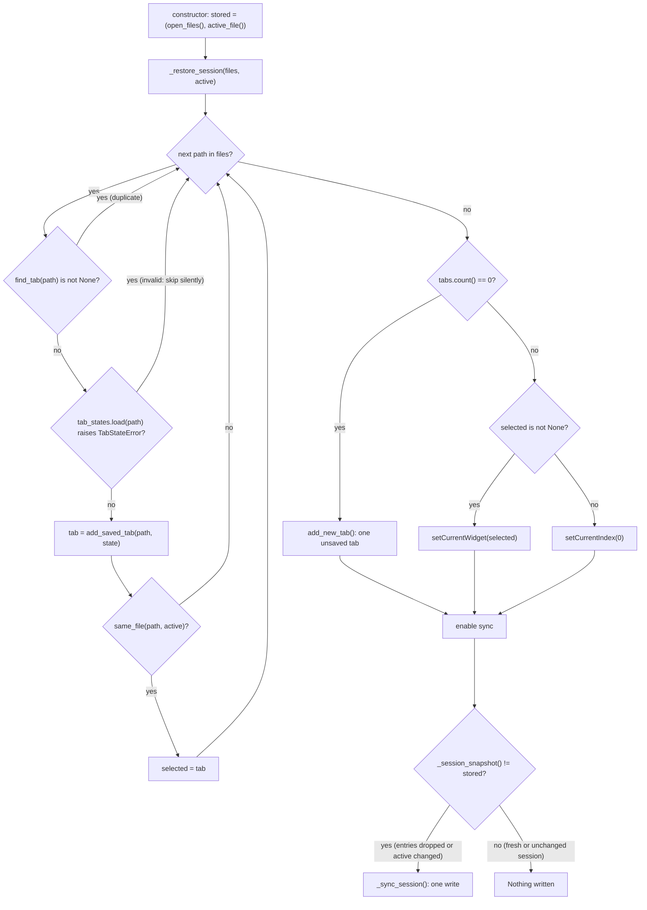
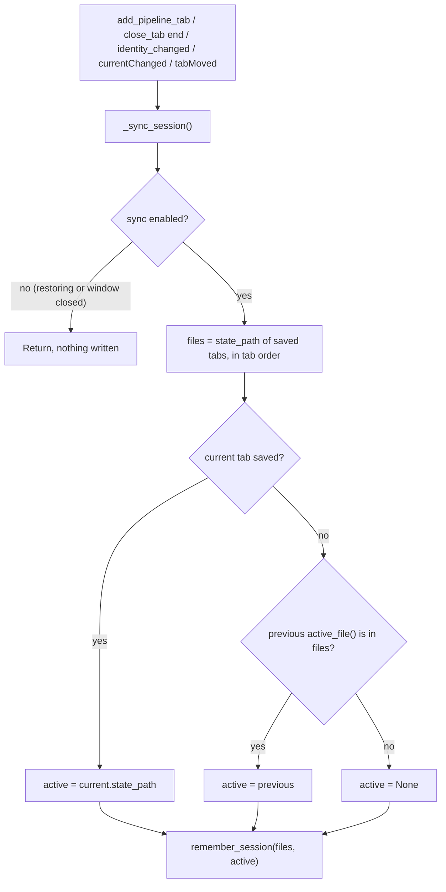

# S04 - Open tabs are kept in config.json and restored at startup

- **Plan:** [plan.md](plan.md)
- **Type:** Slice
- **Requirements covered:** FR-02 (removed from the session list), FR-18, FR-19, FR-20, FR-21
- **Prerequisites:** `AppConfig` with `last_state_folder`, `ConfigRepository` (with its `last_state_folder` key handling and private `_read_path` helper), `ConfigStore`, `SessionService` (`start_folder()`, `remember_folder(state_file)`), `same_file(a, b)` (`services/paths.py`), `Panel`, `TabState`, `TabStateError`, `TabStateService.load`, `PipelineTab` (`state_path`, `active_panel`, `start_panel`, `stack`, `identity_changed`), `NEW_TAB_TITLE`, `MainWindow(window_state, tab_states, session)`, `MainWindow.tabs`, `MainWindow.add_pipeline_tab(tab)`, `MainWindow.add_new_tab()`, `MainWindow.close_tab(index)`, `MainWindow.find_tab(path)`, `MainWindow.add_saved_tab(path, state)`, test fixtures `make_window` and `tab_states` (`tests/views/conftest.py`)
- **Creates:** `AppConfig.open_state_files`, `AppConfig.active_state_file` and the `open_state_files` / `active_state_file` keys of `config.json`; `SessionService.open_files()`, `SessionService.active_file()`, `SessionService.remember_session(files, active)`; session sync and startup restore in `MainWindow`

## 1. Goal
The saved open tabs survive a restart.

Observable behavior when done:
- After any session change, `config.json` holds `open_state_files` (the state file paths of the saved open tabs, in tab order) and `active_state_file` (the path of the selected tab). Unsaved tabs never appear in the list. Startup writes `config.json` only when the restored session differs from the stored one (for example, invalid entries were dropped). A fresh or unchanged session leaves the file as it is, or absent.
- The two keys are rewritten on every session change: a tab added from a file (any code path that goes through `add_pipeline_tab`), a first save, a tab closed, tabs reordered by dragging, and a change of the selected tab.
- At startup one tab opens for each listed file, in list order, showing its `active_panel`, and the tab of `active_state_file` is selected. When the selected tab at shutdown was unsaved, the last saved tab that was selected is selected instead, else the first restored tab.
- Listed files that are invalid (missing, unreadable, corrupted) are skipped with no dialog and are no longer listed in `config.json` after startup.
- If no tab is restored, the window shows one unsaved "New pipeline" tab.
- Closing a tab removes it from the list; its file stays on disk.

## 2. Context
- Starting code (as the prerequisites leave it):
  - `MainWindow.__init__(window_state, tab_states, session)` stores the three services, builds `self.tabs` (closable), the "+" `new_tab_button`, then calls `self.add_new_tab()` as its last statement.
  - `add_pipeline_tab(tab)`: `addTab`, `setTabToolTip`, connects `tab.identity_changed` to `_refresh_tab_identity(tab)` and `tab.start_panel.save_requested` to `_save_tab_as(tab, slug)`, returns the index. It does not select the tab.
  - `close_tab(index)`: returns for an out-of-range index; else `removeTab`, `deleteLater`, and `add_new_tab()` when no tab is left.
  - `add_saved_tab(path, state)`: new `PipelineTab(self._tab_states)`, `apply_saved` (emits `identity_changed`, no write), `add_pipeline_tab`, `setCurrentIndex`, returns the tab. `find_tab(path)` returns the index of the tab with the same file (`same_file`) or `None`.
  - `closeEvent` saves the maximized state through `WindowStateService`; `show_initial` is unchanged by this step.
  - Tabs are not movable yet (`QTabWidget.setMovable` is never called).
- `AppConfig` (`@dataclass`): `window_maximized: bool = False`, `last_state_folder: Path | None = None`.
- `ConfigRepository`: `load()` validates each key with a fallback, using `_read_path(data, key)` (a `Path` from a non-empty string, else `None`); `save()` re-reads the raw file so unknown keys are kept and always writes every known key.
- `SessionService(store)`: `start_folder()`, `remember_folder(state_file)`, load-modify-save on the shared `ConfigRepository`.
- Layer rules (`uv run lint-imports`): views import services and models only; nothing below views imports `PySide6`.
- Tests: pytest + pytest-qt, `--import-mode=importlib`; `make_window()` builds a new `MainWindow` on the same `tmp_path / "config.json"` each call (a second call is a restart); dialogs and message boxes are faked with `monkeypatch`.

## 3. Structure

### 3.1 Files
| File | Change | Responsibility |
|------|--------|----------------|
| `src/devpipe/models/app_config.py` | modify | `open_state_files`, `active_state_file` fields |
| `src/devpipe/persistence/config_repository.py` | modify | Read/write the two session keys with fallbacks |
| `src/devpipe/services/session_service.py` | modify | `open_files()`, `active_file()`, `remember_session(files, active)` |
| `src/devpipe/views/main_window.py` | modify | Startup restore, session sync on add/close/first save/move/current change, movable tabs, no sync after the window closed |
| `tests/persistence/test_config_repository.py` | modify | Session keys round trip and fallbacks; expected dict of `test_save_keeps_unknown_keys` |
| `tests/services/test_session_service.py` | modify | Session list cases |
| `tests/views/test_session_restore.py` | new | Session sync and restore through `MainWindow` |

### 3.2 Models - `src/devpipe/models/app_config.py`

```python
from dataclasses import dataclass, field
from pathlib import Path


@dataclass
class AppConfig:
    window_maximized: bool = False
    last_state_folder: Path | None = None
    open_state_files: list[Path] = field(default_factory=list)  # saved open tabs, in tab order
    active_state_file: Path | None = None                       # state file of the selected tab
```
`AppConfig()` equality with defaults is kept (existing `== AppConfig()` tests still pass).

### 3.3 Persistence - `src/devpipe/persistence/config_repository.py`

```python
_OPEN_STATE_FILES_KEY = "open_state_files"
_ACTIVE_STATE_FILE_KEY = "active_state_file"


class ConfigRepository:
    def load(self) -> AppConfig:
        data = self._read_raw()
        # existing window_maximized / last_state_folder handling unchanged, plus:
        #   open_state_files=self._read_path_list(data, _OPEN_STATE_FILES_KEY),
        #   active_state_file=self._read_path(data, _ACTIVE_STATE_FILE_KEY),

    def save(self, config: AppConfig) -> None:
        # existing lines unchanged, plus before write_text:
        #   data[_OPEN_STATE_FILES_KEY] = [str(path) for path in config.open_state_files]
        #   data[_ACTIVE_STATE_FILE_KEY] = (
        #       str(config.active_state_file) if config.active_state_file is not None else None
        #   )

    @staticmethod
    def _as_path(value: object) -> Path | None:
        """Path from a non-empty string; None for any other value."""

    @staticmethod
    def _read_path(data: dict, key: str) -> Path | None:
        return ConfigRepository._as_path(data.get(key))   # behavior unchanged

    @staticmethod
    def _read_path_list(data: dict, key: str) -> list[Path]:
        """Paths of the non-empty string items of a list value, in order.
        [] for a missing key or a value that is not a list; other items are skipped."""
```

- `_as_path` holds the single "non-empty string -> `Path`" rule; `_read_path` is refactored to use it (same results as before) and `_read_path_list` applies it per item.
- `_read_path_list`: `value = data.get(key)`; if `not isinstance(value, list)` return `[]`; else `[p for p in map(_as_path, value) if p is not None]`. No existence or duplicate check (use-case rules live in the window restore).
- `save` always writes both keys (`[]` / `null` when empty), so `config.json` reflects the model. `_read_raw`, unknown-key preservation and error behavior are unchanged.

### 3.4 Services - `src/devpipe/services/session_service.py`

Add three methods; `__init__`, `start_folder` and `remember_folder` are unchanged.

```python
class SessionService:
    def open_files(self) -> list[Path]:
        """State files of the last session's saved tabs, in tab order (may hold invalid files)."""

    def active_file(self) -> Path | None:
        """State file of the tab that was selected, or None."""

    def remember_session(self, files: list[Path], active: Path | None) -> None:
        """Store the open state files (in order) and the active one as absolute paths.

        Load-modify-save: every other setting is kept. Store errors propagate.
        """
```

- `open_files()`: `list(self._store.load().open_state_files)`.
- `active_file()`: `self._store.load().active_state_file`.
- `remember_session`: `config = self._store.load()`; `config.open_state_files = [path.absolute() for path in files]`; `config.active_state_file = active.absolute() if active is not None else None`; `self._store.save(config)`. `Path.absolute()` does no I/O and makes the stored strings absolute as the data model requires. No validation that `active` is in `files` (the caller guarantees it).

### 3.5 Views - `src/devpipe/views/main_window.py`

New import: `TabStateError` (add to the existing `devpipe.models.tab_state` import). `same_file` and `PipelineTab` are already imported.

Constructor changes (everything else unchanged):
1. Before the tab-building code: `self._session_sync_enabled = False`.
2. After the "+" button is set up: `self.tabs.setMovable(True)` (lets the user reorder tabs by dragging), then
   ```python
   self.tabs.currentChanged.connect(lambda _index: self._sync_session())
   self.tabs.tabBar().tabMoved.connect(lambda _from, _to: self._sync_session())
   ```
3. Replace the final `self.add_new_tab()` with:
   ```python
   stored = (self._session.open_files(), self._session.active_file())
   self._restore_session(*stored)
   self._session_sync_enabled = True
   if self._session_snapshot() != stored:
       self._sync_session()  # one write, only when restore dropped entries or changed the active file
   ```
   When the session is fresh or restored unchanged, nothing is written, so a missing `config.json` stays missing. The comparison is plain equality of `(list[Path], Path | None)`. Restored tabs keep the exact `Path` objects read from the session, so an unchanged session compares equal.

Changed methods:
- `add_pipeline_tab(tab)`: after the existing connections add `tab.identity_changed.connect(self._sync_session)` (records the first save); then call `self._sync_session()` just before `return index`. Insertion, refresh and the `save_requested` connection are unchanged; it still does not select the tab.
- `close_tab(index)`: add `self._sync_session()` as the last statement (after the optional `add_new_tab()`). The early return for an invalid index stays before it (nothing changed, no write).
- `closeEvent(event)`: add `self._session_sync_enabled = False` as the first statement; the maximized-state code is unchanged. The list is already current (written on every change), and Qt may emit `currentChanged` while it tears the tabs down; without this guard a partial list could overwrite the session.

New private methods:
```python
def _restore_session(self, files: list[Path], active: Path | None) -> None:
    """Open a saved tab for each valid state file of `files`, in order; select `active`.

    Invalid or duplicate entries are skipped silently. If nothing was restored, add one
    unsaved tab. Called once from the constructor, while session sync is disabled.
    """

def _session_snapshot(self) -> tuple[list[Path], Path | None]:
    """(state files of the saved tabs in tab order, active file) as the tabs show them now."""

def _sync_session(self) -> None:
    """Write _session_snapshot() to the session (remember_session).
    No-op while session sync is disabled (during restore and after the window closed)."""

def _session_active_file(self, files: list[Path]) -> Path | None:
    """State file to record as active for the given open `files`."""
```

- `_restore_session` (flow in section 4):
  1. `selected: PipelineTab | None = None` (`files` and `active` are the stored values the constructor passed in).
  2. For each `path` in `files`: skip if `self.find_tab(path) is not None` (duplicate entry); `state = self._tab_states.load(path)`, on `TabStateError` continue (no dialog, no log); `tab = self.add_saved_tab(path, state)` (shows `state.active_panel`); if `active is not None and same_file(path, active)`: `selected = tab`.
  3. If `self.tabs.count() == 0`: `self.add_new_tab()`; elif `selected is not None`: `self.tabs.setCurrentWidget(selected)`; else `self.tabs.setCurrentIndex(0)`.
- `_session_snapshot`: `files = [w.state_path for w in (self.tabs.widget(i) for i in range(self.tabs.count())) if isinstance(w, PipelineTab) and w.state_path is not None]`; returns `(files, self._session_active_file(files))`.
- `_sync_session`:
  1. Return if `not self._session_sync_enabled`.
  2. `self._session.remember_session(*self._session_snapshot())`.
- `_session_active_file(files)`:
  - current widget is a saved `PipelineTab` -> its `state_path`;
  - else (unsaved or no current tab) `previous = self._session.active_file()`; return `previous` if it is not `None` and `any(same_file(previous, f) for f in files)`, else `None`.
  - This keeps "the last saved tab that was active" while an unsaved tab is selected; at restore, a `None` (or unknown) active selects the first restored tab.

Signal-order notes (no code, for the implementer):
- `QTabWidget` connects its own handler to `tabBar().tabMoved` in its constructor, before ours, so `tabs.widget(i)` already has the new order when `_sync_session` runs.
- In `add_saved_tab`, `apply_saved` emits `identity_changed` before `add_pipeline_tab` connects to it; the sync inside `add_pipeline_tab` and the following `currentChanged` record the tab. A first save emits `identity_changed` on a connected tab.
- `removeTab` may emit `currentChanged` before the explicit sync at the end of `close_tab`; both writes see the tab already removed.

## 4. Logic flows


Restore rebuilds the tabs with sync disabled, so no partial list is ever written. Afterwards at most one write happens. It occurs only when the restored session differs from the stored one, which removes invalid and duplicate entries from `config.json`. A fresh or unchanged session writes nothing.


Every session change goes through one method that rebuilds the whole list from the tab bar, so the stored list cannot drift from the tabs. Selecting an unsaved tab keeps the previous saved active file as long as that tab is still open.

## 5. Edge cases and errors
| Case | Expected behavior |
|------|-------------------|
| No `config.json` or no session keys | One unsaved tab; startup writes nothing (a missing `config.json` stays missing); loading gives `([], None)` |
| Stored session restored unchanged | No write at startup |
| Listed file missing, unreadable or invalid (any `TabStateError`) | Skipped, no dialog; the session differs, so startup writes once and the file is no longer listed; the file on disk is not touched |
| All listed files invalid | One unsaved tab; startup writes once: list `[]`, active `null` (FR-21) |
| Same file listed twice (any spelling `same_file` matches) | One tab; the session differs, so startup writes once and the file is listed once |
| `active_state_file` not among the restored files, `null`, or invalid | First restored tab selected |
| `open_state_files` not a list, or items that are not non-empty strings | Loaded as `[]` / those items skipped; unknown keys still kept |
| `active_state_file` `""`, number, boolean, list, object | Loaded as `None` |
| Relative path given to `remember_session` | Stored as absolute (`Path.absolute()`) |
| Unsaved tabs open | Never in `open_state_files` |
| Selected tab is unsaved | `active_state_file` keeps the previously active saved file if it is still open, else `null` |
| A saved tab is closed | Removed from the list; its file still exists (FR-02) |
| The last tab is closed and it was saved | A new unsaved tab appears; list `[]`, active `null` |
| `close_tab` with an invalid index | Nothing changes, no write |
| Tabs dragged to a new order | List follows the new order |
| Window closed | No further session writes from that window; the list written before the close stays |
| Writing `config.json` fails | Existing behavior: the `OSError` is not handled (same as the other `config.json` keys) |
| A restored file has `active_panel` `"start"` | The tab shows the start panel in saved mode (via `add_saved_tab`) |

## 6. Tests

### 6.1 Automated
Helpers in `test_session_restore.py` (a few lines each, local to the file):
- `write_state(tab_states, path, name)`: `tab_states.save(path, TabState(name))`, returns `path`.
- `session_of(tmp_path)`: `ConfigRepository(tmp_path / "config.json").load()`, returns `(open_state_files, active_state_file)`.
- `no_dialogs(monkeypatch)`: patches `QMessageBox.warning`, `critical`, `information`, `question` and `QFileDialog.getOpenFileName` / `getSaveFileName` with functions that fail the test.

Paths written by `remember_session` are absolute; `tmp_path` is absolute, so expected values are compared as `Path` objects directly.

| Test file | Test name | Given / When / Then | Proves |
|-----------|-----------|---------------------|--------|
| `tests/persistence/test_config_repository.py` | `test_session_keys_round_trip` | Given `AppConfig(open_state_files=[tmp_path / "a.json", tmp_path / "b.json"], active_state_file=tmp_path / "b.json")` saved, when loaded, then equal fields, and the raw JSON has `open_state_files == [str(a), str(b)]` and `active_state_file == str(b)` | FR-18 |
| `tests/persistence/test_config_repository.py` | `test_session_keys_default_to_empty` | Given a file without the keys (and a missing file), when loaded, then `open_state_files == []` and `active_state_file is None` | FR-18 |
| `tests/persistence/test_config_repository.py` | `test_invalid_open_state_files_gives_empty_list` (parametrized: `None`, `"a.json"`, `5`, `True`, `{}`) | Given `{"open_state_files": value}`, when loaded, then `[]` | FR-18 |
| `tests/persistence/test_config_repository.py` | `test_open_state_files_skips_invalid_items` | Given `["a.json", "", 5, None, ["x"], "b.json"]`, when loaded, then `[Path("a.json"), Path("b.json")]` | FR-18 |
| `tests/persistence/test_config_repository.py` | `test_invalid_active_state_file_gives_none` (parametrized: `None`, `""`, `5`, `True`, `[]`, `{}`) | Then `None` | FR-18 |
| `tests/persistence/test_config_repository.py` | `test_last_state_folder_*` (existing) | Unchanged, still pass after the `_as_path` refactor | Regression |
| `tests/persistence/test_config_repository.py` | `test_save_keeps_unknown_keys` (existing, expected dict updated) | Then the file is `{"other": 1, "window_maximized": True, "last_state_folder": None, "open_state_files": [], "active_state_file": None}` | Regression |
| `tests/services/test_session_service.py` | `test_session_defaults_to_empty` | Given an empty config, then `open_files() == []` and `active_file() is None` | FR-18 |
| `tests/services/test_session_service.py` | `test_remember_session_round_trips` | When `remember_session([a, b], b)` (absolute `tmp_path` paths), then `open_files() == [a, b]`, `active_file() == b` | FR-18, FR-19 |
| `tests/services/test_session_service.py` | `test_remember_session_without_active` | When `remember_session([a], None)`, then `active_file() is None` | FR-18 |
| `tests/services/test_session_service.py` | `test_remember_session_stores_absolute_paths` | When `remember_session([Path("x.json")], Path("x.json"))`, then `open_files() == [Path("x.json").absolute()]` and `active_file() == Path("x.json").absolute()` | Data model (absolute paths) |
| `tests/services/test_session_service.py` | `test_remember_session_keeps_other_settings` | Given `window_maximized` True and `remember_folder(...)` done, when `remember_session([a], a)`, then `window_maximized` and `last_state_folder` are unchanged | Regression |
| `tests/services/test_session_service.py` | `test_remember_folder_keeps_session` | Given `remember_session([a], a)`, when `remember_folder(...)`, then `open_files() == [a]` and `active_file() == a` | Regression |
| `tests/views/test_session_restore.py` | `test_restart_restores_saved_tabs_in_order_with_active_selected` | Given `make_window()` with files `a.json`, `b.json` written, `add_saved_tab` for `a` then `b`, `add_new_tab()` (unsaved), then the `b` tab selected; when the window is closed and `make_window()` is called again, then the new window has 2 tabs, texts `["a", "b"]`, `state_path`s `[a, b]`, and the current widget is the `b` tab | FR-18, FR-20, AC "restart" |
| `tests/views/test_session_restore.py` | `test_restored_tab_shows_its_active_panel` | Given a listed valid file `a.json`, when `make_window()`, then the tab's `active_panel is Panel.START`, `stack.currentWidget() is start_panel`, input text "a" and disabled, Open/Create enabled, tooltip `str(a)` | FR-20 |
| `tests/views/test_session_restore.py` | `test_unsaved_active_tab_selects_last_active_saved_tab` | Given saved tabs `a`, `b` with `a` selected, then `add_new_tab()` (current unsaved); when closed and restarted, then the current tab is `a` | FR-20, spec assumption |
| `tests/views/test_session_restore.py` | `test_no_active_file_selects_first_restored_tab` | Given `SessionService(ConfigRepository(tmp_path / "config.json")).remember_session([a, b], None)` with valid files, when `make_window()`, then current index 0 (the `a` tab) | FR-20, spec assumption |
| `tests/views/test_session_restore.py` | `test_invalid_active_file_selects_first_restored_tab` | Given `remember_session([a, bad], bad)` with `bad` missing, when `make_window()`, then one tab `a`, selected | FR-20 |
| `tests/views/test_session_restore.py` | `test_invalid_listed_file_is_skipped_silently_and_dropped` (parametrized: missing file; `"{not json"`; valid JSON with `"version": 2`) | Given `no_dialogs`, `remember_session([a, bad, b], a)`, when `make_window()`, then tabs `["a", "b"]`, `session_of(tmp_path) == ([a, b], a)`, and a `bad` file that existed still exists with unchanged content | FR-20, AC "deleted or corrupted" |
| `tests/views/test_session_restore.py` | `test_nothing_restorable_opens_one_unsaved_tab` | Given `no_dialogs` and `remember_session([missing1, missing2], missing1)`, when `make_window()`, then one tab titled "New pipeline" with `state_path is None`, and `session_of(tmp_path) == ([], None)` | FR-21, AC "no restorable files" |
| `tests/views/test_session_restore.py` | `test_empty_session_opens_one_unsaved_tab` | Given no `config.json`, when `make_window()`, then one unsaved tab, `not (tmp_path / "config.json").exists()`, and `session_of(tmp_path) == ([], None)` | FR-21, no write for an unchanged session |
| `tests/views/test_session_restore.py` | `test_duplicate_entries_restore_one_tab` | Given `remember_session([a, tmp_path / "x" / ".." / "a.json"], a)` with `a` valid, when `make_window()`, then one tab and `session_of(tmp_path)[0] == [a]` | FR-20 |
| `tests/views/test_session_restore.py` | `test_restore_writes_session_once` | Given valid `a`, `b`, a missing `bad`, and `SessionService(ConfigRepository(tmp_path / "config.json")).remember_session([a, bad, b], b)` done first; then `SessionService.remember_session` wrapped with `monkeypatch` so it records its arguments and calls the original. When `make_window()` runs, then exactly one call is recorded, with `([a, b], b)` | Plan note: no partial list during restore; invalid entries dropped |
| `tests/views/test_session_restore.py` | `test_unchanged_session_is_not_rewritten` | Given valid `a`, `b`, `remember_session([a, b], b)` done first, then the same wrapper installed; when `make_window()`, then zero calls are recorded, and the window has tabs `["a", "b"]` with `b` selected | No startup write for an unchanged session |
| `tests/views/test_session_restore.py` | `test_unsaved_tabs_are_never_listed` | Given `make_window()`, when `add_new_tab()` twice, then `session_of(tmp_path) == ([], None)` | FR-18 |
| `tests/views/test_session_restore.py` | `test_added_saved_tab_is_listed_and_active` | When `add_saved_tab(a, TabState("a"))`, then `session_of(tmp_path) == ([a], a)` | FR-19 (open) |
| `tests/views/test_session_restore.py` | `test_first_save_adds_tab_to_session` | Given `QFileDialog.getSaveFileName` patched to return `(str(tmp_path / "new-feature.json"), "JSON files (*.json)")`, when the first tab's input gets "New Feature" and Save is clicked, then `session_of(tmp_path) == ([tmp_path / "new-feature.json"], tmp_path / "new-feature.json")` | FR-19 (first save), AC "new pipeline" flow |
| `tests/views/test_session_restore.py` | `test_closing_a_tab_removes_it_from_session_and_keeps_file` | Given saved tabs `a`, `b` (files written) with `b` selected, when `close_tab(find_tab(a))`, then `session_of(tmp_path) == ([b], b)` and `a.exists()` with its content unchanged | FR-02, AC "tab is closed" |
| `tests/views/test_session_restore.py` | `test_closing_the_last_saved_tab_empties_the_session` | Given a restored single saved tab `a`, when `close_tab(0)`, then one unsaved tab and `session_of(tmp_path) == ([], None)`; `a` still exists | FR-02, FR-03 |
| `tests/views/test_session_restore.py` | `test_close_tab_with_invalid_index_writes_nothing` | Given saved tab `a` and the config file's text recorded, when `close_tab(5)`, then the text is unchanged | `close_tab` guard |
| `tests/views/test_session_restore.py` | `test_tabs_are_movable` | Then `window.tabs.isMovable()` is True | FR-19 (reorder possible) |
| `tests/views/test_session_restore.py` | `test_reorder_updates_session` | Given saved tabs `a`, `b` added after the initial unsaved tab; when `window.tabs.tabBar().moveTab(window.find_tab(a), window.find_tab(b))`, then `session_of(tmp_path)[0] == [b, a]` | FR-19 (reorder) |
| `tests/views/test_session_restore.py` | `test_current_tab_change_updates_active` | Given saved tabs `a`, `b` with `b` selected, when `setCurrentIndex(find_tab(a))`, then `session_of(tmp_path)[1] == a` | FR-19 (active change) |
| `tests/views/test_session_restore.py` | `test_selecting_unsaved_tab_keeps_previous_active` | Given saved `a` selected, when the unsaved tab is selected, then active is still `a`; when `a` is then closed, then `session_of(tmp_path) == ([], None)` | FR-18, spec assumption |
| `tests/views/test_session_restore.py` | `test_closed_window_writes_no_session` | Given saved `a`, `b` with `b` selected and the window closed, when `close_tab(find_tab(a))` and `setCurrentIndex(0)` are called on the closed window, then `session_of(tmp_path) == ([a, b], b)` | Shutdown guard |
| `tests/views/test_session_restore.py` | `test_restore_shows_no_dialog` | Given `no_dialogs` and a mix of valid and invalid listed files, when `make_window()`, then no fake was called | FR-20 ("silently") |
| `tests/views/test_main_window.py`, `test_first_save.py`, `test_pipeline_tab.py` | existing tests | Unchanged; still pass. A fresh config gives one unsaved tab at startup, and startup writes no `config.json`, so `test_cancel_changes_nothing` ("no `.json` file exists in `tmp_path`") still holds. The assertions "no file was written" (`test_add_saved_tab_adds_and_selects_a_saved_tab`) and "`tmp_path / "a.json"` does not exist" (`test_save_to_path_open_in_other_tab_warns`) refer only to the state file. They still pass even though `add_saved_tab` now writes `config.json` | Regression |

Note on `test_reorder_updates_session`: the window starts with one unsaved tab at index 0; `a` and `b` are at 1 and 2. Moving 1 to 2 gives the saved order `[b, a]`.

Run with: `uv run pytest` and `uv run lint-imports`

### 6.2 Manual
- Given `uv run devpipe` with two tabs saved as `a.json` and `b.json` and a third unsaved tab, and `b` selected, when the user closes devpipe and starts it again, then exactly the `a` and `b` tabs come back in that order with `b` selected, and the unsaved tab is gone. (FR-18, FR-20, AC "restart")
- Given those two tabs, when the user drags `b` before `a`, closes and restarts, then the order is `b`, `a`. (FR-19)
- Given those two tabs, when the user closes `a` with its close button and restarts, then only `b` comes back and `a.json` is still on disk. (FR-02)
- Given those two tabs, when the user deletes `a.json` in the file explorer and restarts devpipe, then only `b` opens, no message appears, and `config.json` no longer lists `a.json`. (FR-20)
- Given `config.json` listing only deleted files, when devpipe starts, then one "New pipeline" tab is shown. (FR-21)
- Given saved `a` selected, when the user clicks "+" and closes devpipe while the new unsaved tab is selected, then on restart `a` is selected. (spec assumption)

### 6.3 Static checks
- `uv run lint-imports` -> all contracts kept.
- `git grep -n -e QSettings -- src` -> no output.
- `git grep -n -e "persistence" -- src/devpipe/views` -> no output.
- `git grep -n -e "remember_session" -- src/devpipe/views` -> only inside `_sync_session` in `main_window.py`.
- `git status --porcelain ai-skills` -> no output.

## 7. Implementation order
1. `AppConfig` fields and `ConfigRepository` (`_as_path`, `_read_path_list`, the two keys), with the `test_config_repository.py` changes; run them.
2. `SessionService.open_files`, `active_file`, `remember_session`, with the `test_session_service.py` cases.
3. `MainWindow`: add the following, then the sync tests of `test_session_restore.py`. For now the constructor still ends with `add_new_tab()` followed by enabling sync (no startup write).
   - `_session_sync_enabled`, `_session_snapshot`, `_sync_session`, `_session_active_file`
   - the sync calls in `add_pipeline_tab` / `close_tab`
   - `setMovable(True)` and the `currentChanged` / `tabMoved` connections
   - the `closeEvent` guard
4. Replace the constructor's `add_new_tab()` with the stored-session read, `_restore_session(*stored)` and the compare-then-write; add the restore tests.
5. Run `uv run pytest`, `uv run lint-imports` and the static checks; do the manual checks.

## 8. Out of scope
- Does not add a menu bar or any Open dialog, and does not change how a state file is chosen for opening.
- Does not change the first-save flow, `find_tab`, `add_saved_tab`, `add_new_tab`, `_refresh_tab_identity`, `show_initial`, or the maximized-state behavior of `closeEvent`.
- Does not change `PipelineTab`, `StartPanel`, the state file format, `TabStateRepository` or `TabStateService`.
- Does not change `start_folder`, `remember_folder` or the `last_state_folder` key.
- Does not delete or modify state files on disk (closing a tab or skipping an invalid file never touches the file).
- Does not ask for confirmation or warn about anything at startup.
- Does not change `docs/architecture.md`, `app.py` or `ai-skills/`.

## 9. Design notes
- **One sync method, whole-list rewrite:** `_sync_session` rebuilds the list from the tab bar on every trigger instead of patching it (add/remove/move). There is a single source of truth (the tabs), no drift, and any future way of adding tabs through `add_pipeline_tab` is recorded with no extra call (Open/Closed). The cost is a small `config.json` write per selection change, which the spec asks for (FR-19).
- **Sync flag instead of connecting signals late:** `_session_sync_enabled` covers both the restore (no partial list while tabs are rebuilt; at most one write at the end, only when entries were dropped or the active file changed) and the shutdown teardown, where Qt can emit `currentChanged` as tabs are destroyed. Alternative rejected: disconnecting signals in `closeEvent`, which needs a handle for every per-tab connection.
- **Active-tab rule lives in the window, stored value as memory:** when the selected tab is unsaved, `_session_active_file` keeps the previously stored active file if it is still open. This implements the spec assumption ("the last saved tab that was active, else the first restored tab") with no extra window state; `remember_session` keeps the simple signature `(files, active)`.
- **Restore reuses `add_saved_tab` and `find_tab`:** the same path as any other saved tab, so restored tabs get identical wiring; `find_tab` also removes duplicate entries.
- **`setMovable(True)`:** FR-19 lists reorder as a session change, which needs movable tabs; the `tabMoved` sync relies on `QTabWidget`'s own `tabMoved` handler running first (connected in its constructor).
- **Persistence stays lenient per item:** a broken item in `open_state_files` is skipped rather than discarding the whole list, matching "invalid files are skipped silently"; `_as_path` is the single string-to-path rule shared with `_read_path` (DRY). Existence and validity of files are checked by the restore (use case), not by the repository.
- **Absolute paths in `remember_session`:** the data model requires absolute path strings; `Path.absolute()` guarantees it without I/O or symlink resolution, so tooltips and stored paths look the same for dialog-chosen (already absolute) paths.
- **Startup writes only on a difference:** the constructor compares `_session_snapshot()` after restore with the stored `(open_files(), active_file())`. It calls `_sync_session()` only when they differ: an invalid or duplicate entry was dropped, or the stored active file was not restored. A fresh or unchanged session therefore creates or rewrites no file, so tests that expect `tmp_path` to stay free of `.json` files keep passing. Alternative rejected: always writing once at startup, which creates `config.json` with no change to record.
