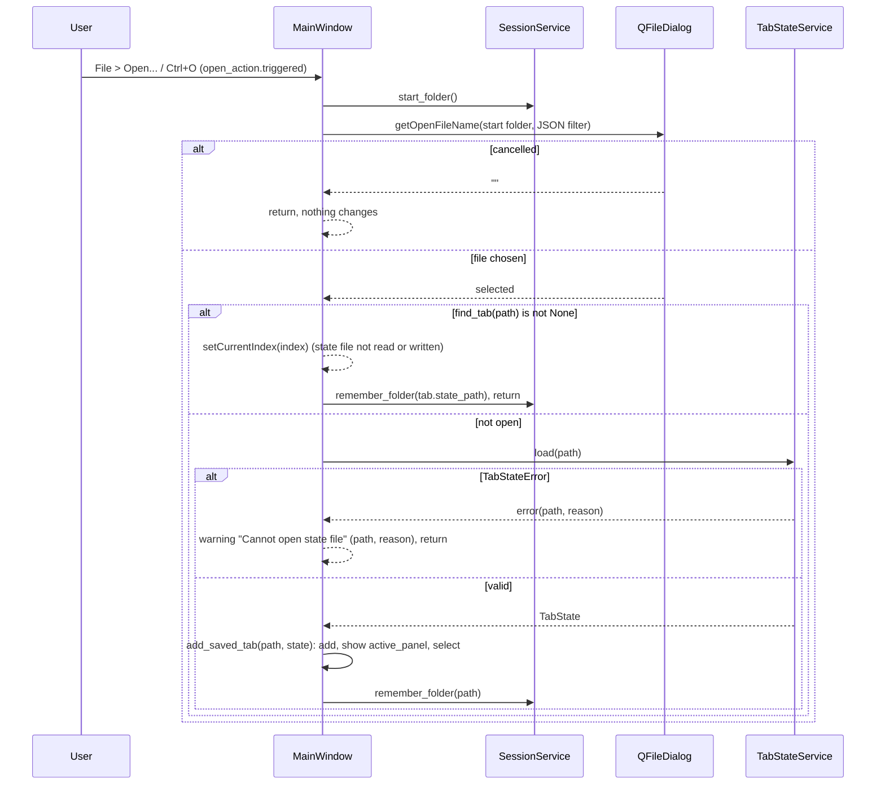

# S05 - File > Open loads a state file into a tab

- **Plan:** [plan.md](plan.md)
- **Type:** Slice
- **Requirements covered:** FR-05, FR-12 (opened files), FR-22, FR-24
- **Prerequisites:** `MainWindow(window_state, tab_states, session)` constructor, `MainWindow.tabs`, `MainWindow.find_tab(path)`, `MainWindow.add_saved_tab(path, state)`, `MainWindow.add_new_tab()`, `STATE_FILE_FILTER` (`views/main_window.py`), `PipelineTab` (`stack`, `start_panel`, `state_path`, `active_panel`, `title()`, `tooltip()`), `SessionService.start_folder()`, `SessionService.remember_folder(state_file)`, `TabStateService.load(path)`, `TabStateError` (`path`, `reason`), `TabState`, `Panel`, `ConfigRepository`, `AppConfig.last_state_folder`, test fixture `make_window` (`tests/views/conftest.py`)
- **Creates:** `MainWindow.open_action` (`QAction` "Open..." with mnemonic `&Open...`, shortcut Ctrl+O, in the "File" menu (`&File`) of the window's menu bar)

## 1. Goal
The user can resume a pipeline that is not in the current session by opening its state file.

Observable behavior when done:
- The main window has a menu bar with a "File" menu holding "Open..." (shortcut Ctrl+O). Mnemonics: Alt+F opens the File menu, then O picks Open... (the visible texts stay "File" / "Open...", with the mnemonic letter underlined where the platform shows it).
- Triggering it shows the native Open dialog titled "Open pipeline state", filter "JSON files (*.json)", starting in the last-used folder (or the home folder when there is none or it no longer exists).
- Cancelling does nothing.
- Choosing a valid file that is not open adds a saved tab for it (title = feature name, tooltip = full path, showing its `active_panel`), selects it, and stores the file's folder as `last_state_folder` in `config.json`.
- Choosing a file already open in a tab selects that tab and stores that file's folder as `last_state_folder`; no tab is added and the state file is neither read nor written.
- Choosing an invalid file shows a warning "Cannot open state file" with the path and the reason; no tab is added and `config.json` is unchanged.

## 2. Context
- Starting code (as the prerequisites leave it): `MainWindow.__init__(window_state, tab_states, session)` stores `self._window_state`, `self._tab_states`, `self._session`, builds `self.tabs` (closable, "+" corner button) as the central widget and fills it with tabs. There is no menu bar content yet.
- `main_window.py` already imports `Path`, `QFileDialog`, `QMessageBox` and defines `STATE_FILE_FILTER = "JSON files (*.json)"`. Warnings in this module use `QMessageBox.warning(self, <title>, f"{path}\n\n{<text or reason>}")`.
- `find_tab(path)` returns the index of the tab whose `state_path` is the same file (resolved, case-insensitive on Windows) or `None`. `add_saved_tab(path, state)` builds a tab, applies the saved state without writing, adds it through the single insertion point, selects it and returns it; it does not check duplicates.
- `TabStateService.load(path)` returns a `TabState` or raises only `TabStateError(path, reason)` for every invalid-file case (missing, unreadable, not UTF-8, not JSON, not an object, bad `version`, bad `feature_name`, missing/unknown `active_panel`).
- Layer rules (`uv run lint-imports`): views import services and models, never persistence. Qt only in views and `app.py`.
- Tests: pytest + pytest-qt, `--import-mode=importlib`, no `__init__.py`; the `make_window` fixture builds a `MainWindow` with real repositories on `tmp_path / "config.json"` registered with `qtbot`. Dialogs and message boxes are faked with `monkeypatch`.

## 3. Structure

### 3.1 Files
| File | Change | Responsibility |
|------|--------|----------------|
| `src/devpipe/views/main_window.py` | modify | Menu bar with File > Open..., `open_action`, open handler |
| `tests/views/test_file_open.py` | new | Menu/shortcut wiring and the open flow end to end through `MainWindow` |

### 3.2 Views - `src/devpipe/views/main_window.py` (modify)

New imports: `QAction`, `QKeySequence` (`PySide6.QtGui`, next to `QCloseEvent`), `TabStateError` (`devpipe.models.tab_state`, next to the existing `TabState` import).

New module constants (next to the existing dialog constants):
```python
FILE_MENU_TITLE = "&File"       # mnemonic: Alt+F
OPEN_ACTION_TEXT = "&Open..."   # mnemonic: O inside the File menu
OPEN_SHORTCUT = "Ctrl+O"
OPEN_DIALOG_TITLE = "Open pipeline state"
OPEN_ERROR_TITLE = "Cannot open state file"
```
The dialog filter reuses the existing `STATE_FILE_FILTER` (one source for the filter of both dialogs).

Constructor: add one call, `self._build_menu_bar()`, right after `self.setCentralWidget(self.tabs)`. It does not depend on tabs, so it is independent of how the constructor fills the tab widget. Nothing else in the constructor changes.

New members:
```python
open_action: QAction  # public attribute, created in _build_menu_bar

def _build_menu_bar(self) -> None:
    """Create the File menu with the Open... action (Ctrl+O)."""

def _open_state_file(self) -> None:
    """File > Open flow: Open dialog, focus an already open tab, or load and add a saved tab."""
```

- `_build_menu_bar()`:
  ```python
  file_menu = self.menuBar().addMenu(FILE_MENU_TITLE)
  self.open_action = QAction(OPEN_ACTION_TEXT, self)
  self.open_action.setShortcut(QKeySequence(OPEN_SHORTCUT))
  self.open_action.triggered.connect(lambda: self._open_state_file())  # drop the `checked` argument
  file_menu.addAction(self.open_action)
  ```
  The action is parented to the window and added to a menu of the window's menu bar, so Ctrl+O works anywhere in the window (default `Qt.WindowShortcut` context). An explicit `QKeySequence("Ctrl+O")` is used rather than `QKeySequence.StandardKey.Open` so the shortcut is the same on every platform and testable exactly.
- `_open_state_file()` (flow in section 4):
  1. `selected, _ = QFileDialog.getOpenFileName(self, OPEN_DIALOG_TITLE, str(self._session.start_folder()), STATE_FILE_FILTER)`.
  2. `selected == ""` (cancel): return.
  3. `path = Path(selected)`.
  4. `index = self.find_tab(path)`; if `index is not None`: `tab = self.tabs.widget(index)`, `self.tabs.setCurrentIndex(index)`, `self._session.remember_folder(tab.state_path)` and return (FR-22, FR-12). The file is not read, so an open tab is focused even if its file changed or vanished on disk. The folder stored is that of the tab's own `state_path`: it is the same file the user picked (`find_tab` matched it), but in the form the tab already uses, so a picked spelling such as `x\..\a.json` or `A.JSON` is never written to `config.json`.
  5. `state = self._tab_states.load(path)`; on `TabStateError as error`: `QMessageBox.warning(self, OPEN_ERROR_TITLE, f"{error.path}\n\n{error.reason}")` and return (FR-24; no tab, `config.json` unchanged).
  6. `self.add_saved_tab(path, state)` (adds, shows `state.active_panel`, selects; no write).
  7. `self._session.remember_folder(path)` (FR-12).

`add_pipeline_tab`, `add_new_tab`, `add_saved_tab`, `find_tab`, `close_tab`, `_save_tab_as`, `_refresh_tab_identity`, `show_initial`, `closeEvent` and the tab bar setup are unchanged.

### 3.3 Tests - `tests/views/test_file_open.py` (new)

Local helpers (in this file only):
- `write_state(path: Path, feature_name: str) -> Path`: writes `json.dumps({"version": 1, "feature_name": feature_name, "active_panel": "start"}, indent=2) + "\n"` as UTF-8 and returns `path` (independent of the code under test).
- `open_dialog` fixture: `monkeypatch.setattr(QFileDialog, "getOpenFileName", fake)`; `fake(parent, caption, dir, filter, *args)` appends `(parent, caption, dir, filter)` to `calls` and returns `(answer, STATE_FILE_FILTER)`, or `("", "")` when `answer` is `None` (cancel). The fixture returns an object with a settable `answer` and the `calls` list.
- `warnings` fixture: `monkeypatch.setattr(QMessageBox, "warning", fake)`; `fake(parent, title, text, *args)` appends `(title, text)` and returns `QMessageBox.StandardButton.Ok`.
- `last_state_folder(tmp_path) -> Path | None`: `ConfigRepository(tmp_path / "config.json").load().last_state_folder`.

Tests record `before = window.tabs.count()` and `window.tabs.currentIndex()` instead of assuming the startup tab count.

## 4. Logic flows


The duplicate check runs before the file is read, so an already open tab is always focused and never reloaded. Every branch ends with no change (cancel or invalid file), or with a selected tab for the picked file (existing or new) and `last_state_folder` set to that file's folder.

## 5. Edge cases and errors
| Case | Expected behavior |
|------|-------------------|
| Dialog cancelled | Nothing changes: no tab, no warning, current tab unchanged, `config.json` unchanged |
| No `last_state_folder`, or it points to a deleted folder | Dialog starts in `Path.home()` (rule of `start_folder()`) |
| Valid file not open | New saved tab at the end, selected, title = `feature_name`, tooltip = full path, `active_panel` shown; `last_state_folder` = file's folder; the file is not rewritten |
| File already open (same path, `..` segments, other letter case on Windows) | That tab is selected; tab count unchanged; no warning; `last_state_folder` = folder of that tab's `state_path` (FR-12) |
| File already open but deleted or corrupted on disk since | Same as above: focused, not read, no warning, folder remembered (if that folder no longer exists, the next dialog falls back to home through `start_folder()`) |
| File missing (typed name), unreadable, not UTF-8, not JSON, not an object, bad `version`, bad/empty/missing `feature_name`, missing/unknown `active_panel` | Warning "Cannot open state file", text `"<path>\n\n<reason>"` with the `TabStateError` reason; tab count and current tab unchanged; `last_state_folder` unchanged (FR-24) |
| Two valid files with the same `feature_name` at different paths | Both open as separate tabs (identity is the path, not the name) |
| Writing `config.json` fails after the tab was added | Not handled (the `OSError` propagates, same as other `config.json` writes); the tab is already open |

## 6. Tests

### 6.1 Automated
| Test file | Test name | Given / When / Then | Proves |
|-----------|-----------|---------------------|--------|
| `tests/views/test_file_open.py` | `test_file_menu_holds_open_action` | Given `make_window()`, then the first action of `window.menuBar().actions()` has text "&File", its `menu()` contains `window.open_action`, and `open_action.text() == "&Open..."` | FR-05, mnemonics decision |
| `tests/views/test_file_open.py` | `test_open_action_shortcut_is_ctrl_o` | Then `window.open_action.shortcut() == QKeySequence("Ctrl+O")` | FR-05 |
| `tests/views/test_file_open.py` | `test_open_dialog_uses_home_and_json_filter` | Given an empty config and the dialog cancels, when `open_action.trigger()`, then the fake was called once with parent `window`, caption "Open pipeline state", `Path(dir) == Path.home()`, filter "JSON files (*.json)" | FR-05, FR-12 |
| `tests/views/test_file_open.py` | `test_cancel_changes_nothing` | Given the dialog cancels, when triggered, then tab count and current index unchanged, no warning, `last_state_folder(tmp_path) is None` | FR-05 |
| `tests/views/test_file_open.py` | `test_open_valid_file_adds_selected_saved_tab` | Given `write_state(tmp_path / "states" / "a.json", "a")` (folder created) and the dialog returns that path, when triggered, then count is `before + 1`, `tabs.currentWidget()` is a `PipelineTab` with `state_path == path`, tab text "a", tab tooltip `str(path)`, `active_panel is Panel.START`, `stack.currentWidget() is start_panel`, start panel in saved mode (input text "a" and disabled, Save disabled, Open/Create enabled), no warning, and the file text is unchanged | FR-22 (new tab case), AC "opens in a new tab" |
| `tests/views/test_file_open.py` | `test_open_valid_file_remembers_its_folder` | Same setup, then `last_state_folder(tmp_path) == tmp_path / "states"` | FR-12 |
| `tests/views/test_file_open.py` | `test_next_open_dialog_starts_in_last_used_folder` | Given one file opened from `tmp_path / "states"`, when the dialog is set to cancel and the action is triggered again, then the second call's `Path(dir) == tmp_path / "states"` | FR-12 |
| `tests/views/test_file_open.py` | `test_open_already_open_file_selects_its_tab` (parametrized `parts`: `("a.json",)`, `("x", "..", "a.json")`; inside the test the dialog answer is `str(tmp_path.joinpath(*parts))`) | Given `add_saved_tab(tmp_path / "a.json", TabState("a"))` (no file on disk) and then `add_new_tab()` selected, when triggered, then the current widget is the saved tab, count unchanged, no warning, and `last_state_folder(tmp_path) == tmp_path` (folder of the tab's `state_path`, for both spellings) | FR-22, FR-12, AC "already open" |
| `tests/views/test_file_open.py` | `test_open_already_open_file_ignores_case_on_windows` (skip unless `sys.platform == "win32"`) | Same with the dialog returning `tmp_path / "A.JSON"`; then the saved tab is selected, count unchanged and `last_state_folder(tmp_path) == tmp_path` | FR-22, FR-12 |
| `tests/views/test_file_open.py` | `test_open_invalid_file_warns_and_adds_no_tab` (parametrized `(content, reason)`; the file is always `path = tmp_path / "bad.json"`: `None` -> "file not found" (nothing is written, the file does not exist); the raw text `"{not json"` written with `write_text(..., encoding="utf-8")` -> "not valid JSON"; the objects `{"version": 2, "feature_name": "a", "active_panel": "start"}` -> "unsupported version" and `{"version": 1, "feature_name": "a", "active_panel": "process"}` -> "unknown active_panel", each written as `json.dumps(content)` in UTF-8) | Given the dialog returns `str(path)`, when triggered, then exactly one warning titled "Cannot open state file" whose text contains `str(path)` and the expected reason substring, count and current index unchanged, `last_state_folder(tmp_path) is None` | FR-24, AC "invalid file" |
| `tests/views/test_file_open.py` | `test_open_two_files_adds_two_tabs` | Given two valid files `a.json` and `b.json`, when each is opened in turn, then count is `before + 2`, tab texts "a" then "b" at the end, current widget is the "b" tab | FR-22 (distinct paths) |
| `tests/views/test_file_open.py` | `test_open_two_files_with_same_feature_name_adds_two_tabs` | Given `write_state(tmp_path / "x" / "a.json", "a")` and `write_state(tmp_path / "y" / "a.json", "a")` (folders created), when each is opened in turn, then count is `before + 2`, both new tabs (the last two) have text "a" with tooltips `str(tmp_path / "x" / "a.json")` and `str(tmp_path / "y" / "a.json")` respectively, the current widget is the second one, and no warning | FR-22 (identity is the path, not the feature name) |

No real dialog is shown: every test that triggers the action installs the `open_dialog` fake, and every test that can warn installs the `warnings` fake.

Run with: `uv run pytest` and `uv run lint-imports`

### 6.2 Manual
- Given `uv run devpipe` with a saved state file not open, when the user opens the "File" menu, then "Open..." is listed with "Ctrl+O". (FR-05)
- Given the window has focus, when the user presses Alt+F and then O, then the File menu opens and the Open dialog appears. (Mnemonics decision)
- Given the window, when the user presses Ctrl+O, then the native Open dialog "Open pipeline state" opens in the last-used folder (or home) with the "JSON files (*.json)" filter. (FR-05, FR-12)
- Given that dialog, when the user picks the state file, then it opens in a new selected tab titled with its feature name, with the path as tooltip; the next Ctrl+O dialog opens in that file's folder. (FR-12)
- Given that tab is open, another tab is selected and the last-used folder was moved by saving a file in another folder, when the user opens the same file again, then the existing tab is selected, no tab is added, and the next Ctrl+O dialog opens in that file's folder. (FR-22, FR-12)
- Given a `.json` file with broken content, when the user opens it, then a "Cannot open state file" warning shows its path and the reason, and no tab is added. (FR-24)
- Given the dialog, when the user cancels, then nothing changes. (FR-05)

### 6.3 Static checks
- `uv run lint-imports` -> all contracts kept.
- `git grep -n -e "persistence" -- src/devpipe/views` -> no output.
- `git grep -n -e "getOpenFileName" -- src/devpipe` -> one match, in `src/devpipe/views/main_window.py`.
- `git status --porcelain ai-skills` -> no output.

## 7. Implementation order
1. Add the constants, `_build_menu_bar()` with `open_action` (handler connected to a `_open_state_file` that only shows the dialog and returns on cancel), and the constructor call; add the menu, shortcut, dialog-arguments and cancel tests.
2. Complete `_open_state_file` with the `find_tab` branch (select, then `remember_folder(tab.state_path)`); add the already-open tests.
3. Add load, the `TabStateError` warning, `add_saved_tab` and `remember_folder`; add the valid, invalid, last-used-folder and two-files tests.
4. Run `uv run pytest`, `uv run lint-imports` and the static checks; do the manual checks.

## 8. Out of scope
- Does not change how tabs are added, closed, selected at startup or listed in `config.json`; uses `find_tab` and `add_saved_tab` as they are.
- Does not change the Save flow, auto-save, `PipelineTab`, `StartPanel`, services, persistence, models or `app.py`.
- Does not add other menus or menu items (no Save, Close or Quit entries).
- Does not offer recent files, multi-file selection or drag and drop.
- Does not migrate or repair invalid state files, and does not rewrite a file when opening it.
- Does not change `docs/architecture.md` or `ai-skills/`.

## 9. Design notes
- **Single Responsibility:** `_build_menu_bar` only builds the menu; `_open_state_file` only runs the open use case and delegates every rule it does not own (start folder, duplicate detection, loading/validation, tab creation, last-used folder) to existing members.
- **Duplicate check before loading:** focusing an open tab must not depend on the file's current content, and it avoids a needless read; the open tab is already the source of truth for that file.
- **`last_state_folder` follows every successful pick** (new tab or focused existing tab, user decision), but not invalid files or cancels, so a failed open never moves the dialog's start folder. In the focus branch the tab's own `state_path` is used (the same file as the pick), so odd spellings of the picked path never reach `config.json`.
- **Warning format** matches the module's other warnings (path, blank line, reason), so tests check both by substring and the user sees a consistent message.
- **Explicit `"Ctrl+O"`** instead of `QKeySequence.StandardKey.Open`: same key on Windows, but deterministic across platforms and matching FR-05 literally.
- **Mnemonics `&File` / `&Open...`** (user decision): Alt+F, O works from the keyboard; the visible texts stay "File" / "Open...". Tests compare the raw texts including the `&`.
- **No new helper for the dialog fakes in `conftest.py`:** they are used by this test file only (YAGNI).
